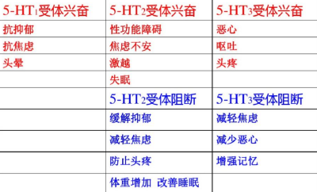
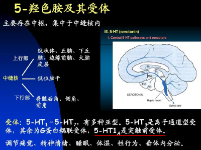

---
aliases:
  - 五羟色胺
tags:
  - pharmacology
---
### 一般来说，5-HT受体兴奋后是中枢抑制效应

受体：5-HT1~5-HT7,有多种亚型（其中<mark style="background-color: #1A4F10; color: white">5-HT3是离子通道型受体，其余为GPCR；</mark><mark style="background-color: #3F4B5E; color: white">5-HT-1A是突触前受体</mark>）
### 调节痛觉、精神情绪、睡眠、体温、性行为、垂体内分泌等活动

