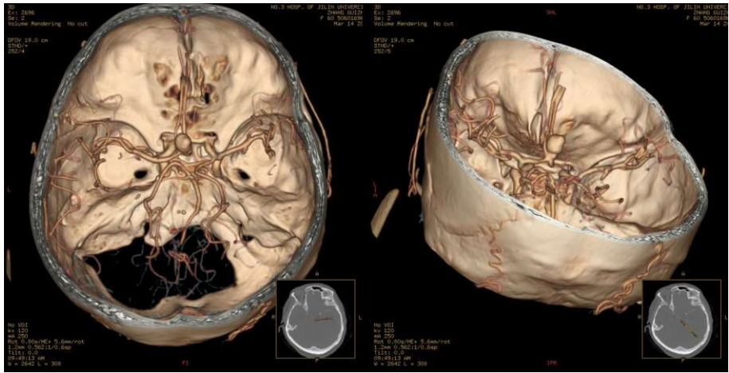
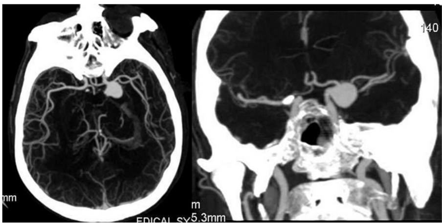
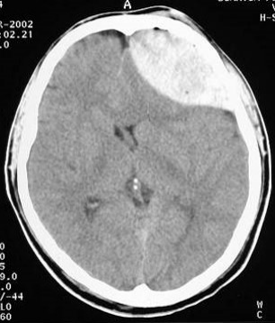
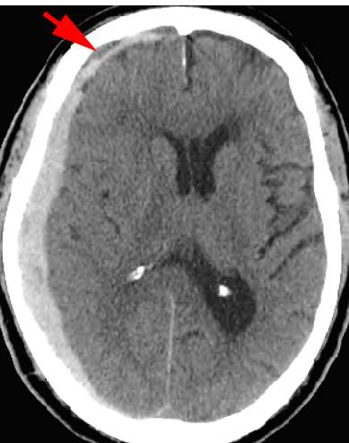
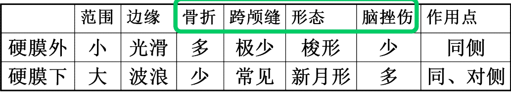

---
tags:
  - imaging
aliases:
  - 中枢神经系统影像学
  - Neuroradiology
---
# 大纲要求
1. 教学目标
认知教学目标: 熟悉中枢神经系统的正常影像表现, 中枢神经系统新技术的应用。Be familiar with normal imaging manifestations of central nervous system; application of new techniques in the central nervous system.
技能教学目标: 掌握中枢神经系统的影像检查方法的选择, 基本征象的影像表现, 脑肿瘤、脑血管疾病、脑外伤及颅内感染的CT及MRI表现。Master the optimization of imaging techniques in central nervous system; Image representation of basic signs; the CT and MRI manifestations of brain trauma, cerebral vascular diseases, brain tumor and intracranial infection.
职业素养教学目标: 培养学生爱党爱国的精神和崇高的医风医德, 引导其树立为人民卫生健康事业服务的理念和对病患的人文关爱意识, 促进独立思考、善于创新和团队合作能力。Cultivate students' spirit of love for the Party, patriotism and lofty medical ethics, guide them to establish the concept of serving the people's health cause and the awareness of humanistic care for patients, and promote independent thinking, innovation and teamwork.

2.教学内容
(1)授课内容：
1）中枢神经系统检查方法的种类及各自的优劣势，以及新技术的应用
2）中枢神经系统正常CT及MRI表现
3）中枢神经系统常见病的影像表现
a) 脑肿瘤：脑膜瘤、胶质瘤、垂体瘤、转移瘤
b) 脑外伤：颅骨骨折、脑挫裂伤、硬膜外血肿、硬膜下血肿
c) 脑血管疾病：脑出血、脑梗死、动脉瘤
d) 颅内感染：脑脓肿、化脓性脑膜炎、结核
e) 先天畸形：小脑扁桃体下疝畸形
f) 脊髓内肿瘤：室管膜瘤
g) 脊髓外肿瘤：神经纤维瘤、神经鞘瘤
h) 脊髓损伤
i) 脊髓空洞症
(2）见习内容：对授课内容涉及疾病的影像图片学习，
(3）重点英语：FLAIR；Chiari malformation；hydrocephalus；lacunar infarction；dural tail sign

3. 授课形式与学时分配：
讲授4学时，见习4学时

---
# 基本检查技术

- **CT**：反映组织密度（X线衰减值）。骨皮质呈高密度，水呈低密度，钙化或出血呈高密度。
    
- **MRI T1WI**：反映解剖结构。水（脑脊液、水肿）呈低信号，脂肪呈高信号。
    
- **MRI T2WI**：反映组织含水量。绝大多数病变（肿瘤、炎症、水肿）因含水增多，呈高信号。
    
- **FLAIR序列**：抑制脑脊液信号。将脑脊液（水）变黑，从而更清晰地显示脑实质内或皮层下的病变（如脑炎、水肿）。
    
- **DWI（弥散加权成像）**：<mark style="background-color: #1A4F10; color: white">反映水分子扩散受限程度</mark>。当水分子被困于细胞内（细胞毒性水肿）或被黏稠物质限制（脓液、胆脂瘤碎屑）时，呈高信号。
    
- **增强扫描**：反映<mark style="background-color: #1A4F10; color: white">血脑屏障完整性</mark>。对比剂透过受损的血脑屏障漏出，导致病变区域强化（发亮）。
    
- **PWI（灌注加权成像）**：反映<mark style="background-color: #1A4F10; color: white">组织血流灌注</mark>情况。新生血管丰富的肿瘤呈高灌注。
    
- **MRS（磁共振波谱）**：反映<mark style="background-color: #1A4F10; color: white">组织代谢物</mark>水平。如胆碱（Cho）升高提示细胞增殖活跃，N-乙酰天冬氨酸（NAA）降低提示神经元受损。

## X线
### 平片
头颅平片——少用，一般用于评估颅骨<mark style="background-color: #1A4F10; color: white">骨质</mark>改变，eg：畸形、骨折、肿瘤
### 脑血管造影DSA
——[脑血管疾病](脑血管病.md)（动脉瘤、动静脉畸形）<mark style="background-color: #705A16; color: white">诊断金标准</mark>
## 脑CT
颅内疾病<mark style="background-color: #1A4F10; color: white">首选！！！</mark>检查，以眦耳线为基线横断面扫描。
### 增强检查
对比剂<mark style="background-color: #1A4F10; color: white">有机碘</mark>，高密度影变白；
> 使用含碘造影剂是由于其物理密度较低而影像密度较高，碘的原子序数较高（53），能有效吸收X射线，使注射造影剂的区域在CT图像中呈现高密度（亮白色）。
### CTA
三位重建脑血管图像（涉及源图像重建技术，eg：VR重建）；
[Open: Pasted image 20261012113716.png](attachments/9c62a9c4dd5310a00b35d38d1688f2de_MD5.jpg)

[Open: Pasted image 20261012113723.png](attachments/0d61c9af5284b0bc5f18e76e5802d99d_MD5.jpg)

适用于[脑血管病](脑血管病.md)检查，与DSA相比有<mark style="background-color: #1A4F10; color: white">无创</mark>的优点
### CT灌注（CTP）
反映脑实质微循环和血流灌注情况：伪彩图重建；
# 正常影像学表现
### 1. 脑实质的CT表现
- **解剖结构**：涵盖了额、颞、顶、枕叶及岛叶、小脑和脑干，基底节及深部结构（包括尾状核、豆状核（壳核、苍白球）、丘脑、屏状核、内囊、外囊）。
- **组织密度（CT值）**：
    - 皮质：32 ~ 40 HU
    - 髓质：28 ~ 32 HU（皮质略高于髓质）
### 2. 蛛网膜下腔及脑室系统
- **整体特征**：含脑脊液的间隙，呈低密度，CT值为 0 ~ 20 HU。
- **脑池（脑池）**：包括枕大池、桥小脑角池、鞍上池、环池、侧裂池、大脑大静脉池、大脑纵裂池，以及伴随的脑沟和裂。
- **脑室（脑室）**：包括第三脑室、第四脑室，以及双侧侧脑室（分为前角、后角、下角、体部、三角区）。
### 3. 增强扫描表现
- **正常脑组织**：仅轻度强化（因为脑实质存在血脑屏障）。
- 颅内其他血管结构、垂体、松果体及硬脑膜<mark style="background-color: #1A4F10; color: white">显著强化</mark>。
- **进一步检查手段**：CTA（动脉强化）和 CT灌注。
### 4. 颅脑各组织MRI信号表现

| 组织                                                              | T1WI | T2WI |
| --------------------------------------------------------------- | ---- | ---- |
| **脑白质**                                                         | 较高   | 中等   |
| **脑灰质**                                                         | 中等   | 较高   |
| **脑脊液**                                                         | 低    | 高    |
| <mark style="background-color: #1A4F10; color: white">脂肪</mark> | 高    | 高    |
| **颅板**                                                          | 低    | 低    |
| **脑膜**                                                          | 低    | 低    |
| **血管**                                                          | 低    | 低    |
| **钙化**                                                          | 低    | 低    |
# 基本病变表现
### [CT](CT.md)
#### CT平扫
##### 密度改变：
###### ①高密度病灶：
见于新鲜血肿、钙化和富血管性肿瘤等；
###### ②等密度病灶：
见于某些肿瘤、血肿吸收期、血管性病变等；
###### ③低密度病灶：
见于某些肿瘤、炎症、梗死、水肿、囊肿、脓肿等；
###### ④混合密度病灶：
上述各种密度病灶混合存在
##### 脑结构改变
###### ①占位效应：
由颅内占位病变及周围水肿所致，局部脑沟、脑池、脑室受压变窄或闭塞，中线结构移向对侧；
###### ②脑萎缩：
范围可为局限性或弥漫性，
皮质萎缩显示脑沟和脑裂增宽，脑池扩大；
髓质萎缩显示脑室扩大；
###### ③[脑积水](脑积水.md)：
交通性---脑室系统普遍扩大，脑池增宽；
梗阻性---梗阻近侧脑室扩大，脑沟、脑池无增宽。
##### 颅骨改变：
①颅骨病变：如骨折、炎症和肿瘤等；
②颅内病变累及颅骨：如蝶鞍、内耳道或颈静脉孔扩大，骨质增生或破坏，常见于肿瘤
#### CT增强
##### 增强检查
###### ①均匀性强化
见于脑膜瘤、转移瘤、神经鞘瘤、[动脉瘤](动脉瘤.md)和[肉芽肿](肉芽肿.md)等；
###### ②非均匀性强化
见于胶质瘤、[脑血管畸形](脑血管畸形.md)等；
###### ③环形强化
见于[脑脓肿](脑脓肿.md)、[结核](结核.md)瘤、胶质瘤、转移瘤等；
###### ④无强化
见于脑炎、囊肿、水肿等。
##### [CTA](CTA)检查
与DSA所见类似
##### CT灌注检查
①[脑缺血](缺血性脑病.md)：<mark style="background-color: #1A4F10; color: white">CBF减低，CBV不明显或增加，MTT及TTP延长</mark>。
②[脑肿瘤](脑肿瘤.md)：CBF及CBV均<mark style="background-color: #1A4F10; color: white">增加</mark>
### [MRI](磁共振.md)
#### 普通MRI检查-信号改变
（脑结构改变同CT）
##### 肿块
<mark style="background-color: #1A4F10; color: white">多数肿块含水量高</mark>，T1WI呈低信号，T2WI高信号；
✅脂肪类肿块，T1WI呈高信号，T2WI高信号；
含顺磁性物质肿块，如黑色素瘤T1WI高信号，T2WI低信号；
✅钙化和骨化性肿块，T1WI呈低信号，T2WI低信号。
##### 囊肿
含液囊肿，T1WI呈低信号，T2WI高信号；
含粘液蛋白和类脂性囊肿，T1WI呈高信号，T2WI呈高信号
##### 水肿
T1呈低信号，T2呈高信号。
##### 出血⭐️⭐️⭐️
因血肿时期而异。——★★MRI的MR信号需要考虑出血期龄
（血肿内血红蛋白的演变过程为：
<mark style="background-color: #1A4F10; color: white">氧合血红蛋白-脱氧血红蛋白-高铁血红蛋白-含铁血黄素</mark>。）
###### ①急性期：
<mark style="background-color: #1A4F10; color: white">脱氧血红蛋白</mark>为主
红细胞完整，氧合血红蛋白变成脱氧血红蛋白。
脱氧血红蛋白是顺磁性物质，且仍在完整红细胞内。
T1WI和T2WI呈等或稍低信号，<mark style="background-color: #3F4B5E; color: white">不易发现</mark>；
###### ②亚急性：⭐️
细胞内<mark style="background-color: #1A4F10; color: white">高铁血红蛋白</mark>形成
高铁血红蛋白含 Fe³⁺，是强顺磁性物质，能显著缩短 T1。
它<mark style="background-color: #1A4F10; color: white">首先从血肿周边形成</mark>，逐渐向中心扩展。
- 早期：血肿T1WI信号由周围向中心逐渐增<mark style="background-color: #8B0000; color: white">高</mark>；T2WI呈<mark style="background-color: #3F4B5E; color: white">低</mark>信号（因为<mark style="background-color: #3F4B5E; color: white">高铁血红蛋白还在红细胞内</mark>，细胞内顺磁物质造成磁场不均匀，T2 缩短）
- 晚期：T1WI和T2WI均呈<mark style="background-color: #8B0000; color: white">高</mark>信号，周围开始出现含铁血黄素环（红细胞破裂后，<mark style="background-color: #8B0000; color: white">高铁血红蛋白从细胞内释放到细胞外</mark>，区室化磁化率差异减弱，<mark style="background-color: #8B0000; color: white">同时局部水肿/自由水增加</mark>，使 T2 延长）。
###### ③慢性期：⭐️
TlWI呈<mark style="background-color: #3F4B5E; color: white">低</mark>信号（因为<mark style="background-color: #3F4B5E; color: white">中心为自由水/囊液</mark>，T1 延长），T2WI呈<mark style="background-color: #8B0000; color: white">高</mark>信号（因为<mark style="background-color: #8B0000; color: white">自由水</mark> T2 延长），周围低信号环更加明显（<mark style="background-color: #1A4F10; color: white">含铁血黄素</mark>超顺磁，显著缩短 T2/T2*，SWI 或 GRE 上更敏感）。
##### 梗死：
###### 超急性期
平扫信号多正常；
###### 急性期和慢性期
脑组织缺血缺氧，继发脑<mark style="background-color: #3F4B5E; color: white">水肿</mark>、坏死和囊变，T1WI呈<mark style="background-color: #3F4B5E; color: white">低</mark>信号，T2WI呈<mark style="background-color: #8B0000; color: white">高</mark>信号。
#### 增强检查、MRA检查
同CT
#### H-MRS检查
代谢物峰的异常改变见于[脑肿瘤](脑肿瘤.md)、[脑梗死](脑梗死.md)、[脑脓肿](脑脓肿.md)等，如星形细胞肿瘤的NAA峰减低，而Cho峰明显增高甚至超过前者。
#### [DWI](DWI.md)和DTI检查
DWI异常表现是<mark style="background-color: #8B0000; color: white">高</mark>信号。
i. 如超急性期脑梗死、脑肿瘤、脑脓肿等；其中，星形细胞瘤的病理级别越高，信号强度也越高；脑脓肿的脓液呈高信号，而肿瘤坏死为<mark style="background-color: #3F4B5E; color: white">低</mark>信号。
ii. DTI的白质纤维束成像可见白质受压移位，常为占位性病变所致；也可表现破坏中断，多见于脑梗死、脱髓鞘疾病，也可为高级别星形细胞瘤。
# CNS疾病影像学表现
急性脑外伤 → 首选<mark style="background-color: #705A16; color: white"> CT</mark>（<mark style="background-color: #8B0000; color: white">快</mark>、看血、看骨）。⭐️⭐️
亚急性/慢性脑外伤，或怀疑弥漫性轴索损伤（DAI） → 首选 <mark style="background-color: #1A4F10; color: white">MRI</mark>（SWI序列看微出血，T2/FLAIR看白质损伤）。⭐️
急性脑梗死 → <mark style="background-color: #8B0000; color: white">确诊超早期梗死用 MRI-DWI</mark>。⭐️
蛛网膜下腔出血 → 首选<mark style="background-color: #705A16; color: white"> CT</mark>，如果CT阴性但高度怀疑，做腰穿或CTA/DSA。⭐️
## [脑外伤](颅脑损伤.md)
★鉴别硬膜外血肿和硬膜下血肿
[Open: Pasted image 20261013215203.png](attachments/3af57351ca634b15d2bdffd9c1fa1e0e_MD5.jpg)

[Open: Pasted image 20261013215208.png](attachments/a7c06751aba68be59a871d346dc0ee68_MD5.jpg)

[Open: Pasted image 20261013215301.png](attachments/8069dd4fc2c8fd8766f0eebd73c074df_MD5.jpg)

| 鉴别项      | 硬膜外血肿           | 硬膜下血肿                                                                  |
| -------- | --------------- | ---------------------------------------------------------------------- |
| **原因**   | 脑膜血管（脑膜中A）损伤    | 桥V或静脉窦损伤                                                               |
| **部位**   | 硬膜外间隙（硬膜与颅骨内板间） | 硬膜下腔（硬膜与蛛网膜间）                                                          |
| **合并**   | 常合并骨折           | 常伴脑挫裂伤或脑内血肿——对冲伤                                                       |
| **范围**   | 局限，不可跨越颅缝       | 广泛，沿脑表面分布，跨颅缝                                                          |
| **形状**   | 梭形              | 新月形                                                                    |
| **边缘**   | 光滑              | 模糊                                                                     |
| **作用点**  | 同侧              | 同侧或对侧                                                                  |
| **占位水肿** | 较轻              | 明显                                                                     |
| **CT**   | 高密度影            | ①急性期：高；   ②亚急性/慢：高、等、低或混杂密度影；   ③MRI与出血期龄相关，CT上等密度血肿，T1、T2均表现为高； |
#### 诊断与鉴别诊断
结合外伤史，CT和MRI表现易于明确诊断颅脑损伤类型
- 急性脑外伤脑出血：<mark style="background-color: #1A4F10; color: white">CT佳</mark>⭐️
- 亚急性、慢性出血：MRI佳
- 弥漫性轴索损伤微出血灶：SWI敏感
## [脑血管疾病](脑血管病.md)
诊断金标准为[DSA](DSA.md)
## [[颅内感染]]
## [脑肿瘤](脑肿瘤.md)
> 其中颅咽管瘤和脑膜瘤易<mark style="background-color: #1A4F10; color: white">钙化</mark>
## 脱髓鞘疾病
最常见：[[多发性硬化]]
## 先天畸形
- 胼胝体发育不全
- 小脑扁桃体下疝畸形

| 影像要素         | 具体观察内容与分类                                                                                                                                                                                                                        |
| ------------ | -------------------------------------------------------------------------------------------------------------------------------------------------------------------------------------------------------------------------------- |
| **1. 位置**    | 病灶位于脑内还是脑外（常判断肿瘤或病变来源及定位）。                                                                                                                                                                                                       |
| **2. 数目**    | 单发还是多发。                                                                                                                                                                                                                          |
| **3. 分布**    | 位于白质还是灰质（对于脑部病变极具定位诊断价值）。                                                                                                                                                                                                        |
| **4. 大小**    | 病灶的大或小（通常需要测量具体径线）。                                                                                                                                                                                                              |
| **5. 形态**    | 规则（如类圆形、椭圆形）或不规则。                                                                                                                                                                                                                |
| **6. 边界**    | 清楚或模糊（有助于判断病变的良恶性及侵袭性）。                                                                                                                                                                                                          |
| **7. 密度/信号** | 在CT上表现为密度（<mark style="background-color: #8B0000; color: white">高</mark>、<mark style="background-color: #3F4B5E; color: white">低</mark>、等、<mark style="background-color: #1A4F10; color: white">混杂</mark>），在MRI上表现为信号（高、低、等、混杂）。 |
| **8. 增强**    | 造影剂增强的程度（明显强化、轻度强化等）和方式（均匀、环形、结节状等）。                                                                                                                                                                                             |
| **9. 周边**    | 病灶周围的伴随表现，如水肿、占位效应等。                                                                                                                                                                                                             |
| **10. 功能**   | 特殊功能成像表现，如 DWI（弥散加权成像）、PWI（灌注加权成像）等（主要针对MRI）。                                                                                                                                                                                    |
## 脊髓疾病
### [[椎管内肿瘤]]
