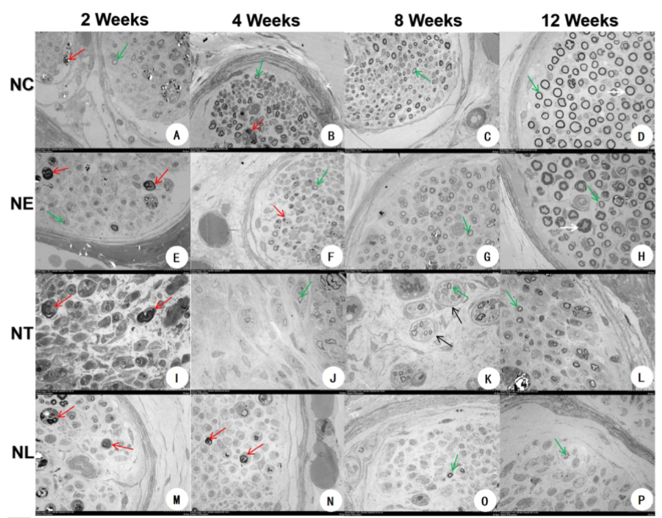

---
tags:
  - Proj
---
> [!PDF|green] [Ultrastructural and Automated Vocal Fold Tracking Study in Recurrent Laryngeal Nerve Injury Models, p.1](Ultrastructural%20and%20Automated%20Vocal%20Fold%20Tracking%20Study%20in%20Recurrent%20Laryngeal%20Nerve%20Injury%20Models.pdf#page=1&selection=44,0,45,50&color=green)
> > The N-ratio (the ratio of myelinated axon area to total nerve trunk area) and myelinated axon density (MAD, the number of axons per unit area): 
> 钳夹伤组的N-ratio和MAD在各时间点均高于电灼伤、横断和结扎组
> [Open: Pasted image 20261010204317.png](attachments/c85b865d1ee52cf753914f0e8894ff1c_MD5.jpg)

