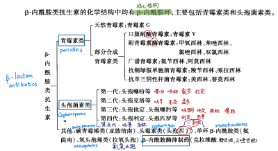
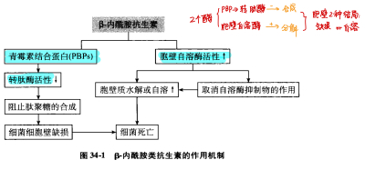

---
tags:
  - pharmacology
---
### β- 内酰胺类抗生素（3学时）

> 青霉素类（Penicillins）头孢菌素类（Cephalosporins）
> 非典型 β-内酰胺类：碳青霉烯类（Carbapenems）头霉素类（Cephamycin）氧头孢烯类（Oxacephems）单环 β-内酰胺类（Monobactam ）
### 一. β-内酰胺类抗生素
### 1. 抗菌机制

作用于细菌菌体内的青霉素结合蛋白（penicillin-binding proteins,PBPs）
抑制转肽酶活性→阻止肽聚糖合成→细胞壁缺损→细菌死亡；
增加胞壁自溶酶活性（自溶酶活性↑，取消自溶酶抑制物的作用）→自溶或胞壁水解→细菌死亡。
##### 繁殖期 <mark style="background-color: #3F4B5E; color: white">窄谱</mark> 杀 菌剂
##### 对G+细菌更敏感，对哺乳细胞几乎无毒
##### 对各种亚型的PBPs的结合能力不同，表现出抗菌活性的差异
### 2. 影响抗菌作用的因素
### 3. 耐药机制
##### （1）生成β-内酰胺酶
青霉素耐药——<mark style="background-color: #1A4F10; color: white">青霉素酶</mark>；<mark style="background-color: #1A4F10; color: white">头孢类耐药——ECBLs；碳青霉烯耐药——金属酶</mark>
其中，<mark style="background-color: #705A16; color: white">金葡菌</mark>易产生耐药性（<mark style="background-color: #705A16; color: white">除了MRSA之外的金葡菌都是靠产生酶来耐药的</mark>）
（2）牵制机制（Trapping Mechanism）：通过酶的结合阻止抗生素到达靶点
β-内酰胺酶与某些耐酶的β-内酰胺类抗生素结合，使药物停留在胞膜外，不能到达靶位发挥作用。与MRSA无关，耐酶青霉素无法治MRSA感染
##### （3）药物不能在作用部位达到有效浓度： 进入减少，外排增加
##### 主动外排系统增强
##### 通道蛋白数量和结构的改变
##### （4）靶位（PBP）改变：药物对PBPs的亲和力降低
耐甲氧西林金黄色葡萄球菌（MRSA）、耐青霉素肺炎链球菌、耐第三代头孢菌素的菌株
##### （5）缺乏自溶酶：金黄色葡萄球菌
### 二.[青霉素](青霉素.md)类
