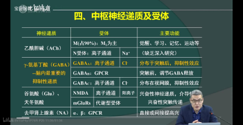
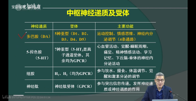
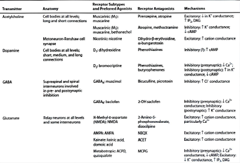
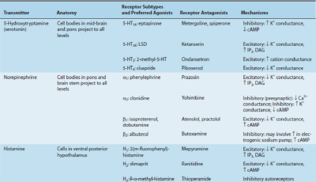
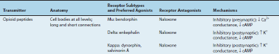
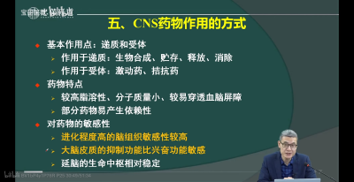

---
tags:
  - pharmacology
---
### 概论

### ※中枢神经递质及其受体

神经肽类主要注意和痛觉的关系，比如[吗啡](吗啡.md)。
[[组胺]]：注意外周效应。
重点梳理哪些药物和GABA有关系，哪些药物和多巴胺有关系。
注意，虽然大部分药物作用在受体上，但是也有部分药物作用在递质和相关的酶上。比如作用于乙酰胆碱酯酶、对中枢有选择性的药物，在阿尔兹海默病中使用。
#### 中枢重要递质受体（PPT）
—— 复习前先看一遍；把整个章节背过一次后，再 对着药物梳理

##### ![[Ach]]

##### ![[GABA]]
##### ![[Glu]]
##### ![[5-HT]]
##### ![[NE]]
##### 
##### 阿片受体

##### 中枢药物作用方式

注意中枢的药物必须要能够通过血脑屏障，所以对药物的结构有很高的要求。你要弥补多巴胺的作用，不能直接用[多巴胺](多巴胺.md)，因为多巴胺有两个羟基，水溶性太强，通不过BBB；只能用多巴胺前体物质，[[左旋多巴]]（L-Dopa）
注意两个逻辑前提，第一，在<mark style="background-color: #1A4F10; color: white">大脑中抑制功能比兴奋功能对药物更加敏感</mark>，第二，[[普鲁卡因]]作用是阻滞神经元细胞膜上的钠离子通道。所以<mark style="background-color: #3F4B5E; color: white">普鲁卡因低剂量体现为兴奋作用。</mark>
进化上越新的脑对药物越敏感，所以当一个药物的副作用已经涉及到延髓的时候，说明它在皮层已经造成了很广泛的影响。

### [[镇静催眠]]药

### [[抗精神失常]]药
> 多背亿遍药名。
### [[镇痛]]药
### [解热镇痛抗炎药](NSAIDs.md)
