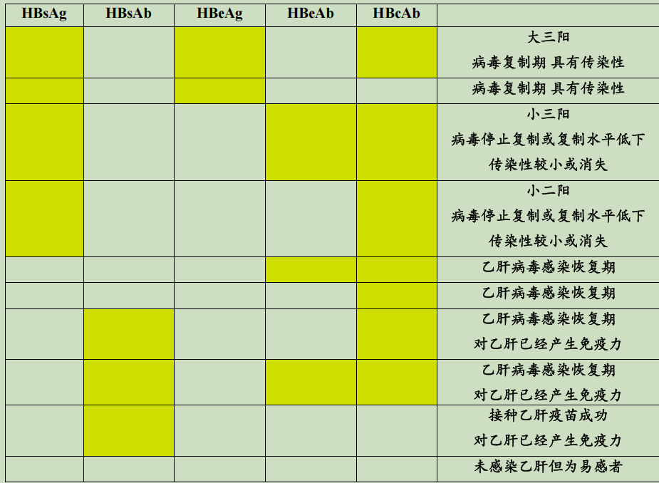
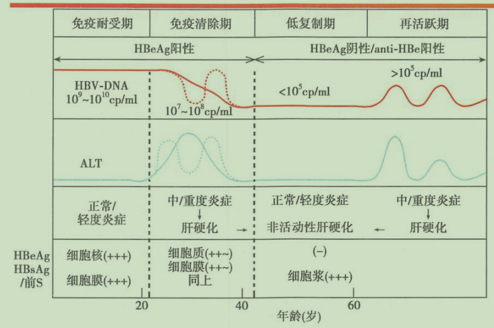

---
tags:
  - pathology
aliases:
  - 乙型肝炎
  - HBV
---
当体缺乏有效免疫反应时，则表现为携带者状态。
#### 病原学
正嗜肝 DNA 病毒属，形态上可见大球形颗粒（Dane 颗粒，包膜+核心）、小球形颗粒 丝状或核状颗粒（空心包膜、不含核酸，无感染性）。
不完全环状双股 DNA，有包膜，短链为正链，长链中包括 S/C/P/X 区，目前分为 10 种抗原亚型（主要是 adw，adr，ayw，ayr），<mark style="background-color: #1A4F10; color: white">对外界抵抗力很强</mark>，对热、低温、干燥、紫外线及一般浓度的消毒剂均能耐受。
是<mark style="background-color: #705A16; color: white">中国慢性肝炎的主要致病原</mark>。
P 区：编码具有反转录酶活性的 DNA 聚合酶，RNA 酶，参与 HBV 的复制。
HBxAg：反式激活作用，在 [HCC](肝细胞癌.md) 发生中可能起到重要作用。
##### 两对半
###### HBsAg
- 表面抗原，由 S 区编码，包括 a 决定簇和两个亚型决定簇 d/y，w/r
- 在感染的肝细胞表面可分泌大量HBsAg，使机体免疫系统，尤其是CD8的T细胞识别并杀伤感染细胞，导致肝细胞坏死或凋亡
- 见于HBV现症感染者,但HBsAg阴性不能完全排除HBV的现症感染。
###### HBsAb
- 抗HBs阳性主要见于接种乙肝疫苗后或过去感染HBV并产生免疫力的恢复者
###### HBeAg
- e 抗原，由 C 区前 C 基因和 C 基因编码
- <mark style="background-color: #3F4B5E; color: white">HBeAg则分泌到血液中</mark>。
- HBeAg属于抗病毒治疗的较好指征的阳性指标。
- HBeAg阳性提示HBV复制活跃,传染性较强
###### HBeAb
- HBeAb阳性临床上有两种可能性：一是 HBV <mark style="background-color: #1A4F10; color: white">复制的减少或停止</mark>；二是 HBV <mark style="background-color: #1A4F10; color: white">前 C 区基因发生变异</mark>，此时 HBV 仍然复制活跃。
###### HBcAb
- HBcAb 是急性乙肝窗口期抗原抗体中唯一可以测到的
- 抗HBc IgM是HBV感染后较早出现的抗体。
- 抗HBc IgG在血清中可长期存在,高滴度的抗HBc IgG表示现症感染,常与HBsAg并存;低滴度的抗HBc IgG表示过去感染,常与抗HBs并存。
[Open: Pasted image 20261128163133.png](attachments/dca21077809953cc4ff47bcf1ebd76f8_MD5.jpg)

##### HBcAg
- HBcAg在感染的肝细胞内
- 核心抗原，由 C 区 C 基因编码
##### HBV DNA定量
诊断方面: ①HBV DNA 是 HBV <mark style="background-color: #1A4F10; color: white">存在</mark>最直接的依据；②HBV DNA 是 HBV 复制的标志，直接反映<mark style="background-color: #1A4F10; color: white">病毒复制水平</mark>，是判断病毒复制活跃程度最直接、特异、敏感的指标；③HBV DNA 是患者具有<mark style="background-color: #1A4F10; color: white">传染性</mark>的标志；④对血清学标志起补充诊断作用：a. HBeAg(-)或抗HBe(+)，乙型肝炎(前C区变异)；b. HBsAg(-)乙型肝炎(S区变异)；c. 低水平感染，如单项抗HBc(+)乙型肝炎。
治疗方面：①作为用药指征,HBV DNA 是决定是否用抗病毒药的重要因素；②用于<mark style="background-color: #1A4F10; color: white">疗效预测</mark>，一般情况下，HBV DNA 低滴度(载量)的患者，抗病毒药的疗效较好；用于疗效评估，HBV DNA 是目前判断乙型肝炎抗病毒药物疗效最敏感的指标。
##### 乙肝疫苗
易感者均可接种，新生儿及各种高危人群是主要的接种对象。
- 普遍采用 0、1、6 月龄的接种程序。
- HBV 慢性<mark style="background-color: #1A4F10; color: white">感染母亲的新生儿</mark>出生后立即注射<mark style="background-color: #1A4F10; color: white">乙型肝炎免疫球蛋白（HBIG）</mark> 及乙肝疫苗；属于被动免疫。（主要用于 HBV 感染母亲的新生儿及暴露于 HBV 的易感者）
> [!NOTE] 如何阻断乙型肝炎病毒的母婴传播?
> (1)妊娠中后期HBV DNA载量大于1×10⁷拷贝/ml,在充分沟通、权衡利弊的情况下,可于妊娠第28周开始给予替诺福韦、替比夫定或拉米夫定,建议于产后1~3个月停药,停药后可以母乳喂养。
> (2)加强产程和产后的卫生保护,在分娩过程中尽量避免血液和阴道分泌物污染新生儿的消化道、皮肤和黏膜。
> (3)新生儿出生后立即注射HBIG。
> (4)乙肝疫苗按出生后0、1、6月龄的接种程序各注射一次疫苗。
#### 流行病学
传染源：急性乙型肝炎患者（潜伏期末和急性期）、慢性患者和和病毒携带者，传染性与体液内 HBV DNA 含量成正比
传播途径：母婴传播（宫内感染、围生期传播、分娩后传播）；血液与体液传播（输血或皮肤破损：吸毒、公用物品、文身）；性传播
易感人群：HBsAb 阴性人群，婴幼儿是获得 HBV 感染最危险时期，高危人群包括HBsAg+家属、反复输血及血制品、血液透析、多个性伴侣、静脉药瘾、医务工作者
无明显季节性，存在地区性差异、性别差异和家族聚集性、散发为主
<mark style="background-color: #1A4F10; color: white">婴幼儿</mark>感染多见
#### 临床表现
成人急性乙型肝炎多数可完全康复，仅约5%~10%转为慢性。
#### 发病机制
乙型肝炎侵入人体后未被单核吞噬细胞系统清除的病毒到达肝脏或肝外组织，通过肝细胞膜上受体进入肝细胞开始复制。
自然病程受感染年龄、病毒因素（HBV 基因型、病毒变异、病毒复制水平）、宿主因素（性别、年龄和免疫状态）和其他外源性因素（同时感染其他嗜肝病毒或嗜酒），一般分为四个阶段：
<mark style="background-color: #705A16; color: white">免疫耐受期</mark>：HBV 复制活跃；HBsAg+ ，HBeAg+；HBV DNA 滴度＞105拷贝/ml；ALT 正常或轻度升高 肝纤维化进展无或缓慢
<mark style="background-color: #705A16; color: white">免疫清除期</mark>：HBV DNA 滴度＞103拷贝/ml；ALT 持续或间接升高 肝组织学出现中度到重度坏死炎症；肝纤维化快速进展，部分进展至肝硬化或肝衰竭；青少年或成年期感染多无免疫耐受期而直接进入免疫清除期
<mark style="background-color: #705A16; color: white">低复制期</mark>：HBeAg- HBeAb+ HBV DNA 滴度很低＜103拷贝/ml ALT 正常 肝细胞炎症轻 可持续终生
<mark style="background-color: #705A16; color: white">再活跃期</mark>：低复制期后部分患者出现自发或免疫抑制引起 HBV DNA 复制 病毒载量升高，ALT 持续或反复异常
[Open: Pasted image 20261128154609.png](attachments/5c3e915818a72e6f829605a1ce5d990c_MD5.jpg)

机体免疫反应不同导致临床表现各异，<mark style="background-color: #1A4F10; color: white">免疫耐受</mark>是慢性化机制的关键因素之一 ——
- 机体免疫耐受无应答——无症状携带者
- 机体免疫功能正常——急性肝炎（成年 HBV）
- 机体免疫功能低下、不完全耐受、自身免疫反应或 HBV 基因突变发生免疫逃逸——慢性肝炎
- 机体处于超敏反应：炎症风暴、肝细胞强烈免疫损伤（第一次打击）—肝细胞肿胀缺血缺氧（第二次打击）—大量肝细胞坏死、毒素释放（第三次打击）—肝衰竭
> 乙型肝炎的肝外损伤主要由<mark style="background-color: #1A4F10; color: white">免疫复合物</mark>引起。可沉积在血管壁，导致膜性肾小球肾炎伴发[肾病综合征](肾病综合征.md)。
##### 病理特征
[毛玻璃](毛玻璃.md)样肝细胞：HE染色光镜下，在 HBsAg 携带者与慢性肝炎患者部分肝细胞细胞质内充满嗜酸性细颗粒状物质，胞质不透明似毛玻璃样
> 本质是<mark style="background-color: #1A4F10; color: white">滑面内质网</mark>增生伴大量 <mark style="background-color: #1A4F10; color: white">HBsAg 沉积</mark>

<mark style="background-color: #705A16; color: white">砂砾样细胞核</mark>：少数情况下 肝细胞核内大量的<mark style="background-color: #1A4F10; color: white"> HBcAg </mark>表示 HBV 复制活跃；注意区别于[砂粒体](砂粒体.md) #comparison 
#### 诊断
血清中游离的HBcAg极少，常规方法难以检出，故血中HBcAg阳性不能作为判断传染性的常规指标。
窗口期HBsAg可能阴性。
#### 治疗
##### [[干扰素]]
一般适应证
- 病毒载量：HBeAg阳性者HBV DNA≥10^5拷贝/ml；HBeAg阴性者HBV DNA≥10^4拷贝/ml。
- 肝功能异常：<mark style="background-color: #705A16; color: white">ALT（丙氨酸氨基转移酶）≥2×ULN</mark>。ALT 应 ≤ 10 × ULN。
- 肝组织学：肝活检显示Knodell HAI≥4，或炎症坏死≥G2。
禁忌证
- 血清总胆红素水平≥2×ULN。（胆红素明显升高提示肝内炎症较重，用干扰素可能使肝功能进一步恶化）
- 黄疸明显、失代偿肝硬化
- 甲状腺疾病、严重心肾疾患、糖尿病、神经精神异常、妊娠、自身免疫病
###### 疗效
干扰素治疗慢性乙型肝炎的疗效与患者基线特征密切相关。
<mark style="background-color: #1A4F10; color: white">ALT升高</mark>是重要的有利预测因素，提示肝脏存在活动性炎症和免疫清除反应，有利于干扰素发挥抗病毒作用。其他有利因素包括：<mark style="background-color: #1A4F10; color: white">女性</mark>、病程短、HBV DNA< 28 IU/ml、无肝硬化、无重叠感染（如丙肝、丁肝、HIV）、无胰岛素抵抗、乙肝患者基因型为 A 或 B 型、基线低 HBsAg 水平、肝组织炎症坏死 G2 以上。
相反，肥胖、男性、高病毒载量、<mark style="background-color: #3F4B5E; color: white">丙肝1b型</mark>（对干扰素反应较差）等均为不利因素。
##### 一般药物
恩替卡韦对肾脏影响小，是合并肾功能损害者的一线选择（需按肌酐清除率调整剂量）。
阿德福韦酯、[[替诺福韦]]有肾毒性及低磷性骨病风险，肾功能不全者慎用。
<mark style="background-color: #1A4F10; color: white">P区突变</mark>与核苷（酸）类似物耐药相关，不属于肝衰竭的常见诱因。
- [拉米夫定](拉米夫定.md)有较高的耐药性，阿德福韦酯有引起肾损害的不良反应，替比夫定有一定的耐药性，目前三者属于 2 线用药。
> 在抗病毒治疗过程中，只有部分适合的患者可以达到 CHB 的临床治愈，<mark style="background-color: #3F4B5E; color: white">即停止治疗后持续的病毒学应答、HBsAg 消失、并伴有 ALT 复常和肝脏组织病变改善。</mark>

> [!NOTE] 试比较IFN-α和核苷(酸)类似物治疗慢性乙型肝炎的优缺点。
> (1)IFN-α的优点是<mark style="background-color: #3F4B5E; color: white">疗程</mark>相对固定,<mark style="background-color: #3F4B5E; color: white">HBeAg血清学转换率</mark>较高,<mark style="background-color: #3F4B5E; color: white">疗效</mark>相对持久,<mark style="background-color: #3F4B5E; color: white">耐药变异</mark>较少。
> 缺点是需要注射给药,不良反应明显,不适于肝功能失代偿者。
> (2)核苷(酸)类似物的优点是<mark style="background-color: #3F4B5E; color: white">口服给药</mark>,抑制病毒作用强,<mark style="background-color: #3F4B5E; color: white">不良反应</mark>少而轻微,可用于肝功能失代偿者。
> 缺点是疗程相对不固定,HBeAg血清学转换率稍低,疗效不够持久,长期应用可产生耐药变异,停药后可出现病情恶化等。
> (3)选择何种药物应根据患者具体情况,如病毒载量高低、肝功能损害程度、是否有肝硬化等。

