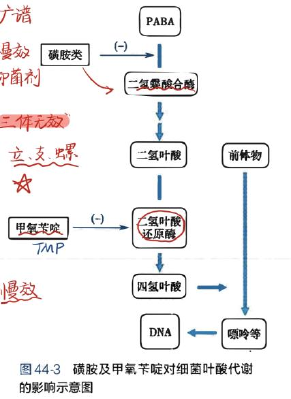

---
tags:
  - pharmacology
---
### 人工合成抗菌药（2学时）
### 一、 [喹诺酮](喹诺酮.md)
### 二、[磺胺](磺胺药.md)
抗菌谱、抗菌力、 作用机制 、耐药性、体内过程、不良反应。
> 广谱、慢效 （ 需要很高浓度才能杀菌 ）、抑菌剂; 竞争性抑制二氢蝶酸合成酶
### 三．其它合成抗菌药
### 1、甲氧吡啶（Trimeth/o/prim, TMP）：
增强磺胺抗菌作用；机制
> 选择题必考，磺胺嘧啶 & 甲氧吡啶
- 二氢叶酸还原酶抑制剂，抗菌谱与磺胺类似，常与 SMZ合用，双向阻断使抑菌作用转变为杀菌作用

> 抑菌→杀菌，耐药性↓，不良反应↓
##### ※复方新诺明（SD：TMP=5：1）
> 掌握！大题也可能考
- 为什么可以合用？
###### 先阐述图44-3
细菌叶酸代谢需要PABA经二氢蝶酸合成酶（磺胺抑制）生成二氢叶酸，再经二氢叶酸还原酶（TMP抑制）生成四氢叶酸。
两者药代学参数相近，血药浓度可同时达峰；
合用对细菌叶酸合成起双重阻断作用，抗菌活性↑，抑菌→杀菌；
抗菌谱扩大 ，耐药菌减少；
###### 合用时药量↓，不良反应发生率↓
##### 临床应用：急性泌尿道感染（ 常常与SMZ合用（复方新诺明））
不良反应：长期应用引起巨幼红细胞性贫血，应停药、补充甲酰四氢叶酸
### 2、 [[甲硝唑]]（Metro nidazole , 灭滴灵） 的临床应用
作用机制：分子中的硝基在细胞内无氧环境下被厌氧菌还原成氨基，破坏细菌DNA
##### ※用时需戒酒双硫仑反应
##### 临床应用： “四抗”
###### <mark style="background-color: #705A16; color: white">抗厌氧菌（破伤风）、抗阿米巴（包囊无效）、抗滴虫的首选药物</mark>
###### 抗蓝氏贾第鞭毛虫
难辨梭状芽孢杆菌引起的伪膜性肠炎（link：四环素耐药菌引起的二重感染）
3、呋喃坦啶 (furadantin，aka呋喃妥因 )、呋喃唑酮(痢特灵，furazolidone)的作用特点
广谱（铜绿单胞菌不敏感），强(5- μg／mL)，尤其pH低时。耐药性低
##### 不良反应：胃肠道反应、周围神经炎
作用机理：干扰糖代谢？
呋喃妥因(furadantin)：口服吸收，尿中浓度高；——主用于泌尿道感染，代谢物为棕色。
呋喃唑酮(furazolidone，痢特灵)：口服吸收少，用于胃肠道感染，包括痢疾，霍乱，胃溃疡的治疗，尿液黄染
> 口服吸收少才能多到达胃肠道分解

<mark style="background-color: #705A16; color: white">典型三大可用于肺炎衣原体的药：沙星、克拉霉素（大环内酯类）、四环素类（多西环素）</mark>
##### <mark style="background-color: #3F4B5E; color: white">衣原体问诊线索：家中养鸟多个</mark>
### 习题
##### 1. 简述氟喹诺酮类药物的药理学共同特点
2. 磺胺类药物有哪些常见的不良反应？如何预防？
3. 简述复方新诺明的组成，机制及临床意义。
4. 在磺胺类药物中，用于治疗流脑、伤寒、烧伤创面绿脓杆菌感染、沙眼的是哪些药？
##### 5. 简述甲硝唑的药理作用
