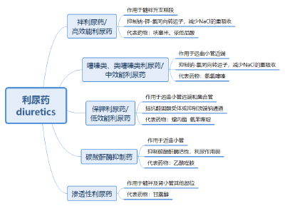
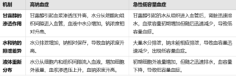
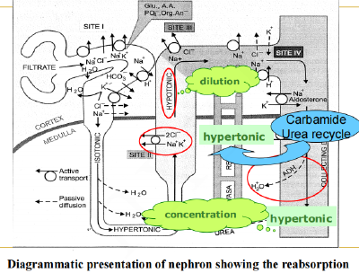
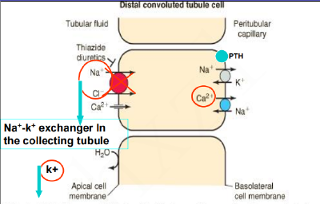
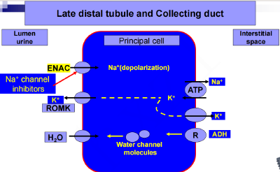
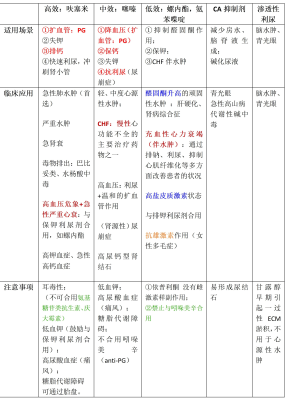

---
tags:
  - pharmacology
---
### 利尿药及脱水药（2 ）
### 概论

写在前面：心中两条分类线索。一，【按作用部位分】，从肾脏结构（尿液途经顺序）来记忆，不同位点→不同特点（主要效应、作用副作用、高中低效）；二，【按高中低效+其它两种分】。
定义：作用于肾脏，增加电解质和水的排泄，使尿量增多的药物。
> 利尿药不是抑制对水的重吸收，更多是抑制对钠的重吸收。
### 碳酸酐酶抑制药（ Carbonic Anhydrase Inhibitors） ——乙酰唑胺（acetazolamide）
#### 作用位点：近曲小管
#### 1. 药理作用
> 排碱、高氯、肾外作用
CA：催化H2CO3分解为H+和HCO3-，之后经历钠氢交换、钠和HCO3-重吸收。
①对肾：作用于 近曲小管 等部位，抑制碳酸酐酶的活性。 大量损失HCO3-，排碱 ；同时Cl-重吸收增加；引起代谢性酸中毒；利尿作用弱
> 复习：近曲小管处Na+-H+交换体带动Na+和HCO3-重吸收。Na+进，H+出，带动CA酶催化的H2CO3分解反应不断平衡正移生成HCO3-。
②肾外：减少房水（<mark style="background-color:#fef3c7;">青光眼</mark>）、脑脊液（<mark style="background-color:#fef3c7;">高山病</mark>）的生成量，降低pH *（引起代谢性酸中毒* ）。
#### 2. 临床应用：除利尿外的特殊用途
> 由于利尿作用较弱，已很少作为利尿药使用，但仍有几种特殊用途
青光眼（Glaucoma） 、碱化尿、代谢性碱中毒、急性高山病（ acute mountain sickness） 、癫痫。
☺ 碱化尿液 ：促进尿酸、弱酸性物质（如阿司匹林）的排泄，只在初期有效
☺ 纠正代碱 ：当心力衰竭患者使用过多利尿药造成代碱时，补盐会增加心脏充盈压，因此可使用乙酰唑胺
☺ 治疗 青光眼Glaucoma ：减少房水生成，降低眼压，对多种类型青光眼有效
##### 复习：治疗青光眼相关药物
###### 1）使房水流出通路更通畅：毛果芸香碱、[[新斯的明]]、毒扁豆碱
2）减少房水生成：β阻滞剂（Timolo），拟肾上腺素药物（α2受体激动剂），利尿药（乙酰唑胺）
☺  急性高山病：减少脑脊液的生成 ，降低脑脊液、脑组织的pH，以减轻症状，防止脑水肿而危及生命
##### ☺ 癫痫辅助治疗 、高磷酸盐血症
#### 3. 不良反应
过敏：磺胺衍生物，可能导致骨髓抑制、皮肤毒性、磺胺样肾损害等；
##### 代酸：高氯性酸中毒
尿结石：乙酰唑胺可引起磷酸盐尿和高钙尿症，且钙盐在碱性尿液中易沉积，容易形成结石
##### 低钾血症
### 脱水药（渗透性利尿药）
#### <u>[[甘露醇]]（mannitol）</u> 、山梨醇、  50% 葡萄糖 
#### 药理作用
##### 脱水作用
 静脉 注射，提高血浆渗透压，使组织间液向血浆转移，产生 组织脱水作用，降低颅内压和眼压； 
> 绝对不能皮下注射，会加剧水肿
 （△初期可出现一过性细胞外液量增加/淤积；后期可能出现大量脱水、低容量血症） 
口服，口干，到不了肾脏，造成渗透性腹泻。可用于从胃肠道消除毒性物质。
##### 利尿作用
①不易吸收（不易通过毛细血管进入组织，所以留在血浆组织脱水）；
②易被肾小球滤过，不易被肾小管重吸收；
##### ③不被代谢，基本完全滤过
##### ④排出的水略多于排钠，尿液低渗
#### 临床应用
##### ☺ 脑水肿、青光眼
##### ☺ 预防急性肾衰、缓解急性肾损伤 （快速把坏死组织冲刷走）
##### *不良反应*
毒性：一过性细胞外液量增加/淤积，心脏负荷增大 ；脱水、<mark style="background-color:#fef3c7;"> 高钠血症（甘露醇排低渗尿） </mark>；急性低容量血症

静注过快会出现眩晕、头痛、视力模糊等症状；
 心功能不全、心源性水肿 （外周循环淤血，用甘露醇初期加重细胞外液量淤积）、 活动性颅内出血（ 增加血量、加剧出血 ）、严重肾衰引起的  <u>无尿</u>  者禁用 。（可以缓解AKI，但是已经无尿就不能用了）
### 高效利尿药：抑制髓袢升粗  NKCC2 ； 高血压危象伴肾功能不全（  扩肾血流  ）、急性肺水肿（  扩血管  ）
> aka loop diuretics袢利尿剂：[[呋塞米]]（Furosemide）、依他尼酸（ethycrinic acid，已因毒性停用） 、布美他尼bumetanide (Bumex) ；阿佐塞米（azosemide)；吡咯他尼(piretamide)
#### <u>作用位点：抑制</u>  <u>髓袢升支粗段</u>  <u>髓质和皮质部</u>  <u>NKCC2</u>  <u>——</u>  <u>Cl-的主动重吸收</u>  <u>，影响肾稀释及浓缩功能。</u>
##### 图示

#### 特点： ① 作用强大、迅速、短暂 ； ② 尿中排出大量的Na+、CI-、K+、Ca2+、Mg2+； ③ 等渗尿，略微排水多与排钠； ④ 注意及时补钾或加服保钾利尿药
#### <u>[[呋塞米]]（furosemide）/速尿</u>
##### 作用部位：髓袢升支粗段髓质部、远曲小管近端
#### 1. 体内过程
吸收：口服吸收迅速、起效迅速 。
-分布：可通过胎盘。
排泄：肾滤过、分泌。与尿酸盐的分泌相竞争，久易 高尿酸血症 。
#### 2. 药理作用
##### （1）利尿作用
特点： ① 作用强大、迅速、短暂 ； ② 尿中排出大量的Na+、CI-、K+、Ca2+、Mg2+； ③ 等渗尿，略微排水多与排钠； ④ 注意及时补钾或加服保钾利尿药
> 注意排钾排钙：K+正电位+溶剂拖拽
机制：与Cl-竞争，抑制Na+-K+-2Cl-同向转运体，使原尿中Na、Cl、K的重吸收减少
#####  （2）扩张血管 <mark style="background-color:#fef3c7;"> （易忘） </mark>
##### 机制：促进 前列腺素PG 的合成
干扰非甾体类抗炎药（如吲哚美辛Indomethacin ）， 避免与吲哚美辛合用（PPT） 
迅速增加全身静脉血容量（Redistribute & 分担） ，降低左心室充盈压，减轻肺淤血
直接扩张肾血管， 增加肾血流量，治疗肾衰 
> CA酶抑制剂也可以冲刷、增加肾血流量
#### 3. 临床应用
☺ <mark style="background-color:#fef3c7;"> 急性肺水肿（首选） </mark>—— 扩张容量血管 （+利尿），降低左心室压，减轻肺淤血
##### ☺  严重  水肿：用于其他利尿药无效的严重水肿病人
☺ 急肾功能衰竭：  冲刷防坏死；增加肾血流量 。慢性肾衰慎用
☺ <u>促进毒物的排出</u> ：某些经肾排出的药物中毒的抢救 ，如巴比妥类、水杨酸中毒
##### <mark style="background-color:#fef3c7;"> 高血压危象、急性严重心衰 </mark> ：  与保钾利尿剂  合用，如螺内酯 
高钾血症、急性高钙血症： Na+、K+经过NKCC2进入肾小管上皮细胞后，Na+经基底侧的Na+-K+-ATPase进入细胞间质，而在细胞内蓄积的K+则扩散返回管腔，使管腔内呈正电位，驱动Ca2+、Mg2+的重吸收，袢利尿药抑制这个过程，也因此增加了Ca2+、Mg2+的排出。
#### 4.  ※※（每次必考）不良反应 
水、电解质紊乱：过度利尿，低血容量、低血钠、低血镁、低血钾、低血氯性碱中毒（排Cl多于排Na）、低血钙、碱血症等；
耳毒性（ototoxicity） ：大量静脉注射时易发生，内耳淋巴液也有NKCC2。 ※忌与氨基糖苷类抗生素、[[庆大霉素]]（耳毒性）合用 
##### 依他尼酸最易引起，布美他尼耳毒性最小
##### 高尿酸血症
利尿→血容量↓→胞外液浓缩→尿酸经近曲小管的再吸收↑；与尿酸竞争有机酸分泌途径
##### ※痛风患者禁用
其他：高血糖、过敏反应（[[呋塞米]]、布美他尼为磺胺衍生物，可引起交叉过敏反应）、低血压、胃肠道反应等
##### △ 高血糖：电解质紊乱 & 低血容量的继发效应
低钾、低镁，胰岛素分泌受抑制、敏感性降低；
低血容量→交感神经激活：引起肝糖异生和糖原分解
#### 5. 药物合用互作
 X  吲哚美辛 干扰非甾体类抗炎药（如吲哚美辛Indomethacin ）， 避免与吲哚美辛合用（PPT） 
 X  氨基糖苷类抗生素、[[庆大霉素]] 耳毒性（ototoxicity）：大量静脉注射时易发生，内耳淋巴液也有NKCC2。 ※忌与氨基糖苷类抗生素、[[庆大霉素]]（耳毒性）合用 
 √  [[螺内酯]] 高血压危象、急性严重心衰 ：  与保钾利尿剂  合用，如螺内酯 
### 中效利尿药：最广泛应用，口服利尿药、基础 <u>降压药</u>
> 噻嗪类：[[氢氯噻嗪]](Hydrochlorothiazide)
#### <u>作用位点：抑制远曲小管近端</u>  <u>（髓袢升支粗段皮质部）Na-Cl同向转运体</u>  <u>的重吸收，间接抑制集合管钠钾交换，引发</u>  <u>失钾</u>  <u>；</u>  <u>增加Ca2+重吸收</u> 
> 注意区别于furosemide：引发失钙
远曲小管：Na-Cl同向转运体，对水不通透；由甲状旁腺激素调节Ca2+通过钙通道的重吸收

#### <u>[[氢氯噻嗪]]（hydrochlorothiazide）</u>
##### 作用部位：髓袢升支粗段皮质部
#### 1. 体内过程——脂溶性高
##### 吸收：快、完全（1~2起效，4~6h达峰）
##### 分布：血浆蛋白结合率高、分布在肾居多
##### 消除：以有机酸形式从肾小管分泌（竞争，高尿酸血症）
#### 2. 药理作用
##### （1）利尿、  保钙  作用
特点：温和、持久；排钠排水排钾 保钙 
##### 机制
###### 抑制远曲小管近端的Na+-Cl-同向转运，减少NaCl的重吸收
 促进Ca2+重吸收 （远曲小管，由甲状旁腺激素调节），减少尿Ca2+含量
> link：[[氢氯噻嗪]] <u>治疗高钙型肾结石</u> ；乙酰唑胺碱化尿液诱发肾结石
##### （2）  降压作用 
##### 早期：利尿，减少血容量
##### 长期：扩张外周血管
（3）抗利尿作用 ——仅 对于尿崩症患者， 减少尿量、缓解口渴。机制：排Na+略多于排水，  引发轻度低钠血症 
> 排钠略多于排水
尿崩症有两种类型：抗利尿激素分泌不足（中枢尿崩症）、肾脏对抗利尿激素反应不足（肾源性尿崩症)
抗利尿有两种类型，①中枢性，②肾源性。 氢氯噻嗪是肾源性抗利尿。 
机制：①<mark style="background-color:#fef3c7;"> 排Na+略多于排水 </mark> ，  引发轻度低钠血症  →渴感↓→饮水、尿量↓；②长期应用，血容量↓激活RAAS，抗利尿
> 区别：furosemide排水略多于排钠
#### 3. 临床应用
 注意补钾！ 
☺ 水肿：对轻、中度心源性水肿效果好，是慢性心功能不全的主要治疗药物之一；
> link：甘露醇早期引起一过性ECM淤积，不用于心源性水肿
☺ 高血压 ：利尿； 温和 的扩血管作用
☺ 心衰Congestive heart failure：减少水钠潴留
☺ （肾源性） <mark style="background-color:#fef3c7;"> 尿崩症 </mark>：对肾性尿崩症及VP无效的中枢性尿崩症有效；
> 轻度低钠血症、减少血容量
☺ <mark style="background-color:#fef3c7;"> 高尿钙型肾结石 </mark> （Nephrolithiasis） ：使Ca2+重吸收增加（ 远曲小管PTH ），抑制高尿钙引起的肾结石的形成。
#### 4. 不良反应（除了耳毒性之外，基本同高效利尿药）
 低血钾； 电解质紊乱：低血钠、代谢性碱血症、低血镁等
 高尿酸血症  ：原因同高效利尿药 ※痛风者慎用 - 排泄：肾滤过、分泌。 与尿酸盐的分泌相竞争，久易 高尿酸血症 。
#####  代谢障碍 
高血糖：（低钾）抑制胰岛素的分泌，减少组织利用葡萄糖， ※  糖尿病人慎用 
##### 高血脂：低密度脂蛋白↑,胆固醇↑， ※  高脂血症患者禁用 
其他：与磺胺类有交叉过敏反应，可引起光敏性皮炎等
### 低效利尿药：常与高效利尿药合用； <u>保钾排钠。</u>
> [[螺内酯]]（spironolactone），依普利酮（eplerenone) ；氨苯蝶啶/三氨蝶啶(Triamterene)，阿米洛利（amiloride） 。“低效”：2%~5% NaCl吸收部位；aka Potassium-Sparing diuretic agents
#### <u>作用位点：远曲小管、集合管。分为两类：①</u>  <u>醛固酮受体拮抗药（[[螺内酯]]），通过竞争醛固酮保钾（失去肾上腺皮质后不管用）</u>  <u>，②肾小管上皮细胞顶端</u>  <u>ENaC抑制药，直接抑制钠钾交换（如氨苯喋啶</u>  <u>、阿米洛利）</u>
集合管：①盐皮质激素受体；②钠钾交换（ENaC & ROMK，盐皮质激素效应靶点）

##### ①抑制盐皮质激素受体：[[螺内酯]]
②抑制钠转运：t riameterenum氨苯蝶啶，amiloride阿米洛利
#### 特点：弱、慢、长期；保钾排钠（竞争醛固酮 / 直接抑制钠钾交换）；一般合用高、中效
#### [[螺内酯]]（spironolactone）/安体舒通（antisterone）
> 竞争性拮抗盐皮质激素受体
#### 1. 药理作用➢ 利尿、抗雄
##### 竞争 醛固酮受体 & 雄激素受体
#### 2. 临床应用
##### ☺ 用于  醛固酮升高的  顽固性水肿 ：肝硬化、肾病综合征
☺ 充血性心力衰竭（伴水肿）：通过排钠、利尿、抑制心肌纤维化等多方面改善患者的状况
> 这一章除了甘露醇慎用，其余都可以治疗心衰伴水肿；注意高效利尿药还需要合用保钾。
☺  高盐皮质激素状态  Hyperaldosteronic state
☺ 与排钾利尿剂合用Adjunct to K+ -wasting diuretics
☺  抗雄激素  作用（女性多毛症） Antiandrogenic uses (female hirsutism)
#### 3. 不良反应
##### 高血钾 & 肾性酸中毒
#####  雌性激素样作用：  男子乳房女性化、性功能障碍、妇女多毛等
#####  依普利酮（eplerenone) 没有这个副作用 
##### 中枢神经系统反应：头痛、困倦、精神紊乱等
#### 氨苯喋啶（triamterene）
> aka三氨蝶呤（理解其叶酸缺乏、肾毒性）
#### 1. 药理作用➢ 利尿
阻滞远曲小管远端和集合管顶端膜钠通道，减少钠的重吸收。由于钠重吸收减少，管腔负电位降低，从而减少钾的分泌
##### 并非竞争性拮抗醛固酮，因而对肾上腺切除者仍有效
#### 2. 不良反应
少，长期服用可致高钾血症，严重肝、肾功能不全，有高钾血症倾向者禁用
##### 嗜睡、恶心、呕吐、腹泻
 叶酸缺乏  ：可抑制叶酸还原酶。贫血、口腔溃疡、皮肤和黏膜改变
#####  肝硬化患者发生巨幼红细胞贫血 
##### 肾结石：水溶性差，形成尿液结晶
##### 急性肾衰竭：  禁止与吲哚美辛合用 
##### 高血压、充血性心力衰竭、糖尿病、严重肝肾损害、低钠血症慎用
##### 习题
##### 痛风不能用噻嗪
BUN提示肌酐尿素氮，和肾功能有关。肾功能不全+少尿：选用甘露醇，尽快排尿
低钾+痛风+高血压+美洲非裔：保钾利尿药；注意RAS普利类药对美洲人无效
##### 严重心衰水肿：把氢氯噻嗪换成呋塞米（强效）
*氯噻酮不能与氢氯噻嗪、阿替洛尔、美托洛尔、[[硝苯地平]]、维拉帕米等药物混合使用。*
### <u>利尿药的临床应用</u>
#### 水肿
心源性：①中度：噻嗪+钾盐；②严重 ：  高效利尿剂 +保钾利尿剂
肾性：一般不用利尿药。①白蛋白+限水钠（RAAS）；②严重：[[氢氯噻嗪]]+保钾利尿剂
> 肾性水肿：蛋白尿→低蛋白血症→水肿；循环血量减少→继发性醛固酮增多→加剧水肿
肝性：一般合并继发性醛固酮增多，极易严重低钾血症。 先保钾（[[螺内酯]]），再利尿 
#####  急性肺水肿、脑水肿 ：高效利尿药（静脉注射呋塞米）
利尿药用量不能过大：排尿速度大于水肿液入血速度时，继发性醛固酮增多
#### 肝硬化腹腔积液
##### 伴水肿：高效利尿药
##### 不伴水肿：[[螺内酯]]（警惕电解质紊乱）
#### 高血压、慢性心功能不全
##### 抗高血压药（  噻嗪类） 
抗CHF药：必须与ACEI合用抑制RAAS通路，且只能用于CHF伴水肿的患者
##### 高血压危象+急性严重心衰：高效+保钾
##### 充血性心力衰竭+伴水肿：噻嗪+ACEI or螺内酯+ACEI
#### 肾功能不全、预防急性肾衰竭 ：高效利尿药呋塞米（ 大量冲刷）
尿崩症：①肾性尿崩症—[[氢氯噻嗪]]；②中枢性尿崩症—VP + [[氢氯噻嗪]]
#### 高尿钙、结石：噻嗪类
#### 高血钙：高效利尿剂呋塞米
#### 低钠血症：托伐普坦
#### 青光眼：乙酰唑胺
#### 加速排毒：高效利尿剂
#### 小结表格

