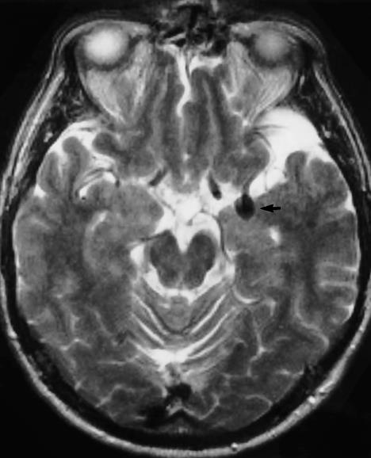

---
tags:
  - pathology
  - imaging
---
动脉壁由于局部病变（可因薄弱或结构破坏）向外膨出形成<mark style="background-color: #1A4F10; color: white">永久性局限性扩张</mark>
根据形态和结构可分为：囊性动脉瘤 梭形动脉瘤 蜿蜒形动脉瘤 舟状动脉瘤 夹层动脉瘤 假性动脉瘤
[主动脉瘤](主动脉瘤.md)
#### 并发症
最严重的并发症是破裂出血
是[蛛网膜下腔出血](蛛网膜下腔出血.md)的常见病因（脑底动脉环）
#### 影像学检查
[CTA](CTA)常规首选。[MRI](磁共振.md)筛查。[DSA](DSA.md)阴性动脉瘤

| 检查方法    | 核心定位                                                                     |
| ------- | ------------------------------------------------------------------------ |
| **DSA** | <mark style="background-color: #705A16; color: white">诊断金标准</mark>⭐️     |
| **CTA** | 急诊<mark style="background-color: #705A16; color: white">首选</mark> / 术前评估 |
| **MRA** | 无症状高危人群筛查首选                                                              |
Ⅱ型“靶型”，中心和瘤壁强化，血栓无强化
##### CT
无血栓动脉瘤：较大时为类圆形<mark style="background-color: #1A4F10; color: white">高密度灶</mark>；增强检查可见均匀强化
部分血栓动脉瘤：平扫可见中心或偏心高密度灶；增强可见中心和瘤壁强化，期间血栓未强化
完全血栓动脉瘤：平扫为等密度灶伴弧形或斑点状钙化；增强见瘤壁环形强化
##### MRI
动脉瘤瘤腔在 T1WI T2WI 可见<mark style="background-color: #3F4B5E; color: white">流空效应</mark>，边界清楚锐利，有血栓则表现为混杂信号。
[Open: Pasted image 20261016083424.png](attachments/9ec6406856850e3b24ad524de49b56f5_MD5.jpg)

