---
tags:
  - pharmacology
---
抗菌药物=[抗生素](抗生素.md)+人工合成抗菌药
后者包括[喹诺酮](喹诺酮.md)类、[磺胺](磺胺药.md)类、甲氧苄啶、硝基咪唑类、噁唑烷酮类等
  - # 一．抗病原微生物药及化学治疗的定义。
    - 定义： 化学治疗 是指对病原微生物、寄生虫所致的感染性疾病与恶性肿瘤的药物治疗
    - 机体、病原体和抗菌药物三者间的相互关系
      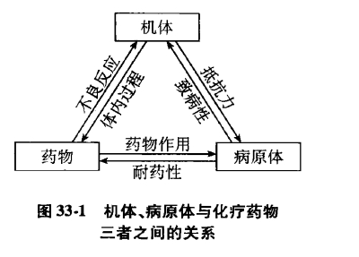
    -  <u>常用术语：抗菌谱，抗菌活性 MIC</u> ， 抑菌药，杀菌药， <u>化疗指数(chemotherapy index，CI)，PAE，首次接触效应(FEE)</u> 
      - 1.  抗菌谱 （antibacterial spectrum）:抗菌药物的抗菌范围，包括广谱和窄谱两种，是临床选药的基础
        - 广谱——对多种病原微生物有效 如 四环素、氯霉素、第三&四代氟喹诺酮类 等
        - 窄谱——仅对单一菌种或种属有效 如 异烟肼 
      - 2.  抗菌活性 ：抗菌药抑制或杀灭病原体的能力，评价抗菌活性的指标：常用MIC和MBC
        - 最低抑菌浓度 （minimum inhibitory concentration, MIC ）体外培养18~24h后能抑制培养基内病原菌生长繁殖的最低药物浓度；
        - 最低杀菌浓度 （minimum bactericidal concentration, MBC ）能够杀灭培养基内细菌或使细菌数减少99.9%的最低药物浓度。
      - 3. 抑菌药——仅能抑制微生物生长而无杀灭作用的药物；杀菌药——既能抑制微生物生长又有杀灭作用的药物。
      - 4.  化疗指数 （chemotherapy index,CI）：评价化学治疗药物安全性与应用价值的指标——LD50/ED50 或 LD5/ED95。CI↑，表明该药物的毒性越小（但不一定越安全！），临床应用价值越高
        > link：治疗指数TI
        - 注意：CI越大不一定越安全，只是越不容易中毒致死。青霉素类药物CI指数大，几乎对身体无毒性，但可能发生过敏性休克
      - 5. 抗生素后效应（post antibiotic effect,PAE）： 细菌与抗生素短暂接触，当抗生素浓度下降低于MIC或消失后，细菌生长仍受到持续抑制的效应。eg <mark style="background-color:#fef3c7;"> 阿奇霉素PAE非常好，可以间歇给药。 </mark>
        > 不能只说“不再给药”，要说“低于MIC或消失后”
      - 6.  首次接触效应（first expose effect，FEE）： 抗菌药物在初次接触细菌时有强大的抗菌效应，再度接触时不再出现该强大效应，或者与细菌接触后抗菌效应不再明显增强，需要间隔相当时间以后，才会再起作用。（如<mark style="background-color:#fef3c7;"> 氨基苷类由于FEE，需要间隔给药 </mark>）
      - 时间依赖性抗生素： 药物浓度超过一定范围后，浓度对杀菌效果影响不大。 β内酰胺连续按时给药 
      - 浓度依赖性抗生素： 杀菌效果随浓度的增加而增加， PAE 长、FEE明显 ，剂量大效果明显。 氨基苷类给三天歇三天 
        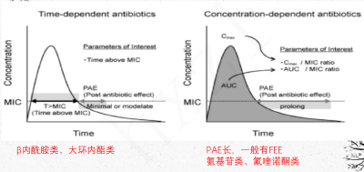
        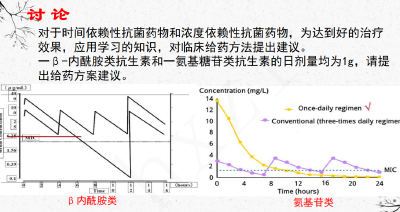
  - # 二． <u>抗菌药物的作用机制（背！）</u>
    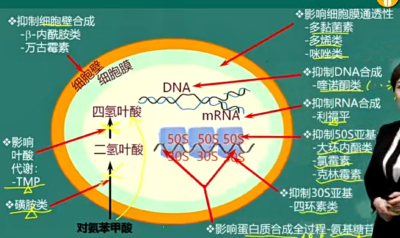
    > 从外往内记：细胞壁、细胞膜、胞内蛋白质、核酸、 <u>叶酸</u> 。1.抑制细菌细胞壁合成；2.影响细菌细胞浆膜的通透性；3.影响胞浆内生命物质（蛋白质）的合成；4.抑制细菌核酸合成；5. 影响叶酸代谢
    - 1. 抑制细菌细胞壁的合成：青霉素&头孢菌素、万古霉素&杆菌肽
      - 均作用于 繁殖期 
      - 青霉素和头孢菌素——抑制PBPs，抑制交联过程
      - 万古霉素和杆菌肽——抑制粘肽合成
    - 2. 改变细胞膜的通透性：多黏菌素 & 两性霉素
      - 多黏菌素——与膜磷脂结合；
      - 两性霉素——与固醇类物质结合（麦角固醇打孔）。
      - 副作用/不良反应强，因为人体也有
    - 3. 抑制蛋白质合成：氨基苷（链、庆大、妥布、阿米卡星）、大环内酯（红霉素）、林可霉素、氯霉素、四环素
      - 氨基苷类——影响蛋白质合成的 全过程 ；
      - 大环内酯类、林可霉素类、氯霉素类—— 50S ，抑制转肽； （“红绿林中50载”） 
      - 四环素—— 30S ，抑制进位（ 30而立四环素 ）
    - 4. 影响核酸代谢：喹诺酮（xx沙星）、利福平
      - 喹诺酮类——抑制 DNA 合成；
      - 利福平——抑制 RNA 合成。（DNA依赖性RNA pol）
    - 5. 影响  叶酸代谢：磺胺、甲氧苄啶 TMP 
      - 复方新诺明：SMZ + TMP，双重阻断四氢叶酸合成
      - 哺乳动物可以直接用叶酸，细菌原核生物需要用到四氢叶酸
  - # 三． <u>细菌耐药性的概念，产生耐药性的机制</u> 。
    - 1. 耐药性 （bacterial resistance）：细菌产生对抗生素不敏感的现象，产生原因是细菌在自身生存过程中的一种特殊表现形式。
      > 区别：人的“耐受性”
      - 固有耐药性（Intrinsic Resistance）： 由细菌染色体基因决定，代代相传不改变。（如：G- 对青霉素 G 天然耐药）
      - 获得性耐药性（Acquired Resistance）： 细菌与抗生素反复接触，由质粒介导，亦可由染色体介导，通过改变自身代谢途径使其不被抗生素杀灭的特性。可逆，可因不再接触抗生素而消失（如：金黄色葡萄球菌产生 β 内酰胺酶而对 β 内酰胺类抗生素耐药）
      - *多重耐药性（Multiple-drug Resistance）：*  *细菌对多种抗生素耐药*
        - MRSA  （ Methicillin Resistant Staphylococcus ） ：耐甲氧西林金黄色葡萄球菌
        - ESBL （Extended Spectrum β-lactamases）：产超广谱 β-内酰胺酶细菌
        - PRSP （Penicillin-Resistant Streptococcus Pneumoniae）：青霉素耐药肺炎球菌
    - 2. 耐药性机制
      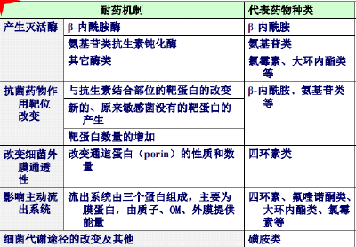
      - 改变细胞外膜通透性
        - 改变通道蛋白（porin）的性质和数量。 铜绿假单胞菌 对抗生素的天然耐药
      - 影响主动外排系统
        - 大肠埃希菌对 四环素、大环内酯类、氯霉素、氟喹诺酮 的多重耐药
      - 产生灭活酶：  主要是β和氨基苷。 
        -  氯霉素乙酰转移酶；林可霉素类（核苷转移酶）；大环内酯类（酯酶）；氨基糖苷类 抗生素钝化酶； β-内酰胺酶 ；
      - 抗菌药物作用靶位改变
        - 与抗生素结合的靶蛋白改变 、出现新的靶蛋白、靶蛋白数量增加
        -  耐压淋病奈瑟菌、MRSA 的青 霉素结合蛋白 改变 影响青霉素的结合
      - ※ 改变代谢途径 <mark style="background-color:#fef3c7;"> 磺胺 </mark>
        - 金黄色葡萄球菌产生大量PABA，逆转 磺胺类 药物的 <u>竞争性</u> 拮抗作用
          > 磺胺：干扰结核杆菌的 二氢蝶酸合酶  ，抑制叶酸代谢、分枝杆菌素合成 
    -  二重感染（Superinfection）/ 菌群失调症 
      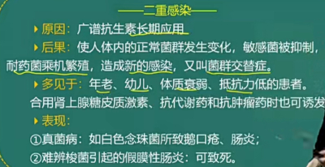
  - # 四．抗菌药的合理使用
    - 不能用抗菌药的场景：  ①病毒感染不用；②原因未明的发热；③绝大部分不局部应用→诱发过敏反应和细菌耐药 
    - 尽早明确诊断 ， 根据抗菌药 的活性、耐药性、药动， 根据患者 生理病理免疫状态选药——根据感染菌种类、药敏试验、感染部位、患者全身情况、抗菌谱、药代动力学、不良反应
      > eg G- 选氨曲南
    - 严格掌握预防应用的适应症： 手术 外伤 风湿 疫区接触
    - 特殊人群用药
      - （1）肾功能不全：避免肾毒性药、避免合用N个肾毒性药（氨基糖苷，多粘菌素，万古霉素，氟胞嘧啶，青霉素，一二代头孢，喹诺酮，四环素）
        - 肾不好肝好，双通道（选择肝脏代谢、肝胆系统排泄的药）：大环内酯，氯霉素，利福霉素，多西环素，异烟肼
      - （2）肝功能不全：由肝清除但无毒，可用、减量；肝毒性，禁用；肝肾双途径，减量
        - 原型经肾排泄正常用：青霉素、头孢唑林&他啶、万古霉素、氨基糖苷、多粘菌素、乙胺丁醇
        - 减量：红霉素、氟胞嘧啶、哌拉西林、美洛西林、头孢噻肟&哌酮&曲松、克林霉素、林可霉素、氟罗沙星
        - 禁用：磺胺，四环素，氯霉素，红霉素酯化剂，利福平，异烟肼，两性霉素B，酮康唑，咪康唑
      - （3） 新生儿： 禁用可能发生严重不良的 磺胺、氯霉素、喹诺酮、氨基苷。  哺乳暂停，吃药不吃奶。
      - （4）小儿：①氨基苷、万古霉素，耳、肾毒性；②四环素，牙齿黄染四环素牙；③喹诺酮：骨骼发育不良（“煞星”）
      - （5）妊娠：致畸性、明显毒性。一青一红不能用。
    - 合理联合用药
      - 繁殖期杀菌剂（ β-内酰胺 ）+ 静止期杀菌剂（ 氨基糖苷 ） 协同
      - 快速抑菌剂（ 大环内酯类 四环类 氯霉素 ）+静止期杀菌剂（ 氨基糖苷 ） 协同
      - 快速 + 慢效协同
      -  繁殖期杀菌剂（  β-内酰胺  ）+ 快速抑菌剂（  大环内酯类 四环类 氯霉素  ）拮抗 
    - 注意  给药顺序：先用四环素，后用青霉素，产生拮抗效应。反之则无 
    - 轮换使用抗生素、  降级使用（de-escalation）  同类药物、序贯使用不同药物
  - ## 习题
    - 1、名词解释：化疗指数；抗菌谱；最低杀菌浓度（MIC）；最低抑菌浓度(MBC)；抗生素后效应（PAE）
    - 2、简述抗菌药的抗菌作用机制
    - 3、简述细菌的耐药机制
    - 4、如何正确地联合应用抗菌药？

- # 人工合成抗菌药（2 学时）
  - # 一、 <u>喹诺酮类 Quinolones</u>
    > 
  - # 二、磺胺类 Sulfonamides、抗菌谱、抗菌力、 <u>作用机制</u> 、耐药性、体内过程、不良反应。
    > <u>广谱、慢效</u>  （ 需要很高浓度才能杀菌 ）、抑菌剂; 竞争性抑制二氢蝶酸合成酶
    - ### 结构：类似 PABA  （对氨基苯甲酸）——体内 二氢叶酸合成前体 
    - ### <mark style="background-color:#fef3c7;"> 重要特点 </mark>： <u>慢</u>  <u>效</u>  （ 需要很高浓度才能杀菌 ）、  广谱  、  抑  菌剂
    - ### 分类
      > 只需要掌握这两个： SD 、 复方新诺明（SMZ+TMP） ，其余掌握共性，知道名字
      - 全身： 磺胺嘧啶 SD （可透过BBB）、 磺胺甲𫫇唑 SMZ  *，SIZ，SDM*
      - 局部：柳氮磺吡啶 SASP （肠道）；磺胺醋酸钠 SA 、磺胺嘧啶银SD-Ag（外用）
      -  复方新诺明 cotrimoxazole：SMZ + TMP 磺胺甲𫫇唑+甲氧吡啶
    - ### 抗菌谱
      -  广谱但  螺 立 支  “三体无效”，尤其注意立克次体不减反增 ： 反而刺激立克次体生长
    - ### 磺胺类抗菌药的机制——  干扰细菌四氢叶酸的合成 
      - 靶点： 二氢蝶酸合成酶 
        - 催化对氨基苯甲酸 PABA 生成二氢叶酸。磺胺类药物与 PABA 类似、可与PABA 竞争，阻止细菌二氢叶酸合成，影响嘌呤、嘧啶代谢，抑制生长繁殖
          > 对哺乳动物影响小： 动物可将食物中的叶酸还原为四氢叶酸，而细菌必须依赖二氢蝶酸合成酶
    - ### 磺胺的耐药性——高，不可逆
      - 随机突变或质粒转移
      - 细菌对磺胺的通透性降低
      - 改变靶点，磺胺与二氢叶酸合成酶的结合能力下降
      - 细菌产生更多的 PABA： 抵消磺胺对二氢蝶酸合成酶的拮抗作用
    - ### 体内/药代
      - 可以透过BBB *（*  *可以抗流脑）* ，但不能进入细胞内液
      - 肝脏代谢, 产物乙酰化磺胺 对肾脏有毒性
        > 一般乙酰化产物对肾脏都有毒性。
        > 药物代谢中的乙酰化反应：极性降低，水溶性变差，从而导致药理效应降低。结晶尿
    - ### 磺胺的三大临床应用：全身（流脑）、胃肠、局部（眼科 皮肤）
      - 全身性感染
      - 流脑： 可以透过血脑屏障。<mark style="background-color:#fef3c7;"> 首选SD 磺胺嘧啶治疗脑膜炎奈瑟菌引起的流行性脑膜炎 </mark>（ 磺胺嘧啶 Sulfadiazine, SD  ，掌握这个知识点！ ）
      - 胃肠道感染： 柳氮磺吡啶（Sulfasalazine） SASP
        > 在肠道分解成 磺胺吡啶 和 5-氨基水杨酸盐 ；前者有抗菌作用，后者具有抗炎和免疫抑制作用，还用于强直性脊柱炎
      - <mark style="background-color:#fef3c7;"> 呼吸道感染、伤寒、菌痢 </mark>：（ 磺胺甲恶唑 Sulfamethoxazole  与 TMP 合用，组成 复方新诺明 SMZ + TMP ）
      - 烧伤（铜绿、金葡、破伤风）：甲磺米隆（磺胺米隆）（Mafenide, SML）、SD-Ag
      - 眼科：磺胺醋酰（Sulfacetamide, SA）
    - ### 磺胺的不良反应
      - 肾脏损伤：  结晶尿（Renal Crystalluria），磺胺类典型不良，多次考“如何解毒”。尤其是   磺胺嘧啶 SD
        > 代谢产物为乙酰类的物质都是肾毒性
        - 使用磺胺类药物时注意 碱化尿液、大量喝水 
      - 过敏反应： 磺胺类药物以衍生物交叉过敏
      - 血细胞生成障碍：   G-6-P 缺乏，  溶血性贫血 、再障。定期补充叶酸
      - 胆红素脑病（Kernicterus）： 竞争血浆蛋白，引起新生儿黄疸，血浆胆红素↑
      - 肝损伤
  - # 三．其它合成抗菌药
    - ## <u>1、</u>  <u>甲氧吡啶（Trimeth/o/prim, TMP）</u>  <u>：增强磺胺抗菌作用；机制</u>
      > 选择题必考，磺胺嘧啶 & 甲氧吡啶
      -  二氢叶酸还原酶抑制剂， 抗菌谱与磺胺类似，常与 SMZ 合用， 双向阻断使抑菌作用转变为杀菌作用 
        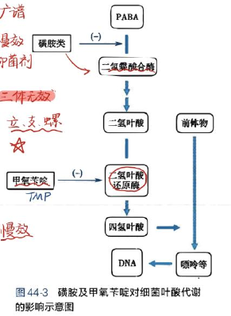
        > 抑菌→杀菌，耐药性↓，不良反应↓
      -  ※复方新诺明 （SD：TMP=5：1）
        > 掌握！大题也可能考
        - 为什么可以合用？
          - 先阐述图44-3
            - 细菌叶酸代谢需要PABA经二氢蝶酸合成酶（磺胺抑制）生成二氢叶酸，再经二氢叶酸还原酶（TMP抑制）生成四氢叶酸。
          - - 两者药代学参数相近，血药浓度可同时达峰；
          - - 合用对细菌叶酸合成起 双重阻断 作用，抗菌活性↑，抑菌→杀菌；
          - - 抗菌 谱扩大 ， 耐药 菌减少；
          - - 合用时药量↓，不良反应发生率↓
      - 临床应用：急性泌尿道感染（ 常常与 SMZ 合用（复方新诺明））
      - 不良反应： 长期应用引起 巨幼红细胞性贫血， 应停药、补充甲酰四氢叶酸
    - ## <u>2、</u>  <u>甲硝唑（Metro</u>  <u>nidazole</u>  <u>, 灭滴灵）</u>  <u>的临床应用</u>
      - 作用机制： 分子中的硝基在细胞内无氧环境下被 <u>厌氧菌</u> 还原成氨基，破坏细菌DNA
      -  ※用时需戒酒 双硫仑反应 
      - 临床应用： “四抗”
        - <mark style="background-color:#fef3c7;"> 抗厌氧菌（破伤风）、抗阿米巴（包囊无效）、抗滴虫的首选药物 </mark>
        - 抗蓝氏贾第鞭毛虫
        - 难辨梭状芽孢杆菌引起的 伪膜性肠炎（link：四环素耐药菌引起的二重感染） 
    - 3、呋喃坦啶 (furadantin，aka 呋喃妥因 )、呋喃唑酮(痢特灵，furazolidone)的作用特点
      - 广谱（铜绿 单胞菌不敏感），强(5- μg／mL)，尤其pH低时。耐药性低
      - 不良反应：胃肠道反应、 周围神经炎
      - 作用机理：干扰糖代谢？
      - 呋喃妥因(furadantin)：口服吸收，尿中浓度高；——主用于泌尿道感染，代谢物为棕色。
      - 呋喃唑酮(furazolidone，痢特灵)：口服吸收少，用于胃肠道感染，包括痢疾，霍乱，胃溃疡的治疗，尿液黄染
        > 口服吸收少才能多到达胃肠道分解
    - <mark style="background-color:#fef3c7;"> 典型三大可用于肺炎衣原体的药：沙星、克拉霉素（大环内酯类）、四环素类（多西环素） </mark>
    -  衣原体问诊线索：家中养鸟多个 
  - ## 习题
    - 1. 简述氟喹诺酮类药物的药理学共同特点
    - 2. 磺胺类药物有哪些常见的不良反应？如何预防？
    - 3. 简述复方新诺明的组成，机制及临床意义。
    - 4. 在磺胺类药物中，用于治疗流脑、伤寒、烧伤创面绿脓杆菌感染、沙眼的是哪些药？
    - 5. 简述甲硝唑的药理作用
- # 抗结核病药（  1.5  学时）
  > 主要要求掌握异烟肼、利福平
  - # 结核分枝杆菌：①胞内寄生菌（异烟肼脂溶性高、穿透力强、抵达病灶和胞内）；②外层由分枝菌酸包裹，普通药物难以发挥作用；③易产生耐药性（耐药选贝达喹啉）
    -  一线抗结核：  异烟肼（Isoniazid, INH） ，利福平（Rifampin）， 链霉素（Streptomycin） ，乙胺丁醇（Ethambutol） ，吡嗪酰胺（Pyrazinamide, PZA）
    - 二线抗结核： 对氨基水杨酸（PAS） 、乙硫异烟胺（ethionamide）、氟喹诺酮类
    - 新药：贝达喹啉 bedaquiline
  - # <u>异烟肼（Isoniazid）</u>
    > <u>高选择性，专职抗痨</u>   快慢代谢    结核首选  繁殖期杀（抑制 <u>分枝菌酸</u> 、 <u>DNA</u> ）； 类似Vit B6 ，周围神经炎（GABA脱羧酶++）
    - 异烟肼是针对异烟肼敏感<mark style="background-color:#fef3c7;">结核分枝杆菌感染</mark>的 预防 和治疗<mark style="background-color:#fef3c7;"> 首选用药 </mark>
    - 体内/药代
      > 以后没特别说就是 肝代谢肾排泄
      -  穿透性强，脂溶性高 
      - 口服吸收完全而迅速 ，广泛分布于全身，可渗入胞内、 干酪样及纤维化结核病灶 中
      -  肝脏代谢 ，人群基因差异决定快慢（注意：分为  慢代谢、快代谢 ）
    - 药理作用： <mark style="background-color:#fef3c7;"> 抗菌谱；抗菌活性(强弱？杀抑?)；繁殖期or静止期；机制；耐药性（联合用药） </mark>
      > 杀菌特点：高度选择性；细胞内外均可；强大；性质：繁殖期，杀菌 bacteriocide
      - 抗菌谱：  仅结核杆菌 （高度选择性杀菌作用）
      - 抗菌活性： 强大，对 胞内外 均有杀菌作用
      -  繁殖期  杀 菌剂（联系机制记忆，“抑制合成”，繁殖期作用强，静止期作用弱）
      - 机制
        > 细胞壁、代谢、DNA 三方面干扰占完了，最具特色的是细胞壁，针对分枝菌酸决定了其高度选择性抗菌。
        - 1. 抑制 分枝菌酸 合成酶（结核杆菌特异性）— → 细胞壁 × 
        - 2. 抑制 DNA 合成；
        - 3.  干扰代谢 。
      - 耐药性： 单用易耐药， 联合用药 可延缓（对其他抗结核药物无交叉耐药）
        > 早期轻症、预防、巩固可以单用，规范化治疗 <u>必须</u> 与其他药合用
    - 临床应用： 各种结核首选药，注意联合用药
    - 不良反应
      - 基于化学结构 与维生素B6相似 、经 肝代谢 、 抑制肝药酶 三大特点
      - （1）[周围神经炎](周围神经病.md) 、中枢神经症状 （眩晕、失眠、兴奋、精神错乱）
		- 机制：化学结构与Vit B6相似， 竞争性抑制Vit B6参与的GABA合成 ；
		- 预防： 及时补充Vit B6 
      - （2）肝损害
        - 乙酰化代谢物所致，老年、酗酒、 快代谢型 多见
        - 用药期间可出现转氨酶升高、黄疸、多发性肝小叶坏死
        - ※异烟肼为  肝药酶抑制剂（  伏笔：异烟肼有药酶抑制作用 利福平有药酶诱导作用  ） 
          > 记：异与抑同音；利与诱同意
      - （3）过敏、胃肠道反应
  - # <u>利福平（Rifampin）</u> ；利福喷丁 （rifapentine）、利福定（rifabutin）
    > 广谱，兼职抗痨，联合使用 （结核 麻风 金葡 沙眼衣原体）       繁殖、静止期全杀（抑制DNA依赖性的RNA pol，即mRNA合成）
    - 体内过程
      - 吸收易受食物影响，推荐空腹服用（伏笔：胃肠道不良反应），可透过血脑屏障
      - 代谢产物为红色（抗结核药服用者，红色粪便），使用时现配现用
      - 经 胆汁 排泄（治疗重症胆道感染）
    - 药理作用 —— <mark style="background-color:#fef3c7;"> 抗菌谱；抗菌活性(强弱？杀抑?)；繁殖期or静止期； </mark><mark style="background-color:#fef3c7;"> ~~*机制；耐药性*~~ </mark>
    - 抗菌谱：广谱全杀， 繁殖期 静止期 胞内胞外均有效
      - ✓ 分枝杆菌：结核分枝杆菌、 <u>麻风</u>  <u>分枝杆菌</u> ；（用于麻风病（合用氨苯砜））
      - ✓ G+球菌 （活性＜青霉素G，＞红霉素、头孢），尤其是对于耐药金葡菌；
      - ✓  G- 菌，高浓度时对某些病毒、沙眼衣原体也有抑制作用
    - 抗菌活性强大
    - 机制：）；
    - 作用机制： 抑制 DNA依赖性  RNA pol ，阻碍细菌mRNA的合成（对人、动物的无影响）
    - 利福平的临床应用
      - 结核病（与其他药联合）；
      - 麻风病（合用氨苯砜）
      - 耐药金葡菌
      - - 局部，主要是眼睛（沙眼、急性结膜炎等）
      - - 重症胆道感染；（胆汁排泄）
    - 利福平的不良反应
      - 胃肠道反应为主（link：食物影响吸收，推荐空腹服用）
      - 肝毒性：与异烟肼合用肝毒性增加；
        - ※ 利福平为  肝药酶诱导剂  （注意：异烟肼和利福平一上一下，异烟肼抑制肝药酶，利福平诱导肝药酶，但都在肝脏代谢） 
      - 致畸性： ※妊娠早期禁用 
      - 大剂量间隔使用时，可引起   “流感综合征”
    - 利福喷丁 （rifapentine）、利福定、利福布汀（rifabutin）
      - 与利福平一起，三者之间交叉耐药；其中，利福布汀是不完全交叉耐药
      - 利福喷丁 （rifapentine）：更长效、高效
      - 利福定（rifabutin）：活性更大，进入细胞内浓度更高。不完全交叉耐药，用于之前利福平有效的复治结核。
  - # 链霉素（Streptomycin SM）
    > 氨基苷类抗生素。胞外， 适合渗出病灶，易耐药；肾毒性大
    - <u>对结核作用 & 适应症</u> （还是从化疗药药理作用的几个方面来答）
      -  主要在胞外 ，穿透力弱，对胞内作用小——不能根除、 不易进入纤维化干酪病灶，适合 <mark style="background-color:#fef3c7;"> 渗出病灶 </mark>
      - 抗结核作用＜INH、RFP
      - 仍是一线抗结核药，联合用于急性期、严重结核感染（结核性脑膜炎、粟粒性结核、重要器官结核）
    - <u>耐药性：单用很容易耐药</u>
    - 不良：肾毒性、耳毒性
  - # <u>乙胺丁醇（</u>  <u>E</u>  <u>th/am/but/ol）</u>
    > 球后可逆性 视神经炎
    - 特点
      -  高度选择性 ：乙胺丁醇对所有结核分枝杆菌均具有抗菌活性，对其他细菌无效
      -  易耐药但耐药慢 ：耐药产生较慢，对耐异烟肼和链霉素者仍有效；没有交叉耐药性
      - 机制：结合Mg2+， 干扰RNA合成 ，胞内外杀菌；
        > 记：“醇美”
    - 不良反应：发生率低，最严重的是 球后可逆性视神经炎（Reversible Retrobulbar Neuritis） 
      > 视野缩小、视力下降、盲点，发生率与剂量有关
    - 应用：联合用药治疗各型结核。毒性少，容易被患者接受。
      > 记：“醇”，每个人接受度高。
  - # 吡嗪酰胺 pyrazinamide
    > 酸性好用，毒性大，联合用药
    - 在酸性环境中抗菌作用增强，中性环境中无作用
    - 单用易耐药，与异烟肼和利福平有协同作用；
    - - 可能影响分枝菌酸的合成；
      > 注意：“zin”烟酰，与 异烟肼 相似
    - - 常用于其他抗结核药失败的复治病人；
    - - 毒性较大，尤其是肝损害。
  - # <u>二线抗结核药：对氨基水杨酸（PAS）</u> 、乙硫异烟胺（ethionamide）
    > PAS类似PABA（联想到磺胺），抑制叶酸代谢、分枝杆菌素合成；乙硫异烟胺类似异烟肼，主要抑制分枝菌酸的合成
    - 对氨基水杨酸（Para-aminosalicylic acid PAS）
      - 干扰结核杆菌的 二氢蝶酸合酶  ，抑制叶酸代谢、分枝杆菌素合成 
      - 作用弱，但耐药产生慢；
      - 联合应用治疗各型结核，对 渗出病灶好 
  - # 氟喹诺酮类：<mark style="background-color:#fef3c7;"> 耐多药结核病 </mark>的 首选 
  - # 新药：贝达喹啉 bedaquiline（ *好* ）
    > 抑制ATP合成
    -  全新作用靶位： 抑制结核分枝杆菌ATP合成酶质子泵， 影响ATP 合成。
    - 对耐药菌、休眠菌也有很好的作用
    - 安全性高
  - # <u>抗结核病药的应用原则：早期、联合、适量、</u>  <u>长期（全程规范）</u>  <u>、规律用药。</u>
    - ※教材有趣点：糖尿病合并结核（实质：药物互作的考虑；特色不良反应）
      - ① 肝毒性 ：避免口服降糖药和抗结核药合用，多重肝损伤，首选注射类胰岛素
      - ②糖尿病视网膜病变：避免  乙胺丁醇 
      - ③周围神经病变：避免 异烟肼 
      - ④肾病：避免氨基苷类 链霉素 
  - # 对比表
    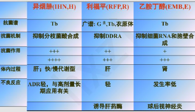
- # 抗恶性肿瘤药（  2.5  学时）
  - 一．抗恶性肿瘤药的作用机制与分类
    - ~~根据化学结构和来源分类~~
      - 烷化剂： 包括 环磷酰胺（Cyclophosphamide）  卡莫司汀（Carmustine） 马法兰（Busulfan）
      - 抗代谢药： 包括 甲氨喋呤  （Methotrexate,  MTX  ）   氟尿嘧啶  （Fluorouracil, 5-FU） 巯嘌呤（Mercaptopurine, 6-MP）   阿糖胞苷  （Cytarabine, Ara-C）
      - 抗肿瘤抗生素： 包括 放线菌素 D  （Dactinomycin D） 多柔比  星  （Doxorubicin） 博来霉素（Bicomycin） 柔红霉素（Daunorubicin,DNR） 丝裂霉素（Mitomycin, MMC）
        > ~cin，~mycin
      - 抗肿瘤植物药： 包括 长春（新）碱  （VLB，VCR）  紫杉醇  （Paclitaxel） 喜树碱（Camptothecine）
      - 其他类： 包括 顺铂  （Cisplatin） 卡铂（Carboplatin） 维甲酸（Retinoc Acid）
      - 激素类： 糖皮质激素 、雌激素、雄激素等
    -  <u>※ 根据药物作用周期分类</u> 
      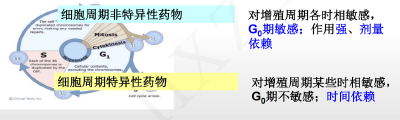
      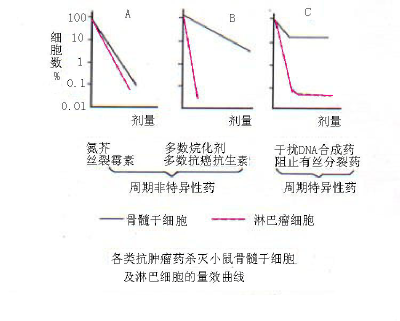
      > *间期分为G0静止期、G1期(蛋白质、RNA合成)、S(DNA合成期)、G2(蛋白质、RNA合成)、M期 （分裂）*
      -  （记：细胞周期非特异性药物 只有 <mark style="background-color:#fef3c7;"> 烷化剂、抗肿瘤抗生素、顺铂、激素 </mark> ，其余均为细胞周期特异性药物） 
      - • 细胞周期 <u>非特异性</u> 药物
        - 直接破坏DNA或影响复制、转录功能的药物。
        - 对增殖周期各时期的细胞敏感， G0 期敏感
        - 作用强，杀伤作用呈剂量依赖性。
        - 剂量反应曲线是一条直线
        - 举例：烷化剂、抗肿瘤抗生素、顺铂和激素
          - 烷化剂：氮芥；环磷酰胺；白消安；博来霉素；丝裂霉素
          - 影响转录过程：放线菌素 D；多柔比星；柔红霉素
          - 顺铂和激素
      - • 细胞周期 <u>特异性</u> 药物
        - 仅对增殖周期某些时相敏感，对G0期不敏感；
        - 作用往往较弱，杀伤作用呈时间依赖性。
        - 剂量反应曲线是一条渐近线；
        - 举例：抗代谢药、干扰蛋白质合成（主要是M期纺锤丝）药
          - 作用于S期： 干扰核酸生物合成（抗代谢药）：甲氨喋呤 阿糖胞苷
          - 作用于M期： 干扰蛋白质合成药：长春新碱  主要作用于 M 期； 紫杉醇： 主要作用于 M 期和 G2 期
    - 根据作用机制分类（图中4点+影响全程的“ 影响激素平衡药物 ”）
      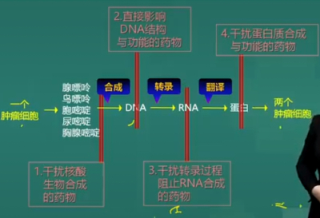
      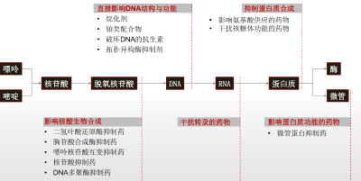
    - 肿瘤细胞的共同特点：细胞  增殖  有关的基因被开启或激活，细胞  分化  有关的基因被关闭或抑制。
    - 抗肿瘤药的 <u>毒性反应</u>
      - • 共有反应
        -  骨髓抑制：除外激素类,博来霉素, 门冬酰胺酶； 
        - 消化道反应：恶心、呕吐
        - 脱发。
      - • 特有反应
        -  心脏毒性 ： 柔 红霉素、 多柔 比星、三尖杉酯碱；
          > 恩怨 <u>柔</u> 情 <u>多</u> 伤心
        -  呼吸 系统毒性： 博来 霉素、白消安、CTX（环磷酰胺）
          > 平阳博来吵架了，肺气炸了
        -  肝脏 毒性：MTX 甲氨蝶呤、羟基脲、CTX 环磷酰胺、鬼臼毒素；
        -  膀胱 毒性：<mark style="background-color:#fef3c7;"> 环磷酰胺致出血性膀胱炎 </mark>
        -  肾毒性： CTX、顺铂；
          > 为了买个铂金戒指，卖肾
        -  神经 毒性：顺铂、长春新碱、紫杉醇、门冬酰胺酶；
          > 顺铂的两大毒性反应：“肾”“神”
        -  过敏 反应：博来霉素、门冬酰胺酶、紫杉醇。
          > 因为都是生物制剂
    - <u>抗肿瘤药物联合用药原则。</u>
      - 1. 细胞增殖动力学机制
        - （1）招募作用: 周期特异和非特异性药物交替使用，先杀灭一部分肿瘤，引诱更多肿瘤细胞进入G0期再歼灭
        - （2）同步化抑制: 使用周期特异性药物，肿瘤细胞阻滞于某一时期、同步进入下一时期，再用下一时期抑制药
      - 2.生化机制(作用于不同环节的药物互补):  eg  核酸合成(Doxorubicin)+ 细胞毒(cyclophosphamide)→DNA修复↓
      - 3. 降低毒性: 合用激素,长春新碱,博来霉素→骨髓抑制↓
      - 4. 抗癌谱： 消化道腺癌 → 5-FU ;             鳞癌 → MTX :         骨肉瘤 → Doxo 
      - 5. 合理剂量：考虑患者耐受性
  - 二．常用抗肿瘤药
    - (一) 细胞毒类抗肿瘤药
      - 1．干扰 <u>核酸生物合成的药物 / （抗代谢药）：主要用于</u>  <u>S 期</u>  <u>。</u>
        > <u>5-氟尿嘧啶（5-FU）、6-巯基嘌呤（6-MP）、甲氨蝶呤（MTX）</u> 、阿糖胞苷、羟基脲
        - 胸苷酸合成酶抑制药——氟 尿 嘧啶（５－FU）        可用于消化道癌、乳腺癌、卵巢癌等；
        - 嘌呤核苷酸互变抑制药——巯嘌呤（６－MP）      用于儿童急性淋巴细胞白血病（维持治疗）；免疫抑制剂（用于自身免疫病）
        - 二氢叶酸还原酶抑制剂——甲氨蝶呤（MTX）      可用于儿童急性白血病；
        - 核苷酸还原酶抑制剂——羟基脲                                   可用于慢性粒细胞白血病；
        - DNA多聚酶抑制剂——阿糖胞苷                     用于成人急性粒细胞／单核细胞白血病
      - <u>2．破坏 DNA 结构和功能：</u>  <u>细胞周期非特异性</u>  <u>药物</u>
        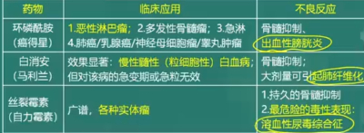
        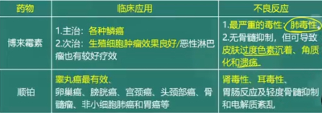
        > 氮芥、 <u>环磷酰胺（cyclophosphamide）、</u> 白消安、塞替哌、博莱霉素（bleomycin）、丝裂霉素（把红细胞“撕裂”～溶血性尿毒症）、 <u>顺氯氨铂（cisplatin, DDP）（“结合DNA”）</u>
        - 烷化剂（DNA交联剂） ：氮芥、 <u>环磷酰胺（cyclophosphamide）</u>  <u>、</u> 白消安
          - 机制：与DNA或蛋白质分子中亲核基团（氨基、羧基、羟基、磷酸基）起烷化反应→交联或脱嘌呤→DNA链断裂
          - <u>环磷酰胺（cyclophosphamide）</u>
            - 肝药酶代谢物为磷酰胺氮芥，对恶性淋巴瘤疗效显著；
            - 诱发 出血性膀胱炎 
          - 白消安 busulfan、马利兰myleran
            - 慢性粒细胞、原发性血小板、真性红细胞增多
            - 久用后肺纤维化（马利兰肺）、闭经、睾丸萎缩
        - 破坏DNA的抗生素 ：博莱霉素（bleomycin）、丝裂霉素
          - 博莱霉素（bleomycin）
            - DNA结合-DNA链断裂一复制受阻
            - G2和M期；鳞状上皮癌，淋巴瘤，睾丸癌，卵巢癌
            -  不良反应：间质性肺炎->纤维化。 
          - 丝裂霉素（mytomycin）
            - 生物还原烷化作用（与DNA双链交叉联结，抑制其复制；使DNA断裂）；周期非特异性；
            -  广谱 ； 毒性大. 
        - 破坏DNA的铂类 （金属与DNA共价结合）
          - <u>顺氯氨铂（cisplatin, DDP）/顺铂</u>
            -  Pt2+与碱基（G、A、C）交叉联结 ；
            - 周期非特异性， 广谱 ；口服无效，静注
            -  肾和耳毒性 。
          - 卡铂（carboplatin）
        - 抑制拓扑异构酶：鬼臼毒素衍生物
      - 3． <u>影响转录过程、阻止 RNA 合成：</u>  <u>细胞周期非特异性</u>  <u>药物（都是</u>  <u>抗癌抗生素</u>  <u>）</u>
        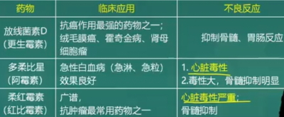
        > 只有博来、丝裂这两个抗癌抗生素是破坏DNA的，其它都是影响转录的
        - 共性： 抗癌抗生素 、 周期非特异性 。 嵌入DNA碱基对，干扰转录 ，阻止RNA合成；
        - 放线菌素D （dactinomycin）：G1期，拓扑酶II ⬇️
          - 肾母细胞瘤、绒癌、恶性葡萄胎。“放射召回”．
        - <u>多柔比星</u> （doxorubicin，adriamycin， 阿霉素，ADM）
          -  S和M期 
          - 急淋、急粒、恶性淋巴瘤、实体瘤；
          -  心脏毒性 
        - 柔红莓素 （daunorubicin）同上
      - <u>4．干扰蛋白质合成：主要作用于</u>   <u>M 期</u>  <u>。</u>
        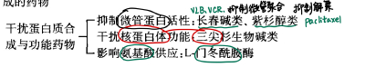
        - 微管蛋白活性抑制药——长春碱（vinblatine，VLB）、长春新碱（vincristine，VCR）、紫杉醇（paclitaxel）
          - <u>长春碱（vinblatine，VLB）、长春新碱（vincristine，VCR）</u>
            - 抑制微管聚合、纺锤丝形成，有丝分裂停止（M期）；急性白血病，恶性淋巴瘤，绒癌；
            - 不良反应：外周神经炎.
          - 紫杉醇（paclitaxel）
            - 促进微管聚合，抑制解聚——纺锤体失去正常功能，有丝分裂停止。转移性卵巢癌、乳腺癌。
            - 骨髓抑制、周围神经病变、过敏反应、心脏毒性等。
        - 干扰核蛋白体功能——三尖杉酯碱（harringtonine）：
          - 抑制蛋白质合成起始阶段，有丝分裂↓
          - 急粒，急单（急非淋），淋巴肉瘤，肺癌；
          - 心肌损害。
        - 影响氨基酸供应——L-门冬酰胺酶（asparaginase）
          - 急淋；
          - 过敏反应、精神症状。
    - (二) 非细胞毒类抗肿瘤药
      - 内分泌治疗药物：激素类：肾上腺皮质激素，雌激素、雄性激素、他莫昔芬。
        -  糖皮质激素 ：急淋、恶性淋巴瘤、慢淋；
        - 雌激素：前列腺癌、绝经期乳腺癌；
        - 雄激素：晚期乳腺癌；
        - 选择性雌激素受体阻断药—— 他莫昔芬 —乳腺癌
      - 小分子化合物：伊马替尼、吉非替尼、索拉非尼等
      - 其他：维 A 酸、亚砷酸、重组人血管内皮抑制素等
    - (三)肿瘤免疫治疗：伊匹单抗、尼伏单抗、阿替珠单抗等 重组人白介素-2 新药研究等
      - 分子靶向抗肿瘤药： 利妥昔单抗（ 单克隆抗体）、 曲妥珠单抗（ 抗体耦联药） 、阿替利珠单抗（ <mark style="background-color:#fef3c7;"> 第一个PD-L1抑制剂 </mark> ） 等
  - 习题
    - 1  ．简述抗肿瘤药的分类方法。
      - ※ 根据药物作用周期分类——细胞周期特异性、非特异性，其中非特异性只有 烷化剂、抗肿瘤抗生素、顺铂、激素 
      - 根据作用机制分类（图中4点+影响全程的“ 影响激素平衡药物 ”）
    - 2  ．周期特异性和非特异性药物。
    - 3  ．简述抗肿瘤药的主要不良反应。
      - 抗肿瘤药的 <u>毒性反应</u> 
    - 4.  简述环磷酰胺的临床应用
      - 烷化剂，直接破坏DNA结构和功能
      -  广谱，恶性淋巴瘤、多发骨髓瘤 、急性淋巴细胞白血病、肺癌、乳腺癌、卵巢癌、神经母细胞瘤、率丸肿瘤等
      - <mark style="background-color:#fef3c7;">引起骨髓抑制</mark>
      - 代谢物引起<mark style="background-color:#fef3c7;">化学性膀胱炎</mark>
    - 5.  简述氟尿嘧啶的临床应用
      - 干扰核酸生物合成（S期）
      -  消化系统肿瘤、乳腺癌 疗效较好，宫颈癌、卵巢癌、头颈部肿瘤等有效
- # 抗真菌药（1 学时）
  - 真菌感染可分为
    - • 浅部真菌感染——各种癣菌引起，主要侵犯皮肤、毛发、指甲、趾甲；
      > 局部抗真菌药
    - • 深部真菌感染——白色念珠菌、新型隐球菌，一般见于免疫缺陷患者
      > 全身抗真菌药
  - 抗真菌药物：具有抑制或杀死真菌生长或繁殖的药物，根据化学结构的不同，可分为
    - 抗生素类（antibiotic）： 两性霉素B
    - 唑类（azole）： 酮康唑
    - 丙烯胺类（allylamine）： 特比奈芬
    - 嘧啶类（pyrimidine）： 氟胞嘧啶
    - 棘白菌素类（echinocandins）
  - 机制分类
    - 破坏真菌细胞膜麦角固醇，打孔——易有毒，人体也有固醇
    - 抑制麦角固醇合成
    - 在体内转化为5-FU，抑制真菌DNA合成
  - 抗生素类——两性霉素B、灰黄霉素、制霉菌素
    - <u>两性霉素B （Amphotericin B）——</u>  <u>具有很大毒性；麦角固醇打孔</u> 
      - 作用： 广谱 ，对 深部真菌 有强效抑制作用
      - 机制：与真菌胞膜 <u>麦角固醇</u> 结合，形成孔道，改变膜的通透性，营养物质外漏；细胞膜氧化损伤
        - 注意：对细菌、立克次体无用（不含固醇类物质），对人毒性大而严重（人有固醇）
      - 应用：<mark style="background-color:#fef3c7;"> 深部真菌感染首选药 </mark>；
        > （真菌性肺炎、脑膜炎、尿路感染、心内膜炎等）
      - 给药方法：静脉注射，要求静滴时间＞6h（毒性大）； 肠道感染则口服；鞘内注射——治疗脑膜炎；局部应用——皮肤科、妇科等。对隐球菌感染，与5-氟胞嘧啶合用以提升疗效。
      - 不良反应  多 
        - 急性毒性反应： 最常见，由于本药引起单核细胞 IL-1 释放
        - 肾毒性： 与剂量相关，不可合用氨基苷类抗生素
        - 低钾血症   血液系统毒性   心血管系统反应
        - 合用解热镇痛药、抗组胺药、地塞米松减轻不适感
    - 灰黄霉素（Griseofulvin）——  浅表但口服；微管蛋白 
      -  口服 易吸收， 外用无效 （不能穿透角质层）；主要分布于皮肤、脂肪、毛发中
      - 可抑制浅表皮肤癣菌，对深部真菌无效；
      - 机制：干扰敏感真菌的 微管蛋白聚合成微管 ，抑制其有丝分裂；
      - 应用：<mark style="background-color:#fef3c7;"> 浅表真菌感染（尤其是头癣） </mark>
      - 不良反应：多，消化系统反应多，有致畸、致癌作用
    - 制霉菌素（Nystatin）： 毒性更大。阴道滴虫、口服治疗胃肠道真菌、局部用药
  - 氟胞嘧啶——抑制DNA，BBB脑膜炎
    - 机制：在菌体内转变为5-氟胞嘧啶，抑制 真菌 DNA（胸腺嘧啶核苷）的合成而不抑制哺乳动物的，故 不良反应少 
    - 可以穿过血脑屏障
    - 应用：  与两性霉素B合用，首选治疗隐球菌所致脑膜炎。 
      > 两性霉素细胞膜打孔，氟胞嘧啶进入细胞抑制DNA合成。
    - 抗菌谱较两性霉素B窄而弱，单用易耐药；适用于白色念珠菌 隐球菌 霉菌等
  - <u>咪唑类</u> 和三唑类 （酮  康唑  、伊曲康唑   *不尿路*  、氟康唑   *HIV*  ）
    - 咪唑类： 酮康唑（Ketoconazole）、 克霉唑（clotrimazole） 咪康唑（miconazole） 益康唑（econazole）
    - 三唑类：第一代： 氟康唑（fluconazole） 伊曲康唑（itraconazole）； 第二代：伏立康唑（voriconazole） 泊沙康唑（posaconazole）
    - 唑类抗真菌药是一种 广谱 抗真菌药， 毒性明显小于两性霉素 
    - 机制：抑制真菌胞膜上的细胞色素P450-14-α-去甲基酶→14-α-甲基固醇蓄积，抑制真菌胞膜 <u>麦角固醇</u>  合成
    - 酮康唑（  Ketoconazole  ）
      - 抑制 CYP3A4 酶，严重影响相关药物代谢。严重肝毒性；抑制睾酮和肾上腺皮质激素合成
      - 已被 氟康唑、伊曲康唑 代替
      - 常见不良反应包括胃肠道反应、肝毒性、 肾上腺皮质抑制 
    - 伊曲康唑（  Itraconazole  ）
      - 抗真菌作用更强、谱更广
      - <mark style="background-color:#fef3c7;">治疗</mark><mark style="background-color:#fef3c7;"> 罕见真菌 </mark><mark style="background-color:#fef3c7;">：组织胞浆菌、芽生菌感染的</mark><mark style="background-color:#fef3c7;"> 首选用药 </mark>
      - 用于治疗口腔、食管、阴道的念珠菌感染，但  不适合治疗尿路感染 
      - 不良反应比酮康唑少：包括胃肠道反应、一过性肝功能异常、皮疹
    - 氟康唑（  Fluconazole  ）
      - 抗真菌谱广 与伊曲康唑类似
      - <mark style="background-color:#fef3c7;"> 治疗 </mark> 艾滋病 <mark style="background-color:#fef3c7;"> 患者隐球菌性脑膜炎的首选药 </mark> 口服和静脉均有效
      - 与氟胞嘧啶合用增强疗效
    - 咪康唑、克霉唑 ：毒性大，但强度高，<mark style="background-color:#fef3c7;"> 仅限局部浅表应用 </mark>
  - 丙烯胺类： 特比奈芬（terbinafine）、奈普芬（Terbinafine）
    > 主要用于 <u>浅部，</u> 体外抗菌活性高
    - 选择性抑制真菌膜的角鲨烯环氧化酶，抑制麦角固醇合成
    - 外用或口服治疗<mark style="background-color:#fef3c7;"> 甲癣 </mark>和其他一些<mark style="background-color:#fef3c7;"> 浅表 </mark>部真菌感染；
    - 深部需与唑类药物或两性霉素B合用，才可获良好效果
  - *棘白菌素类抗真菌药*  ： 卡泊芬净 米卡芬净 阿尼芬净，静脉注射抑制细胞壁
    - 非竞争性抑制葡聚糖合成酶， 抑制真菌 细胞壁 合成
    - 用于侵袭性念珠菌病等
  - 抗真菌药：灰黄霉素抗浅表真菌的作用与应用；制霉菌素、，其他抗真菌作用与应用、不良反应；新药。
  - 习题
    - 1．抗深部真菌感染药——两性霉素B、氟胞嘧啶、酮康唑、氟康唑、伊曲康唑——的抗菌作用及临床应用。
    - 2．抗浅表真菌感染药——特比萘芬、咪康唑、克霉唑——抗菌作用及临床应用。
    -  3. 抗真菌药物的分类及主要作用机制？ 
      - （1）作用于真菌细胞膜：丙烯胺（特比奈芬）、唑、多烯类
        - 抑制麦角固醇合成，或直接破坏打孔麦角固醇（两性霉素B、制霉菌素）
          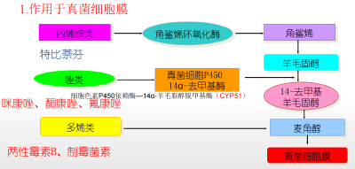
      - （2）作用于真菌细胞核：氟胞嘧啶
        - 转化为5-FU抑制真菌T和DNA合成
          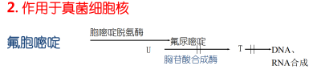
      - （3）作用于有丝分裂（微管蛋白）：灰黄霉素
        - 抑制微管蛋白合成围观
          
# [[抗病毒药]]

