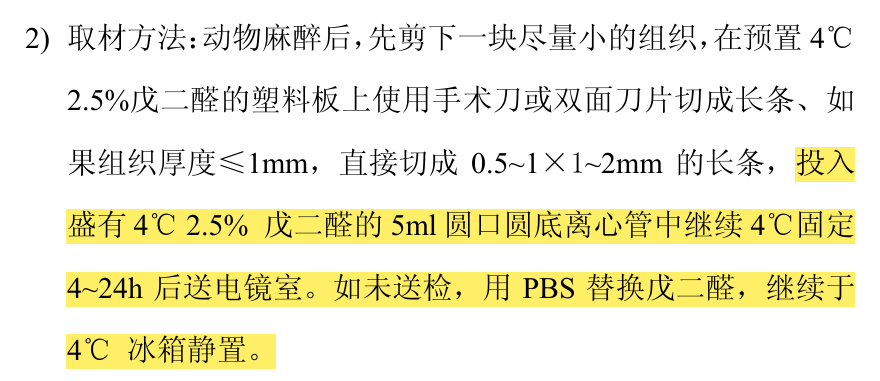
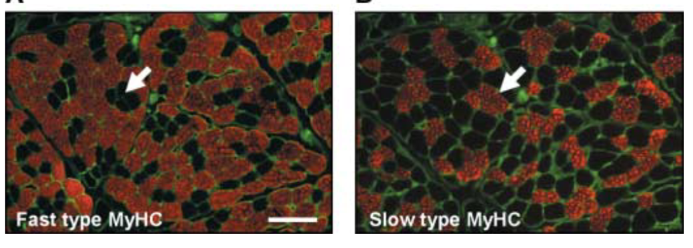
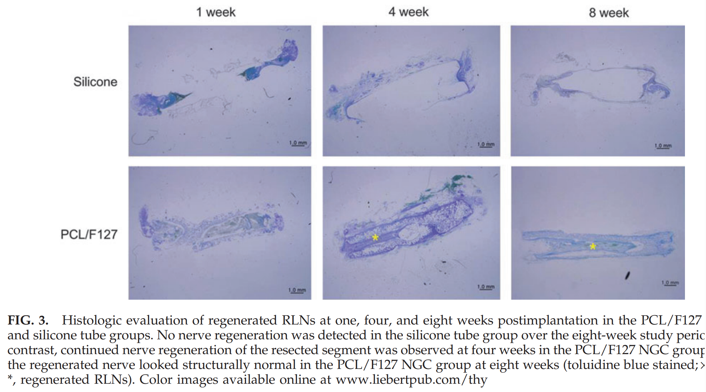
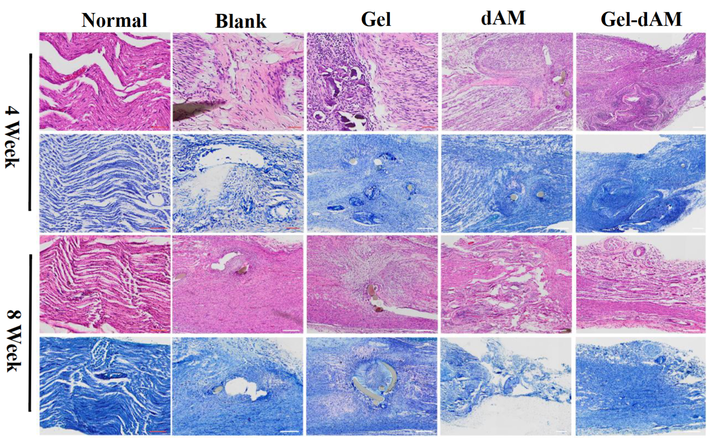
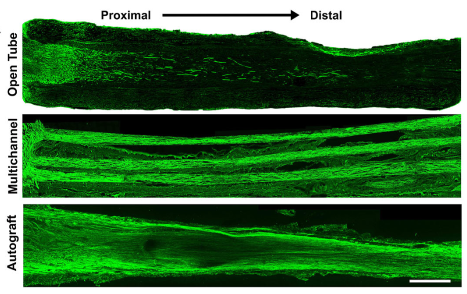
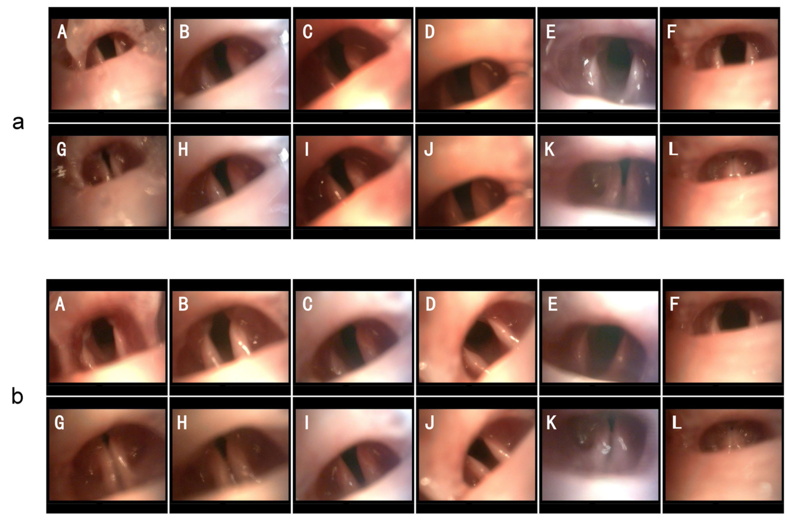
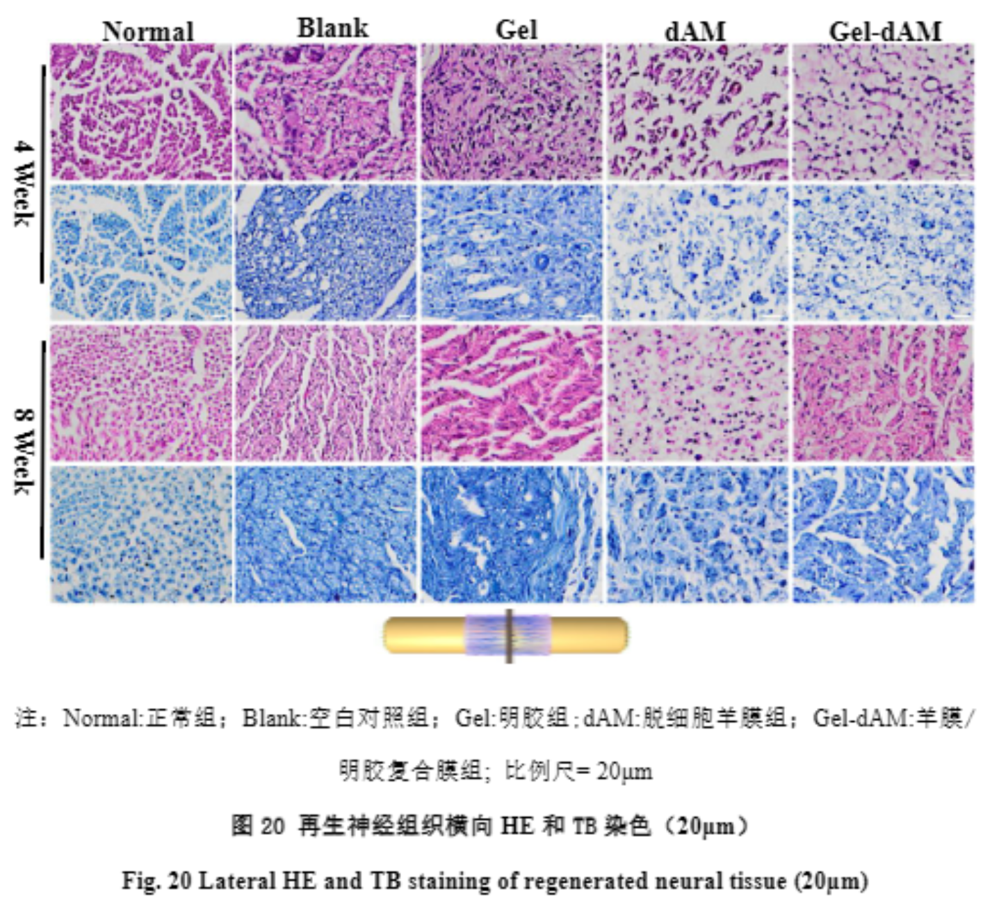

#### 试剂
4%PFA，2.5% 戊二醛
！！！要做树脂包埋的透射电镜（TEM）测髓鞘，必须用**戊二醛**（可以加少量PFA，但不能只有PFA）
[Open: Pasted image 20261026113005.png](attachments/8ae30b471071d970a55f49e0d7cff761_MD5.jpg)

注意不要固定过久！！！

环氧树脂包埋剂、甲苯胺蓝（购于美国 Sigma 公司）；
BDNF 抗体（购于美国 Abcam 公司）
The posterior cricoarytenoid (PCA) and thyroarytenoid (TA) were rapidly micro-dissected from each animal. [The Laryngoscope - 2009 - Shiotani - Modulation of Myosin Heavy Chains in Rat Laryngeal Muscle](The%20Laryngoscope%20-%202009%20-%20Shiotani%20-%20Modulation%20of%20Myosin%20Heavy%20Chains%20in%20Rat%20Laryngeal%20Muscle.pdf)

方案选择参考
> [!PDF|green] [Myelin histology a key tool in nervous system research, p.3](Myelin%20histology%20a%20key%20tool%20in%20nervous%20system%20research.pdf#page=3&selection=376,1,380,42&color=green)
> > NR: Toluidine blue is often used on both paraffin and cryosections for the study of proteoglycans or metachromatic elements, but it will not stain myelin as it perfectly does on semithin sections where it is HR. 

E600 光学显微镜（购于日本 Nikon 公司）；
#### [TA](甲杓肌.md)
> [!PDF|rouge] [A Novel Method for Thyroarytenoid Myofiber Culture, p.10](A%20Novel%20Method%20for%20Thyroarytenoid%20Myofiber%20Culture.pdf#page=10&selection=2,0,2,51&color=rouge)
> > Excised rat larynx (A) and exposure of VF lumen (B)

两种横切（已探索声带面，待探索<mark style="background-color: #1A4F10; color: white">肌肉横切</mark>）
> [!PDF|yellow] [Bioengineered nerve regeneration and muscle reinnervation, p.6](Bioengineered%20nerve%20regeneration%20and%20muscle%20reinnervation.pdf#page=6&selection=119,0,121,32&color=yellow)
> > The thyroarytenoid laryngeal adductor muscle expresses predominantly fast-type fibres. 
> 
> [Open: Pasted image 20261029085501.png](attachments/1c4d643ed71ce0379546f235c90a773f_MD5.jpg)

#### RLN
> [!PDF|yellow] [thy.2013.0338, p.3](thy.2013.0338.pdf#page=3&selection=20,26,27,54&color=yellow)
> > placed in 4% paraformaldehyde at room temperature, processed, embedded in paraffin, and sectioned at 4 lm (RLNs were sectioned longitudinally, and larynxes were sectioned axially). For evaluation, the RLNs were stained with toluidine blue and hematoxylin and eosin,
> 
> 普通石蜡切片，纵切
> [Open: Pasted image 20260930082746.png](attachments/628ed5563ed27e6767fef45b25989fee_MD5.jpg)

纵向切片染色还不少
> [!PDF|yellow] [羊膜_明胶纳米纤维复合膜促进大鼠周围神经损伤修复的实验研究_吴家瑞, p.7](羊膜_明胶纳米纤维复合膜促进大鼠周围神经损伤修复的实验研究_吴家瑞.pdf#page=7&selection=4,2,4,15&color=yellow)
> > 通过对染色图像计算轴突面积
> 
> [Open: Pasted image 20260930100026.png](attachments/bdc07a7e0d559a99177d5b43b5f917ca_MD5.jpg)

> [!PDF|yellow] [NC-Multichannel, biomimetic scaffolds improve functional connectivity following traumatic long-gap peripheral nerve injury, p.3](NC-Multichannel,%20biomimetic%20scaffolds%20improve%20functional%20connectivity%20following%20traumatic%20long-gap%20peripheral%20nerve%20injury.pdf#page=3&selection=104,9,104,70&color=yellow)
> > Axon regeneration across 1 cm rat sciatic gap after 4 weeks. 
> 
> [Open: Pasted image 20260930094714.png](attachments/5803a26abcffe8609a9021a2da9e9355_MD5.jpg)

也有横向[^1]

#### TEM
- 将喉返神经标本放置于 2.5% 戊二醛溶液中，之后用 1% 四氧化锇固定 24 h， 经梯度丙酮（30%、60%、90%、100%、100% 及 100%） 
> [!PDF|yellow] [1982 - Fiber components of the recurrent laryngeal nerve of the rat  A study, p.1](1982%20-%20Fiber%20components%20of%20the%20recurrent%20laryngeal%20nerve%20of%20the%20rat%20%20A%20study.pdf#page=1&selection=288,1,305,41&color=yellow)
> > ARer a buffer (0.2M sodium cacodylate) rinse, the specimens were postfixed in 1% osmium tetroxide in the same buffer, dehydrated in graded alcohol solutions, and embedded in Epon. 

- 脱水 20 min 后用环氧树脂包埋剂包埋喉返神经标本， 待硬化后使用超薄切片机切取横断面厚度为 1 μm 的切片，用 1% 甲苯胺蓝染色。
- 在光学显微镜下（100 倍）观察形态并拍照，用 Photoshop CC 软件计数轴突数目（1 个视野）
##### 喉镜
可参考[Co-transplantation of Schwann cells and neural stem cells in the laminin-chitosan-PLGA nerve conduit to repair the injured recurrent laryngeal nerve in SD rats](Co-transplantation%20of%20Schwann%20cells%20and%20neural%20stem%20cells%20in%20the%20laminin-chitosan-PLGA%20nerve%20conduit%20to%20repair%20the%20injured%20recurrent%20laryngeal%20nerve%20in%20SD%20rats.pdf)
[Open: Pasted image 20260928212036.png](attachments/c7b1cc63b553a05590e626a5108aacf1_MD5.jpg)

---
#### Footnote
[^1]: [Open: Pasted image 20260930095733.png](attachments/803c2447fb0a4623bdf2590f1ffca093_MD5.jpg)

