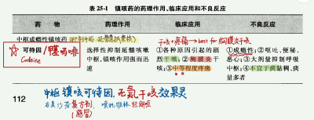
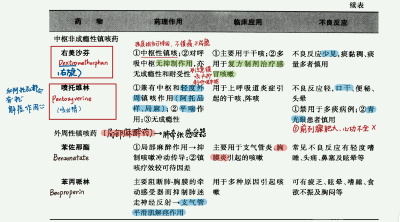

---
tags:
  - pharmacology
---
### <u>[[可待因]]、</u> 右美沙芬、喷托维林、苯丙哌林、苯佐那酯的作用与临床应用特点。

#####  作用注意 
可待因成瘾性；
哪些中枢、哪些外周（实质局麻）；
##### 喷托维林、苯丙哌林有解痉作用
#####  临床应用注意 
##### 干咳
##### 镇痛-[[可待因]]
##### 复方制剂感冒-右美沙芬
##### 胸膜炎-[[可待因]]、苯丙哌林
##### *补充：咳嗽症状的处理*
##### OTC
#####  感冒：右美沙芬复方制剂 
刺激性干咳或阵咳——苯丙哌林或喷托维林
剧咳首选苯丙哌林，次选右美沙芬；轻咳：喷托维林
##### 咳嗽发作时间
###### 白日咳嗽：苯丙哌林（感受器）
###### 夜间咳嗽：右美沙芬（延髓、迷走）
##### 处方药
##### 剧烈无痰咳嗽：[[可待因]]，12岁以下禁用
剧咳伴随大量痰液，有阻塞呼吸道风险：司坦类粘液调节剂(羧甲司坦)或祛痰剂(氨溴索)
应用镇咳药时，应注意及时采用控制感染、对抗过敏原等治疗措施(针对病因)
