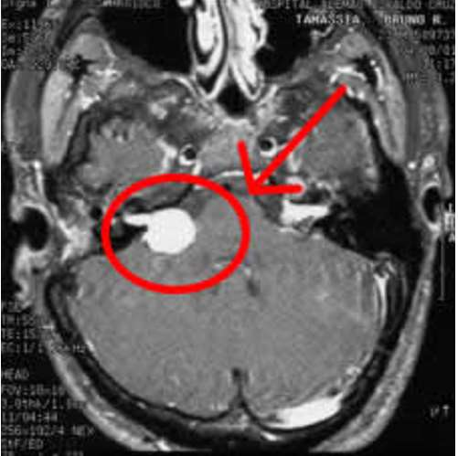

---
tags:
  - Neurology
  - imaging
---
[Open: Pasted image 20261013214303.png](attachments/426895aebbfdde8718a5b23f85400b5d_MD5.jpg)

<mark style="background-color: #8B0000; color: white">最常见</mark>的颅内神经鞘瘤
起源于[听神经](听神经.md)前庭支的神经鞘
特点：呈锥形，扩大内耳道。早期位于内耳道内，以后长入桥小脑角池。
听力部分或完全丧失
#### 影像学
##### CT
①. 部位：<mark style="background-color: #1A4F10; color: white">内听道及桥小脑角池</mark>内
②. 密度：等、低或混杂密度肿块，可见钙化、囊变和出血
③. 瘤周：轻-中度水肿，
④. 占位效应：肿瘤增大压迫脑干及小脑，第四脑室受压移位，伴幕上脑积水。
⑤. 增强：均匀、非均匀或环形强化。
⑥. 骨窗：<mark style="background-color: #1A4F10; color: white">内耳道呈锥形扩大</mark>。
##### MRI
①. 与CT相似，实性部分T1中等或稍低信号，<mark style="background-color: #8B0000; color: white">T2高</mark>信号，实性部分明显均匀或不均匀强化，囊变后明显环形强化。
②. 增强及薄扫可发现内耳道内3 mm的小肿瘤。