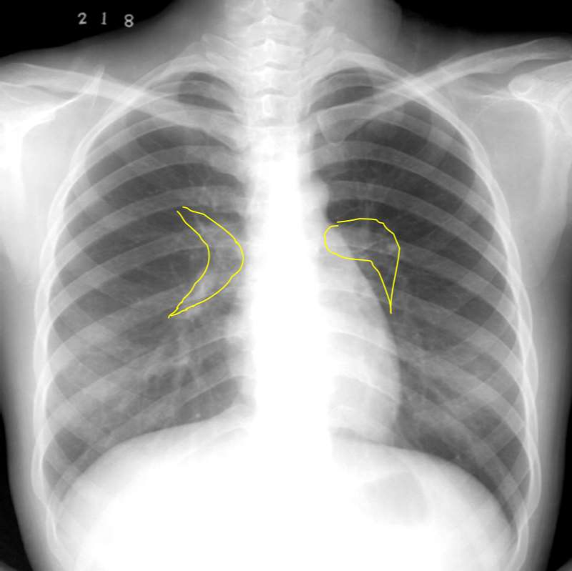

---
tags:
  - imaging
---
## 第四章 呼吸系统

### 一、概况
- 第一次：检查技术及正常影像表现；基本病变（支气管阻塞、肺实变）。
- 第二次：基本病变（空洞与空腔、结节与肿块、索条影、钙化、纵隔与胸膜病变）；疾病诊断（支扩、大叶性肺炎）。
- 第三次：疾病诊断（小叶性肺炎、脓肿、结核、肺肿瘤、纵隔占位、胸膜病变）。
#### 基本概念
- 正常充气的两肺在X线胸片上表现为均匀一致较为透明的区域，称为肺野。
- 肺野的划分（非解剖概念，人为划分，以描述病变位置）。

| 划分方式        | 具体               |
| ----------- | ---------------- |
| 横向划分野：上、中、下 | 第二、四肋骨前端下缘引一水平线。 |
| 纵向划分带：内、中、外 | 三等分。             |
	肺尖区为第一肋骨圈外缘以内的部分。
	锁骨下区为锁骨以下至第2肋骨圈外缘以内的部分，是结核好发部位。
- 肺门：肺动脉及叶段分支，伴行支气管、肺静脉。
	正位：<mark style="background-color: #1A4F10; color: white">左高右低</mark>，侧位：<mark style="background-color: #1A4F10; color: white">右前左后</mark>。
	右侧肺门钝角-肺门角，左侧肺门逗号
	[Open: Pasted image 20261027175318.png](attachments/e7fdb0b01237a41bf50dddfd8a4e57e8_MD5.jpg)

- 

### 二、肺部病变

#### （一）肺部病变范围
① 支气管阻塞；② 肺实变；③ 空洞与空腔；④ 结节与肿块；⑤ 网状、细线状及条索状影；⑥ 钙化。

#### （二）支气管阻塞
##### 1. 阻塞原因
- 腔内阻塞：肿块、异物、炎性狭窄、分泌物淤积、水肿、血块等。
- 腔外压迫：如肿瘤、增大淋巴结等。

##### 2. 不完全性阻塞——阻塞性肺气肿
- 肺气肿共同表现：。
- 局限性肺气肿：
  - X光片：一侧或一叶肺，纵隔移向健侧，病侧横膈下降。
- 弥漫性肺气肿：
  - X光片：
    ① 肺间质增宽；
    ② 肺实变、血肿、血肿……（原文此处OCR重复/不清）；
    ③ 肺阻塞、活动度明显减弱；
    ④ 肺阻塞及前后径增大（肺阻塞）。
  - CT：弥漫性肺气肿可分为3种类型：
    ① 小叶中央型；
    ② 小叶间隔旁型（胸膜下&纵隔旁）；
    ③ 全小叶型。

##### 3. 完全性阻塞——阻塞性肺不张
- 肺不张的常见点：不张肺实质缩小、密度增高、与肺的解剖单位相吻合。
- 一侧肺不张：
  - X线：患侧肺野均匀致密，纵隔向患侧移位，横膈升高，肋间隙变窄，健侧代偿性肺气肿。
  - CT：可见阻塞原因；不张侧肺缩小，呈均匀致密影；增强扫描可显示不张肺内血管的分布，常可显示支气管阻塞的部位和原因。
- 肺叶不张：
  - X线：不张肺叶缩小，密度均匀增高，叶间裂呈向心性移位；纵隔及肺门不同程度向患侧移位；邻近肺叶可代偿性肺气肿。
  - CT：梯形或三角形密度影（斑片影）尖端指向肺门。
  - 右肺上叶不张：上纵隔旁三角形，底边贴右纵隔，边缘清楚；左肺上叶不张：底部在前胸壁。

#### （三）空洞与空腔
- 概念：肺内空腔性病变的统称；肺大泡、含气肺囊肿及肺气囊等都属于空腔。
- X线：
  ① 薄壁空洞，多小于3mm；
  ② 周围无实变；
  ③ 腔内多无液体。
- CT：肺大泡的壁看不到，但肺气囊/肺囊肿可见致密线状壁；多发肺气囊（即使看到壁也是光滑锐利的线状透亮影）。

#### （四）结节与肿块
- ★结节与肿块：以直径3cm为界命名，大小不区分良恶性，D≤3cm为结节，D>3cm为肿块。
- 良性肿瘤/肿瘤样病变：
  - X线：① 边缘清楚，生长缓慢；② 密度高，可有钙化、骨化、脂肪；③ 卫星灶。
- 恶性肿瘤：
  - X线：边缘不锐利，无包膜，胸膜凹陷。
  - CT更清晰：
    ① 分叶征；
    ② 毛刺征；
    ③ 空泡征——肿瘤内小空泡，多见于腺癌；
    ④ 胸膜凹陷征；
    ⑤ 增强扫描明显强化，CT值增加20HU以上。
- ★不典型结核球与周围型肺癌鉴别：

| 项目 | 不典型结核球 | 周围型肺癌 |
|---|---|---|
| 概念 | 结核球 | 肺癌 |
| 处理策略 | 影像诊断 | 影像诊断 |
| 影像诊断 | 边缘清楚，密度高，可有钙化、卫星灶 | 分叶、毛刺、空泡、胸膜凹陷，增强明显 |
| 随访 | 随访 | 随访 |

#### （五）网状、细线状及条索状影——★重点掌握
- X线表现：
  ① 较大支气管、血管周围间质——肺纹理增多、增粗、紊乱；
  ② 小支气管及肺血管周围间质——网状、蜂窝状；
  ③ 局限性线条影：肺纤维化、瘢痕等；
  ④ 小叶间隔增厚——网状及细线影。
- CT表现：
  ① 支气管、血管周围间质增厚，呈网状、线状、放射状；
  ② 胸膜下间质增厚：胸膜下线、小叶间隔增厚；
  ③ 晚期：蜂窝状。

#### （六）钙化
- X线：高密度，边缘清楚。
- CT：钙化密度较高，CT值>100HU。

### 三、胸膜病变
① 胸腔积液；② 气胸与液气胸；③ 胸膜肥厚、粘连与钙化；④ 胸膜肿块。

#### （一）胸腔积液
##### 1. 游离性胸腔积液
- X线：
  - 少量积液：上缘在第4前肋以下；患侧肋膈角变钝。
  - 中量积液：上缘在第2—4前肋之间；患侧胸下部均匀致密影，上缘呈外高内低弧线。
  - 大量积液：上缘在第2前肋以上；患侧胸野均匀致密，纵隔向健侧移位，膈肌下降。
- CT：少量、中量、大量；游离性胸腔积液CT表现。

##### 2. 包裹性胸腔积液
- X线：
  ① 多发生于胸壁、叶间、肺底；
  ② 切线位呈半圆形或梭形影，边缘清楚；
  ③ 边缘光滑，密度均匀；
  ④ 与胸壁呈钝角。
- CT：
  ① 胸壁呈梭形或半圆形；
  ② 与胸壁呈钝角；
  ③ 边缘光滑，密度均匀；
  ④ 增强扫描。

##### 3. 叶间积液
- X线：
  ① 位于叶间裂；
  ② 呈梭形或球状；
  ③ 边缘清楚；
  ④ 密度均匀。
- CT：叶间裂呈梭形或球状。

#### （二）胸膜肥厚、粘连及钙化
- 胸膜肥厚、粘连：
  - X线：广泛性胸膜增厚、粘连：① 肋膈角变钝，膈肌变平；② 膈肌可呈幕状；③ 肋膈角变浅；④ 胸膜增厚、粘连。
  - CT：胸膜增厚可呈条状、带状或片状。
- 胸膜钙化：点状、斑块、条状高密度影。

#### （三）气胸与液气胸
- 成因：脏层胸膜破裂；胸壁破裂；外伤。
- X线气胸：
  - 气胸线：从外上到内下的条状影，气胸线以外无肺纹理，可被压缩的肺边缘；呼气相显示更清楚。
  - 大量气胸：① 气胸线可被压缩的肺边缘；② 纵隔向健侧移位；③ 膈肌低平，肋间隙增宽。
- 液气胸：
  - 液气平面：① 胸腔内同时有气体和液体；立位片可见液平面；② 液平上方为气体，下方为液体。
- 局限性或多房性气胸/液气胸：局部粘连，气体分隔。
- CT：
  - 气胸：胸膜腔内无肺纹理的透亮区，内侧可见压缩的肺边缘。
  - 液气胸：气液平面。
  - 意义：CT可发现少量气胸；可发现肺大泡。

#### （四）胸膜肿块
- X线：
  ① 切线位呈半圆形、凸向肺野阴影；
  ② 边缘清楚，密度均匀；
  ③ 上下缘平直。
- CT：
  ① 局限性：基底宽，可见胸膜尾征，增强后多有强化；
  ② 弥漫性：高低不平，多结节或波浪状。

### 四、纵隔病变
- 了解纵隔2个基本病变：纵隔增宽，纵隔移位（牵拉性向同侧，压迫性向对侧）。

### 五、疾病诊断

#### （一）★支气管扩张
- 支气管（3~6级分支）内腔不可见导管扩大，多见于儿童，病因包括先天性、后天性。
- 症状：咳嗽、脓痰、咯血。
- 病理：管壁平滑肌、腺体和软骨减少或缺如，同时有支气管上皮脱落，支气管内及细胞浸润，管壁回声及周围纤维组织增厚；可单发可并发。
- 分型：
  - 柱状型：近远端管径相同；
  - 囊状型：远端大于近端，呈球囊状；
  - 曲张型：程度大于柱状，中间有收缩。
- X线：早期可无异常或仅肺纹理增多；囊状支气管扩张可呈蜂窝状。
- CT：
  - 柱状型：轨道征——扩张支气管与CT扫描平面平行；印戒征——扩张支气管与CT扫描平面垂直。
  - 囊状型：葡萄串征、液气平面。
  - 曲张型：念珠状。
- 合并感染：周围渗出、肺纹理增多、斑片影；支气管扩张合并感染与肺脓肿鉴别。

#### （二）大叶性肺炎
- 鉴别：肺不张（同与肺实变区分）、阻塞性肺炎（支气管远端有肺块/结节影）、大叶性干酪性肺炎（实变密度高、有虫蚀样空洞）。

| 依据病理分期 | X线 | CT |
|---|---|---|
| 充血期 | 不明显，正常性充血程度减低，肺纹理增多；肺纹理增多型，边缘模糊，病变区血管缘约可见 | 同X线 |
| 实变期（红色肝样变／灰色肝样变） | （1）以叶间膜为界的大片实变型——形态与肺叶、肺段的轮廓相符，邻近叶裂一侧边界清晰；（2）可见空泡影，呈大叶性或肺段性分布；空气支气管征 | 同X线 |
| 消散期 | （1）实变密度降低，呈散点大小不一、分布不规则的内层状影；（2）直至完全吸收，或残留条索状影 | 同X线 |

#### （三）小叶性肺炎和间质性肺炎
##### 1. 小叶性肺炎（支气管肺炎，以小儿及老人多见）
- X线：
  ① 病变多位于两肺中下野内中带；
  ② 肺纹理增多、增粗、模糊；
  ③ 斑片状模糊影，边缘不清，可融合成大片；
  ④ 可并发肺气肿或肺不张。
- CT：
  ① 两肺中下野可见斑片状支气管血管束增粗；
  ② 大小不等、边缘模糊的结节影、片状影；
  ③ 可融合成大片状；
  ④ 可伴有肺门及纵隔淋巴结肿大；
  ⑤ 治疗后可完全吸收或残留少许纤维条索。

##### 2. 间质性肺炎
- X线：
  ① 病变好发于两肺中下野，以内中带为主；
  ② 肺纹理增粗、模糊，呈网状或条索状；
  ③ 可伴有肺门影增大、模糊；
  ④ 可伴有小叶间隔增厚。
- CT：
  ① 两肺弥漫性支气管血管束增粗；
  ② 磨玻璃影或小片状影；
  ③ 可伴有小叶间隔增厚、蜂窝状改变；
  ④ 可伴有肺门及纵隔淋巴结肿大。

#### （四）★三大重点疾病鉴别

##### 1. 肺脓肿
- X线：
  ① 急性期：大片状浓密阴影，边缘模糊；
  ② 脓肿形成后：大片状阴影中可见圆形透亮区，内有液平面；
  ③ 慢性期：脓腔壁增厚，周围纤维化。
- CT：
  ① 早期空洞形成前：大片状低密度影，边缘模糊；
  ② 空洞形成后：大片状低密度影中可见空洞，内壁光滑，可有液平面；
  ③ 慢性期：空洞壁增厚，周围纤维化。

##### 2. 肺结核
- 继发型肺结核：
  - X线：
    ① 好发于上叶尖后段、下叶背段；
    ② 病变多形性：渗出、增殖、纤维化、钙化、空洞；
    ③ 可有卫星灶；
    ④ 可伴有肺门淋巴结肿大。
  - CT：同上。
- 结核球：
  - X线：
    ① 好发于上叶尖后段、下叶背段；
    ② 圆形或椭圆形，边缘清楚；
    ③ 密度较高，可有钙化；
    ④ 周围可有卫星灶。
  - CT：同上。

##### 3. 肺结核空洞、恶性空洞、肺脓肿鉴别

| 项目 | 结核空洞 | 恶性空洞 | 肺脓肿 |
|---|---|---|---|
| 部位 | 上叶尖后段、下叶背段 | 单发 | 单发或多发 |
| 数目 | 单发或多发 | 单发 | 单发或多发 |
| 形态 | 圆形 | 不规则较大 | 圆形或不规则 |
| 壁厚度 | 薄 | 厚 | 厚 |
| 内壁 | 锐利、可不规则 | 不规则壁结节 | 光整 |
| 液气平 | 可见、较少 | 少 | 多见 |
| 壁钙化 | 有 | 无 | 无 |
| 位置 | 多位于中心 | 偏心性 | 多位于中心 |
| 周围 | 卫星灶 | 恶性征象 | 炎性渗出或实变 |
| 核桃 | 无 | 有 | 无 |

#### （五）肺肿瘤
##### 1. 肺癌
- 弥漫型：细支气管肺泡癌。
- （2）磨玻璃结节（GGN）——纯GGN、部分实性GGN。
- （3）恶性征象：分叶征、毛刺征、胸膜凹陷征、空泡征等。
- 中晚期：
  ① 肺内肿块，常有分叶；
  ② 侵及胸膜；
  ③ 钙化；
  ④ CT增强扫描肿块明显均匀或不均匀强化；
  ⑤ 周围淋巴结转移。
- 弥漫型[了解]——细支气管肺泡癌：
  ① 两肺多发弥漫结节，呈粟粒大小至1cm不等，以两肺中下野较多；
  ② 斑片状或大片状，可见空气支气管征（走行僵硬呈“枯树枝样”）；
  ③ 增强扫描实变区密度较低，支气管内多发粘液，内可见高密度血管影。

##### 2. 继发性肺肿瘤——肺转移瘤
- 血行转移：
  - 多发圆形结节，界清，密度均匀，大小不等；
  - 两肺中下野较多；
  - 可呈弥漫粟粒状或斑片状浸润影；
  - 少数可见空洞及钙化。
- 淋巴转移：
  - 肺门或纵隔淋巴结肿大；
  - 自肺门向外放射状分布索条影伴串珠状结节；
  - 小叶间隔不规则增厚，伴沿支气管血管束或小叶间隔分布的小结节。

#### （六）纵隔原发肿瘤和肿瘤样病变
- 纵隔内肿瘤和肿瘤样病变的特定好发部位：
  ① 胸廓入口区：成人——甲状腺肿；儿童——淋巴管瘤。
  ② 前纵隔：胸腺瘤、畸胎瘤、心包囊肿。
  ③ 中纵隔：淋巴瘤、支气管囊肿。
  ④ 后纵隔：神经源性肿瘤（神经鞘瘤、神经纤维瘤）。