---
tags:
  - pharmacology
---
### 呼吸系统（2）
### 一． 平喘药
### 哮喘的疾病本质：气道炎症Inflammation
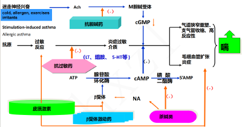
慢性、变态反应性、<mark style="background-color: #3F4B5E; color: white">炎症</mark>疾病——气道重塑、狭窄、<mark style="background-color: #3F4B5E; color: white">炎性浸润</mark>
外因性（吸入性）: 特异性抗原，<mark style="background-color: #705A16; color: white">Ⅰ型变态反应</mark>。
内因性：非特异性刺激（冷空气、烟尘、异味等）。
治疗思路：抗过敏；消炎；解痉挛
### β（2）肾上腺素受体激动药 <mark style="background-color: #3F4B5E; color: white">{解痉挛；（消炎）}</mark>
> 非选择性β激动 （肾上腺素（adrenaline）、异丙肾上腺素（isoprenaline）、麻黄碱（ephedrine））；选择性β2激动 （沙丁胺醇（salbutamol）/喘乐宁、舒喘灵（宁））
#### 1、药理作用——激动β2
激动<mark style="background-color: #3F4B5E; color: white">支气管平滑肌</mark>细胞的β2-R——气道平滑肌松弛；
激动<mark style="background-color: #3F4B5E; color: white">肥大细胞</mark>表面的β2-R受体——抑制肥大细胞释放炎症介质、过敏介质。
机制：β2+—→激活Gs—→AC—→cAMP—→PKA—→[Ca2+]↓—→支气管平滑肌松弛
#### 2、临床应用
肾上腺素（adrenaline） ——皮下注射，哮喘急性发作；
异丙肾上腺素（isoprenaline） ——吸入，哮喘急性发作；长期应用，严重心律失常
麻黄碱（ephedrine） ——口服，<mark style="background-color: #3F4B5E; color: white">轻症、预防</mark>发作；缓慢、温和、持久
※<mark style="background-color: #3F4B5E; color: white">沙</mark>丁胺<mark style="background-color: #3F4B5E; color: white">醇</mark>（<mark style="background-color: #3F4B5E; color: white">sal</mark>butam<mark style="background-color: #3F4B5E; color: white">ol</mark>）<mark style="background-color: #705A16; color: white">——缓解哮喘急性发作症状的首选药</mark>
> 喘乐宁、舒喘灵（宁）。also：特布他林 、克伦特罗、氯丙那林

<mark style="background-color: #705A16; color: white">高选择性β2</mark> ：对支气管平滑肌β2-R的作用<mark style="background-color: #3F4B5E; color: white">远大于</mark>对心脏β1-R的作用；
扩张支气管的作用与异丙肾上腺素相近，但作用更<mark style="background-color: #3F4B5E; color: white">持久</mark>；
气雾吸入→迅速缓解；口服→控制频发性或慢性哮喘
#### 3、不良反应
心脏反应 （β 1）：心率加快、心律失常、室颤，缺氧时更为敏感。
##### 肌肉震颤 （骨骼肌慢收缩纤维的β 2 ）
##### 代谢紊乱
### 茶碱类Theophylline <mark style="background-color: #3F4B5E; color: white">{解痉挛；（消炎）}</mark>
#### 1、药理作用
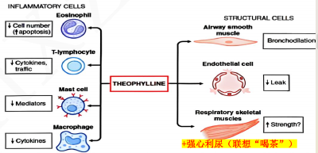
##### 1. 舒张支气管平滑肌
###### ①抑制磷酸二酯酶（PDE）
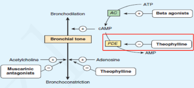
###### ②阻断腺苷受体
③增加内源性儿茶酚胺释放，间接舒张支气管。
##### 2.抗炎
##### 3.强心利尿
##### 4.增加呼吸肌（膈肌）收缩力
#### 2、临床应用
##### 用药注意：氨茶碱 <mark style="background-color: #3F4B5E; color: white">稀释后缓慢静注</mark>
##### ①支气管哮喘
> 急性静注，慢性口服
##### ②COPD
> COPD伴有喘息/伴有右心功能不全的心源性哮喘
##### ③心源性哮喘
> 氨茶碱强心、利尿、扩血管（肺动脉 ）
##### ④中枢型睡眠呼吸暂停综合征
> 茶碱兴奋中枢
#### 3、不良反应
##### 治疗窗较窄
胃肠道不良反应；
> link：所有的消化系统药都有胃肠道不良反应

中枢兴奋；（失眠、[震颤](震颤.md)、激动）
心血管系统症状；
急性中毒：常见于静注过快或剂量较大，出现心动过速、心律失常、血压骤降、谵妄、[惊厥](惊厥.md)、[昏迷](昏迷.md)等（低浓度缓慢注射）
### 抗胆碱药（M阻断） Muscarinic Antagonists <mark style="background-color: #3F4B5E; color: white">{解痉挛}</mark>
> Ipratropium bromide异丙托溴胺、异丙托品；Oxitropium氧托溴胺、氧托品；Isopropyl scopolamine 异丙东莨菪碱；Tiotropium噻托溴胺、泰乌托品 (长效）；可必特气雾剂：异丙托品 + 沙丁胺醇
##### M受体分布
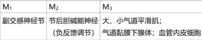
#### 与β2受体激动剂比较：
① 抗胆碱药主要作用于大气道，使大气道的口径松弛，对小气道口径影响小；β受体激动剂对大小气道均有影响。
② 起效慢，但维持时间长、剂量小、副作用少，不易耐药。
③ β2受体激动药的替代药 ：与β2受体激动剂联合使用，协同、互补
④对心血管系统的作用不明显，对痰液分泌和痰液粘稠度无明显影响；对支气管平滑肌选择性较高
#### 药物特点：
老年、伴有<mark style="background-color: #705A16; color: white">迷走神经功能亢进</mark>的哮喘、喘息性支气管炎患者尤为适用
副作用：口干、咽部刺激、恶心和干咳。
对阿托品类药物过敏者避免使用；<mark style="background-color: #1A4F10; color: white">青光眼、前列腺肥大</mark>患者慎用
### 糖皮质激素GC {消炎}
> 倍氯米松（beclomethasone）
##### 基本作用机制：强大的抗炎作用与免疫抑制作用
吸入剂型糖皮质激素已成为<mark style="background-color: #705A16; color: white">治疗哮喘的一线药物</mark>，主要不良反应是局部不良反应
#### ❖ 倍氯米松（beclomethasone）
#### 1、药理作用
①抗炎抗免疫：抑制多种参与哮喘发病的~细胞；抑制~因子和介质；
②抗炎之缩血管：增强支气管及血管平滑肌对儿茶酚胺的敏感性；
link GC抗炎早期——炎症早期：增加血管紧张性；减轻充血、通透性、渗出和水肿；抑制白细胞浸润与吞噬反应；减少炎症因子释放 →减轻红、肿、热、痛
③抑制气道高反应性；
##### ④ 促进上皮损伤修复、纤毛生长
#### 2、临床应用
目前治疗哮喘最有效的抗炎药物（哮喘一线用药）；
支气管扩张药不能有效控制的慢性哮喘患者；
重度COPD；
##### ⭐气雾吸入、局部作用
局部用，控制性药物（ 吸入激素：哮喘预防与持续状态治疗，维持药效）；
###### 全身用，抢救药物 （哮喘严重急性发作治疗）
###### link GC章节
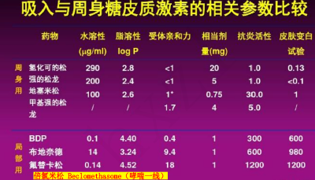
#### 3、不良反应：局部为主
##### 咽喉疼痛、口腔食道真菌生长、声音嘶哑
##### <mark style="background-color: #705A16; color: white">※吸入后立即漱口</mark>
### 色甘酸钠 <mark style="background-color: #3F4B5E; color: white">{抗过敏}</mark>
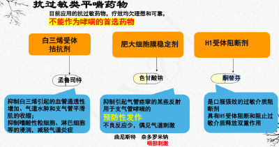
> 炎症细胞膜稳定药；色甘酸钠（Disodium Cromoglycate）
#### 药理作用
##### 没有直接扩张支气管的作用
##### 抑制肥大细胞释放炎症介质
##### 抑制支气管对非特异性刺激的高反应性
#### 临床应用：预防外源性哮喘的发作
##### 不良反应
少数患者吸入药物后有咽喉和器官刺激症状出现胸部紧迫感；可能反而诱发哮喘
### 白三烯调节剂CysLTs <mark style="background-color: #3F4B5E; color: white">{抗过敏，消炎}</mark>
> 半胱氨酰(Cys）白三烯（LT）受体1拮抗剂（CysLT1受体阻断剂） ：ileuton（齐留通AA861），扎鲁斯特（zafirlukast）、孟鲁斯特（montelukast）、普仑司特（pranlukast）

CysLTs与炎症：引起支气管黏液分泌、支气管平滑肌收缩、血管通透性↑、嗜酸性粒细胞浸润
CysLTs对应药： 5-脂氧酶抑制剂 & CysLT-1受体拮抗药
5-脂氧酶抑制剂可减少CysLTs合成，而CysLT-1受体拮抗药阻断CysLTs的上述作用
##### 5-脂氧酶抑制剂：zileuton（齐留通AA861）
白三烯受体拮抗药：扎鲁斯特（zafirlukast）、孟鲁斯特（montelukase）
#### 扎鲁斯特（zarfirlukast）
##### 口服
#### 药理作用
###### 选择性CysLT-1受体拮抗药
###### 抑制气管炎症及抗原诱导的迟发性支气管痉挛
#### 临床应用
###### 不用于急性发作
轻中度慢性哮喘的<mark style="background-color: #3F4B5E; color: white">预防</mark>及治疗；
###### 阿司匹林过敏性哮喘和运动性哮喘的治疗
###### 减少哮喘病人糖皮质激素及β2-R激动药的用量
#### 不良反应
###### 全身血管炎（Chung-Strauss综合征）
###### 妊娠期哺乳期妇女慎用
#### 重点小结（PPT）
##### 支气管扩张药
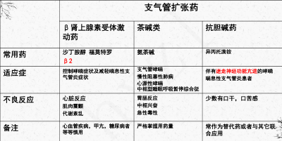
##### 抗炎平喘药
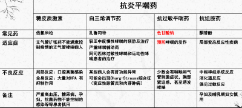
### 二．COPD药
> 罗氟司特（Roflumilast）——PDE4抑制剂

COPD：气流受限不完全可逆、进行性发展，与肺部对香烟烟雾等有害气体或有害颗粒的异常炎症反应\感染等有关
### 罗氟司特（Roflumilast）
#### 本质：磷酸二酯酶4抑制剂，抗炎作用
磷酸二酯酶4（PDE4）是炎症和免疫细胞中一种主要的cAMP代谢酶 ，因此PDE4抑制剂具有广泛的抗炎作用
#### 药理作用
##### 抑制PDE4，抗炎
抑制炎症细胞的聚集与活化——炎症细胞主有PDE4
##### 扩张气道平滑肌，缓解气道重塑
#### 临床应用：COPD
### 三．镇咳药
### 无痰干咳——用镇咳药；细菌性感染，+抗菌药物；咳嗽+咳痰困难，用祛痰药，慎用镇咳药。
### 分类 & 作用环节
##### 中枢性镇咳药（抑制延髓咳嗽中枢）
##### 外周性镇咳药（抑制咳嗽反射弧中除中枢外的环节）
### [[可待因]]、 右美沙芬、喷托维林、苯丙哌林、苯佐那酯的作用与临床应用特点。
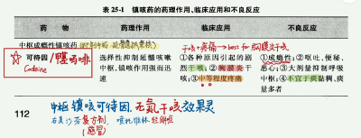
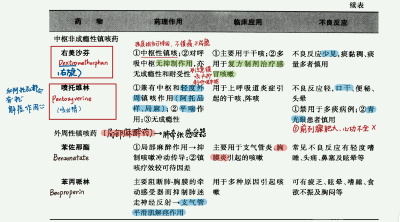
##### <mark style="background-color: #705A16; color: white">作用注意</mark>
可待因成瘾性；
哪些中枢、哪些外周（实质局麻）；
##### 喷托维林、苯丙哌林有解痉作用
##### <mark style="background-color: #705A16; color: white">临床应用注意</mark>
##### 干咳
##### 镇痛-[[可待因]]
##### 复方制剂感冒-右美沙芬
##### 胸膜炎-[[可待因]]、苯丙哌林
##### *补充：咳嗽症状的处理*
##### OTC
##### <mark style="background-color: #1A4F10; color: white">感冒：右美沙芬复方制剂</mark>
刺激性干咳或阵咳——苯丙哌林或喷托维林
剧咳首选苯丙哌林，次选右美沙芬；轻咳：喷托维林
##### 咳嗽发作时间
###### <mark style="background-color: #1A4F10; color: white">白日咳嗽：苯丙哌林（感受器）</mark>
###### <mark style="background-color: #1A4F10; color: white">夜间咳嗽：右美沙芬（延髓、迷走）</mark>
##### 处方药
##### 剧烈无痰咳嗽：[[可待因]]，12岁以下禁用
剧咳伴随大量痰液，有阻塞呼吸道风险：司坦类粘液调节剂(羧甲司坦)或祛痰剂(氨溴索)
应用镇咳药时，应注意及时采用控制感染、对抗过敏原等治疗措施(针对病因)
### 四．祛痰药expectorants
### 作用方式和分类——痰液变稀、易于咳出。
#### 痰液稀释药——增加痰液中水分含量
##### 恶心性祛痰药： 氯化铵
###### 刺激胃黏膜，通过迷走神经反射促进支气管腺体分泌↑
##### 刺激性祛痰药
#### 黏痰溶解药——调节黏液成分
##### 黏痰溶解药： 乙酰半胱氨酸（痰易净）
<mark style="background-color: #3F4B5E; color: white">打断黏痰</mark><mark style="background-color: #705A16; color: white">蛋白</mark><mark style="background-color: #3F4B5E; color: white">的二硫键</mark>；降解脓性痰液中的DNA
##### 黏液调节药： 溴己新
作用于黏多糖：裂解、抑制合成；祛痰（支气管分泌↑）、促进痰液排出
### 氯化铵、 乙酰半胱氨酸、溴己新的作用特点与应用。
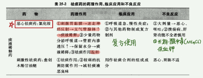
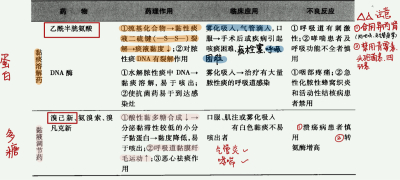
记key feature：氯化铵~酸性刺激；Cys~打断二硫键；溴己新硬背粘多糖
