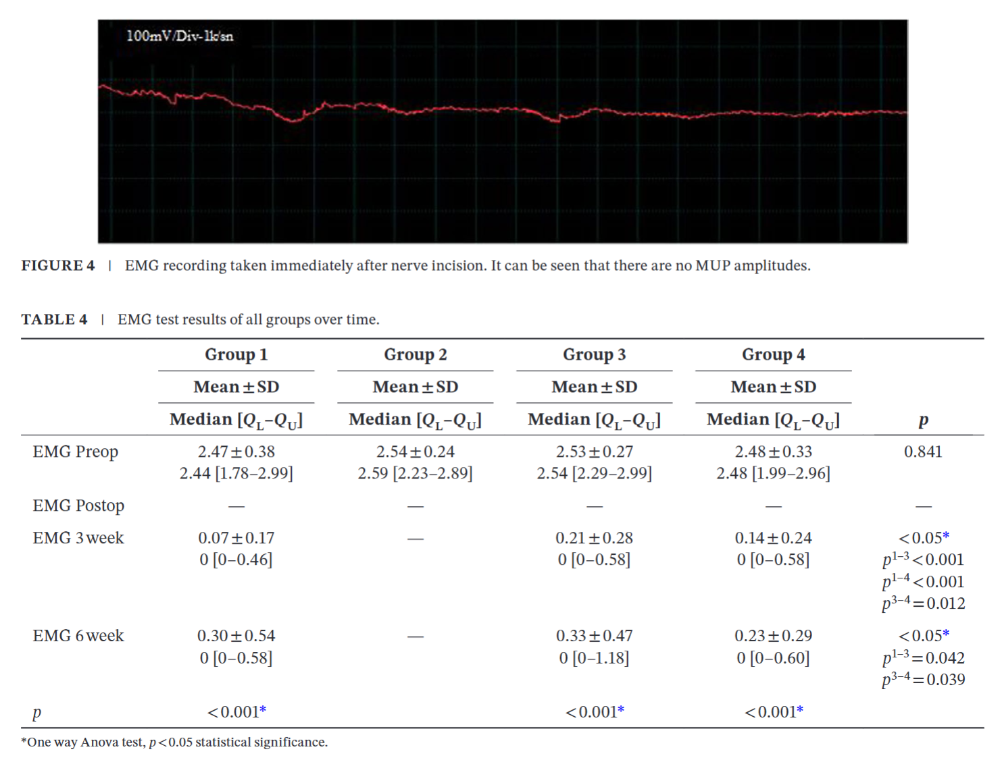
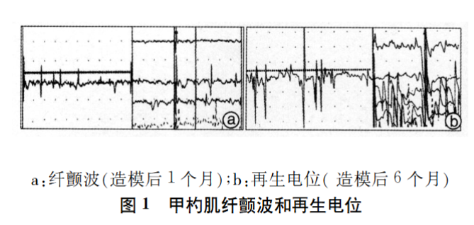

---
tags:
  - Proj
aliases:
  - L-EMG
  - L-Electromyography
---
#### 不同种属
##### 兔子
The electromyogram of RLN was detected using an EMG device (Trigno mobil, Delsys, Inc., MA, USA). The current intensity for stimulation was 0.07 MA. The exciting electrode was put on the position of RLN 4 cm from the throat and the reference electrode was inserted into the subcutaneous tissue in front of the sternum.（[Insights into the Therapeutic Potential of Heparinized Collagen Scaffolds Loading Human Umbilical Cord Mesenchymal Stem Cells and Nerve Growth Factor for the Repair of Recurrent Laryngeal Nerve Injury - PMC](https://pmc.ncbi.nlm.nih.gov/articles/PMC6171598/)）

---
##### 人

---
##### 大鼠
具体方案[^1]
> [!PDF|green] [The Laryngoscope - 2009 - Tessema - Observations of recurrent laryngeal nerve injury and recovery using a rat model, p.1649](The%20Laryngoscope%20-%202009%20-%20Tessema%20-%20Observations%20of%20recurrent%20laryngeal%20nerve%20injury%20and%20recovery%20using%20a%20rat%20model.pdf#page=6&selection=135,9,136,60&color=green)
> > lectromyograph recordings from the posterior cricoarytenoid muscle of rat following injury at different time points
> 
> PCA的肌电图

> [!PDF|purple] [The Laryngoscope - 2026 - Bhatt - Novel Injectable Supports Long‐Term Recurrent Laryngeal Nerve and Partial Peripheral, p.4](The%20Laryngoscope%20-%202026%20-%20Bhatt%20-%20Novel%20Injectable%20Supports%20Long‐Term%20Recurrent%20Laryngeal%20Nerve%20and%20Partial%20Peripheral.pdf#page=4&selection=156,6,165,13&color=purple)
> > paired analysis of right (injured) versus left (uninjured) stimulated RLN EMG demonstrated no significant difference in AUC between sides in the biomolecule group (p = 0.177), indicating restoration of symmetry between the injured and uninjured RLN
> 
> 奇怪了，他的统计方法好奇怪，no significant difference 并不能代表有好转啊，可能只是数据较为分散导致的，而且图里看来确实不能证明什么……
> The figure makes it visually obvious that they are using **“failure to detect asymmetry” as if it were evidence of symmetry**.

> [!PDF|purple] [The Laryngoscope - 2026 - Bhatt - Novel Injectable Supports Long‐Term Recurrent Laryngeal Nerve and Partial Peripheral, p.10](The%20Laryngoscope%20-%202026%20-%20Bhatt%20-%20Novel%20Injectable%20Supports%20Long‐Term%20Recurrent%20Laryngeal%20Nerve%20and%20Partial%20Peripheral.pdf#page=10&selection=6,36,9,14&color=purple)
> > Attempts to obtain posterior cricoarytenoid (PCA) EMG recordings produced mucosal edema/airway compromise so synkinetic reinnervation was not assessed. 

> [!PDF|green] [Evaluation of PRP injection after RLN injury in rats, p.1](Evaluation%20of%20PRP%20injection%20after%20RLN%20injury%20in%20rats.pdf#page=1&selection=154,25,154,110&color=green)
> > Laryngoscopy and electromyography (EMG) were conducted before and after the procedure
> [Open: Pasted image 20261010211910.png](attachments/e0bdac4991939f22ad25cd376838d890_MD5.jpg)

> [!PDF|green] [Placental-Derived Connective Tissue Matrix Mediates Murine RLN regeneration, p.2220](Placental-Derived%20Connective%20Tissue%20Matrix%20Mediates%20Murine%20RLN%20regeneration.pdf#page=1&selection=116,18,120,6&color=green)
> > Outcomes included laryngeal electromyography (L-EMG) and video laryngoscopy after 7 and 28 days, 
> 
> FIGURE 3 | Assessment of neuronal structure and function after 28 days. The box-and-whisker plot (A) shows the mean normalized (right to left) L-EMG area under the curve (AUC) ratios across the normal, saline, and pd- CTM groups.

[The Laryngoscope - 2009 - Shiotani - Modulation of Myosin Heavy Chains in Rat Laryngeal Muscle](The%20Laryngoscope%20-%202009%20-%20Shiotani%20-%20Modulation%20of%20Myosin%20Heavy%20Chains%20in%20Rat%20Laryngeal%20Muscle.pdf)
[Observations of recurrent laryngeal nerve injury and recovery using a rat model - Tessema - 2009 - The Laryngoscope - Wiley Online Library](https://onlinelibrary.wiley.com/doi/10.1002/lary.20293) 

##### 犬
> [!PDF|green] [喉返神经损伤后喉肌病理生理研究_徐文, p.2](喉返神经损伤后喉肌病理生理研究_徐文.pdf#page=2&selection=418,0,457,1&color=green)
> > 挫灭法和半切法造模成功后即刻观察到甲杓肌和环杓后肌存在部分正常 M UP 以及振幅减小的 M UP‚募集减弱；3～6 个月间出现振幅减小、时程增大的 M UP 和纤颤电位‚但与终板电位等较难区分‚募集变化不明显；6～12个月期间可观察到再生电位‚ 这种变化在第12个月时达最大水平‚同时募集增加。
> 
> [Open: Pasted image 20261010224710.png](attachments/e509810a01b23045928e1e8f6a74c7b4_MD5.jpg)

> [!PDF|green] [喉返神经损伤后喉肌病理生理研究_徐文, p.2](喉返神经损伤后喉肌病理生理研究_徐文.pdf#page=2&selection=140,0,183,1&color=green)
> > 应用 Nicolet Vikingquest 肌电图（诱发电位仪）‚采用同心针电极经颈前皮肤进针‚检测甲杓肌和环杓后肌肌电及诱发电位特性。根据进针位置‚阻塞呼吸、疼痛刺激等被动活动及肌肉有无相应肌电反应来定位。主要观察指标包括①常规肌电特征‚包括自发电位特征‚平静呼吸时观察喉肌单个运动单位（motor unit potential‚<mark style="background-color: #1A4F10; color: white">MUP</mark>） 特征‚刺激深呼吸时观察募集电位； ②肌诱发电位（evoked potential‚<mark style="background-color: #1A4F10; color: white">EP</mark>）特征。

---
#### Footnotes
[^1]: **1. 设备与基础参数设置**
	
	- 使用 **Nicolet Viking Quest** 肌电图仪。
	- 参数设置为：**振幅 50 µV**，**扫描速度 10 ms/格**。
	- 记录电极采用 **25号双极同心圆针电极**，**接地夹** 放置在暴露的颈部侧面肌肉上。
	
	**2. 暴露与进针方式（直视下操作）**
	
	- 为了确保针尖精准放置，手术中会**切开皮肤**并**牵开带状肌**，在**直接直视喉部**的情况下进行电极插入。
	- **环杓后肌（PCA）**：采用**后方入路**，轻轻向对侧牵拉喉部后直接定位该肌肉。
	- **甲杓肌（TA）**：首先**经环甲膜**插入电极针，之后为了进一步**确认针尖位置是否正确**（以确保信号最佳），会通过**喉正中裂开**（midline laryngofissure）进行直视下验证。
	
	**3. 信号采集与分级标准**
	
	- **TA 肌**的募集电位在**喉痉挛（laryngospasm）** 期间进行评定。
	- **PCA 肌**的募集电位在**吸气（inspiration）** 期间进行评定。
	- 评定采用 **0–4 级** 的分级量表（引用自 Koufman 等人的文献）。
	
	**4. 神经支配来源的验证操作（关键步骤）**
	
	- 在完成各肌肉的单独测试后，将电极针**留在左侧 TA 肌中**。
	- 使用手术刀**依次离断**支配喉部的神经供应，离断顺序为：**左侧 RLN（喉返神经）→ 左侧 SLN（喉上神经）→ 右侧 RLN → 右侧 SLN**，直至**左侧 TA 肌的肌电活动完全消失（被沉默）**，以此验证该肌肉的神经支配来源。
	见[Neurotrophic Factor-Secreting Autologous Muscle Stem Cell Therapy for the Treatment of Laryngeal Denervation Injury - PMC](https://pmc.ncbi.nlm.nih.gov/articles/PMC3484207/)“Experiments to Address Specific Aim 3”标黄部分
	
	###### 方案2
	将记录电极置于大鼠左侧环杓后肌（PCA） 上，接地电极置于右侧胸大肌。肌电图仪参数设置为扫描速度 10 ms/格、灵敏度 100 mV。分别于术前、术后即刻、术后第3周及第6周四个时间点进行肌电信号记录。
	见[Evaluation of PRP injection after RLN injury in rats](Evaluation%20of%20PRP%20injection%20after%20RLN%20injury%20in%20rats.pdf)
