---
tags:
  - Proj
---
### 概论
#### 1. 现有用于RLN修复的材料
> [!PDF|blueee] [NC-Non-muscle myosin II inhibition at the site of axon injury increases axon regeneration, p.1](NC-Non-muscle%20myosin%20II%20inhibition%20at%20the%20site%20of%20axon%20injury%20increases%20axon%20regeneration.pdf#page=1&selection=89,4,90,57&color=blueee)
> > there are no approved drugs to either induce the regeneration of injured CNS neurons or accelerate regeneration in the PNS
> 
> 无已经上市的神经修复药物

##### 胶原导管
###### 动物实验
> [!PDF|yellow] [TrkA inhibitor promotes motor functional regeneration of recurrent laryngeal nerve by suppression of sensory nerve regeneration, p.1](TrkA%20inhibitor%20promotes%20motor%20functional%20regeneration%20of%20recurrent%20laryngeal%20nerve%20by%20suppression%20of%20sensory%20nerve%20regeneration.pdf#page=1&selection=90,21,91,102&color=yellow)
> > RLN axotomy rat models were used in this study, in which cut ends of the nerve were bridged with polyglycolic acid-collagen tube with and without TrkA inhibitor (TrkAi) infiltration
###### 临床验证
RENERVE® [The Laryngoscope - 2023 - Watanabe - Artificial Nerve Conduit for Recurrent Laryngeal Nerve Reconstruction in Thyroid](The%20Laryngoscope%20-%202023%20-%20Watanabe%20-%20Artificial%20Nerve%20Conduit%20for%20Recurrent%20Laryngeal%20Nerve%20Reconstruction%20in%20Thyroid.pdf)
1, 3, and 12 months
> [!PDF|green] [The Laryngoscope - 2023 - Watanabe - Artificial Nerve Conduit for Recurrent Laryngeal Nerve Reconstruction in Thyroid, p.1773](The%20Laryngoscope%20-%202023%20-%20Watanabe%20-%20Artificial%20Nerve%20Conduit%20for%20Recurrent%20Laryngeal%20Nerve%20Reconstruction%20in%20Thyroid.pdf#page=1&selection=195,7,205,31&color=green)
> > Here, we report our retrospective study findings on the feasibility, safety, and efficacy of a collagen conduit with collagen filaments for RLN reconstruction.

> [!PDF|rouge] [The Laryngoscope - 2023 - Watanabe - Artificial Nerve Conduit for Recurrent Laryngeal Nerve Reconstruction in Thyroid, p.1774](The%20Laryngoscope%20-%202023%20-%20Watanabe%20-%20Artificial%20Nerve%20Conduit%20for%20Recurrent%20Laryngeal%20Nerve%20Reconstruction%20in%20Thyroid.pdf#page=2&selection=107,0,107,16&color=rouge)
> > Conduit Suturing

Case [The Laryngoscope - 2009 - Mattsson - Nimodipine and Microsurgery Induced Recovery of the Vocal Cord after Recurrent](The%20Laryngoscope%20-%202009%20-%20Mattsson%20-%20Nimodipine%20and%20Microsurgery%20Induced%20Recovery%20of%20the%20Vocal%20Cord%20after%20Recurrent.pdf)

Review of aetiology [Complications after reoperative thyroid surgery retrospective evaluation of 152 consecutive cases](Complications%20after%20reoperative%20thyroid%20surgery%20retrospective%20evaluation%20of%20152%20consecutive%20cases.pdf)

#### 2.参考：
##### [喉返神经](喉返神经.md)
> [!PDF|yellow] [Electrical stimulation and testosterone enhance recovery from recurrent laryngeal nerve crush, p.573](Electrical%20stimulation%20and%20testosterone%20enhance%20recovery%20from%20recurrent%20laryngeal%20nerve%20crush.pdf#page=3&selection=17,46,24,14&color=yellow)
> > It is additionally important to note that the RLN is similar to the facial nerve in that both cranial nerve nuclei from which the two nerves arise are abundant in androgen receptors (the nucleus ambiguus and the facial motor nucleus, respectively) (Perez & Kelley, 1996; Yu & McGinnis, 2001) and thus may be similarly sensitive to androgen treatment.

> [!PDF|green] [Electrical stimulation and testosterone enhance recovery from recurrent laryngeal nerve crush, p.573](Electrical%20stimulation%20and%20testosterone%20enhance%20recovery%20from%20recurrent%20laryngeal%20nerve%20crush.pdf#page=3&selection=29,0,31,37&color=green)
> > It has been previously demonstrated that the natural timecourse for recovery from an RLN crush injury is <mark style="background-color: #1A4F10; color: white">up to 6 weeks</mark> (Tessema et al., 2009).
> 
> 这个自然修复时间怎么还有点争议的样子……力度不一样吧，不能说up to
##### [神经导管](神经导管.md)
> [!PDF|yellow] [Co-transplantation of Schwann cells and neural stem cells in the laminin-chitosan-PLGA nerve conduit to repair the injured recurrent laryngeal nerve in SD rats, p.2](Co-transplantation%20of%20Schwann%20cells%20and%20neural%20stem%20cells%20in%20the%20laminin-chitosan-PLGA%20nerve%20conduit%20to%20repair%20the%20injured%20recurrent%20laryngeal%20nerve%20in%20SD%20rats.pdf#page=2&selection=0,38,11,36&color=yellow)
> > a novel technique of co-culturing neural stem cells (NSCs) and Schwann cells (SCs) in a laminin-chitosan-poly-lactic-co-glycolic acid (laminin-chitosan-PLGA) nerve condui
###### [[干细胞修复]]
##### 电刺激
类似于起搏器，永久性，随呼吸刺激甲杓肌，并保证不干扰吞咽反射：
> [!PDF|green] [REHABILITATION OF BILATERALLY PARALYZED CANINE LARYNX WITH IMPLANTABLE STIMULATOR, p.1](REHABILITATION%20OF%20BILATERALLY%20PARALYZED%20CANINE%20LARYNX%20WITH%20IMPLANTABLE%20STIMULATOR.pdf#page=1&selection=60,0,61,47&color=green)
> > A Genesis XP stimulator and electrodes were surgically implanted and the recurrent laryngeal nerves sectioned/repaired bilaterally
> 
> [Open: Pasted image 20261011171502.png](attachments/c7414486d26454ba2e0d883ad91fa001_MD5.jpg)
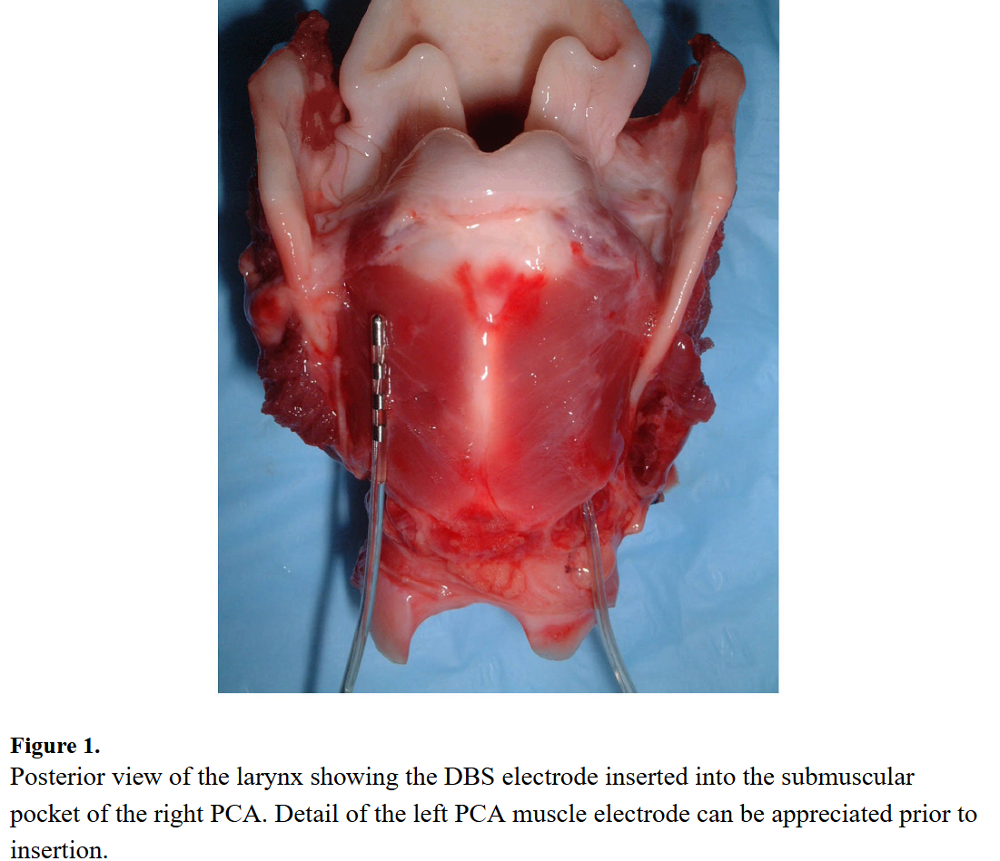

> [!PDF|yellow] [Electrical stimulation and testosterone enhance recovery from recurrent laryngeal nerve crush, p.572](Electrical%20stimulation%20and%20testosterone%20enhance%20recovery%20from%20recurrent%20laryngeal%20nerve%20crush.pdf#page=2&selection=22,21,28,36&color=yellow)
> > Previous work has demonstrated that a combination treatment consisting of brief electrical stimulation (ES) and supraphysiologic levels of testosterone, a gonadal steroid, improves functional recovery from both extratemporal and intratemporal facial nerve injury in rats (Lal et al., 2008, Hetzler et al., 2008; Sharma et al., 2010b).
> 
> 电刺激治疗

> [!PDF|green] [Electrical stimulation and testosterone enhance recovery from recurrent laryngeal nerve crush, p.572](Electrical%20stimulation%20and%20testosterone%20enhance%20recovery%20from%20recurrent%20laryngeal%20nerve%20crush.pdf#page=2&selection=36,37,44,15&color=green)
> > A summary of ES-mediated neuronal effects includes <mark style="background-color: #3F4B5E; color: white">neuronal excitation</mark>,<mark style="background-color: #3F4B5E; color: white"> upregulation of regeneration-associated gene expression,</mark> <mark style="background-color: #3F4B5E; color: white">promoting neurite growth after injury,</mark> <mark style="background-color: #3F4B5E; color: white">improving selective targeting of regenerating axons</mark>, <mark style="background-color: #3F4B5E; color: white">providing alignment and polarity instructions to myelinating Schwann cells</mark>, and <mark style="background-color: #3F4B5E; color: white">enhancing the functional recovery of target organs</mark> (Gordon et al., 2008; Wan et al., 2010). 

> [!PDF|green] [Electrical stimulation and testosterone enhance recovery from recurrent laryngeal nerve crush, p.572](Electrical%20stimulation%20and%20testosterone%20enhance%20recovery%20from%20recurrent%20laryngeal%20nerve%20crush.pdf#page=2&selection=56,17,89,6&color=green)
> > <mark style="background-color: #1A4F10; color: white">End-organ stimulation</mark> has been clinically useful because it is a substitute for the usual neuronal input and has the effect of attenuating the extent of denervation atrophy while the injured axons are regenerating; however, it <mark style="background-color: #3F4B5E; color: white">does not stimulate axonal regrowth itself</mark> (Williams, 1996).<mark style="background-color: #1A4F10; color: white"> Stimulation to the injured nerv</mark>e sends impulses orthodromically along the myelin sheath as well as antidromically toward the cell body to augment the internal distress signals carried by reverse axonal transport <mark style="background-color: #3F4B5E; color: white">that increase expression of regeneration-associated genes</mark> such as growth-associated protein-43 (GAP-43; present at the tips of growth cones), 1 -tubulin (a structural protein within axons), brain-derived neurotrophic factor (BDNF), neuritin (enhances neurite extention in vitro), and pituitary adenylate cyclase-activating peptide (PACAP) (Sharma et al., 2010b; Wenjin et al., 2011).

> [!PDF|blueee] [Electrical stimulation and testosterone enhance recovery from recurrent laryngeal nerve crush, p.572](Electrical%20stimulation%20and%20testosterone%20enhance%20recovery%20from%20recurrent%20laryngeal%20nerve%20crush.pdf#page=2&selection=113,0,119,50&color=blueee)
> > ES treatment affects “early” events during regenerations: it reduces the initial delay before sprout formation begins and leads to rapid but short-term upregulation of regeneration-associated genes which in turn improves functional recovery (Sharma et al., 2009; 2010b). Thus, the positive effects of ES on recovery have often been observed soon after treatment.

> [!PDF|blueee] [Electrical stimulation and testosterone enhance recovery from recurrent laryngeal nerve crush, p.574](Electrical%20stimulation%20and%20testosterone%20enhance%20recovery%20from%20recurrent%20laryngeal%20nerve%20crush.pdf#page=4&selection=10,4,12,25&color=blueee)
> > stimulated for 10 sec before axotomy in order to determine the minimum voltage threshold for evoking a vocal fold response
>
> > Immediately after axotomy, the RLN was stimulated proximal to the crush injury site at a frequency of 20 Hz for 30 min.
> 
> > After the stimulation period, the electrodes were removed and wound sites were closed as described above.

> [!PDF|yellow] [Electrical stimulation and testosterone enhance recovery from recurrent laryngeal nerve crush, p.576](Electrical%20stimulation%20and%20testosterone%20enhance%20recovery%20from%20recurrent%20laryngeal%20nerve%20crush.pdf#page=6&selection=23,19,36,29&color=yellow)
> > The facial nerve is completely motor once it exits the facial canal and experimentally is usually injured distal to this point. In contrast, both motor and sensory fibers of the RLN travel with the vagus nerve for some distance prior to branching off at the level of the aortic arch on the left and the subclavian artery on the right, finally terminating in the larynx. The polyvagal theory has suggested that the myelinated and unmyelinated portions of the nerve serve different functions for neurogenic control of the heart (Porges, 2009). Since the heart is extremely sensitive to electrical activity, the vagal neurons and fibers that eventually compose the RLN may be more responsive to electrical stimulation as a therapy.

> [!PDF|green] [Subcutaneous Ports for Chronic Nerve Cuff and Intramuscular Electrode Stimulation in Animal Models, p.821](Subcutaneous%20Ports%20for%20Chronic%20Nerve%20Cuff%20and%20Intramuscular%20Electrode%20Stimulation%20in%20Animal%20Models.pdf#page=1&selection=130,0,132,51&color=green)
> > Custom ECPs are easily fabricated and cause little tissue reaction over months to years of subcutaneous implantation, facilitating long-term physiologic studies.
> 
> 皮下埋植ECP（electrical connection ports）<mark style="background-color: #1A4F10; color: white">记录</mark>了RLN修复过程中的电信号数据，犬

##### [压电材料](压电材料.md)
> [!PDF|yellow] [Jov-the evolution of laryngeal reinnervation, the current state of science and thoughts for future treatments, p.793](Jov-the%20evolution%20of%20laryngeal%20reinnervation,%20the%20current%20state%20of%20science%20and%20thoughts%20for%20future%20treatments.pdf#page=1&selection=17,72,18,101&color=yellow)
> > reviews the evolution of<mark style="background-color: #1A4F10; color: white"> laryngeal reinnervation</mark>, reviews the current state of the science, and suggests directions in which it might move in the future.
> 
> 2014年综述；Current surgical interventions<mark style="background-color: #1A4F10; color: white"> primarily improve glottic closure</mark> rather than re-establishing physiologic neuromuscular junction (NMJ) architecture.

> [!puzzle] **Is it possible without ultrasound?**
> Can the radial expansion of the trachea generate sufficient compressive stress on the x–y face of the composite to produce a measurable z-direction piezoelectric potential?
> 
> https://pmc.ncbi.nlm.nih.gov/articles/PMC11175597/?utm_source=chatgpt.com
> https://pmc.ncbi.nlm.nih.gov/articles/PMC5148015/?utm_source=chatgpt.com
> https://pmc.ncbi.nlm.nih.gov/articles/PMC8440427/?utm_source=chatgpt.com

- [Otolaryngol --head neck surg - 2018 - Philips - Multi‐institutional Evaluation of Medialization Laryngoplasty in the](Otolaryngol%20--head%20neck%20surg%20-%202018%20-%20Philips%20-%20Multi‐institutional%20Evaluation%20of%20Medialization%20Laryngoplasty%20in%20the.pdf)
- [The Laryngoscope - 2009 - Tessema - Observations of recurrent laryngeal nerve injury and recovery using a rat model](The%20Laryngoscope%20-%202009%20-%20Tessema%20-%20Observations%20of%20recurrent%20laryngeal%20nerve%20injury%20and%20recovery%20using%20a%20rat%20model.pdf)
##### 声带麻痹
- [Vocal Fold Paresis](Vocal%20Fold%20Paresis.pdf)文献
> [!PDF|yellow] [The Laryngoscope - 2009 - Sanuki - Expression of Fibroblast Growth Factor‐2 in the Nucleus Ambiguus Following Recurrent, p.1](The%20Laryngoscope%20-%202009%20-%20Sanuki%20-%20Expression%20of%20Fibroblast%20Growth%20Factor‐2%20in%20the%20Nucleus%20Ambiguus%20Following%20Recurrent.pdf#page=1&selection=107,18,107,54&color=yellow)
> > breathy dysphonia or mild aspiration
> 

有研究只针对功能修复，注射入[甲杓肌](甲杓肌.md)——
> [!PDF|green] [The Laryngoscope - 2026 - Bhatt - Novel Injectable Supports Long‐Term Recurrent Laryngeal Nerve and Partial Peripheral, p.1](The%20Laryngoscope%20-%202026%20-%20Bhatt%20-%20Novel%20Injectable%20Supports%20Long‐Term%20Recurrent%20Laryngeal%20Nerve%20and%20Partial%20Peripheral.pdf#page=1&selection=123,59,139,4&color=green)
> > saline (N = 5), biomolecule (Agrin, NRG1, ACh) (N = 5), and uninjured controls (N = 5). 
> 
> 即[supinfo-Novel Injectable Supports Long-Term Recurrent Laryngeal Nerve and Partial Peripheral Nerve Repair](supinfo-Novel%20Injectable%20Supports%20Long-Term%20Recurrent%20Laryngeal%20Nerve%20and%20Partial%20Peripheral%20Nerve%20Repair.docx)

注射Autologous muscle progenitor (stem) cells [Enhanced Abductor Function in Bilateral Vocal Fold Paralysis with Muscle Stem Cells - Paniello - 2024 - The Laryngoscope - Wiley Online Library](https://onlinelibrary.wiley.com/doi/10.1002/lary.30885)

口服激素 oral corticosteroids do not enhance vocal cord remobilization or improve voice quality in patients with postoperative unilateral VFP. 
[Open: Pasted image 20261012093103.png](attachments/712d91384f1ff00a59b7d07f35e54bc2_MD5.jpg)
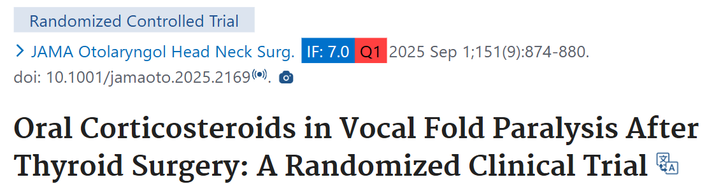

> [!PDF|yellow] [RLN修复 间质干细胞 NRR, p.1](RLN修复%20间质干细胞%20NRR.pdf#page=1&selection=118,6,127,4&color=yellow)
> > Medialization thyroplasty first described by Isshiki et al. (1974) and injection laryngoplasty first introduced by Bruening (1911) have been the major treatments for unilateral vocal fold paralysis but do not restore mobility of the vocal fold

> [!PDF|yellow] [Evaluation of Autologous Fascia Implantation With Controlled Release of Fibroblast Growth Factor for Recurrent Laryngeal Nerve Paralysis Due to Long-term Denervation, p.1](Evaluation%20of%20Autologous%20Fascia%20Implantation%20With%20Controlled%20Release%20of%20Fibroblast%20Growth%20Factor%20for%20Recurrent%20Laryngeal%20Nerve%20Paralysis%20Due%20to%20Long-term%20Denervation.pdf#page=1&selection=93,0,94,48&color=yellow)
> > transplantation of <mark style="background-color: #705A16; color: white">fascia</mark> into the vocal fold (ATFV) with controlled release of basic fibroblast growth factor (<mark style="background-color: #705A16; color: white">bFGF)</mark> on long-term unilateral vocal fold paralysis (UVFP)

##### 神经吻合与自体移植
> [!PDF|green] [Otolaryngol --head neck surg - 2016 - Myers - An experimental comparison of different kinds of laryngeal muscle, p.1](Otolaryngol%20--head%20neck%20surg%20-%202016%20-%20Myers%20-%20An%20experimental%20comparison%20of%20different%20kinds%20of%20laryngeal%20muscle.pdf#page=1&selection=12,0,24,23&color=green)
> > comparing nerve suture, nerve implantation, and nerve-muscular pedicle (NMP) transfer,

> [!PDF|yellow] [neurorrhaphy-of-the-recurrent-laryngeal-nerve, p.1](neurorrhaphy-of-the-recurrent-laryngeal-nerve.pdf#page=1&selection=53,0,55,28&color=yellow)
> > Neurorrhaphy of the recurrent laryngeal nerve is a simple and effective procedure to improve voice quality, aspiration, GRBAS scales, glottal gap, and maximum phonation time by preventing atrophy of the vocal cor
> 
> <mark style="background-color: #705A16; color: white">神经吻合术</mark>

> [!PDF|yellow] [颈襻前根修复单侧喉返神经损伤的疗效分析, p.1](颈襻前根修复单侧喉返神经损伤的疗效分析.pdf#page=1&selection=2055,0,2060,1&color=yellow)
> > 颈袢前根喉返神经吻合术
> 
> 同团队同方法6年后发表[颈袢前根-喉返神经吻合术治疗单侧声带麻痹的疗效分析](颈袢前根-喉返神经吻合术治疗单侧声带麻痹的疗效分析.pdf)

> [!PDF|green] [Endoscopic Robot-assisted, p.203](Endoscopic%20Robot-assisted.pdf#page=1&selection=91,0,92,49&color=green)
> > Pediatric patients undergoing evaluation for hoarseness in our Pediatric Voice Clinic were screened for UVFP

> [!PDF|green] [单侧喉返神经切断后甲杓肌结构与酶学变化的实验性研究_何双八, p.12](单侧喉返神经切断后甲杓肌结构与酶学变化的实验性研究_何双八.pdf#page=12&selection=598,0,716,1&color=green)
> > G o r d o n 和 M e C a b e (1 9 6 8 ) [’]将 2 只犬的喉返神经完全切断‚ 然后尽量按断前神经位置行端端吻合 ‚ 另外 4 只犬则将切断的喉返神经旋转 180 度后作端端吻合 ‚ 结果所有犬仅恢复了声带内收功能 

曾进. 在喉返神经损伤的动物模型上应用舌下神经进行修复手术的效果评估[J]. 中华耳鼻咽喉头颈外科杂志,2015,0(9):782.

##### 脑干疑核（NA）
> [!puzzle] **Attention!!!**
> 喉返神经（RLN）损伤后，其神经元胞体的核定位主要在同侧的疑核（Nucleus Ambiguus, NA）

> [!PDF|green] [TrkA inhibitor promotes motor functional regeneration of recurrent laryngeal nerve by suppression of sensory nerve regeneration, p.10](TrkA%20inhibitor%20promotes%20motor%20functional%20regeneration%20of%20recurrent%20laryngeal%20nerve%20by%20suppression%20of%20sensory%20nerve%20regeneration.pdf#page=10&selection=110,0,110,44&color=green)
> > <mark style="background-color: #1A4F10; color: white">Retrograde labeling</mark> in the nucleus ambiguus.
> 
> 逆行示踪

> [!PDF|green] [Polysialylated Neural Cell Adhesion Molecule Supports Regeneration of Neurons in the Nucleus Ambiguus After Unilateral Recurrent Laryngeal Nerve Avulsion in Adult Rats, p.52](Polysialylated%20Neural%20Cell%20Adhesion%20Molecule%20Supports%20Regeneration%20of%20Neurons%20in%20the%20Nucleus%20Ambiguus%20After%20Unilateral%20Recurrent%20Laryngeal%20Nerve%20Avulsion%20in%20Adult%20Rats.pdf#page=1&selection=16,82,17,104&color=green)
> >  evaluate the expression of PSANCAM in the ipsilateral nucleus ambiguus (NA) after unilateral recurrent laryngeal nerve (RLN) avulsion.
> 
> NA中神经元胞体的分子标记物（PSA-NCAM）表达变化（术后 6小时、12小时、1天、3天、7天、14天、28天）

> [!PDF|green] [The Laryngoscope - 2009 - Sanuki - Expression of Fibroblast Growth Factor‐2 in the Nucleus Ambiguus Following Recurrent, p.2](The%20Laryngoscope%20-%202009%20-%20Sanuki%20-%20Expression%20of%20Fibroblast%20Growth%20Factor‐2%20in%20the%20Nucleus%20Ambiguus%20Following%20Recurrent.pdf#page=2&selection=35,43,37,53&color=green)
> >  FGF-2 in the NA was detected immunohistochemically and assessed quantitatively 1, 3, 7, 14, and 28 days after injury.

> [!PDF|blueee] [The Laryngoscope - 2009 - Sanuki - Expression of Fibroblast Growth Factor‐2 in the Nucleus Ambiguus Following Recurrent, p.2](The%20Laryngoscope%20-%202009%20-%20Sanuki%20-%20Expression%20of%20Fibroblast%20Growth%20Factor‐2%20in%20the%20Nucleus%20Ambiguus%20Following%20Recurrent.pdf#page=2&selection=127,50,135,49&color=blueee)
> > he animals were anesthetized in the same manner as described above and then perfused transcardially with 4% paraformaldehyde in 0.1 mol/L phosphate buffer (pH 7.4). After confirming cardiac arrest, the brainstem was immediately harvested from each rat and postfixed for 5 minutes in the same fixative. The specimens were transferred to 0.1 mol/L phosphate buffer (pH 7.4) containing 20% sucrose overnight at room temperature. The medulla oblongata including the NA, which innervates the RLN, 
> 
> 取材操作

> [!PDF|green] [Adenoviral GDNF gene transfer enhances neurofunctional recovery after recurrent laryngeal nerve injury, p.1](Adenoviral%20GDNF%20gene%20transfer%20enhances%20neurofunctional%20recovery%20after%20recurrent%20laryngeal%20nerve%20injury.pdf#page=1&selection=57,28,78,5&color=green)
> > eurons in the nucleus ambiguus on the crushed side were labeled with X-gal or GDNF immnohistochemistry after AxCALacZ or AxCAhGDNF injection.
###### NA神经元培养
- [ ] https://www.sciencedirect.com/science/article/abs/pii/S0165027016301686?via%3Dihub

---
### 技术路线
[Open: Pasted image 20260902145628.png](attachments/13a4a0b1c7ebb2787efd99b18a736c44_MD5.jpg)
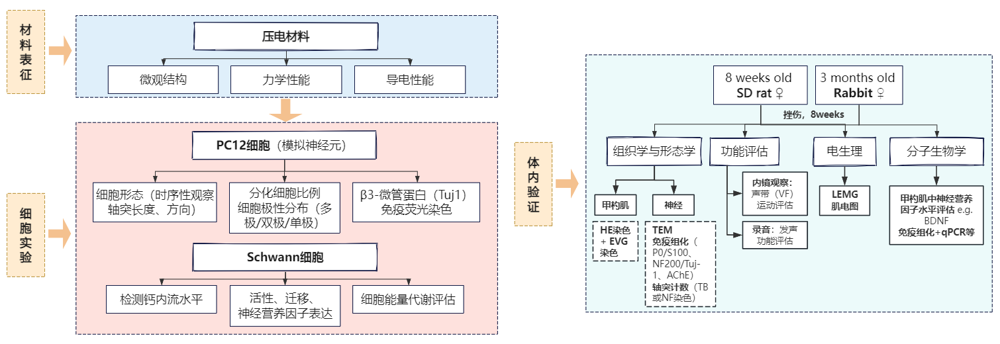

---
#### 细胞指标
##### PC12细胞
[PC12-压电](PC12-压电.pdf)
##### 原代神经元提取
> [!PDF|blueee] [Co-transplantation of Schwann cells and neural stem cells in the laminin-chitosan-PLGA nerve conduit to repair the injured recurrent laryngeal nerve in SD rats, p.2](Co-transplantation%20of%20Schwann%20cells%20and%20neural%20stem%20cells%20in%20the%20laminin-chitosan-PLGA%20nerve%20conduit%20to%20repair%20the%20injured%20recurrent%20laryngeal%20nerve%20in%20SD%20rats.pdf#page=2&selection=138,42,140,47&color=blueee)
> > he cerebral hemispheres were split and stripped of obvious vasculature, and the hippocampal tissue was isolated

##### 正常轴突再生速度
> [!PDF|green] [NC-Non-muscle myosin II inhibition at the site of axon injury increases axon regeneration, p.1](NC-Non-muscle%20myosin%20II%20inhibition%20at%20the%20site%20of%20axon%20injury%20increases%20axon%20regeneration.pdf#page=1&selection=95,2,105,1&color=green)
> > After a traumatic nerve injury, mature motor neurons only regenerate at a rate of 1–4 mm per day, the slowness of which results in only ~ 45% of injured axons achieving anatomical reinnervation of their muscle targets with, in consequence, limited functional recovery1–7 .

##### Schwann细胞
Transwell 迁移实验

---
#### 体内指标：
voice function, such as extended maximum phonation time最长发声时间 and better<mark style="background-color: #1A4F10; color: white"> GRBAS scores</mark>
GRBAS分别代表了五个不同的评估维度：G（Grade，总嘶哑度）、R（Roughness，粗糙声）、B（Breathiness，气息声）、A（Asthenia，无力声）和S（Strain，紧张声）。
##### 组织学形态学评估
###### H&E染色
评估[[甲杓肌]]（thyroarytenoid muscle）的病理改变，包括单肌纤维直径（SMFD） 和肌纤维面积比（MFAR）。
###### TEM（透射电镜）
评估RLN及神经肌肉接头的再生情况，包括髓鞘形态、有髓轴突密度（DMA/MAD） 、N-ratio（有髓轴突面积占神经干总面积之比）等。
[[RLN-TEM]]
###### IF/IHC
标记施万细胞、轴突、神经肌肉接头等
> [!PDF|green] [Characteristics of Nerve Injury, Regeneration, and Vocal Fold Movement After Recurrent Laryngeal Nerve Electrocautery Injury, p.3](Characteristics%20of%20Nerve%20Injury,%20Regeneration,%20and%20Vocal%20Fold%20Movement%20After%20Recurrent%20Laryngeal%20Nerve%20Electrocautery%20Injury.pdf#page=3&selection=158,38,160,27&color=green)
> > s. IF images of NMJs in the TA muscle (middle two rows) are displayed, with the fourth row showing a close-up of the region marked by the white arrow in the third row. NMJs are marked as normal (blue arrows), injured (red arrows), or regenerated (orange arrows)
> [Open: Pasted image 20261010204448.png](attachments/412278f66f56f8be74d1406e065793b1_MD5.jpg)
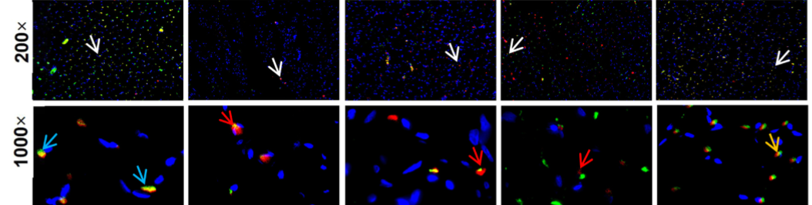

胎盘源性结缔组织基质（pd-CTM）治疗后28天，免疫组化检测到有神经支配的神经肌肉接头
[Placental-Derived Connective Tissue Matrix Mediates Murine RLN regeneration](Placental-Derived%20Connective%20Tissue%20Matrix%20Mediates%20Murine%20RLN%20regeneration.pdf)

> [!PDF|rouge] [The Laryngoscope - 2014 - Hernandez‐Morato - Differential expression of glial‐derived neurotrophic factor in rat laryngeal, p.2754](The%20Laryngoscope%20-%202014%20-%20Hernandez‐Morato%20-%20Differential%20expression%20of%20glial‐derived%20neurotrophic%20factor%20in%20rat%20laryngeal.pdf#page=5&selection=172,8,172,42&color=rouge)
> > GDNF labeling of laryngeal muscles
> 
> 不止[甲杓肌](甲杓肌.md)（MTA/LTA），还有环杓后肌PCA
> [Open: Pasted image 20261019112857.png](attachments/092c81a39915336649fd4bec82a327e1_MD5.jpg)
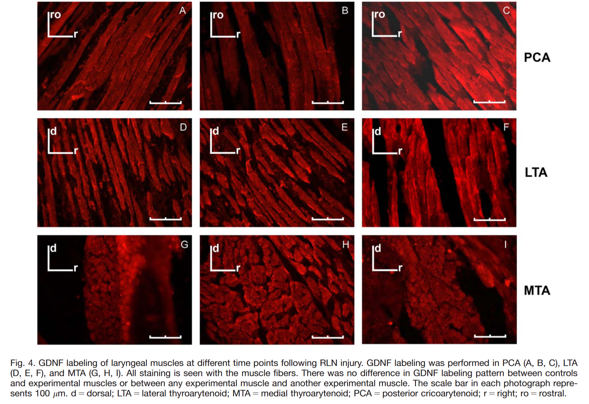

###### 轴突计数
评估受损神经中轴突数量的恢复

> [!PDF|green] [Co-transplantation of Schwann cells and neural stem cells in the laminin-chitosan-PLGA nerve conduit to repair the injured recurrent laryngeal nerve in SD rats, p.6](Co-transplantation%20of%20Schwann%20cells%20and%20neural%20stem%20cells%20in%20the%20laminin-chitosan-PLGA%20nerve%20conduit%20to%20repair%20the%20injured%20recurrent%20laryngeal%20nerve%20in%20SD%20rats.pdf#page=6&selection=79,34,83,25&color=green)
> > we observed a large number of regenerated nerve fibres and a thicker myelin

> [!PDF|green] [RLN修复 间质干细胞 NRR, p.4](RLN修复%20间质干细胞%20NRR.pdf#page=4&selection=11,103,11,124&color=green)
> > luidine blue staining
> [Open: Pasted image 20261010203616.png](attachments/5acc173a109decb463b7a5ab7879f4dd_MD5.jpg)
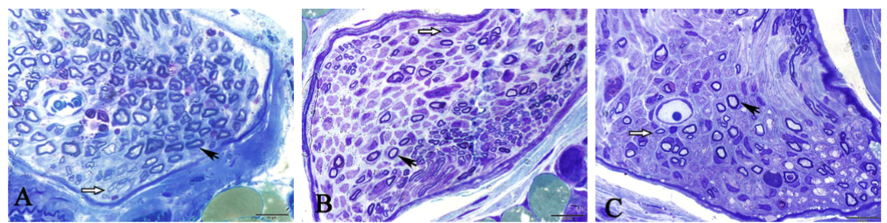

> [!PDF|blueee] [RLN修复 间质干细胞 NRR, p.5](RLN修复%20间质干细胞%20NRR.pdf#page=5&selection=21,37,27,14&color=blueee)
> > Semi-thin transverse sections (1 μm) were cut, stained with 1% toluidine blue solution and examined under a light microscope (Olympus, Tokyo, Japan).
> 
> 用的锇酸

##### 功能学评估
###### 声带运动评估（喉镜）
通过<mark style="background-color: #1A4F10; color: white">喉镜（laryngoscopy）</mark> 观察[[声带运动]]范围（MMR）和运动速度（MMS），是RLN修复的核心功能指标
###### 发声功能评估
评估动物的发声（vocalization） 能力恢复情况
> [!PDF|green] [大鼠喉返神经挤压伤后喉肌及神经变化的初步研究, p.2](大鼠喉返神经挤压伤后喉肌及神经变化的初步研究.pdf#page=2&selection=626,0,679,1&color=green)
> > 对照组大鼠声音清脆、尖锐，G0。实验组术后 1 d 发声嘶哑、无力，G3；术后 4 周声音嘶哑较前有好转， G2；术后 8 周有较大改善，声音略低沉，G1；术后 12 周声音比较尖锐，主观评估与对照组无差异，G0。
###### 喉内收肌压力（LAP）
评估喉内收肌的收缩力恢复情况
[Comparison of Conventional, Revascularized, and Bioengineered Methods of Recurrent Laryngeal Nerve Reconstruction | Surgery | JAMA Otolaryngology–Head & Neck Surgery | JAMA Network](https://jamanetwork.com/journals/jamaotolaryngology/fullarticle/2520694)
[Open: Pasted image 20261010215126.png](attachments/57086200671c501d492c207a0a2e30df_MD5.jpg)
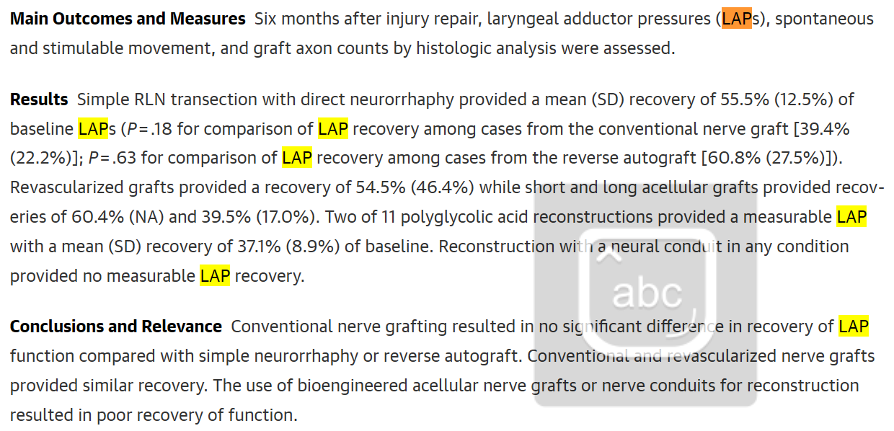
###### AUC
> [!PDF|yellow] [The Laryngoscope - 2026 - Bhatt - Novel Injectable Supports Long‐Term Recurrent Laryngeal Nerve and Partial Peripheral, p.4](The%20Laryngoscope%20-%202026%20-%20Bhatt%20-%20Novel%20Injectable%20Supports%20Long‐Term%20Recurrent%20Laryngeal%20Nerve%20and%20Partial%20Peripheral.pdf#page=4&selection=213,0,213,29&color=yellow)
> > quantitative AUC differences 
###### 吞咽功能
> [!PDF|green] [A Surgical Mouse Model for Advancing Laryngeal Nerve Regeneration Strategies, p.25](A%20Surgical%20Mouse%20Model%20for%20Advancing%20Laryngeal%20Nerve%20Regeneration%20Strategies.pdf#page=25&selection=23,1,30,12&color=green)
> > c, d Representative X-ray images from a 30 fps video of a mouse drinking in lateral view
> 
> [Open: Pasted image 20261011173348.png](attachments/2a66166ed9dad0e773e88591086b8dfd_MD5.jpg)
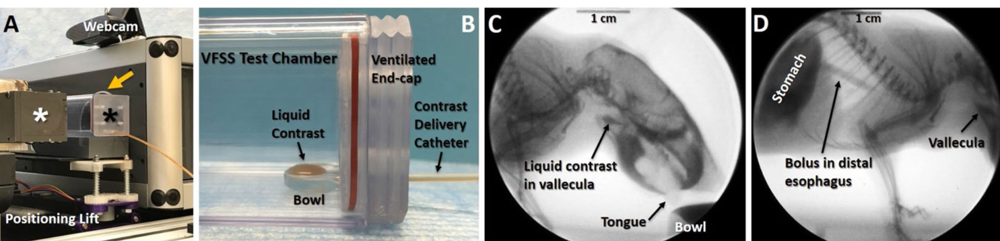

##### 电生理学评估
###### [[喉肌电图]]
EMG是评估RLN再生的核心电生理指标
可检测纤颤电位（FPs）、正锐波（PSWs） 及诱发电位等
###### 诱发电位
通过刺激神经，记录诱发电位波幅和潜伏期变化
> [!PDF|green] [喉返神经损伤后喉肌病理生理研究_徐文, p.2](喉返神经损伤后喉肌病理生理研究_徐文.pdf#page=2&selection=499,0,499,6&color=green)
> > 诱发电位分析

诱发电位测试能揭示麻痹喉神经的再神经支配状态，甚至早于普通EMG
[Open: Pasted image 20261010213053.png](attachments/5c0890211eae20a0c0a256e6af673a41_MD5.jpg)
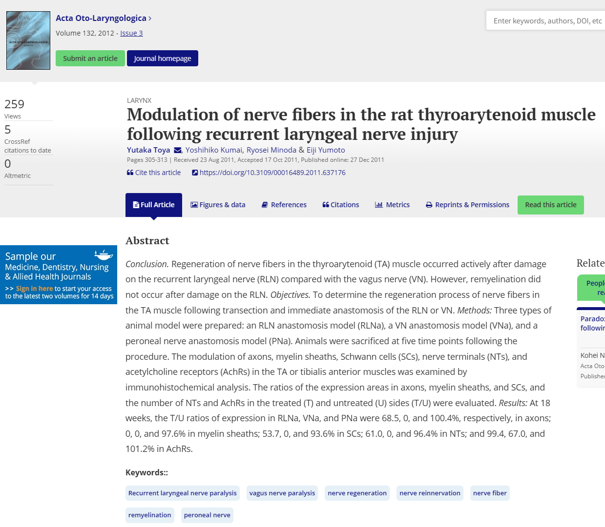
##### 分子生物学评估
[喉返神经修复分子生物学](喉返神经修复分子生物学.md)
###### 组学
——[甲杓肌](甲杓肌.md)相关
> [!PDF|yellow] [Multi-omics technologies Novel tools and methods for assessing nerve injury and regeneration, p.1](Multi-omics%20technologies%20Novel%20tools%20and%20methods%20for%20assessing%20nerve%20injury%20and%20regeneration.pdf#page=1&selection=103,160,109,106&color=yellow)
> > Single-cell multiomics technologies resolve cellular heterogeneity, revealing the distinct functions of <mark style="background-color: #1A4F10; color: white">neurons</mark>, <mark style="background-color: #1A4F10; color: white">glial cells</mark>, and<mark style="background-color: #1A4F10; color: white"> immune cell </mark>subpopulations during the injury response. Spatially resolved transcriptomics maintain the spatial context of lesion and regeneration sites, enabling precise localization for targeted interventions. Multi-omics technologies not only identify key molecular players involved in nerve regeneration but also create opportunities for personalized medicine. 
> 
> 关于周围神经修复的组学应用

> [!PDF|green] [Larynx proteomics after jellyfish collagen IL Increased ECM collagen and suppressed inflammation, p.1516](Larynx%20proteomics%20after%20jellyfish%20collagen%20IL%20Increased%20ECM%20collagen%20and%20suppressed%20inflammation.pdf#page=4&selection=25,0,25,78&color=green)
> > Principal up- and downregulated cellular processes in the VF proteome after IL
> 
> 2022年声带注射胶原治疗的蛋白组学
> [Open: Pasted image 20261019201530.png](attachments/96fdccf656ce132b3016ea78169f1bdb_MD5.jpg)
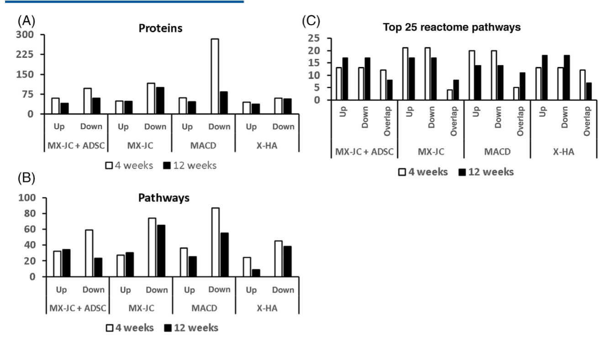

###### 神经营养因子表达
检测损伤局部BDNF等神经营养因子的表达变化
> [!PDF|green] [大鼠喉返神经挤压伤后喉肌及神经变化的初步研究, p.2](大鼠喉返神经挤压伤后喉肌及神经变化的初步研究.pdf#page=2&selection=899,0,975,1&color=green)
> > 实验组的 BDNF 在甲杓肌中的表达在喉返神经损伤后下降，随时间延长逐渐上升，术后 4 周相对光密度为（0.45±0.15）；术后 8 周时为（0.71±0.19）；术后 12 周时为（1.20±0.11），与对照组相比，差异有统计学意义（ P< 0.05，图 3B）。
###### qPCR/IHC
检测炎症、神经营养、血管生成等相关因子的基因和蛋白表达
pd-CTM中检测到BDNF、CNTF、GDNF等多种神经营养因子

---
##### 各模型观察时间点总结
> [!PDF|blueee] [A preliminary integrated morphologic and transcriptomic analysis of denervation remodeling in rat laryngeal and hindlimb muscles, p.6](A%20preliminary%20integrated%20morphologic%20and%20transcriptomic%20analysis%20of%20denervation%20remodeling%20in%20rat%20laryngeal%20and%20hindlimb%20muscles.pdf#page=6&selection=10,19,11,9&color=blueee)
> > varying with muscle type, species, <mark style="background-color: #3F4B5E; color: white">time point</mark>, and experimental condition

> [!PDF|yellow] [The Anatomical Record - 2014 - Hernández‐Morato - Somatotopic Changes in the Nucleus Ambiguus After Section and, p.961](The%20Anatomical%20Record%20-%202014%20-%20Hernández‐Morato%20-%20Somatotopic%20Changes%20in%20the%20Nucleus%20Ambiguus%20After%20Section%20and.pdf#page=7&selection=86,8,105,7&color=yellow)
> > after a RLN crush injury (axonotmesis), functional laryngeal fold movements were restored from 6 to 8 wpi (Tessema et al., 2008, 2009; Hernandez-Morato et al., 2013b).

- [ ] 核实一下几篇文章的动物选择

---
动物选择：2012年综述[A systematic review of animal models used to study nerve regeneration in tissue-engineered scaffolds - ScienceDirect](https://www.sciencedirect.com/science/article/pii/S0142961212008514)
###### <mark style="background-color: #705A16; color: white">兔子</mark>：
[[造模-兔子]]
2, 4, 8, and 12 weeks post-injury [Characteristics of Nerve Injury, Regeneration, and Vocal Fold Movement After Recurrent Laryngeal Nerve Electrocautery Injury](Characteristics%20of%20Nerve%20Injury,%20Regeneration,%20and%20Vocal%20Fold%20Movement%20After%20Recurrent%20Laryngeal%20Nerve%20Electrocautery%20Injury.pdf)
[Open: Pasted image 20260812181937.png](attachments/d17f4cba743d8d179ef3d0d2358f493c_MD5.jpg)
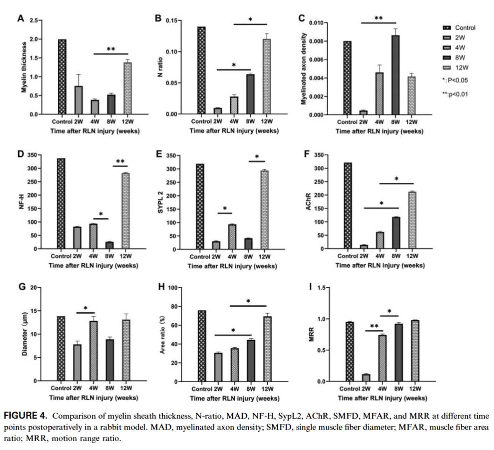
+[Ultrastructural and Automated Vocal Fold Tracking Study in Recurrent Laryngeal Nerve Injury Models](Ultrastructural%20and%20Automated%20Vocal%20Fold%20Tracking%20Study%20in%20Recurrent%20Laryngeal%20Nerve%20Injury%20Models.pdf)
> [!PDF|rouge] [Ultrastructural and Automated Vocal Fold Tracking Study in Recurrent Laryngeal Nerve Injury Models, p.7](Ultrastructural%20and%20Automated%20Vocal%20Fold%20Tracking%20Study%20in%20Recurrent%20Laryngeal%20Nerve%20Injury%20Models.pdf#page=7&selection=49,16,53,54&color=rouge)
> > By 12 weeks, the difference in motion range had decreased to approximately 2%, while the difference in motion speed remained at approximately 24%.
> 
> 12周时，患侧与健侧声带的运动范围差异缩小至约2%，两侧声带的运动速度差异仍高达约24%。再生有髓鞘轴突数量和N比值在8周达到峰值，之后开始下降。这说明12周时神经正处于“修剪期”——早期错误匹配的轴突正在退化消亡，神经再支配尚未达到稳定成熟的状态。

8 weeks [PCL Nerve Guide Conduit Coated](PCL%20Nerve%20Guide%20Conduit%20Coated.pdf)=[PCL Nerve Guide Conduit Coated_translated.pdf](PCL%20Nerve%20Guide%20Conduit%20Coated_translated.pdf.pdf)

 8, 12, and 16 weeks （离断伤） [Platelet-rich plasma loaded nerve guidance conduit as implantable biocompatible materials for recurrent laryngeal nerve regeneration - PMC](https://pmc.ncbi.nlm.nih.gov/articles/PMC9474804/#Sec7)

8 w  [局部应用地塞米松在喉返神经损伤后的作用探讨](局部应用地塞米松在喉返神经损伤后的作用探讨.pdf) 负压吸引损伤

---
###### <mark style="background-color: #705A16; color: white">大鼠</mark>：
[[造模-大鼠]]
[[取材]]
4周、8周及12周 [大鼠喉返神经挤压伤后喉肌及神经变化的初步研究](大鼠喉返神经挤压伤后喉肌及神经变化的初步研究.pdf)2018； [鼠单侧喉返神经横断后喉内肌和喉返神经](鼠单侧喉返神经横断后喉内肌和喉返神经.pdf)2016 
> 碎碎念→ 这两篇是同一群人发的

> [!PDF|yellow] [The Laryngoscope - 2009 - Tessema - Observations of recurrent laryngeal nerve injury and recovery using a rat model, p.1647](The%20Laryngoscope%20-%202009%20-%20Tessema%20-%20Observations%20of%20recurrent%20laryngeal%20nerve%20injury%20and%20recovery%20using%20a%20rat%20model.pdf#page=4&selection=165,36,182,21&color=yellow)
> > (A) 4 days, (B) 7 days, (C) 14 days, (D) 21 days, <mark style="background-color: #705A16; color: white">(E) 33 days</mark>, and (F) 42 days after the injury
> 
> [Open: Pasted image 20261012192601.png](attachments/4f783d32c9388571e9663941813d08ff_MD5.jpg)
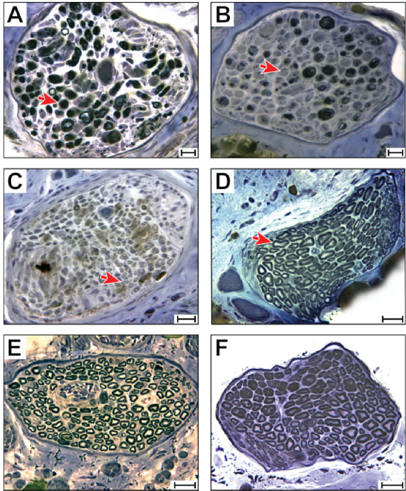

0123456周 [Evaluation of PRP injection after RLN injury in rats](Evaluation%20of%20PRP%20injection%20after%20RLN%20injury%20in%20rats.pdf)
6周 using a calibrated pressure clip (0.61 N or 1.19 N) [Observations of recurrent laryngeal nerve injury and recovery using a rat model - PubMed](https://pubmed.ncbi.nlm.nih.gov/19504559/) (Transoral laryngeal EMG: day 0, 4, 7, 14, 28, 33, and 42)
1-4 周
> [!PDF|green] [Electrical stimulation and testosterone enhance recovery from recurrent laryngeal nerve crush, p.573](Electrical%20stimulation%20and%20testosterone%20enhance%20recovery%20from%20recurrent%20laryngeal%20nerve%20crush.pdf#page=3&selection=40,8,40,44&color=green)
> > between 1 and 4 weeks post-operative
> 
> > Adult male Sprague-Dawley rats (∼2 months old)
> 
> 不过他这个有睾酮，要快一些

2, 4, and 6 周 [Adipose-derived mesenchymal stem cells accelerate nerve regeneration and functional recovery in a rat model of recurrent laryngeal nerve injury - PMC](https://pmc.ncbi.nlm.nih.gov/articles/PMC5649477/)=[RLN修复 间质干细胞 NRR](RLN修复%20间质干细胞%20NRR.pdf)
4、8、12周 [大鼠喉返神经挤压伤后喉肌及神经变化的初步研究](大鼠喉返神经挤压伤后喉肌及神经变化的初步研究.pdf)
8周 [Recurrent laryngeal nerve regeneration using a self‐assembling peptide hydrogel - Yoshimatsu - 2020 - The Laryngoscope - Wiley Online Library](https://onlinelibrary.wiley.com/doi/full/10.1002/lary.28434?saml_referrer=)
8 weeks [Fabrication of microgroove poly(lactic-co-glycolic acid) nerve guide conduit using dry-jet wet spinning for rat laryngeal recurrent nerve regeneration - ScienceDirect](https://www.sciencedirect.com/science/article/pii/S0264127522007730)
8, 12周 
> [!PDF|yellow] [Co-transplantation of Schwann cells and neural stem cells in the laminin-chitosan-PLGA nerve conduit to repair the injured recurrent laryngeal nerve in SD rats, p.1](Co-transplantation%20of%20Schwann%20cells%20and%20neural%20stem%20cells%20in%20the%20laminin-chitosan-PLGA%20nerve%20conduit%20to%20repair%20the%20injured%20recurrent%20laryngeal%20nerve%20in%20SD%20rats.pdf#page=1&selection=47,9,49,22&color=yellow)
> > ecurrent laryngeal nerve repair by transplantation of cocultured Schwann cells and neural stem cells (NSCs) in laminin-chitosan-poly-lactic-co-glycolic acid (laminin-chitosan-PLGA) nerve conduits in rats
 
16周（4 months） [Comparison of primary repair and repair with polyglycolic acid coated tube in recurrent laryngeal nerve cuts (an experimental study) - ScienceDirect](https://www.sciencedirect.com/science/article/pii/S0002961019306300)

30、90、180 d [The Laryngoscope - 2009 - Shiotani - Modulation of Myosin Heavy Chains in Rat Laryngeal Muscle](The%20Laryngoscope%20-%202009%20-%20Shiotani%20-%20Modulation%20of%20Myosin%20Heavy%20Chains%20in%20Rat%20Laryngeal%20Muscle.pdf)

###### <mark style="background-color: #705A16; color: white">小鼠</mark>：
1、4周 C57BL/6 mice 
a Steindorff Digital Video microscope [小鼠 喉返神经修复](小鼠%20喉返神经修复.pdf)
7、28天 [Placental-Derived Connective Tissue Matrix Mediates Murine RLN regeneration](Placental-Derived%20Connective%20Tissue%20Matrix%20Mediates%20Murine%20RLN%20regeneration.pdf)
> [!PDF|green] [A Surgical Mouse Model for Advancing Laryngeal Nerve Regeneration Strategies, p.24](A%20Surgical%20Mouse%20Model%20for%20Advancing%20Laryngeal%20Nerve%20Regeneration%20Strategies.pdf#page=24&selection=6,16,6,51&color=green)
> > our custom endoscopy suite for mice
> 
> [Open: Pasted image 20261011173013.png](attachments/d1d556cb24a29c3b6dd8ef0bd52d7c26_MD5.jpg)
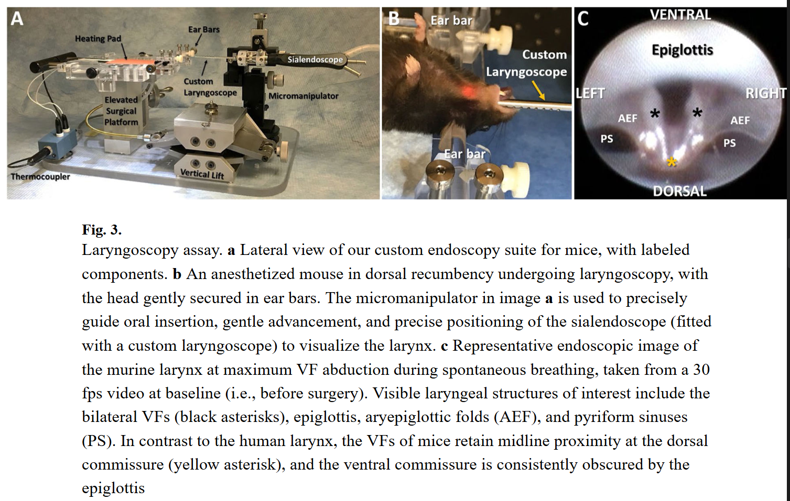
> 太牛了，小鼠的喉镜

###### <mark style="background-color: #705A16; color: white">犬</mark>：
> [!PDF|blueee] [The Laryngoscope - 2016 - Chitose - Recurrent laryngeal nerve regeneration using an oriented collagen scaffold containing, p.1624](The%20Laryngoscope%20-%202016%20-%20Chitose%20-%20Recurrent%20laryngeal%20nerve%20regeneration%20using%20an%20oriented%20collagen%20scaffold%20containing.pdf#page=3&selection=35,0,35,32&color=blueee)
> > Six months after transplantation

> [!PDF|green] [喉返神经损伤后喉肌病理生理研究_徐文, p.1](喉返神经损伤后喉肌病理生理研究_徐文.pdf#page=1&selection=57,0,69,1&color=green)
> > 造模成功后的即刻、1、3、6和12个月观察甲杓肌和环杓后肌肌电特征及组织病理学改变

> [!PDF|yellow] [The Laryngoscope - 2009 - Peterson - Objective Measures of Laryngeal Function After Reinnervation of the Anterior and, p.1](The%20Laryngoscope%20-%202009%20-%20Peterson%20-%20Objective%20Measures%20of%20Laryngeal%20Function%20After%20Reinnervation%20of%20the%20Anterior%20and.pdf#page=1&selection=70,10,70,44&color=yellow)
> > . Eight months after nerve repair,

6个月[Comparison of Conventional, Revascularized, and Bioengineered Methods of Recurrent Laryngeal Nerve Reconstruction | Surgery | JAMA Otolaryngology–Head & Neck Surgery | JAMA Network](https://jamanetwork.com/journals/jamaotolaryngology/fullarticle/2520694)

###### <mark style="background-color: #705A16; color: white">猪</mark>
静水压损伤对ECM的影响：[Extracellular matrix deformations of the porcine recurrent laryngeal nerve in response to hydrostatic pressure](Extracellular%20matrix%20deformations%20of%20the%20porcine%20recurrent%20laryngeal%20nerve%20in%20response%20to%20hydrostatic%20pressure.pdf)

2, 4, and 8 weeks [Laryngeal Reconstruction Using Tissue-Engineered Implants in Pigs: A Pilot Study - PMC](https://pmc.ncbi.nlm.nih.gov/articles/PMC8176280/) （after hemi-laryngectomy.）

##### 早期时间点总结
###### 延期干预研究
> [!PDF|yellow] [Preserved Regeneration and Functional Recovery of the Injured Recurrent Laryngeal Nerve after Secondary Surgical Repair in Adult Rats, p.1](Preserved%20Regeneration%20and%20Functional%20Recovery%20of%20the%20Injured%20Recurrent%20Laryngeal%20Nerve%20after%20Secondary%20Surgical%20Repair%20in%20Adult%20Rats.pdf#page=1&selection=15,0,17,85&color=yellow)
> > In adult rats, the left RLN was transected and repaired at time intervals up to <mark style="background-color: #705A16; color: white">3 weeks after transection</mark>, in combination with nimodipine treatment starting either before or after the operation. Regeneration and neuromuscular recovery were assessed by electrophysiology, retrograde tracing, and immunohistochemistry.
> 
> > <mark style="background-color: #3F4B5E; color: white">5-mm sural nerve graft </mark>segment to bridge the gap
>
> > Similar (whether 0, 2, or 7 days) regenerative results were obtained when the RLN was repaired up to 1 week after injury, given nimodipine administration, whereas fewer motor neurons managed to regenerate after nerve repair at 3 weeks after the initial transection.

###### 神经错配研究
早期（9 d）神经错配研究 [Influence of Netrin-1 on reinnervation of laryngeal muscles following recurrent laryngeal nerve injury - ScienceDirect](https://www.sciencedirect.com/science/article/pii/S0304394017304214) 

> [!PDF|purple] [Specificity of peripheral nerve regeneration Interactions at the axon level, p.17](Specificity%20of%20peripheral%20nerve%20regeneration%20Interactions%20at%20the%20axon%20level.pdf#page=2&selection=3400,1,3617,6&color=purple)
> > the lack of selectivity of axon-target reconnection leads to a poor functional recovery. Indeed, only a low percentage of adult patients regain normal function after complete transection and surgical repair of a major peripheral nerve. Appropriate and inappropriate targets can be reinnervated by axotomized neurons. For example, efferent motor axons may be misdirected to sensory end organs, and cutaneous afferents to motor endplates or sensory end organs of inappropriate modality or location. Thus, function will be degraded or permanently lost, depending on the severity of mismatch. As surgical nerve repair techniques cannot be further refined, there is a need for new and improved strategies to enhance specific axon regeneration following nerve injuries (Lundborg, 2003). 

###### 分子生物学研究
[496Open: Pasted image 20260812185228.png](attachments/eba136a5c034bec5703fe82af9c4139c_MD5.jpg)
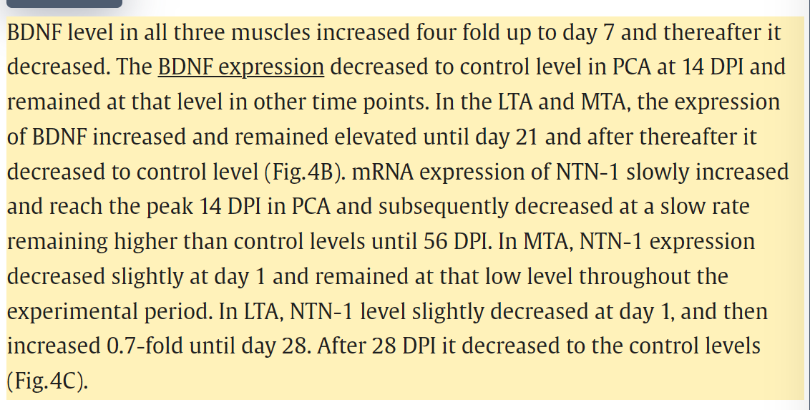

> [!PDF|blueee] [Microarray Analysis Gene Expression Profiles in Laryngeal Muscle After Recurrent Laryngeal Nerve Injury, p.2](Microarray%20Analysis%20Gene%20Expression%20Profiles%20in%20Laryngeal%20Muscle%20After%20Recurrent%20Laryngeal%20Nerve%20Injury.pdf#page=2&selection=68,53,72,5&color=blueee)
> >  This time point was selected because internal and microenvironmental changes involving denervated laryngeal muscle have been demonstrated <mark style="background-color: #1A4F10; color: white">within 1 week</mark> after denervation injury.

---
#### 造模方法
##### 切断造模
切断神经并置入材料，
缝合舌骨下肌群，关闭皮肤。
##### 压迫造模
using a calibrated pressure clip 止血钳控制压力和时间
- 小蚊式钳一扣（力度标准，指蚊式钳卡住第一个齿）钳夹喉返神经10 min
> [!PDF|green] [喉返神经损伤后喉肌病理生理研究_徐文, p.2](喉返神经损伤后喉肌病理生理研究_徐文.pdf#page=2&selection=31,0,36,5&color=green)
> > 挫灭法‚以小蚊式钳一扣钳夹喉返神经10 min
> 

- 于第3、4气管环平面，小蚊式钳一扣（力度标准，指蚊式钳卡住第一个齿）钳夹喉返神经10 min
##### 结扎、半切法
> [!PDF|yellow] [喉返神经损伤后喉肌病理生理研究_徐文, p.3](喉返神经损伤后喉肌病理生理研究_徐文.pdf#page=3&selection=316,2,326,3&color=yellow)
> > 结果‚喉返神经损伤程度由重至轻依次为全切法＞结扎法＞半切法 ＞挫灭法

---
取材：

| 评估指标 | 推荐方法 | 原因 |
| :--- | :--- | :--- |
| H&E染色（形态学） | 甲醛固定 | 最佳保存组织结构细节 |
| 免疫荧光（IHC） | OCT包埋（冰冻切片） | 最大程度保留S100、NF200、Tuj-1、MBP等蛋白抗原性，背景荧光低 |
| 原位杂交（RNA） | OCT包埋（冰冻切片） | 更好保存RNA完整性 |
[带你“找不同”——石蜡切片与冰冻切片](https://www.larc.tsinghua.edu.cn/post/730/31)

---
### 机理机制
#### [喉返神经修复分子生物学](喉返神经修复分子生物学.md)
##### NMJ
"reconstruction of the nerve by various techniques, including the ansa cervicalis-recurrent nerve anastomosis, facilitates recovery of the voice（功能运动单元的存在可防止声带肌萎缩，改善发声时的张力）, although movement of the vocal cord does not recover"[^1]
##### NF
> [!PDF|green] [Microarray Analysis Gene Expression Profiles in Laryngeal Muscle After Recurrent Laryngeal Nerve Injury, p.7](Microarray%20Analysis%20Gene%20Expression%20Profiles%20in%20Laryngeal%20Muscle%20After%20Recurrent%20Laryngeal%20Nerve%20Injury.pdf#page=7&selection=18,27,31,1&color=green)
> >  The NFs refer to not only the neurotrophins NGF, BDNF, NT-3, and NT-4/5 that act on the trk family of tyrosine kinase receptors, but they also include other neuropeptides that provide neuronal support. Based on this definition, the list of potential NFs is exhaustive and includes proteins such as the GDNF family of ligands (GDNF, neurturin [NTN], artemin [ART], and persephin [PSP]), neuregulin 1 with its isoforms, melanocortins, and a number of other growth factors such as ciliary neurotrophic factor (CNTF), insulin-like growth factor-1 (IGF-1), transforming growth factors (TGFa and TGFb), VGF peptide, glia maturation factors (GMFs), and fibroblast growth factors (FGF 1, 2, 9).9

<mark style="background-color: #1A4F10; color: white">神经营养因子</mark>在神经再支配和声带功能中的作用的研究正在进行中，希望最终能诱导神经再支配有序发生，从而重建损伤前神经支配模式。[^2]
> [!PDF|green] [Restoring Vocal Fold Movement after Transection and Immediate Suturing of the RLN with Local Application of Basic Fibroblast Growth Factor_An Experimental Study in the Rat, p.1](Restoring%20Vocal%20Fold%20Movement%20after%20Transection%20and%20Immediate%20Suturing%20of%20the%20RLN%20with%20Local%20Application%20of%20Basic%20Fibroblast%20Growth%20Factor_An%20Experimental%20Study%20in%20the%20Rat.pdf#page=1&selection=14,1,18,16&color=green)
> > o evaluate the effects of basic fibroblast growth factor (bFGF) on the recovery of vocal fold movement and the attenuation of laryngeal muscle atrophy after transection of the recurrent laryngeal nerve (RLN)
>
> [Open: Pasted image 20261011165342.png](attachments/4a3ba358887f86a1aeade7629b6c4c6c_MD5.jpg)
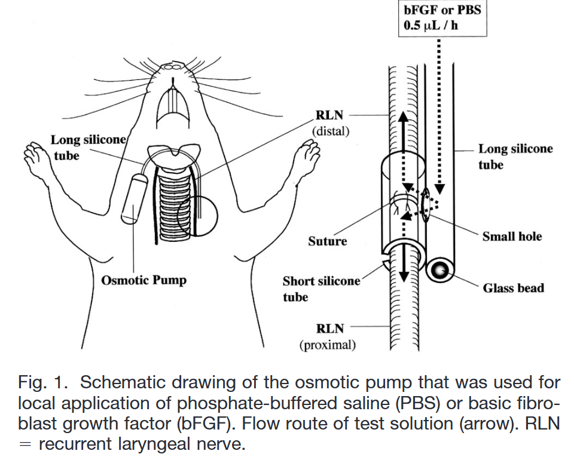

#### NSCs
> [!PDF|green] [Co-transplantation of Schwann cells and neural stem cells in the laminin-chitosan-PLGA nerve conduit to repair the injured recurrent laryngeal nerve in SD rats, p.2](Co-transplantation%20of%20Schwann%20cells%20and%20neural%20stem%20cells%20in%20the%20laminin-chitosan-PLGA%20nerve%20conduit%20to%20repair%20the%20injured%20recurrent%20laryngeal%20nerve%20in%20SD%20rats.pdf#page=2&selection=12,26,13,54&color=green)
> >  co-cultured SCs and NSCs might promote the differentiation of NSCs into neurons

> [!PDF|yellow] [Co-transplantation of Schwann cells and neural stem cells in the laminin-chitosan-PLGA nerve conduit to repair the injured recurrent laryngeal nerve in SD rats, p.7](Co-transplantation%20of%20Schwann%20cells%20and%20neural%20stem%20cells%20in%20the%20laminin-chitosan-PLGA%20nerve%20conduit%20to%20repair%20the%20injured%20recurrent%20laryngeal%20nerve%20in%20SD%20rats.pdf#page=7&selection=16,39,21,5&color=yellow)
> > Some studies have suggested that the survival rate of NSC transplantation alone in vivo is low [19]. Yihua et al. indicated that factors secreted by SCs can substantially support the growth of NSCs; if NSCs lose the support of SCs, the NSCs will gradually die [20].
#### ECM
> [!PDF|green] [Co-transplantation of Schwann cells and neural stem cells in the laminin-chitosan-PLGA nerve conduit to repair the injured recurrent laryngeal nerve in SD rats, p.2](Co-transplantation%20of%20Schwann%20cells%20and%20neural%20stem%20cells%20in%20the%20laminin-chitosan-PLGA%20nerve%20conduit%20to%20repair%20the%20injured%20recurrent%20laryngeal%20nerve%20in%20SD%20rats.pdf#page=2&selection=15,0,18,15&color=green)
> > laminin and chitosan in the conduits might increase the conglutination of the cells, promote cell growth, provide better biocompatibility and improve the microenvironment for regeneratio
> 
> <mark style="background-color: #1A4F10; color: white">laminin</mark> and <mark style="background-color: #1A4F10; color: white">chitosan</mark>

---
### 喉返神经修复的挑战：
[Recurrent laryngeal nerve regeneration using an oriented collagen scaffold containing Schwann cells - Chitose - 2017 - The Laryngoscope - Wiley Online Library](https://onlinelibrary.wiley.com/doi/full/10.1002/lary.26389)[^3]
- 喉返神经是**混合神经**，含有运动纤维、感觉纤维和自主（副交感）神经纤维
> [!PDF|blueee] [The Laryngoscope - 2026 - Bhatt - Novel Injectable Supports Long‐Term Recurrent Laryngeal Nerve and Partial Peripheral, p.8](The%20Laryngoscope%20-%202026%20-%20Bhatt%20-%20Novel%20Injectable%20Supports%20Long‐Term%20Recurrent%20Laryngeal%20Nerve%20and%20Partial%20Peripheral.pdf#page=8&selection=39,0,49,39&color=blueee)
> > With the RLN being a motor nerve, the primary recovery challenge is misdirected motor reinnervation leading to inappropriate central input (abduction rather than adduction). By contrast, the SN is a large- diameter mixed sensory–motor nerve innervating multiple muscles; sensory and motor fibers from different fascicles attempt to regenerate simultaneously, and trophic factor and Schwann cell support alone cannot resolve this complex intraneural anatomy, for which precise fascicular alignment would be required.

- 有文献指出，即便是**同样的修复方法**，在喉返神经损伤上的效果也**相互矛盾**，有的成功，有的效果有限甚至无效。这说明其<mark style="background-color: #1A4F10; color: white">内部精细结构（如不同纤维束的位置和比例）</mark>的个体差异对修复结果影响巨大
- 施万细胞分离培养困难：
  [^4][^5]
- 即使有施万细胞和支架引导，喉返神经损伤处的再生微环境也可能不利于高质量再生。有研究发现，再生后的喉返神经**缺乏神经外膜（epineurium）** 包裹，且**被胶原纤维所穿插**，这会影响神经信号的传导和神经的韧性
- <mark style="background-color: #1A4F10; color: white">SLN</mark>侧支支配干扰
> [!PDF|green] [Microarray Analysis Gene Expression Profiles in Laryngeal Muscle After Recurrent Laryngeal Nerve Injury, p.9](Microarray%20Analysis%20Gene%20Expression%20Profiles%20in%20Laryngeal%20Muscle%20After%20Recurrent%20Laryngeal%20Nerve%20Injury.pdf#page=9&selection=61,36,78,16&color=green)
> > the authors feel that SLNderived intramuscular sprouting could explain<mark style="background-color: #1A4F10; color: white"> many postRLN injury clinical manifestations </mark>such as post-injury spontaneous medialization of the immobile vocal fold, persistent false vocal fold adduction, and electromyography-documented synkinesi
> 
> SLN代偿的后果⬆️

---
#### Footnote
[^1]: [Lateral Mobilization of the Recurrent Laryngeal Nerve to Facilitate Tracheal Surgery in Patients with Thyroid Cancer Invading the Trachea Near Berry’s Ligament - Miyauchi - 2007 - World Journal of Surgery - Wiley Online Library](https://onlinelibrary.wiley.com/doi/10.1007/s00268-007-9180-6)

[^2]: [Delivery of an Adenoviral Vector to the Crushed Recurrent Laryngeal Nerve - Rubin - 2003 - The Laryngoscope - Wiley Online Library](https://onlinelibrary.wiley.com/doi/10.1097/00005537-200306000-00013);  [Electromyographic and histologic evolution of the recurrent laryngeal nerve from transection and anastomosis to mature reinnervation - Pitman - 2011 - The Laryngoscope - Wiley Online Library](https://onlinelibrary.wiley.com/doi/10.1002/lary.21290)

[^3]: 
	Kanemaru S, Nakamura T, Omori K, et al. Recurrent laryngeal nerve regeneration by tissue engineering. Ann Otol Rhinol Laryngol 2003;112: 492–498.

[^4]: Ziegler L, Grigoryan S, Yang IH, Thakor NV, Goldstein RS. Efficient generation of Schwann cells from human embryonic stem cell-derived neurospheres. Stem Cell Rev 2011;7:394–403.

[^5]: 
	Rodriguez FJ, Verdu E, Ceballos D, Navarro X. Nerve guides seeded with autologous Schwann cells improves nerve regeneration. Exp Neurol 2000;161:571–584.
