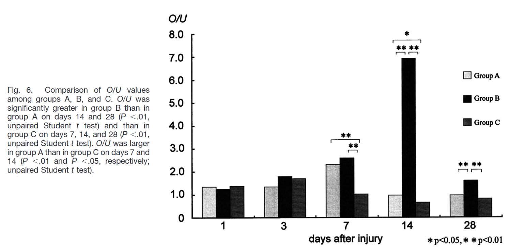
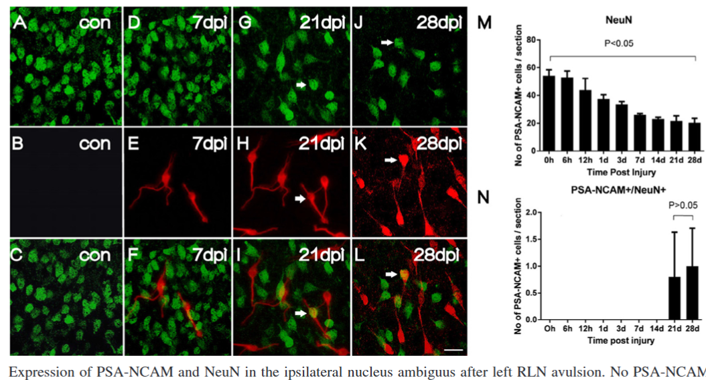
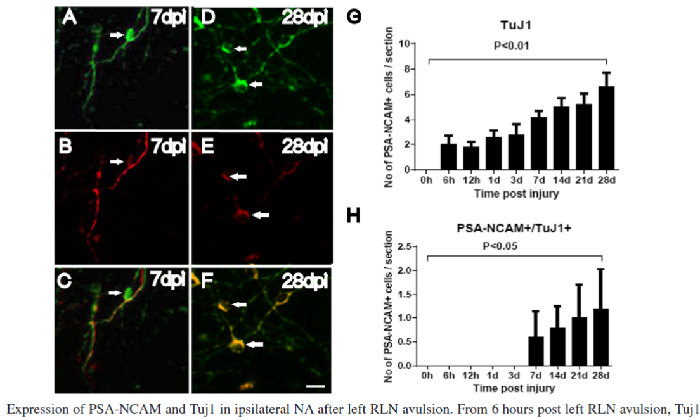
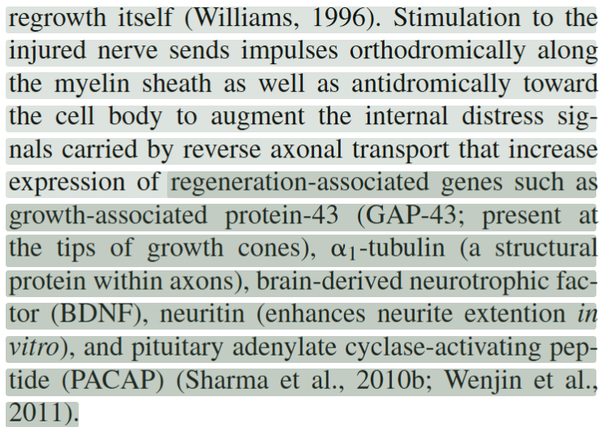
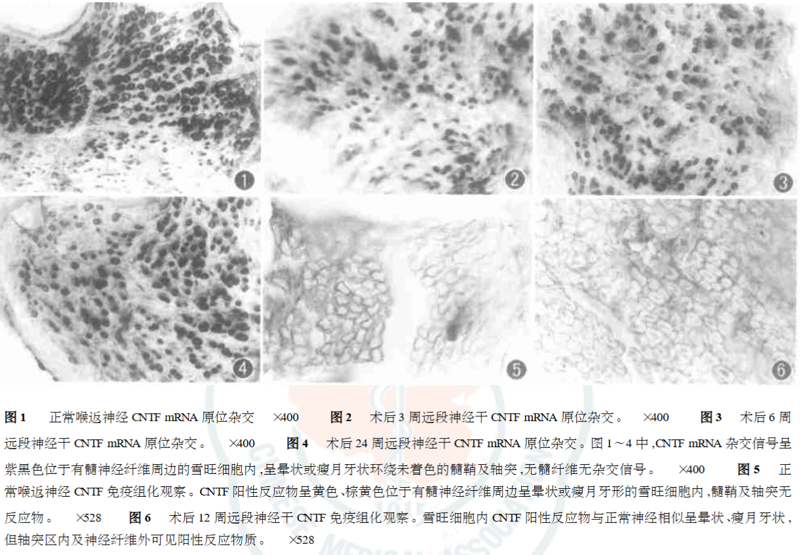

---
tags:
  - Proj
---
### 疑核 (NA)
> 评估神经元胞体的存活、再生程序启动及细胞应激反应。

| 检测因子                                                                    | 主要意义及选择原因                                                            | 推荐程度               |
| ----------------------------------------------------------------------- | -------------------------------------------------------------------- | ------------------ |
| GAP-43                                                                  | 生长相关蛋白，反映轴突生长与再生相关反应。RLN轴切研究发现，疑核运动神经元中GAP-43 mRNA于术后第7天达到峰值，之后逐渐下降。 | 优先；有直接RLN证据        |
| <mark style="background-color: #1A4F10; color: white">FGF-2</mark>/bFGF | 与神经元损伤反应、存活及再生有关。RLN损伤大鼠研究发现，疑核FGF-2免疫反应随损伤类型和时间发生变化。                | 优先；有直接RLN证据        |
| nNOS/NOS1                                                               | 反映神经元一氧化氮合酶相关反应。既往RLN轴切研究显示，疑核运动神经元nNOS的变化时程与GAP-43不同。               | 优先；有直接RLN证据        |
| ATF3                                                                    | 神经元损伤应答转录因子，可辅助判断神经元是否启动损伤反应。                                        | 推荐候选；主要依据一般周围神经研究  |
| STAT3、SOX11                                                             | 参与损伤后的转录调控及轴突再生相关程序，可用于探索再生反应。                                       | 机制研究候选             |
| BCL-2、BAX、cleaved caspase-3                                             | 分别从抗凋亡、促凋亡及凋亡执行等角度评估细胞死亡相关变化。                                        | 仅在关注神经元存活时增加       |
| GDNF、GFRα1/RET                                                          | 涉及胶质细胞源性神经营养因子信号及神经元存活、轴突生长。                                         | 候选；不是已确立的RLN疑核常规指标 |

- [ ] [Migration and differentiation of neural progenitor cells after recurrent laryngeal nerve avulsion in rats](Migration%20and%20differentiation%20of%20neural%20progenitor%20cells%20after%20recurrent%20laryngeal%20nerve%20avulsion%20in%20rats.pdf)
- [ ] [Neuroregeneration in the nucleus ambiguus after recurrent laryngeal nerve avulsion in rats](Neuroregeneration%20in%20the%20nucleus%20ambiguus%20after%20recurrent%20laryngeal%20nerve%20avulsion%20in%20rats.pdf)

> [!PDF|yellow] [The Laryngoscope - 2009 - Sanuki - Expression of Fibroblast Growth Factor‐2 in the Nucleus Ambiguus Following Recurrent, p.1](The%20Laryngoscope%20-%202009%20-%20Sanuki%20-%20Expression%20of%20Fibroblast%20Growth%20Factor‐2%20in%20the%20Nucleus%20Ambiguus%20Following%20Recurrent.pdf#page=1&selection=128,50,133,37&color=yellow)
> > Several proteins promote neuron survival and growth of the regenerated axon. These include <mark style="background-color: #1A4F10; color: white">fibroblast growth factor-2 (FGF-2)</mark>, <mark style="background-color: #1A4F10; color: white">ciliary neurotrophic factor (CNTF)</mark>, <mark style="background-color: #1A4F10; color: white">nerve growth factor (NGF)</mark>, <mark style="background-color: #1A4F10; color: white">brain-derived neurotrophic factor (BDNF)</mark>, and insulin-like growth factor (IGF).
#### fibroblast growth factor-2 (FGF-2)
> [!PDF|green] [The Laryngoscope - 2009 - Sanuki - Expression of Fibroblast Growth Factor‐2 in the Nucleus Ambiguus Following Recurrent, p.2](The%20Laryngoscope%20-%202009%20-%20Sanuki%20-%20Expression%20of%20Fibroblast%20Growth%20Factor‐2%20in%20the%20Nucleus%20Ambiguus%20Following%20Recurrent.pdf#page=2&selection=6,0,9,41&color=green)
> > Komori reported that local administration of FGF-2 significantly facilitated functional and morphological recovery of the injured RLN in rats compared with other neurotrophic factors, such as CNTF and NGF. 
> 
> [Open: Pasted image 20261011113046.png](attachments/ac059185a3ab5854a8899fbdee46ac35_MD5.jpg)

#### PSA-NCAM/NeuN & PSA-NCAM/Tuj1
> [!PDF|green] [Polysialylated Neural Cell Adhesion Molecule Supports Regeneration of Neurons in the Nucleus Ambiguus After Unilateral Recurrent Laryngeal Nerve Avulsion in Adult Rats, p.52](Polysialylated%20Neural%20Cell%20Adhesion%20Molecule%20Supports%20Regeneration%20of%20Neurons%20in%20the%20Nucleus%20Ambiguus%20After%20Unilateral%20Recurrent%20Laryngeal%20Nerve%20Avulsion%20in%20Adult%20Rats.pdf#page=1&selection=27,0,30,17&color=green)
> > PSA-NCAM-positive and PSA-NCAM/NeuN and PSA-NCAM/Tuj1 double-labeled positive cells were observed 7 days post injury in the ipsilateral NA. PSA-NCAM/NeuN and PSA-NCAM/Tuj1 double-labeled cells were observed at 21 and 7 days post injury, respectively. PSA-NCAM/NeuN double-labeled cells were also found in the contralateral NA.（没截图）
> 
> [Open: Pasted image 20261011115311.png](attachments/685cafe1a5d10a060505a4ae43c65ad5_MD5.jpg)

> [Open: Pasted image 20261011115401.png](attachments/86ad95407433ea95112966524fca335a_MD5.jpg)

#### Apoptosis
> [!PDF|blueee] [Microarray Analysis Gene Expression Profiles in Laryngeal Muscle After Recurrent Laryngeal Nerve Injury, p.2](Microarray%20Analysis%20Gene%20Expression%20Profiles%20in%20Laryngeal%20Muscle%20After%20Recurrent%20Laryngeal%20Nerve%20Injury.pdf#page=2&selection=42,0,46,47&color=blueee)
> > loss of apoptic factors such as p53, bax, and Fas has been shown to protect from motoneuron apoptosis after axotomy
> 
> 凋亡也是可以注意的点

#### GFAP
是星形胶质细胞（Astrocytes）的经典标志物。属于细胞骨架蛋白中的III型中间丝（Intermediate Filament, IF）。它是成熟星形胶质细胞中主要的中间丝蛋白，为细胞提供机械强度和结构支撑。
> [!PDF|yellow] [GFAP immunoreactivity within the rat nucleus ambiguus after laryngeal nerve injury, p.1](GFAP%20immunoreactivity%20within%20the%20rat%20nucleus%20ambiguus%20after%20laryngeal%20nerve%20injury.pdf#page=1&selection=45,68,46,103&color=yellow)
> > after RLN injury, GFAP immunoreactivity was increased beyond the area of the nucleus ambiguus within which RLN motor neuron somata were located

> [!PDF|green] [The Anatomical Record - 2014 - Hernández‐Morato - Somatotopic Changes in the Nucleus Ambiguus After Section and, p.956](The%20Anatomical%20Record%20-%202014%20-%20Hernández‐Morato%20-%20Somatotopic%20Changes%20in%20the%20Nucleus%20Ambiguus%20After%20Section%20and.pdf#page=2&selection=160,23,175,55&color=green)
> > However, somatotopy of the motor nuclei of the individual intrinsic laryngeal muscles within the Amb is dramatically changed after the crush injury and the previous pattern is never fully restored

### 神经损伤处
> 评估局部微环境的炎症状态、雪旺细胞功能及轴突再生情况。

| 检测因子                                                                                                                                              | 主要意义及选择原因                                                       | 推荐程度     |
| ------------------------------------------------------------------------------------------------------------------------------------------------- | --------------------------------------------------------------- | -------- |
| c-Jun                                                                                                                                             | 施万细胞损伤后重编程的重要转录因子，参与形成支持轴突再生的修复型施万细胞。                           | 优先       |
| SOX10、S100                                                                                                                                        | 用于识别施万细胞相关结构和细胞群。 SOX10通常更适合辅助确认施万细胞身份； S100不宜单独作为修复表型证据。 | 优先作为身份标记 |
| MPZ/P0、MBP、PMP22                                                                                                                                  | 评估髓鞘相关蛋白变化，辅助观察损伤后髓鞘清除及再髓鞘化。                                    | 优先       |
| NF200、<mark style="background-color: #1A4F10; color: white">βIII-tubulin</mark>/<mark style="background-color: #1A4F10; color: white">TUJ1</mark> | 观察轴突结构和分布；结合GAP-43可进一步评价再生相关变化。                                 | 优先       |
| <mark style="background-color: #1A4F10; color: white">GAP-43</mark>                                                                               | 反映轴突生长相关反应，但表达升高不等于已完成有效再支配。                                    | 优先       |
| CD68、Iba1                                                                                                                                         | 观察巨噬细胞相关浸润和分布，辅助评估髓鞘碎片清除及炎症细胞反应。                                | 炎症研究优先   |
| TNF-α、IL-6、IL-10                                                                                                                                  | 反映炎症相关状态。应结合时间点解释，不能简单把促炎因子升高视为有害、抗炎因子升高视为有益。                   | 按研究目的选择  |
| <mark style="background-color: #1A4F10; color: white">GDNF</mark>、BDNF、NGF、<mark style="background-color: #1A4F10; color: white">CNTF</mark>      | 评估局部神经营养支持及其与施万细胞、轴突生长的关系。                                      | 机制研究候选   |
| Laminin、Collagen IV                                                                                                                               | 评估基底膜及细胞外基质结构，帮助理解轴突生长通道和局部组织重塑。                                | 组织结构研究候选 |
| NF-κB、MAPK、PI3K/Akt                                                                                                                               | 用于研究具体信号通路；应明确检测磷酸化蛋白、下游靶标或细胞类型，不能仅列出通路名称。                      | 有明确假设时使用 |

##### βII-tubulin
> [!PDF|green] [Electrical stimulation and testosterone enhance recovery from recurrent laryngeal nerve crush, p.573](Electrical%20stimulation%20and%20testosterone%20enhance%20recovery%20from%20recurrent%20laryngeal%20nerve%20crush.pdf#page=3&selection=5,43,9,12&color=green)
> > structural building blocks of axons (including the <mark style="background-color: #1A4F10; color: white">βII-tubulin</mark>) 

标志纵向伸长；
当神经元成熟，轴突转向径向生长（增粗）时，它的表达则会下调

##### GAP-43
> [!PDF|green] [Electrical stimulation and testosterone enhance recovery from recurrent laryngeal nerve crush, p.572](Electrical%20stimulation%20and%20testosterone%20enhance%20recovery%20from%20recurrent%20laryngeal%20nerve%20crush.pdf#page=2&selection=66,14,90,46&color=green)
> > regeneration-associated genes such as growth-associated protein-43 (<mark style="background-color: #1A4F10; color: white">GAP-43</mark>; present at the tips of growth cones), <mark style="background-color: #1A4F10; color: white">α1 -tubulin</mark> (a structural protein within axons), brain-derived neurotrophic factor (<mark style="background-color: #1A4F10; color: white">BDNF</mark>), <mark style="background-color: #1A4F10; color: white">neuritin</mark> (enhances neurite extention in vitro), and pituitary adenylate cyclase-activating peptide <mark style="background-color: #1A4F10; color: white">(PACAP</mark>) (Sharma et al., 2010b; Wenjin et al., 2011). ES has been shown to be particularly effective
> 
> <mark style="background-color: #1A4F10; color: white">GAP-43</mark>; present at the tips of growth cones生长锥[神经再生](神经再生.md)
> [Open: Pasted image 20261029160531.png](attachments/f027d27b9131ff64babd6e2245649276_MD5.jpg)

##### GDNF
> [!PDF|green] [Adenoviral GDNF gene transfer enhances neurofunctional recovery after recurrent laryngeal nerve injury, p.1](Adenoviral%20GDNF%20gene%20transfer%20enhances%20neurofunctional%20recovery%20after%20recurrent%20laryngeal%20nerve%20injury.pdf#page=1&selection=317,5,336,6&color=green)
> > glial cell line-derived neurotrophic factor (<mark style="background-color: #1A4F10; color: white">GDNF</mark>), brain-derived neurotrophic factor, neurotrophin (NT)-3, NT-4/5 and ciliary neurotrophic factor have been shown to prevent the loss of facial and spinal motoneurons after axotomy in neonatal rodents. 16–18 Of these, GDNF offers powerful survival-promoting effects on motor neurons in vitro and in vivo, and promotes nerve regeneration after injury

> [!PDF|green] [The Laryngoscope - 2014 - Hernandez‐Morato - Differential expression of glial‐derived neurotrophic factor in rat laryngeal, p.2750](The%20Laryngoscope%20-%202014%20-%20Hernandez‐Morato%20-%20Differential%20expression%20of%20glial‐derived%20neurotrophic%20factor%20in%20rat%20laryngeal.pdf#page=1&selection=24,0,27,76&color=green)
> > The expression of glial-derived neurotrophic factor (GDNF) was studied in the abductor and adductor muscles of the larynx in the rat utilizing real-time polymerase chain reaction at different times following transection, anastomosis, and reinnervation of the right recurrent laryngeal nerve (RLN). Immunostaining of GDNF, axons, and the motor endplates were performed. This data was correlated with intramuscular mRNA <mark style="background-color: #1A4F10; color: white">GDNF </mark>expression.

#### ciliary neurotrophic factor (CNTF)
> [!PDF|green] [睫状神经营养因子在喉返神经再生过程中的表达及分析, p.1](睫状神经营养因子在喉返神经再生过程中的表达及分析.pdf#page=1&selection=72,0,108,25&color=green)
> > 正常神经 CNTF mRNA 及其蛋白反应产物位于包绕轴突及髓鞘的雪旺细胞中。神经修复术后 2 周神经纤维降解 ,CNTF mRNA 及其蛋白表达迅速下降 ,3 周后随着神经的再生 CNTF mRNA 及其蛋白表达逐渐增加 ,表达产物仍位于包绕再生轴突及髓鞘的雪旺细胞中 ,CNTF 蛋白还出现于再生的轴突中。18 周后虽然神经再生完成 ,但反应产物灰度值及面积百分率仍明显低于正常状态。
> 
> [Open: Pasted image 20261011154820.png](attachments/c5c386d5275b74280705e3988be57f2f_MD5.jpg)

### 甲杓肌处 (NMJ)
> 评估神经再支配后，运动终板的形态与功能恢复。

| 检测因子或方法                                                                                                                                                                                              | 主要意义及选择原因                                                     | 推荐程度     |
| ---------------------------------------------------------------------------------------------------------------------------------------------------------------------------------------------------- | ------------------------------------------------------------- | -------- |
| AChR: α-Bungarotoxin (α-BTX)标记                                                                                                                                                                       | 标记突触后乙酰胆碱受体区域，观察运动终板的位置、形态、碎片化及分布。α-bungarotoxin是标记AChR的常用方法。 | 优先       |
| Synaptophysin、SV2                                                                                                                                                                                    | 标记突触囊泡相关结构，辅助显示突触前神经末梢。                                       | 优先候选     |
| Neurofilament + AChR共染                                                                                                                                                                               | 同时观察神经轴突末梢与突触后受体区域，判断神经末梢是否重新占据运动终板。                          | 优先       |
| Agrin、MuSK、LRP4                                                                                                                                                                                      | 参与NMJ形成和突触后结构维持，可用于研究运动终板组织及稳定机制。                             | 机制研究候选   |
| CHRNG                                                                                                                                                                                                | 胚胎型乙酰胆碱受体亚基，成年骨骼肌去神经支配后可能重新表达，可作为去神经支配相关反应的辅助指标。              | 候选       |
| <mark style="background-color: #1A4F10; color: white">MyoD</mark>、Myogenin                                                                                                                           | 反映肌肉损伤、去神经支配相关反应及肌生成程序，不能单独证明NMJ再生。                           | 肌肉反应研究候选 |
| MuRF1/TRIM63、Atrogin-1/FBXO32                                                                                                                                                                        | 反映肌肉萎缩相关蛋白降解程序，辅助判断靶肌去神经支配和肌肉状态。                              | 肌肉萎缩研究候选 |
| <mark style="background-color: #1A4F10; color: white">BDNF</mark>、<mark style="background-color: #1A4F10; color: white">GDNF</mark>、<mark style="background-color: #1A4F10; color: white">NGF</mark> | 评估靶肌及局部组织的神经营养支持。其意义取决于细胞来源和具体时间点。                            | 机制研究候选   |

> [!PDF|rouge] [Microarray Analysis Gene Expression Profiles in Laryngeal Muscle After Recurrent Laryngeal Nerve Injury, p.8](Microarray%20Analysis%20Gene%20Expression%20Profiles%20in%20Laryngeal%20Muscle%20After%20Recurrent%20Laryngeal%20Nerve%20Injury.pdf#page=8&selection=11,52,13,3&color=rouge)
> > gene expression changes characteristic of acute muscle denervation

> [!PDF|blueee] [Microarray Analysis Gene Expression Profiles in Laryngeal Muscle After Recurrent Laryngeal Nerve Injury, p.8](Microarray%20Analysis%20Gene%20Expression%20Profiles%20in%20Laryngeal%20Muscle%20After%20Recurrent%20Laryngeal%20Nerve%20Injury.pdf#page=8&selection=13,6,23,29&color=blueee)
> > For example, there was<mark style="background-color: #3F4B5E; color: white"> upregulation of myogenin and downregulation of myostatin</mark>, which are both signs of acute denervation. Furthermore, <mark style="background-color: #3F4B5E; color: white">cholinergic receptor nicotinic alpha 1</mark>, which classically surges after acute denervation, dramatically upregulated in both the AC and PCA, supporting that the RLN transection procedure had indeed disrupted a primary innervation source.

#### MyoD
> [!PDF|green] [Effects of early local administration of high-dose bFGF on RLN injury, p.8](Effects%20of%20early%20local%20administration%20of%20high-dose%20bFGF%20on%20RLN%20injury——有些粗糙.pdf#page=8&selection=81,0,112,16&color=green)
> >  Representative microscopy images of double staining with <mark style="background-color: #1A4F10; color: white">myogenic differentiation (MyoD) </mark>antibody and 4ʹ,6-diamidino-2-phenylindole dihydrochloride (DAPI) on day 14 after high dose basic fibroblast growth factor (bFGF) injection in the paralyzed side, or saline injection in the paralyzed side or non-paralyzed side (400 × magnification). 

#### nerve growth factor (NGF)
> [!PDF|green] [CHANGES IN NEUROTROPHIC FACTORS OF ADULT RAT, p.44](CHANGES%20IN%20NEUROTROPHIC%20FACTORS%20OF%20ADULT%20RAT.pdf#page=1&selection=63,51,79,21&color=green)
> > Nerve Growth Factor (<mark style="background-color: #1A4F10; color: white">NGF</mark>), Brain-Derived Neurotrophic Factor (<mark style="background-color: #1A4F10; color: white">BDNF</mark>) and Netrin-1 (<mark style="background-color: #1A4F10; color: white">NTN-1</mark>) increased their expression levels in laryngeal muscles after nerve section and during regeneration of RLN. 

#### brain-derived neurotrophic factor (BDNF)
> [!PDF|green] [CHANGES IN NEUROTROPHIC FACTORS OF ADULT RAT, p.44](CHANGES%20IN%20NEUROTROPHIC%20FACTORS%20OF%20ADULT%20RAT.pdf#page=1&selection=63,51,79,21&color=green)
> > Nerve Growth Factor (<mark style="background-color: #1A4F10; color: white">NGF</mark>), Brain-Derived Neurotrophic Factor (<mark style="background-color: #1A4F10; color: white">BDNF</mark>) and Netrin-1 (<mark style="background-color: #1A4F10; color: white">NTN-1</mark>) increased their expression levels in laryngeal muscles after nerve section and during regeneration of RLN. 

#### GDNF family
> [!PDF|blueee] [Microarray Analysis Gene Expression Profiles in Laryngeal Muscle After Recurrent Laryngeal Nerve Injury, p.7](Microarray%20Analysis%20Gene%20Expression%20Profiles%20in%20Laryngeal%20Muscle%20After%20Recurrent%20Laryngeal%20Nerve%20Injury.pdf#page=7&selection=23,24,30,19&color=blueee)
> > the GDNF family of ligands (GDNF, neurturin [NTN], artemin [ART], and persephin [PSP]), neuregulin 1 with its isoforms, melanocortins
##### Netrin-1 (NTN-1)
> [!PDF|green] [CHANGES IN NEUROTROPHIC FACTORS OF ADULT RAT, p.44](CHANGES%20IN%20NEUROTROPHIC%20FACTORS%20OF%20ADULT%20RAT.pdf#page=1&selection=63,51,79,21&color=green)
> > Nerve Growth Factor (<mark style="background-color: #1A4F10; color: white">NGF</mark>), Brain-Derived Neurotrophic Factor (<mark style="background-color: #1A4F10; color: white">BDNF</mark>) and Netrin-1 (<mark style="background-color: #1A4F10; color: white">NTN-1</mark>) increased their expression levels in laryngeal muscles after nerve section and during regeneration of RLN. 
##### neuregulin 1

#### Ki67 & Pax7
> [!PDF|green] [Effects of early local administration of high-dose bFGF on RLN injury——有些粗糙, p.5](Effects%20of%20early%20local%20administration%20of%20high-dose%20bFGF%20on%20RLN%20injury——有些粗糙.pdf#page=5&selection=98,0,112,37&color=green)
> > To clarify the mechanisms by which high-dose bFGF suppressed atrophic changes in the TA muscles, we investigated its effects on the cell lineage of<mark style="background-color: #1A4F10; color: white"> SCs</mark> to muscle fibers. We examined cell proliferation in the TA muscles and performed time-course analyses of the numbers of Pax7+ SCs and Ki67+ proliferating cells per muscle fiber.

> [!PDF|green] [Effects of early local administration of high-dose bFGF on RLN injury, p.7](Effects%20of%20early%20local%20administration%20of%20high-dose%20bFGF%20on%20RLN%20injury——有些粗糙.pdf#page=7&selection=40,0,61,14&color=green)
> > Representative microscopy images of triple staining with <mark style="background-color: #1A4F10; color: white">Ki67, paired box 7 (Pax7)</mark>, and 4ʹ,6-diamidino-2-phenylindole dihydrochloride (DAPI) on day 1 after basic fibroblast growth factor (bFGF) (2000 ng: high dose) injection in the paralyzed side
#### CHRNB1 & synaptophysin
> [!PDF|green] [Effects of early local administration of high-dose bFGF on RLN injury, p.9](Effects%20of%20early%20local%20administration%20of%20high-dose%20bFGF%20on%20RLN%20injury——有些粗糙.pdf#page=9&selection=89,0,104,16&color=green)
> > Representative microscopy images of double staining with <mark style="background-color: #1A4F10; color: white">cholinergic receptor nicotinic beta 1 subunit (CHRNB1) and synaptophysin</mark> in the untreated side (400 × magnification). 

> [!PDF|rouge] [Microarray Analysis Gene Expression Profiles in Laryngeal Muscle After Recurrent Laryngeal Nerve Injury, p.10](Microarray%20Analysis%20Gene%20Expression%20Profiles%20in%20Laryngeal%20Muscle%20After%20Recurrent%20Laryngeal%20Nerve%20Injury.pdf#page=10&selection=18,0,100,10&color=rouge)
> > 1. Woodson GE. Spontaneous laryngeal reinnervation after recurrent laryngeal nerve or vagus nerve injury. Ann Otol Rhinol Laryngol. 2007;116(1):57-65. 
> > 2. Woodson GE, Hughes LF, Helfert R. Quantitative assessment of laryngeal muscle morphology after recurrent laryngeal nerve injury: right vs left differences. Laryngoscope. 2008;118(10):1768-1770. 
> > 3. Björck G, Margolin G, Måbäck GM, Persson JK, Mattsson P, Hydman J. New animal model for assessment of functional laryngeal motor innervation. Ann Otol Rhinol Laryngol. 2012;121(10):695-699. 
> > 4. Hydman J, Mattsson P. Collateral reinnervation by the superior laryngeal nerve after recurrent laryngeal nerve injury. Muscle Nerve. 2008;38(4):1280-1289. 
> > 5. Weissbrod P, Pitman MJ, Sharma S, Bender A, Schaefer SD. Quantity and three-dimensional position of the recurrent and superior laryngeal nerve lower motor neurons in a rat model. Ann Otol Rhinol Laryngol. 2011;120(11):761-768. 
> > 6. Kupfer RA, Old MO, Oh SS, Feldman EL, Hogikyan ND. Spontaneous laryngeal reinnervation following chronic recurrent laryngeal nerve injury. Laryngoscope. 2013;123(9): 2216-2227.
> 
> PCA和CA的区别

---
####  insulin-like growth factor (IGF)

