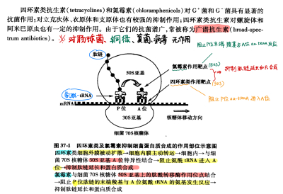

---
tags:
  - pharmacology
---
### [[四环素]]（~cycline）[[氯霉素]]（ <mark style="background-color: #1A4F10; color: white">chlora</mark>mphenicol）（1学时）

“广谱抗生素”：G+、G-、立克次、支、衣原体；四环素对螺旋体和阿米巴也有抑制作用
### 一. [四环素](四环素.md)
> 多西环素（Doxycycline）/ 强力霉素 、米诺环素（Minocycline）、替加环素（Tigecycline）
### 二、[[氯霉素]](Chloramphenicol)
#### 广谱、抑菌，高浓度杀菌
体内过程： 脂溶性高，易穿过各种屏障 ，可进脑脊液、眼、胎儿，典型的肝药酶抑制剂
#### 抗菌谱
##### 对真菌 <mark style="background-color: #3F4B5E; color: white">结核分枝杆菌</mark> 病毒原虫无效
G-：尤其对 <mark style="background-color: #3F4B5E; color: white">伤寒、副伤寒、流感、肺炎</mark> 链球菌、 <mark style="background-color: #3F4B5E; color: white">脑膜炎</mark> 球菌、嗜血杆菌有效
##### G+：不如青霉素、四环素
##### 对厌氧菌、各种体有效
> 厌氧菌、支原体、衣原体、立克次体、螺旋体

作用机制：核糖体50S亚基，可逆结合，抑制肽酰转移酶的转肽反应，阻止肽链延伸，使蛋白质合成受阻（对真核细胞也有较弱作用）
作用位点与<mark style="background-color: #3F4B5E; color: white">大环内酯类和林可霉素类相似</mark>，同时应用可产生拮抗作用
耐药性：产生很缓慢，主要靠<mark style="background-color: #1A4F10; color: white">氯霉素乙酰转移酶</mark>使药物失活
#### 临床应用： 毒性很大，不作为一线药物
##### 伤寒、副伤寒（首选氟喹诺酮或三代头孢）
##### 流感、嗜血杆菌感染引起的脑膜炎
##### 局部滴眼液
#### ※ 不良反应： 尤其注意血液系统毒性严重
##### 胃肠道反应、肝肾损害
##### 二重感染（Superinfection）/ 菌群失调症
##### 骨髓抑制血液系统毒性
剂量相关——可逆性骨髓抑制& 血细胞减少：剂量、疗程依赖
剂量无关——不可逆性骨髓毒性& 再生障碍性贫血：可致死，与剂量无关
*防治措施：严格掌握适应症，详细询问有无与药物相关的血液毒性既往史；定期检查血象，发现异常立即停药；每日剂量不宜超过1g，疗程一般为5~7d（治伤寒、副伤寒可酌情延长）*
灰婴综合征 ：早产儿、新生儿缺乏氯霉素脱毒能力（本质：缺乏6-磷酸葡萄糖脱氢酶），引起氯霉素蓄积
##### 表现为呕吐低温呼吸困难、循环衰竭、发绀和休克、进行性血压下降
##### 缺乏6-磷酸葡萄糖脱氢酶、肝功不好的人都不宜使用
精神病禁用：引起精神病患者严重失眠、幻视、狂躁、抑郁
##### 药物互作
肝药酶抑制剂：增加苯妥英钠、甲苯磺丁脲、氯磺丙脲、双香豆素的血药浓度
同位点（50S）相互拮抗：与林可霉素类、大环内酯类有拮抗作用；
同作用时期相互拮抗（繁殖期杀菌剂 & 快速抑菌剂）：与青霉素类合用时产生拮抗
### 习题
1. 请阐述四环素的抗菌谱及作用机制？
2. 四环素的不良反应？
3. 氯霉素的不良反应？
