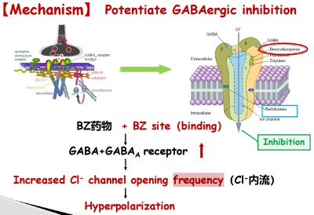
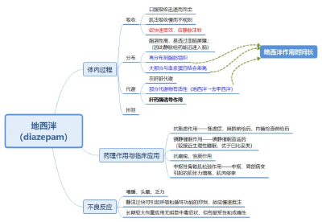
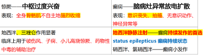

---
tags:
  - pharmacology
aliases:
  - Diazepam
---
### （1）机制
#### ①增强中枢抑制性递质γ-氨基丁酸（[GABA](GABA.md)）的作用
②BZ类药物与GABA-A复合物上的 BZ位点 结合—→受体构象发生变化，促进GABA与GABA-A受体结合—→ <mark style="background-color: #1A4F10; color: white">CI-通道</mark> 开放 <mark style="background-color: #705A16; color: white">频率</mark> 增加（CI-内流增加）—→ 超极化 ，中枢抑制

##### ※苯二氮䓬药物作用于Cl-离子通道的重要特性
##### 反复体会PPT第20页“<mark style="background-color: #1A4F10; color: white">促进GABA的抑制效应</mark>”
1.增加氯离子通道开放频率，而不是延长时间（巴比妥）；
##### 2.不改变神经递质（GABA）量
3.零递质的状态下激动剂也会有效应—→激动剂模拟递质，不依赖于递质的含量—→ 苯二氮䓬 <mark style="background-color: #705A16; color: white">不属于激动剂，只属于变构调节剂</mark>。<mark style="background-color: #3F4B5E; color: white">“魔方”</mark>
##### ※苯二氮䓬为什么有<mark style="background-color: #705A16; color: white">明显的量-效关系</mark><mark style="background-color: #705A16; color: white">（eg很小的剂量不会引起骨骼肌效应）</mark> ?
与GABA受体分布密度和对药物的敏感度相关 。
###### 分布密度：大脑皮质＞边缘系统&中脑＞脑干&脊髓
作用于大脑皮层、丘脑、边缘系统，抑制癫痫灶异常放电扩散——抗惊厥、抗癫痫（Anticonvulsant & Antiepileptic ）
作用于边缘系统（海马、杏仁核，管情绪、<mark style="background-color: #3F4B5E; color: white">记忆</mark>）——抗焦虑（Anxiolytic effects）、<mark style="background-color: #3F4B5E; color: white">麻醉前（逆行性遗忘）</mark>
作用于延脑、下丘脑等网状结构——镇静、催眠（Sedation-Hypnosis ）
作用于网状结构、脊髓——<mark style="background-color: #705A16; color: white">中枢性肌松弛（</mark><mark style="background-color: #705A16; color: white">Muscle relaxation）</mark>
不良：[[呼吸抑制]]。注意：<mark style="background-color: #1A4F10; color: white">无麻醉作用</mark>。
##### 体内过程特点

脂溶性高，静脉注射，快速入脑
作用<mark style="background-color: #705A16; color: white">时间长效</mark>：血浆蛋白结合率高、<mark style="background-color: #705A16; color: white">再分布</mark>到脂肪、<mark style="background-color: #705A16; color: white">肝脏代谢物（奥沙西泮）</mark>还有活性
##### 肝药酶代谢
### （2）药理作用 & 临床应用（上节课）
> <mark style="background-color: #3F4B5E; color: white">从大脑皮层——边缘系统——边缘&中脑网状结构——脊髓这样依次往下记。</mark>
##### （1）Anticonvulsant抗癫痫、惊厥作用

##### （2）抗焦虑作用 ；麻醉前给药/逆行性遗忘
##### 快速
##### 选择性高：小剂量作用于边缘系统的BZ受体
> 管情绪、管记忆
##### ☺抗[焦虑](焦虑.md)的<mark style="background-color: #705A16; color: white">首选药</mark>
☺<mark style="background-color: #705A16; color: white">麻醉前给药、内镜检查前给药</mark>（缓解恐惧；暂时性记忆缺失/link逆行性遗忘）
> 一般目的：缓解情绪；镇痛；遗忘
##### （3）镇静催眠作用
☺镇静催眠的<mark style="background-color: #705A16; color: white">首选药</mark>（引起的较接近于生理性睡眠，优于巴比妥类）
<mark style="background-color: #1A4F10; color: white">优于巴比妥</mark>：①作用于NREMS，不易反跳、不易耐受；②接近生理性睡眠
延长NREMS的2期，缩短3、4期深睡（降低睡眠质量）。
停药后出现反跳性失眠（ rebound insomnia，REMS延长） 较轻，停药困难少
产生耐受性、依赖性慢；安全范围大
##### （4）中枢性骨骼肌松弛
☺治疗中枢或局部病变引起的<mark style="background-color: #705A16; color: white">肌张力增高、肌肉痉挛</mark>：有较强的肌松作用和降低肌张力作用，但不影响正常活动
<mark style="background-color: #3F4B5E; color: white">小剂量</mark>抑制脑干网状系统下行系统对γ神经元的易化作用；
> 位于脊髓前角；调节肌梭对牵拉刺激的敏感性；支配梭内肌

<mark style="background-color: #3F4B5E; color: white">大剂量</mark>增强脊髓神经元的突触前抑制，抑制多突触反射；
##### 临床应用
抗<mark style="background-color: #705A16; color: white">癫痫持续状态（首选）</mark>；抗惊厥（ 三唑仑）；
抗<mark style="background-color: #705A16; color: white">焦虑（首选）</mark>；麻醉前给药、内镜检查前给药；
<mark style="background-color: #705A16; color: white">镇静催眠（首选）；</mark>
##### 肌张力增高、肌肉痉挛
### （3）不良反应
<mark style="background-color: #3F4B5E; color: white">剂量相关的中枢抑制</mark>。急性过量相对不那么危险。
#### ①显著剂量相关的<mark style="background-color: #1A4F10; color: white">逆行性遗忘</mark>
> Significant dose-related retrograde amnesia

②嗜睡、头晕、乏力；<mark style="background-color: #1A4F10; color: white">——地西泮半衰期长，药物的残留效应。</mark>
③长期较大剂量服用（300~600mg/日），无明显中毒症状，但有耐受性和成瘾；
④静注过快可引起<mark style="background-color: #3F4B5E; color: white">呼吸、循环功能抑制</mark>，故应慢速推注；
⑤与其他中枢抑制药、乙醇（⚠）合用，可加重嗜睡、昏睡、呼吸抑制、[昏迷](昏迷.md)，严重可致死。
