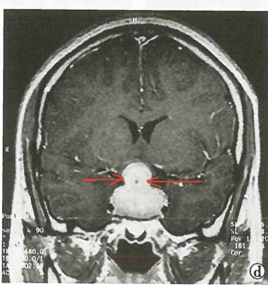

---
aliases:
  - 雪人征
  - 垂体瘤
tags:
  - pathology
  - imaging
---
垂体瘤又称雪人征。
[Open: Pasted image 20261013211228.png](attachments/07afc359012c7a402f899ff97d1b4fed_MD5.jpg)

#### 解剖
肿瘤向上生长可穿破鞍隔突入鞍上池，向下可侵入蝶窦，向两侧可侵入海绵窦。

---
#### 病理特点
腺瘤，来源于垂体前叶上皮细胞，**鞍内最常见**肿瘤，占颅内肿瘤的 10%，好发于30-60岁，女性多见，功能性腺瘤占65%。
##### 肉眼观
肿瘤大小不一，直径可由0.1 ~10cm。
肿瘤一般境界清楚，呈膨胀性生长，约30%的腺瘤无包膜，呈侵袭性生长，<mark style="background-color: #1A4F10; color: white">肿瘤侵入周围脑组织时，则称之为侵袭性垂体腺瘤</mark>。
肿瘤质软，色灰白、粉红或黄褐；可有出血、坏死、囊性变、纤维化和钙化。
##### 镜下观
瘤细胞似正常的垂体前叶细胞，核圆或卵圆形，有小的核仁，多数腺瘤由单一细胞构成，形态一致，少数可由几种瘤细胞构成
瘤细胞排列成片块、条索、巢状﹑腺样或乳头状结构，瘤细胞可有一定的异型性，但核分裂罕见
瘤细胞巢之间为血管丰富的纤细间质。
#### 临床表现
①分泌某种过多的激素，表现相应的功能亢进；
②<mark style="background-color: #705A16; color: white">垂体功能异常</mark>：肿瘤浸润，破坏、压迫垂体，使其激素分泌障碍，表现为功能低下；
③<mark style="background-color: #705A16; color: white">视野缺损</mark>：肿瘤压迫[视神经](视神经.md)表现为视野损失、视力下降或失明等。
#### 影像学
首选MRI，微腺瘤<mark style="background-color: #1A4F10; color: white">首选动态增强MRI</mark>

#### 诊断
根据影像学表现结合内分泌检查，95%垂体腺瘤可明确诊断。
#### 分类
- 以10mm划分微腺瘤、大腺瘤
- 大于40mm为垂体巨大腺瘤
<mark style="background-color: #1A4F10; color: white">催乳素细胞腺瘤</mark>：30%，表现为泌乳，无月经和不育等→闭经泌乳综合征
<mark style="background-color: #1A4F10; color: white">生长素细胞腺瘤</mark>：25%，生长激素水平升高，青春期前巨人症（gigantism），成年后肢端肥大症（acromegaly）。
促肾上腺皮质激素细胞腺瘤.
促性腺激素细胞腺瘤
<mark style="background-color: #1A4F10; color: white">促甲状腺素细胞腺瘤</mark>：1%，多数患者甲状腺功能低下，仅少数患者伴有甲亢及血中TSH升高。
多种激素细胞腺瘤（plurihormonal）
无功能细胞腺瘤（nonfunctional）

嫌色性细胞腺瘤 嗜酸性细胞腺瘤 嗜碱性细胞腺瘤 混合细胞腺瘤