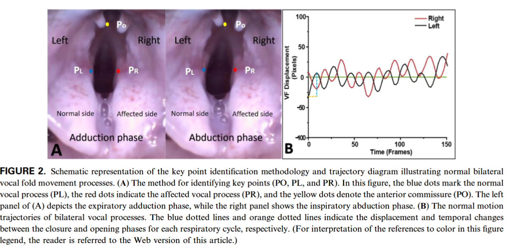
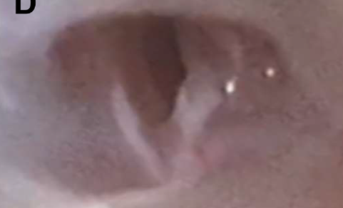

---
tags:
  - Proj
---
> [!PDF|yellow] [The Laryngoscope - 2026 - Bhatt - Novel Injectable Supports Long‐Term Recurrent Laryngeal Nerve and Partial Peripheral, p.4](The%20Laryngoscope%20-%202026%20-%20Bhatt%20-%20Novel%20Injectable%20Supports%20Long‐Term%20Recurrent%20Laryngeal%20Nerve%20and%20Partial%20Peripheral.pdf#page=4&selection=124,37,134,7&color=yellow)
> > At 84 days, 3/5 biomolecule mice demonstrated midline VF positioning compared to 0/5 saline mice, which showed predominantly abducted positioning (p = 0.076).

> [!PDF|green] [Ultrastructural and Automated Vocal Fold Tracking Study in Recurrent Laryngeal Nerve Injury Models, p.3](Ultrastructural%20and%20Automated%20Vocal%20Fold%20Tracking%20Study%20in%20Recurrent%20Laryngeal%20Nerve%20Injury%20Models.pdf#page=3&selection=189,0,190,30&color=green)
> > Schematic representation of the key point identification methodology and trajectory diagram illustrating normal bilateral vocal fold movement processes.
> 
> [Open: Pasted image 20261010222812.png](attachments/41efecccb97dbc1ca07bfadbdd2380d4_MD5.jpg)

> [!PDF|green] [Ultrastructural and Automated Vocal Fold Tracking Study in Recurrent Laryngeal Nerve Injury Models, p.1](Ultrastructural%20and%20Automated%20Vocal%20Fold%20Tracking%20Study%20in%20Recurrent%20Laryngeal%20Nerve%20Injury%20Models.pdf#page=1&selection=51,21,58,8&color=green)
> > Compared to the normal VF, the affected VF’s mean motion range (MMR) was 22% less (P < 0.05), and mean motion speed (MMS) was 58% slower (P < 0.05).

> [!PDF|green] [The Laryngoscope - 2026 - Bhatt - Novel Injectable Supports Long‐Term Recurrent Laryngeal Nerve and Partial Peripheral, p.5](The%20Laryngoscope%20-%202026%20-%20Bhatt%20-%20Novel%20Injectable%20Supports%20Long‐Term%20Recurrent%20Laryngeal%20Nerve%20and%20Partial%20Peripheral.pdf#page=5&selection=80,0,80,18&color=green)
> > Videolaryngoscopy 
> [Open: Pasted image 20261010212342.png](attachments/86188d6f2eee722975e3a8c03ebdf2c3_MD5.jpg)
