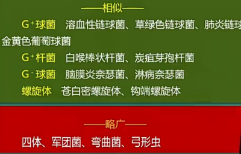
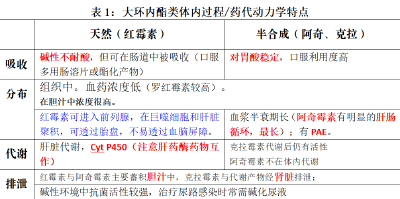
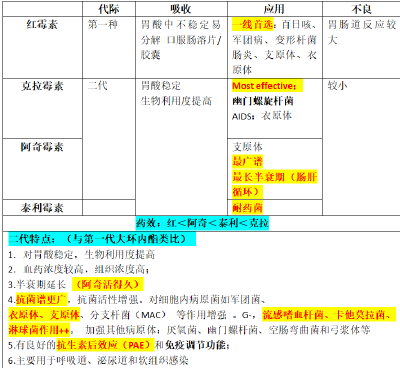
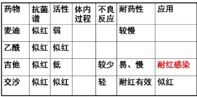
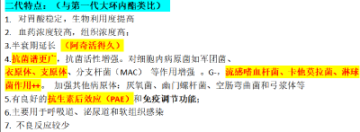

---
tags:
  - pharmacology
---
### 大环内酯类 （Macrolides） 、林可霉素类（lincomycins）、多肽类抗生素：万古霉素、多粘菌素、杆菌肽
### 概论
### 共同特点
##### 具有大环内酯环结构
##### 静止期、抑菌（quiescent bacteriostatic）
##### 高浓度杀菌
##### 在碱性 环境中活性强
机制：红绿林中50载（因此红绿林不可联用，相互拮抗）
### 分代 & 分类（要记）
第一代大环内酯类抗生素——β过敏/耐药者：[[红霉素]]（Ery thromycin ）麦迪霉素（Midecamycin）乙酰螺旋霉素（Acetylspiramycin）
第二代大环内酯类抗生素——抗菌活性、PAE↑ 不良反应↓：克拉、阿奇、罗红（Clari thromycin ） （Azi thromycin ） （Roxithromycin）氟红霉素（Miocamycin）
第三代大环内酯类抗生素——超级耐药菌：泰利 霉素（Telithromycin） 。地红霉素（Dirithromycin）喹红霉素（Cethromycin）酮基大环内酯（Ketolides）
##### *按结构分类*
14元环：天然：[[红霉素]]；人工半合成：克拉霉素罗红霉素
##### 1819<mark style="background-color: #3F4B5E; color: white">5</mark><mark style="background-color: #3F4B5E; color: white">元环：半合成：阿</mark><mark style="background-color: #3F4B5E; color: white">奇</mark><mark style="background-color: #3F4B5E; color: white">霉素（唯一，“奇”-奇数）</mark>
16元环：天然：交沙霉素。人工：罗他霉素乙酰螺旋霉素
### 1. 抗菌能力—— <mark style="background-color: #705A16; color: white">四个/军团/弯/弓/（射）一</mark>百<mark style="background-color: #705A16; color: white">个/太阳</mark>
天然（[[红霉素]]） ：与青霉素相似而略广，但青霉素是繁殖期杀菌剂，大环内酯是静止期抑菌剂：<mark style="background-color: #3F4B5E; color: white">G+ ，厌氧菌</mark>，部分G-

> 四个军团弯曲如弓

弯曲杆菌引起的肠胃炎；军团菌（Lp）引起的肺炎；百日咳杆菌引起的百日咳
##### 支 原体、 衣 原体、 弓 形虫、立克次体、螺旋体
<mark style="background-color: #705A16; color: white">四个/军团/弯/弓/（射）一</mark>百<mark style="background-color: #705A16; color: white">个/太阳</mark> *（G+ & 厌氧）*
> Legionella pneumophila (Lp) 军团菌, Campylobacter弯曲杆菌, Bordetella pertussis百日咳杆菌，mycoplasma支原体chlamydia衣原体，mycoplasma支原体, chlamydia衣原体，Toxoplasma gondii弓形虫， Rickettsia立克次体
##### <mark style="background-color: #705A16; color: white">“白衣空（空肠弯曲菌）军百支曲”（加了一个白喉）</mark>
###### 耐青霉素或青霉素过敏者的金葡菌感染
##### 半合成（阿奇、克拉、罗红）：广谱
### 2.作用机制 ——抑制蛋白质的合成（50S、延长阶段）
##### 抑制蛋白质的合成 （50S、延长）
大环内酯类抗生素作用于 50S核糖体亚基，抑制<mark style="background-color: #705A16; color: white">转肽酶</mark>并干扰mRNA移位
##### 阻止肽链延长，使其提前脱落
##### 对哺乳动物核糖体无影响
### 3. 耐药：大环内酯易产生耐药性和交叉耐药性，主要是外排
靶位点修饰（Target Modification）：核糖体50S结合位点发生构象改变
##### 产生灭活酶：质粒介导，打开内酯环
主动外排系统增强/细胞膜通透性降低： <mark style="background-color: #1A4F10; color: white">链球菌的外排系统是其主要耐药机制</mark>
### 4.药代动力学/体内过程

吸收：红霉素可被胃酸灭活，但可在肠道内吸收。克拉霉素和阿奇霉素在胃酸稳定。
分布：除了脑脊液。胆汁蓄积。天然macrolides<mark style="background-color: #705A16; color: white">血药浓度低，所以不适合败血症。</mark>
##### 代谢：肝脏，细胞色素P450
排泄：主要通过胆道。
### 5. 临床应用
<mark style="background-color: #705A16; color: white">替代青霉素使用</mark><mark style="background-color: #1A4F10; color: white">（链球菌感染；</mark>耐青霉素的金黄色葡萄球菌感染；对青霉素过敏者）
衣原体、支原体感染，<mark style="background-color: #705A16; color: white">※</mark><mark style="background-color: #705A16; color: white">非典型病原体的首选</mark><mark style="background-color: #705A16; color: white">；</mark> 社区性肺炎的一线用药
治疗军团菌病、白喉、百日咳；(<mark style="background-color: #705A16; color: white">白衣军团百支曲</mark>/军团弯弓支援一百 ~~个太阳~~ ）
##### <mark style="background-color: #705A16; color: white">- HP（幽门螺旋杆菌）感染：三联疗法</mark>
##### 皮肤软组织感染等
##### *大环内酯的新药理作用*
##### 非特异抗炎作用
1.肺部和呼吸道炎症。直接抗菌；对哮喘，泛细支气管炎治疗作用
##### 抗支气管哮喘作用
##### 抗肿瘤作用
2.抗肿瘤作用。凋亡与免疫，肿瘤与免疫间相互作用
3.逆转肿瘤细胞多药耐药。红霉素逆转急非淋白血病对高三尖杉酯碱、阿糖胞苷等体内耐药，预防化疗期间感染发生
##### 促进胃肠动力作用
##### 免疫调节（抑制多糖蛋白复合物合成酶）
##### 抗寄生虫抗真菌抗病毒
### 6. 不良反应
> 红伤心肠肝

胃肠道反应：主要联系它的碱性刺激——半合成药物胃肠道反应轻微。
肝毒性： ※胆汁淤积、肝功能不良者禁用红霉素<mark style="background-color: #1A4F10; color: white">（从胆汁排泄）</mark>；
耳毒性： 大剂量使用时出现（＞12mg/L)听力下降
##### ※Superinfections二重感染
##### 过敏性：少见
心脏毒性，LQTS——长QT间期综合征：静注过快/与茶碱合用时发生率更高
### <mark style="background-color: #705A16; color: white">7. 药物相互作用：青红合用不对路，绿林红争结合点，四红合用增肝毒</mark>
青霉素是繁殖期杀菌药，红霉素抑制细菌繁殖，红霉素用了之后青霉素无法发挥作用，所以青红合用不对路
##### 拮抗克林霉素、林可霉素、[[氯霉素]] （作用位点相似）
抑制茶碱、[[卡马西平]]、华法林的代谢 （血药浓度异常升高；延长凝血时间）
促进环孢霉素吸收，引起腹痛、高血压及肝功能障碍
##### 增加地高辛肝肠循环，体内存留时间延长
### 一． [[红霉素]](erythromycin)、阿奇霉素、克拉霉素等

#### [[红霉素]]（Erythromycin）
##### 概论说的主要就是它
##### 胃酸中不稳定易分解口服肠溶片/胶囊
[[红霉素]]<mark style="background-color: #705A16; color: white">是</mark><mark style="background-color: #705A16; color: white">百</mark><mark style="background-color: #705A16; color: white">日咳</mark><mark style="background-color: #705A16; color: white">军团</mark><mark style="background-color: #705A16; color: white">病</mark><mark style="background-color: #705A16; color: white">变形</mark><mark style="background-color: #705A16; color: white">杆菌肠炎</mark><mark style="background-color: #705A16; color: white">支原体衣原体</mark><mark style="background-color: #705A16; color: white">的首选用药</mark>
##### 胃肠道反应较大
##### 一代大环内酯系列

二代大环内酯：克拉霉素（Clarithromycin）、阿奇霉素（Azithromycin）
##### 更容易被吸收，生物利用度更高
##### 抗菌活性更高：更长的 PAE 和更明显的免疫调节作用
##### 不良反应：胃肠道反应比红霉素低
罗红 霉素（Roxithromycin）：生物利用度高 血药浓度更高
克拉霉素（Clarithromycin）：抗菌活性 <mark style="background-color: #705A16; color: white">最强，</mark> <mark style="background-color: #1A4F10; color: white">对胃酸最稳定（用于治疗幽门螺旋杆菌）</mark> ；对军团菌、衣原体效果最好。肺、扁桃体中蓄积；生物利用度略低。联用时：先使用阿莫西林，后使用克拉霉素
<mark style="background-color: #705A16; color: white">治疗HP引起消化性溃疡：克拉克星，克拉霉素、克林霉素、沙星</mark>
阿奇霉素（Azithromycin）： <mark style="background-color: #705A16; color: white">最广谱</mark>的大环内酯类抗生素半衰期最长对支 原体肺炎是大环内酯最强；明显的PAE，肠肝循环，吃三天停三天
泰利霉素（Telithromycin）： <mark style="background-color: #705A16; color: white">适用于耐药菌。</mark>吸收度好，比阿奇霉素效果更好
### 二． 林可霉素类—— <mark style="background-color: #1A4F10; color: white">“抗厌氧、骨分布”</mark>
> 林可霉素（lincomycin）和克林霉素（clindamycin）;与大环内酯类抗生素相互拮抗、交叉耐药。克林顿总统是骨干，一身正气，厌氧。身边很多小人（伪人），伪膜性肠炎。
### 1.抗菌能力：克林霉素克 厌氧
抗菌谱： G+ all；<mark style="background-color: #3F4B5E; color: white">但是对G-需氧菌无效</mark>
抗菌机制：与大环内酯类类似，竞争50S结合位点，所以红绿林不可合用
### 2.耐药性：位点修饰、主动外排、钝化酶（主要)；对肠球菌耐药；与大环内酯类抗生素交叉耐药
### 3.药代动力学： <mark style="background-color: #705A16; color: white">骨分布</mark>
##### 吸收：林可霉素吸收坏，克林霉素吸收好
> 记：克林顿是正牌总统易进入白宫，林克顿是冒牌。
##### 分布： 在<mark style="background-color: #705A16; color: white">骨组织</mark>内很好
##### 排泄：胆汁和尿液
### 4.临床应用： <mark style="background-color: #705A16; color: white">骨、腔感染</mark>
> 记：克林顿总统是骨干

金葡菌<mark style="background-color: #705A16; color: white">所致的急、慢性</mark><mark style="background-color: #705A16; color: white">骨关节感染</mark><mark style="background-color: #705A16; color: white">——</mark><mark style="background-color: #705A16; color: white">首选药</mark><mark style="background-color: #705A16; color: white">；</mark>
部分厌氧菌感染，口腔、盆腔、腹腔（合用氨基苷类效果好，G-）
外用需氧G+菌引起的感染（红霉素软膏，克林霉素软膏）
### *5.不良反应：* *假膜性肠炎*
口服给药易发生<mark style="background-color: #705A16; color: white">假膜性肠炎</mark>（AAPC, Antibiotic-Associated Pseudomembranous Colitis）
难辨梭状芽孢杆菌大量繁殖，产生外毒素，需用<mark style="background-color: #3F4B5E; color: white">万古霉素+甲硝唑治疗</mark>
> 打小人（伪人）是遗名万古的任务，甲硝“假消”消除假膜
##### 胃肠道反应常见，口服多见
> 静脉缓慢滴注、不可静脉推注
##### 二重感染
肝、肾损害；神经肌肉阻滞作用：黄疸、血尿等；避免与其他阻滞剂合用
##### 过敏反应
### 三．多肽类抗生素：万古霉素、多粘菌素、杆菌肽<mark style="background-color: #3F4B5E; color: white">——抗菌特点&不良反应</mark>
> 万古霉素（vancomycin）、去甲万古霉素（norvancomycin）、替考拉宁（teicoplanin）——使用最多
### 万古霉素(Vancomycin） 、去甲万古霉素、替考拉宁（teicoplanin）——使用最多
#### 抗菌能力：杀真菌剂； 窄谱G+；<mark style="background-color: #705A16; color: white">繁殖期快速杀菌（细胞壁合成）</mark>
抗菌谱：窄谱，对G+菌，尤其是对<mark style="background-color: #705A16; color: white">MRSA和MRSE、对</mark><mark style="background-color: #1A4F10; color: white">甲氧西林耐药</mark><mark style="background-color: #705A16; color: white">的菌</mark>有强大抗菌作用
###### 去甲万古霉素<mark style="background-color: #705A16; color: white">抗</mark><mark style="background-color: #705A16; color: white">脆弱拟杆菌</mark><mark style="background-color: #705A16; color: white">作用最强</mark>
#### 抗菌机制：与细胞壁合成前体肽聚糖五肽末端结合，阻断高分子肽聚糖合成，从而抑制细胞壁形成—— 因此对G-无效
#### 耐药性：难以产生
肠球菌：产生修饰细胞壁前体肽聚糖的酶；
###### 金葡菌：多种机制
###### 细胞壁增厚
###### 细胞壁成分改变
###### 青霉素结合蛋白（PBPs）变化
###### 耐药质粒传递
#### 药代动力学 ：口服不能吸收（但替考拉宁<mark style="background-color: #3F4B5E; color: white">治疗肠炎时口服</mark>）
###### 万古霉素不能肌内注射,会刺激局部肌肉组织坏死，只能静脉注射
###### 替考拉宁可以i.m.
###### 炎症反应时可以通过血脑屏障
###### 肾小球滤过消除
#### 临床使用：一般不用，仅用于严重 耐药G+感染
###### 多重 （MRSA MRSE）
###### 严重链球菌感染（对青霉素过敏）
常规的G+，一般用“青庆”（青霉素联合氨基苷类），治疗失败的肠球菌、链球菌心内膜炎再上万古霉素
###### 治疗假膜性肠炎：替考拉宁 最好 （此时需要口服）
#### 不良反应—— 红人
###### 多
###### 高 耳毒性、肾毒性
变态反应： 红人综合征（Red Man Syndrome, RMS）
###### 极度的皮肤潮红、红斑、荨麻疹、心动过速、低血压等特征性症状
###### <mark style="background-color: #705A16; color: white">万古霉素促进组胺释放</mark>
###### 解救：使用<mark style="background-color: #705A16; color: white">抗组胺药</mark>和<mark style="background-color: #705A16; color: white">糖皮质激素</mark>
###### 单给
*静注液中不宜加氯霉素、[[甾体激素]]、甲氧苯青霉素等，以免产生沉淀*
*禁止与碱性溶液配伍禁止与重金属接触禁止与具有肾毒性、耳毒性的药物合用*
### 多黏菌素（Polymyxins）
##### 临床上多用多黏菌素B、多黏菌素E
抗菌活性： 窄谱、慢效，部分G—杆菌、<mark style="background-color: #705A16; color: white">铜绿假单胞菌</mark>
抗菌机制：破坏、裂解细胞 膜→物质外漏
临床应用： <mark style="background-color: #705A16; color: white">耐药株很少，</mark>用于耐药铜绿假单胞菌、革兰氏阴性杆菌感染，<mark style="background-color: #1A4F10; color: white">局部应用</mark>
不良反应：毒性很大，肾神。 肾毒性（25%）、神经毒性、变态反应
### 杆菌肽
抗菌能力： 慢效杀菌 药物；对<mark style="background-color: #3F4B5E; color: white">G+菌</mark>有强大抗菌作用（对耐β-内酰胺酶的细菌也有作用），对G-球菌、螺旋体、放线菌有一定作用，对G-杆菌无作用
作用机制： 选择性抑制细菌细胞壁合成过程中的脱磷酸化，阻碍细胞壁合成，同时破坏细胞膜，使内容物外漏，细菌死亡
##### 体内过程：口服不吸收，只能局部给药
##### 不良反应 ：有严重的肾毒性 ，仅用于 局部抗感染
### <mark style="background-color: #705A16; color: white">思考题</mark>
1.请阐述macrolides的抗菌谱及作用机制？
2第二代大环内酯类pk/pd有何特点？
3.阿奇霉素克林霉素的抗菌作用和临床应用有何特点？
4 Vancomycin类与β lactamantibiotics在作用机制和抗菌谱上有何不同？
##### 5. 简述多黏菌素的抗菌作用机制
### 小结
##### 1.红霉素在胆汁中浓度高，主要 <mark style="background-color: #1A4F10; color: white">经胆汁排泄</mark>
2.红霉素抗菌谱的特点： 与青霉素相似而略广 ，“广”在对某些 G-杆菌<mark style="background-color: #1A4F10; color: white">、军团菌、支原体、衣原体、立克次体、厌氧菌</mark> 有效
##### 3.红霉素的抗菌机理：抑制蛋白质的合成（50s）
##### 4.红霉素首选用于军团菌、弯曲杆菌、支原体、衣原体感染、白喉带菌者
##### 5.红霉素主要不良反应：胃肠道反应
##### 6. 其他第一代大环内酯类与红霉素比较主要特点是不良反应较轻
7. 第二代大环内酯类的特点有哪些？

##### <mark style="background-color: #705A16; color: white">8.</mark> <mark style="background-color: #705A16; color: white">林可霉素类主要作用于</mark> <mark style="background-color: #705A16; color: white">G+菌，对G-杆菌无效</mark>
##### 9. 林可霉素类的抗菌机理：与红霉素相同
##### 10. 林可霉素类主要特点： 骨组织 浓度高
##### 11.林可霉素类首选用于：金葡菌性急/慢性骨髓炎
##### 12. 林可霉素类主要不良反应：胃肠道反应
##### 13. 万古霉素类对G + 菌作用强大，对G - 菌无效
##### 14. 万古霉素类的抗菌机理：抑制 细胞壁粘肽 的合成
##### 15. 万古霉素类禁与氨基苷类、高效利尿药合用
16. 多粘菌素类仅对G-杆菌 作用强大，尤其 <mark style="background-color: #1A4F10; color: white">绿脓杆菌</mark> ，为 窄谱 杀菌剂
##### 17. 多粘菌素类的抗菌机理：增加 <mark style="background-color: #3F4B5E; color: white">胞浆膜的通透性</mark>
##### 18. 多粘菌素 类的主要不良反应： 肾毒性
