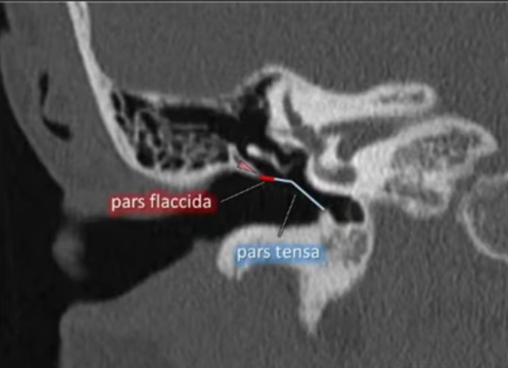
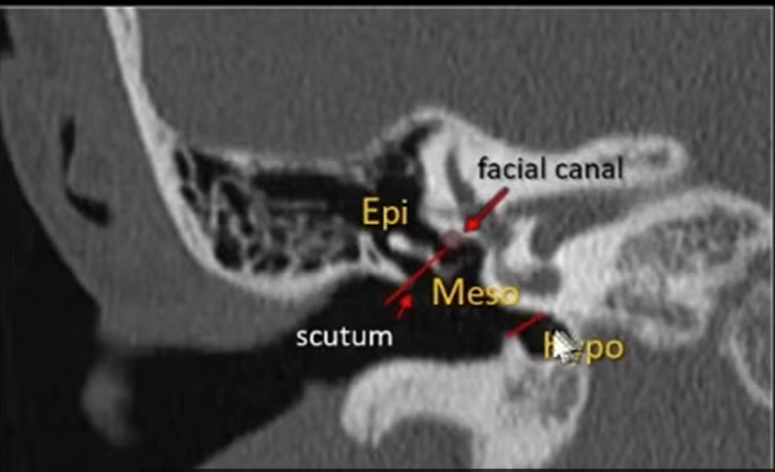
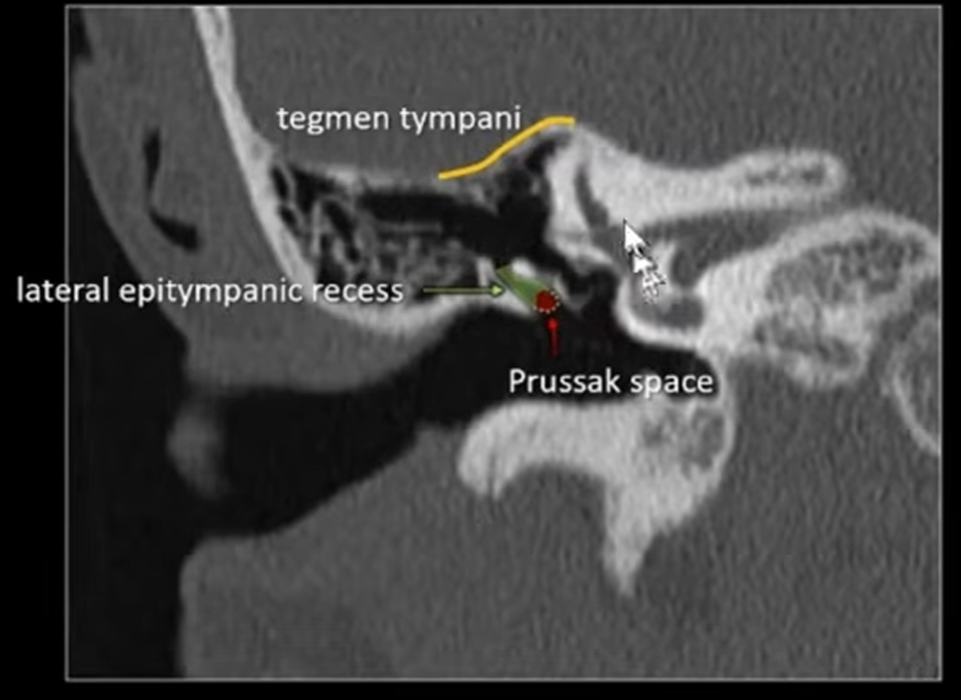
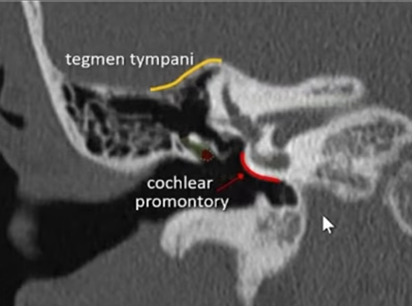
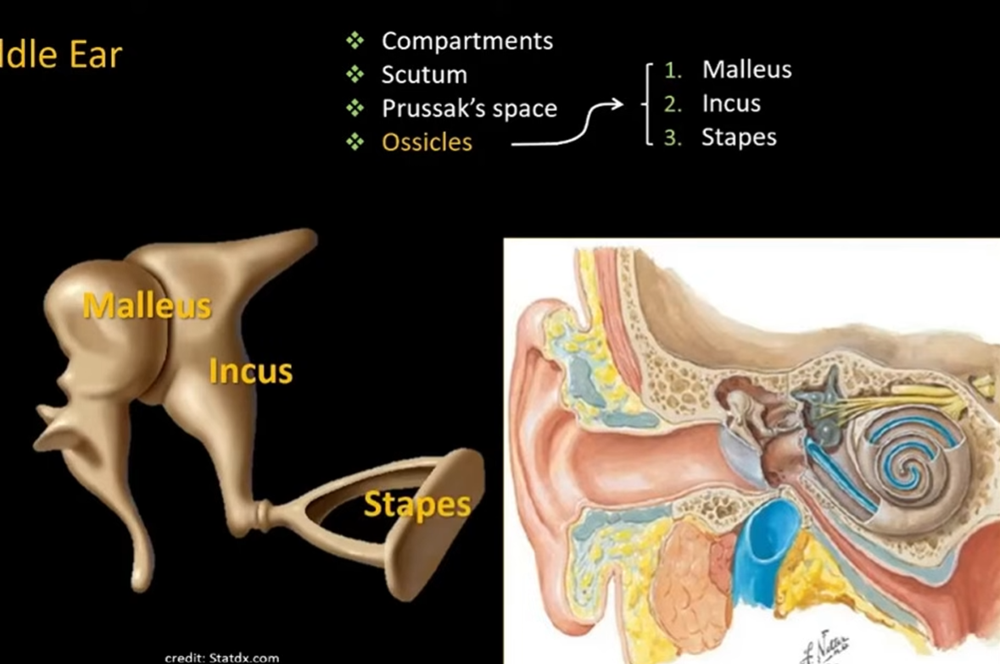
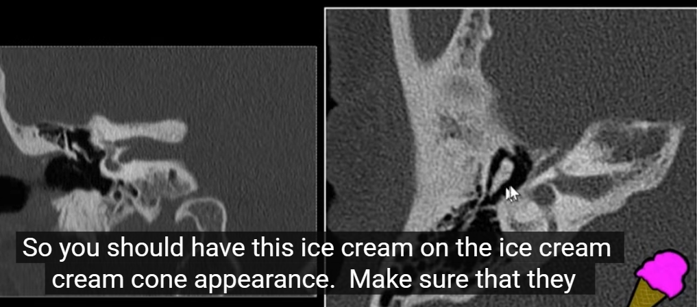

---
tags:
  - imaging
---

#### 耳
X 线：观察人工耳蜗植入术后电极的形态与位置
CT 检查：耳部病变主要影像检查技术，是<mark style="background-color: #1A4F10; color: white">耳镜检查无异常的搏动性耳鸣</mark>的<mark style="background-color: #705A16; color: white">首选</mark>方案
MRI 检查：可显示听神经、面神经、膜迷路和软组织病变。中耳、听骨链、乳突：长 T1 短 T2；岩锥骨髓：短 T1 长 T2；膜迷路：长 T1 长 T2
##### 正常解剖定位
[Open: Pasted image 20261016090447.png](attachments/8ce04f2a3ecfcef24b9f7f53015d528d_MD5.jpg)

[Open: Pasted image 20261016090334.png](attachments/77ee2c8073b69c4fb0b213247c2c44ba_MD5.jpg)

[Open: Pasted image 20261016091248.png](attachments/0c90acd382c38cb52e6e07eaf47ca13c_MD5.jpg)

[Open: Pasted image 20261016091311.png](attachments/8568be9e77b5a4d1147ac233a72cfb05_MD5.jpg)

[Open: Pasted image 20261016091540.png](attachments/82ad5505bd7fbea99aa68af25e134a56_MD5.jpg)

[Open: Pasted image 20261016092732.png](attachments/96f964e6cca955bfd82dd52110053a0f_MD5.jpg)

##### 常见疾病
[[中耳乳突炎]]

#### 典型病例
[Graves病](Graves%20病.md)