---
tags:
  - pharmacology
---
### 局部麻醉药（2学时自学翻转课堂）
> 最重要的是从教材摘出来的那张绿色表格。
### 一．局部麻醉药的概念
 局部地作用 于神经 末梢或神经干 ，能 可逆 地阻断神经AP的产生和传导，在 意识清醒  的条件下引起有关神经支配的部位出现暂时性、可逆性的感觉丧失的药物。
#### 常用局部麻醉药的 <u>*化学结构*</u> ：亲脂-中间链-亲水
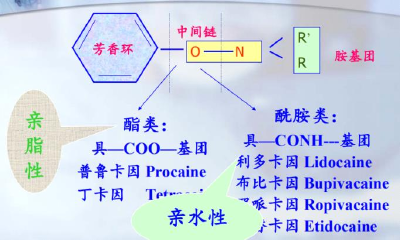
酯类：毒性相对大、治疗指数低、易过敏，由胆碱酯酶降解。代表药： 普、丁（pudding） 
酰胺类：毒性相对小、治疗指数较大、不易过敏，由肝药酶降解。代表药见上
变态反应：荨麻疹、支气管痉挛、喉头水肿等，酯类比酰胺类发生率高。（~[[普鲁卡因]]）
② 治疗指数（Therapeutic Index, TI）：在动物试验中，<mark style="background-color:#fef3c7;"> TI = LD50 / ED50（致死比有效） </mark> ;在临床上， <mark style="background-color:#fef3c7;"> TI=TD50/ ED50（中毒比有效） </mark>。TD50越大，ED50越小，治疗指数越高，表明安全性越高。
### <mark style="background-color:#fef3c7;"> 影响因素 ※ </mark>
 血管收缩药 可延长局麻药作用时间，降低毒性。但侧支循环差部位（手脚趾、阴茎）禁用，缺血坏死
药物剂量：✔药效、毒性；但 ×消除时间（一级动力学，半衰期恒ln2/Ke)
体液pH：碱性胺类药。炎症、脓肿部位酸性，必须浸润麻醉才好吸收。
##### 长短效局麻药混用
### 二．局部麻醉药的作用
#### <u>局麻作用</u>
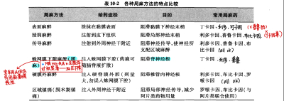
选择性作用于局部神经组织电压门控Na+通道，抑制Na+内流， 阻止动作电位的产生和传导 
对膜RP电位无明显影响，主要抑制动作电位；
具有 使用依赖性/频率依赖性  ，即  神经组织受到的刺激频率越高、开放的通道数目越多，受阻滞越明显，局麻作用越强。 （“枪打出头鸟”）
对任何神经都有阻断作用，高浓度时最后抑制运动神经、平滑肌和骨骼肌。敏感性不同：先麻冷的、痛的、兴奋的
### 不良反应
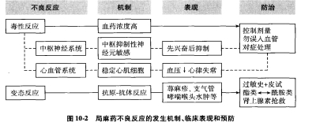
#### <u>中枢作用（不良）</u> ：先兴奋后抑制
> 中枢抑制性神经元对procaine更敏感；先焦躁后意识丧失；可被 <u>苯二氮卓</u> 、巴比妥干预
#### <u>心血管作用（不良）</u> ：心脏抑制、小动脉扩张
#### 变态反应：荨麻疹、支气管痉挛、喉头水肿等，酯类比酰胺类发生率高
### 三． <u>[[普鲁卡因]](procaine)</u> /奴佛卡因（novocaine）； <u>丁卡因(tetracaine)、利多卡因(lidocaine)</u> ； *布比卡因、罗哌卡因等；新型麻醉药。*
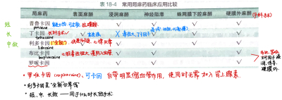
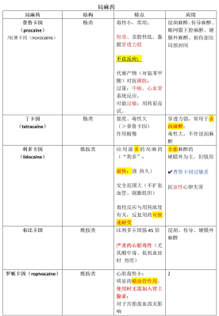
> 普鲁卡因中枢毒性可被苯二氮卓类解救
> ​优先看第一个表，背住表1就够了！
> 普定利布多——酯类+利布特奥特曼
#### 选择题
#### 镇静催眠
#### 入睡困难：[[唑吡坦]]、佐匹克隆
#### 早醒：[[地西泮]]
#### 刺激胃：水合氯醛
#### 精神失常
抗抑郁症药会问“属于XX类抑郁药的是”。回去看绿色大表和口诀。NARI就记一个地昔帕明。
#### 神经阻滞镇痛药：氟哌利多
#### 氯丙嗪对晕动症无效
中枢抗胆碱药不可解救氯丙嗪引起的迟发型运动障碍
#### 见D4受体、免除锥体外系反应，选氯氮平
#### 解救氯丙嗪低血压：去甲肾上腺素
#### II型精神分裂症可用：[[氯氮平]]、舒必利
#### 氯培酮是非经典抗精神分裂药（5-HT受体抑制）
#### 镇痛药
喷他佐辛激动k、d，抑制u；杜冷丁抑制M受体
#### 冬眠合剂
<mark style="background-color:#fef3c7;">[[喷他佐辛]]：非麻醉性镇痛药；</mark>[[哌替啶]]：心源性哮喘；不可用于支气管哮喘
#### 哌替啶vs吗啡：呼吸抑制相似，胃肠道作用减弱
#### [[芬太尼]]：时间最短
纳洛酮鉴别吗啡成瘾；美沙酮戒毒
#### 急性心肌梗死大胆选吗啡（镇痛、心肌保护）
#### 胆结石：不可选吗啡，要选【[[哌替啶]]+阿托品】
#### NSAIDS
几乎无抗炎作用、仅解热镇痛、儿童感冒首选、Reye替代：[[对乙酰氨基酚]]
#### 最强、不易控制的发热：吲哚美辛
#### 类风湿性关节炎首选：阿斯匹林
#### 小剂量明显抑制血栓：仅Aspirin
#### 十二指肠溃疡史：布洛芬
#### 无水杨酸反应：布洛芬
长期大量Aspirin，凝血障碍，可用Vit K预防
解热镇痛药对内脏平滑肌绞痛无效，不仅在外周，部分进入中枢发挥作用。
#### 塞来昔布：治疗剂量影响PG但不影响TXA2
#### 阿斯匹林可通过胎盘屏障
#### 与NSAIDS抑制PG合成酶无关的不良反应是
A阿斯匹林哮喘——脂氧酶LT⬆️
##### <mark style="background-color:#fef3c7;">B水杨酸反应（过量中毒）</mark>
C抑制血小板聚集（COX-2于血小板TXA2⬇️）或致血栓（血管内皮PGI2⬇️）
D胃溃疡、胃出血（PGE2保护作用⬇️、直接刺激。布洛芬弱）
##### E损伤肾功能 （PGE2扩肾血管）
#### 局麻药
#### 也有心肌膜稳定作用
#### 普鲁卡因易过敏
#### 丁卡因不浸润（毒大），普鲁卡因不表面（穿透力弱）
#### 罗哌卡因  产科手术 
> 联想：罗姐姐刚生了宝宝。
中毒：中枢先兴奋后抑制。惊厥抢救：苯二氮卓（[[地西泮]]）、速效巴比妥
#### 布比卡因：严重心肌毒性，但可用于产科
#### 蛛网膜下腔、硬膜外麻醉合用 麻黄碱 ：防止局麻药过度降低血压
#### 癫痫惊厥
#### 名词解释
癫痫：脑组织局部病灶神经元异常高频放电，并向周围扩散，大脑功能短暂失调综合征。
惊厥：中枢神经系统过度兴奋，表现为全身骨骼肌不自主强烈收缩抽搐。
#### 临床应用考的多
“小老虎大苯蛋卡掉部分才好看丙戊酸钠全能干氯硝西泮肌阵挛持续状态地西泮”
 大局苯 ：大发作、局限性发作，首选苯妥英钠。小发作无效甚至病情恶化
[[乙琥胺]]：小发作（单纯失神发作）首选。“小老虎”
##### 部分性发作首选卡马西平（“卡掉部分”）
##### [[丙戊酸钠]]：广谱抗癫痫，大发作合并小发作首选
##### 氯硝西泮：肌阵挛型发作
苯二氮卓——[[地西泮]]：癫痫持续状态（静脉推注，易呼吸抑制）
##### 局限性发作辅助治疗、单用全身发作治疗：氟桂利嗪、[[拉莫三嗪]]
##### 癫痫+抗心律失常（解救强心苷中毒）+三叉神经痛：[[苯妥英钠]]
##### 癫痫+尿崩症+抗抑郁（比锂好用）+周围神经痛：[[卡马西平]]
苯妥英钠不良反应有哪些：①强碱性、局部刺激（牙龈增生、静脉炎；肌皮注射局部沉淀）；②抑制叶酸合成促进代谢，巨幼红细胞贫血；③小脑前庭功能障碍；④抑制维生素D代谢，缺乏维生素D；⑤男性增乳，女性多毛，胎儿致畸
苯妥英钠长期使用应补充甲酰四氢叶酸。
[[扑米酮]]代谢产物就是苯巴比妥。
##### 苯巴比妥先行，苯妥英钠维持
苯妥英钠药物互作——考苯妥英钠 高血浆蛋白结合率、肝药酶诱导剂。 
##### ①血浆蛋白结合角度
 [[保泰松]]、[[苯二氮䓬类]]、磺胺类、水杨酸类、口服抗凝药 ：与苯妥英钠竞争血浆蛋白的结合部位，使本品游离型血药浓度增加。
##### ②肝药酶代谢角度
 [[异烟肼]]、[[氯霉素]] ：抑制肝药酶，提高本品的血药浓度；
 [[苯巴比妥]]、[[卡马西平]] ：肝药酶诱导作用，降低本品血药浓度和药效。
#### 退行性
#### 名词解释：开关现象
长期服用左旋多巴产生的不良反应，表现为症状波动： “ <mark style="background-color:#fef3c7;"> 开-关现象” </mark> （on-off phenomenon）:患者突然多动不安，而后又出现肌强直运动不能，交替出现。 （或：“开”时患者活动正常，“关”时出现严重的PD）。
L-dopa对吩噻嗪类药源性PD无效；抗胆碱药（[[苯海索]]/安坦）对氯丙嗪PD有效！
#### 大题
#### 镇静催眠
#### 苯二氮卓类（ key：[[地西泮]] ）作用机制、药理作用
#### 精神失常
（名词解释） 人工冬眠 ：[[氯丙嗪]]、[[异丙嗪]]、哌替啶合用，使患者深睡、体温&基础代谢&耗氧量降低，增强患者对缺氧、酸中毒的耐受性，中枢反应降低。有利于机体度过危险的缺氧缺能阶段，例如严重创伤、感染性休克、高热惊厥、甲状腺危象。
抗抑郁药可能的作用靶点有？
##### 病理：5-HT，NE⬇️
从已有药物的机制来看：TCA（非选择性单胺再摄取抑制），MAOI，NARI，SSRI，SNRI，NaSSA
#### 论述抗抑郁药分类、机制、代表药
抗抑郁药主要就是考哪一类有哪些什么名什么机制。重点药记一个丙米嗪。
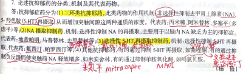
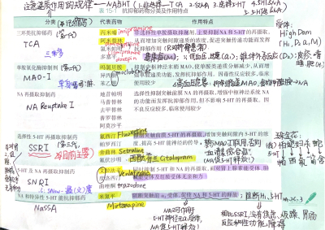
#### [[氯丙嗪]]
氯丙嗪阻断哪些受体，产生哪些作用、不良反应？ D2aM
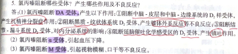
如何理解氯丙嗪药理作用与脑内DA神经环路的关系？（结合多巴胺四条通路和氯丙嗪药理作用）
氯丙嗪镇吐作用特点、机制？高低剂量作用区域不同，但都是D2受体
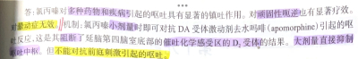
丙咪嗪药理作用、用药注意？
##### 非选择性TCA，H1D2aM
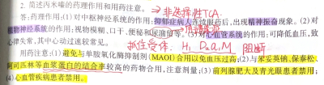
氯氮平几乎没有锥体外系反应的机制？
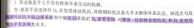
#### 非经典精神分裂症药的特点（与经典相比）
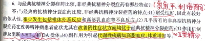
#### 镇痛药
#### 镇痛药名词解释（中枢、不影响意识、缓解情绪）
1. 阿片受体有几种类型？分别介导阿片镇痛药的哪些作用？
#####  μ、  δ、κ三种，中枢& 外周
①  μ  ：  介导吗啡典型作用：  <u>镇痛</u>  <u>，</u>  <u>镇静、镇咳、呼吸抑制、催吐、缩瞳、欣快感、依赖性</u>
②κ：弱版的 μ， 主要介导脊髓镇痛效应，也能引起镇静作用；
> link：杜冷丁/哌替啶脊髓麻醉，搭配纳洛酮解救呼吸抑制，分娩4h之前
③δ：吗啡的 心肌保护作用 ；依赖性小；镇痛效应不明显，主要调节激素 ；抗焦虑、抗抑郁
> link：吗啡对心脏不直接作用；扩张外周血管；治疗心绞痛心肌梗死、心源性哮喘
2. 吗啡治疗胆绞痛和肾绞痛需与解痉药阿托品合用。为什么？
##### 作用于外周平滑肌阿片受体使其收缩
胆绞痛：作用于胆道Oddi括约肌阿片受体，引起平滑肌收缩绞痛
肾绞痛：泌尿系统平滑肌收缩；膀胱括约肌张力升高；作用于中枢阿片受体（d？）使ADH释放增加。肾血流量减少、肾功能抑制。
3.临床各种疼痛如何选药？
特殊：（<mark style="background-color:#fef3c7;">[[喷他佐辛]]：非麻醉性镇痛药</mark>）（[[哌替啶]]：心源性哮喘）（[[芬太尼]]：时间最短）
##### 轻度疼痛：解热镇痛抗炎药（[[阿司匹林]]、布洛芬、消炎痛栓剂等）
中度疼痛：弱阿片类，如部分μ激动剂、完全κ激动剂 。（[[可待因]]；纳布啡、[[喷他佐辛]]）
重度疼痛（  <u>胆结石必+阿托品</u>  ）：强阿片类（[[吗啡]]、[[美沙酮]]、[[哌替啶]]/杜冷丁、[[芬太尼]]）
#### 4.论述（中枢）镇痛药的分类和代表药
##### 阿片受体激动药
##### （一）[[吗啡]] （Morphine） 
##### 阿片受体部分激动药
##### [[哌替啶]]（Pethidine) / 度冷丁（dolantin）
美沙酮methadone：主要用来戒毒，仍为较强效μ受体完全激动剂，作用时间较吗啡长、副作用小。
 芬太尼fentanyl：短且强，吗啡镇痛的100倍。 不良弱。各种镇痛、麻醉辅助、透皮贴剂
可待因codeine：甲基吗啡，作用、不良弱。中枢镇咳，剧烈干咳；与NSAIDS合用于中等疼痛。
 喷他佐辛pentazocine： 镇痛新，μ部分激动剂、κ完全激动剂，镇痛作用、成瘾性弱，是非麻醉管理药品
能提高血浆NA浓度，因此心血管作用与吗啡相反，加快心率、升高血压，冠心病不可用；对Oddi作用弱
##### 可用[[纳洛酮]]对抗精神副反应、呼吸抑制
<u>曲马多tramadol：</u> 中枢镇痛，作用中等（弱于吗啡，强于NSAIDS），成瘾性低
<u>布桂嗪bucinnazine：</u> 同上；对皮肤黏膜运动器官有用，对内脏镇痛反而较差。用于偏头痛、三叉神经痛、炎症/外伤痛、痛经（都沾个“布”字）
##### 阿法罗定、[[二氢埃托啡]]（知道名字）
##### 其它镇痛药
延胡索乙素tetrahydropalmatine： 非阿片受体激动剂类，中枢镇痛 ，阻断D1受体，无成瘾，作用弱。慢性疼痛、胃肠肝胆疼痛、分娩痛。
> “妙不可言”
##### 罗通定rotundine
> 由延胡索提取制成
5.吗啡治疗心源性哮喘的三大机制？
 呼吸抑制、镇静；外周：扩血管 
##### 考察心源性哮喘发病机制
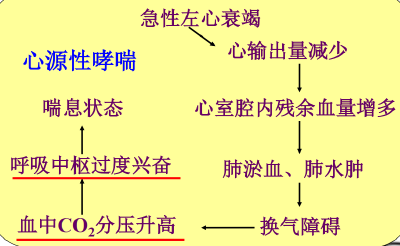
原理：①降低呼吸中枢对CO2的敏感性；②镇静，减轻焦虑Sedation；③扩张血管Vasodilation —→缓解淤血水肿
6.论述吗啡的药理作用？（小绿本p118-119）
中枢作用（三镇两抑一催缩）、外周（平滑肌—心血管、胃肠道、胆、泌尿生殖）、免疫抑制
##### 1. 对CNS  “三镇两抑一催缩” 
##### 各自的机制、后果
#### NSAIDS
#### 名词解释：水杨酸反应
> 剂量过大、中毒、症状、停药+碳酸氢钠
 水杨酸类药物用量过大 时，可引起 头痛、恶心、呕吐、视听减退 等症状，总称为水杨酸反应；
严重时可出现 过度换气、酸碱失衡、精神错乱 。
治疗： 立即停药，静滴  碳酸氢钠溶液  以碱化尿液，加速排泄；对症支持治疗 
#### 名词解释：瑞夷综合征
> 儿童病毒发热；肝衰竭合并脑病；少见预后恶劣；对乙酰氨基酚替代
##### <mark style="background-color:#fef3c7;"> 瑞夷综合征 </mark><mark style="background-color:#fef3c7;"> *Reye’s syndrome* </mark>
> 病毒发热儿童肝性脑病？
病毒感染伴发热的儿童服用阿斯匹林后，偶可发生严重的 肝衰合并脑病 的表现（惊厥、谵妄、昏迷，死亡率较高，少见但预后恶劣）
 ※病毒感染患儿（流感、水痘、麻疹、流行性腮腺炎等）不宜使用，换用  [[对乙酰氨基酚]] 
#### 简述“ 阿斯匹林哮喘 ”发病机制、急救用药
某些哮喘患者服用水杨酸后可诱发 “阿司匹林哮喘 ”（并非抗原-抗体反应为基础的过敏反应，而与PG合成受抑制有关）
 机制： 因PG合成受阻 ，由AA生成的白三烯及其他 脂氧酶 代谢产物增多，内源性支气管收缩物质占优势（使用抗组胺药，CysLT，糖皮质激素治疗）
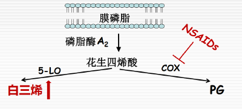
1.无心血管疾病的人可以服用阿斯匹林作为预防药吗？
不建议。长期使用阿司匹林不旦没有益处，反而有药物的副作用，比如长期应用阿司匹林可以导致胃黏膜水肿、糜烂，形成消化性溃疡，甚至出现消化道出血。
<mark style="background-color:#fef3c7;"> 2.对比：阿斯匹林的解热、镇痛作用，与氯丙嗪的解热、吗啡的镇痛有何不同；阿斯匹林的抗炎作用与糖皮质激素的不同。 </mark>
##### （1）解热：阿斯匹林vs氯丙嗪
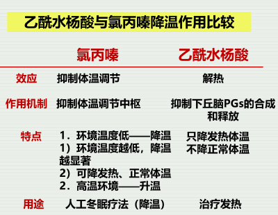
1️⃣机制不同：氯丙嗪抑制下丘脑体温调节中枢,使其调节功能减弱,随外界温度变化而调节体温;[[阿司匹林]]抑制环氧酶,减少前列腺素合成,使散热增加而解热。
2️⃣作用特点不同：氯丙嗪在物理降温的配合下，不但降低发热机体的体温，也可降低正常体温，在炎热天气，可使体温升高。[[阿司匹林]]只能使发热的体温恢复至正常水平，对正常的体温没有影响。
3️⃣临床应用:氯丙嗪用于低温麻醉、人工冬眠；阿司匹林用于感冒发热。
##### （2）镇痛：阿斯匹林vs吗啡
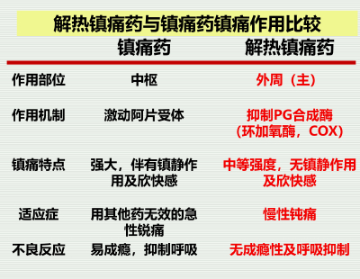
1️⃣机理不同：吗啡镇痛作用部位是 *脊髓胶质区、丘脑内侧核团、脑室与导水管周围灰质* 的 阿片受体(κ、μ与δ受体)，激动受体后阻止P物质、谷氨酸等递质释放 。阿司匹林镇痛作用部位主要在外周,抑制环氧化酶,可以抑制pGs的合成从而使 局部痛觉感受器对缓激肽等致痛物质的敏感性降低 ；部分地通过中枢发挥作用（阻碍中枢神经系统pGs的合成，或干扰伤害感受系统的介质和调质的产生释放）；其 本身也有一定的致痛作用 
2️⃣特点/镇痛强度与性质不同：[[吗啡]] 强大，三镇两抑一催缩， 对各种疼痛均有效,对持续性慢性钝痛的效力大于间断性锐痛，可 消除疼痛引起的焦虑、紧张、恐惧情 绪,还显著提高对疼痛的耐受力。具有欣快感，成瘾性强。阿司匹林仅有中等程度镇痛作用,对严重创伤性剧痛、尖锐的一过性疼痛（直接刺激神经末梢）、内脏、平滑肌绞痛无效；对慢性钝痛有良好镇痛作用，对于 炎症和组织损伤引起的疼痛尤其有效 。
3️⃣临床应用：吗啡主要用于急性锐痛与癌性疼痛, 因有成瘾性不用于慢性疼痛 。阿司匹林主要用于慢性钝痛,因不产生欣快感与成瘾性,应用广。阿司匹林与阿片样物质联用可抑制术后疼痛,且可以减少阿片样物质的用量。 
##### （3）抗炎：阿斯匹林vs GCs
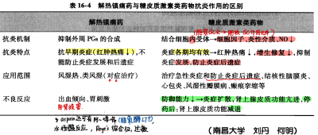
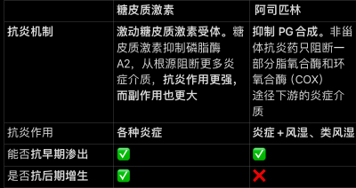
#### 简述解热镇痛抗炎药的药理作用
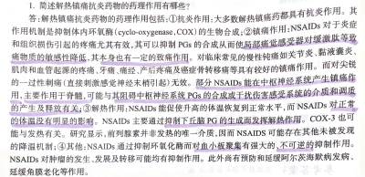
#### 简述阿斯匹林药理作用、临床应用
