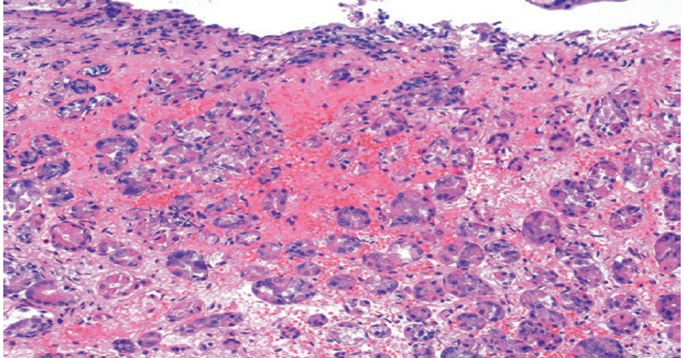
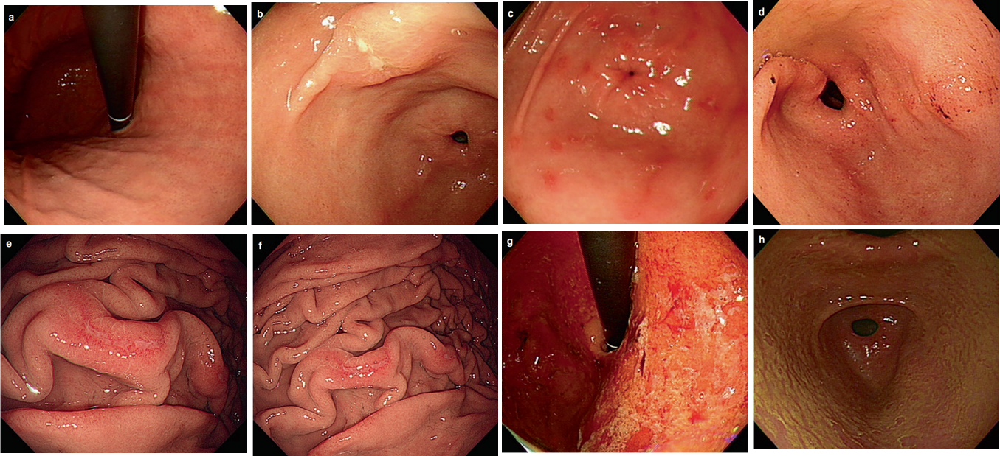

是指由多种病因引起的急性胃黏膜炎症
急性发病，常表现为上腹部症状
因这类炎症多由药物、急性应激造成，故亦称急性胃黏膜损害

若主要病损是糜烂和出血，则称之为急性糜烂出血性胃炎：
- 急性胃黏膜病变（AGML）/[[急性糜烂出血性胃炎]]
- [[Cushing溃疡]]
#### 病因
###### 一、理化因素
药物[NSAIDs](NSAIDs.md)[^1]最常见，其他如肾上腺[糖皮质激素](糖皮质激素.md)、某些[抗生素](抗生素.md)及抗癌药物
乙醇破坏黏膜屏障，引起上皮细胞损害、黏膜内出血和水肿
胆汁反流胆盐、磷脂酶A、胰酶破坏胃黏膜，产生多发性糜烂
物理因素：辛辣及粗糙食物对胃黏膜造成机械性损伤
###### 二、[应激](应激生理反应.md)
急性应激可由严重的脏器疾病、大手术、机械通气、全身严重感染、大面积[烧伤](烧伤.md)、[休克](休克.md)、颅脑外伤、颅内疾病、精神心身因素等引起
发病机制：
- 胃黏膜缺血
- H+反弥散
###### 三、急性感染及病原体毒素
某些细菌：常见有葡萄球菌、α-链球菌、大肠杆菌、嗜盐杆菌等。
[[幽门螺杆菌]]（Helicobacter pylori，Hp）是主要因素
病毒：如流感病毒和肠道病毒等
细菌毒素：以金葡菌毒素常见
###### 四、血管因素 
 血管闭塞所致，常见于：   
 老年的[动脉粥样硬化](动脉粥样硬化.md)患者、腹腔动脉栓塞治疗后

#### 病理
内镜下可见胃黏膜充血、水肿、糜烂、出血等改变。甚至一过性的浅表溃疡形成
糜烂：黏膜破损不超过黏膜肌层
出血：黏膜下或黏膜内出血外渗，而黏膜上皮无破坏
黏膜固有层<mark style="background-color: #1A4F10; color: white">中性粒细胞和单个核细胞</mark>浸润，以中性粒细胞为主，可有上皮细胞丧失，并见血液渗出，腺体歪曲
[Open: Pasted image 20260914173744.png](attachments/07254c5592f2f3165361fdad1e528457_MD5.jpg)

#### 临床表现
症状：
- 轻者多无症状，少数患者表现为上腹不适、[疼痛](疼痛.md)、厌食、恶心、[呕吐](呕吐.md)等，伴有肠炎者可腹泻，呈水样便
- 病程自限，数天内症状消失
- 如为急性胃黏膜病变，可表现为上消化道出血，出血常为间歇性（占上消化道出血病因的10％～25％）
体征：
- 上腹部或脐周压痛，肠鸣音亢进
#### 诊断
诊断：依靠病史及临床表现，内镜检查确诊
内镜下表现：弥漫分布的多发性糜烂、出血灶和浅表溃疡形成
[Open: Pasted image 20260914174126.png](attachments/d5315d12d348b98b26fc9efe87097d84_MD5.jpg)

#### 治疗
病因治疗：去除病因，停止一切对胃有刺激的饮食和药物，对严重原发病预防性使用抑酸药
暂时禁食或流质饮食，多饮水
对症处理：
- 解痉—[[Atropine]]、[[Probantin]]、[[654-2]]
- 止吐—[[胃复安]]10mg im或[[吗丁啉]]10mg tid
- 抑酸—H2受体阻滞剂或[[PPI]]
- 纠正水、电解质失衡，呕吐、腹泻严重者应输液
- 存在上消化道出血者同时予以止血等治疗
#### 预防： 
停用不必要的NSAIDs；严重创伤、烧伤、大手术、重要器官衰竭及需长期服用阿司匹林/氯吡格雷等病人，预防性使用PPI/H2RA; 尽量选用COX-2抑制剂，减少对COX-1的抑制；避免酗酒等。

---
[^1]: #### [前列腺素](PG.md)与胃炎
	###### 前列腺素 E（PGE）
	- **作用**：胃黏膜**保护因素**
	- **机制**：生物合成对应 **COX-1**。能**舒张血管**，增加黏膜血流量，促进黏液和碳酸氢盐分泌，促进黏膜修复，并促进血小板聚集。
	###### 前列腺素 F（PGF）
	- **作用**：胃黏膜**损害因素**。
	- **机制**：生物合成对应 **COX-2**。促进组织炎症的发生，进而导致组织损伤，具有舒张血管作用（引起炎症红肿热痛）。
	###### NSAIDs（非甾体抗炎药）的机制与副作用
	- **非选择性 NSAIDs**（如阿司匹林、布洛芬、吲哚美辛）：
	    - 同时抑制 COX-1 和 COX-2。
	    - **副作用**：抑制了 COX-1 介导的胃黏膜保护作用，进而诱导消化性溃疡的发生（同时也抑制了血小板聚集，易出血）。
	        
	- **高选择性 COX-2 抑制剂**（如塞来昔布、依托考昔）：
	    - 仅抑制 COX-2。
	    - **优点**：显著降低消化性溃疡的风险，且不抑制血小板功能；与此同时，仍具有解热镇痛的作用。
	    - **缺点（补充）**：长期使用会增加心血管不良事件的风险。
	    
	- **倾向性 COX-2 抑制剂**（如美洛昔康）：
	    - 对 COX-2 的抑制大于 COX-1，胃肠道副作用低于传统 NSAIDs，但高于高选择性药物。
