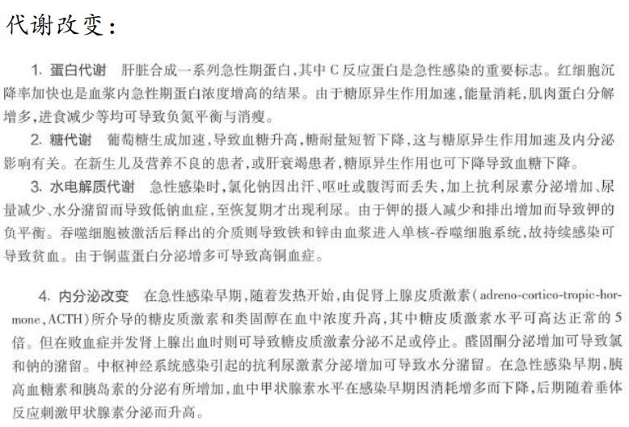

---
tags:
  - pathology
  - infection
---
#### 定义：
[感染](感染.md)引起的炎症性疾病
#### 分类：
- primary infection
- re-infection
- recurrent infection
- co-infection
- super-infection
- secondary infection

#### 组织损伤发生机制
- 直接损伤
- 毒素作用
- 免疫机制（免疫损伤）
  一般是IL-6相关

#### 症状
- [发热](发热.md)
[Open: Pasted image 20260914201655.png](attachments/c29386d92d160450634f7f16d384b88d_MD5.jpg)

- 皮疹[皮肤](皮肤.md)
- 毒血症[败血症](败血症.md)
- MPS（单核-巨噬细胞系统反应）

#### 疾病
[水痘](水痘.md)&[带状疱疹](带状疱疹.md)

#### 新发感染病
[丙型肝炎](丙肝.md)病毒于1989年经分子生物学方法鉴定，属新发感染病。
SARS病原体为2003年发现的SARS冠状病毒，属新发感染病。
埃博拉出血热、甲型H1N1流感、[艾滋病](AIDS.md)属新发感染病；[乙型肝炎](乙肝.md)属经典老感染病；性传播疾病属再发感染病。

新发感染病的流行趋势难以判断。
##### 再发感染病
[结核](结核.md)、[登革热](登革热.md)、[梅毒](梅毒.md)
##### 特殊的新发感染病-多重耐药菌感染
多重耐药菌指对三类或三类以上抗菌药物同时耐药的细菌。

---
#pathology 
考的不多，结核是重点
[结核](结核.md)
[[麻风]]
[伤寒](伤寒)
[[细菌性痢疾]]
[性传播性疾病](性传播性疾病.md)
[阿米巴](阿米巴.md)
[血吸虫病](血吸虫病)
[[真菌病]]
