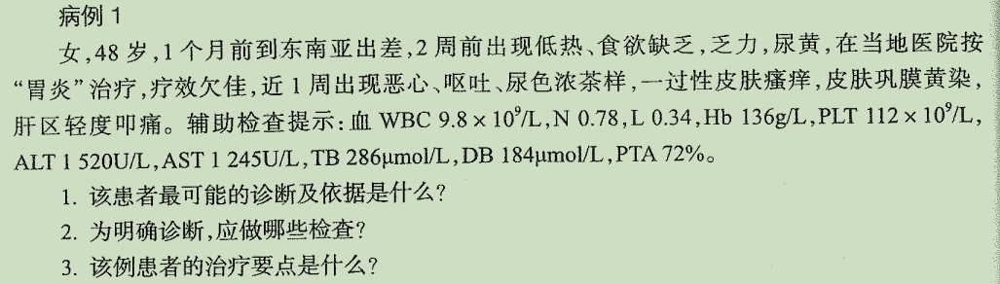

---
tags:
  - pathology
---
#### 病原学
α 病毒亚组，形态表现为二十面对称体圆球形颗粒。
单股正链 RNA，无包膜，分为四个基因型，其中<mark style="background-color: #1A4F10; color: white"> I 型和 II 型只感染人</mark>；III 型和 IV 型人畜共患。在碱性环境中稳定，对高热和氯仿敏感。
HEAg：肝组织标本中可发现、血液中无法检测。
#### 流行病学
主要通过消化道传播
HEV多感染35岁以上的中年人和老年人(病情往往较重)，<mark style="background-color: #1A4F10; color: white">妊娠期</mark>戊型肝炎发生重症肝炎的比例较高。
HEV一般不导致携带者状态和慢性肝炎。
大多数病例预后良好，但<mark style="background-color: #1A4F10; color: white">在孕妇中死亡率</mark>可达20%。
#### 病理特征：
##### 门管区炎症
可见大量Kupffer细胞和多形核白细胞，但淋巴细胞少见
##### 肝细胞和毛细胆管<mark style="background-color: #1A4F10; color: white">胆汁淤积</mark>
##### [坏死](坏死.md)
肝细胞灶状或小片状至亚大块或大块坏死
#### 病例
[Open: Pasted image 20261123212240.png](attachments/d582d1226ff035ae642dba14d04c8341_MD5.jpg)

