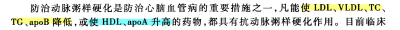
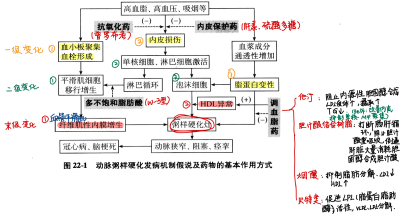
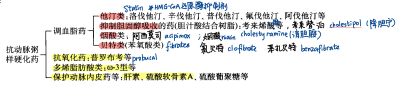
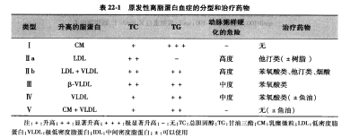
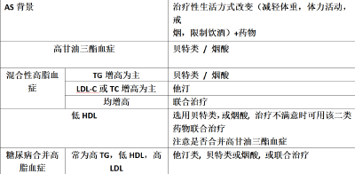
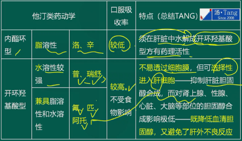
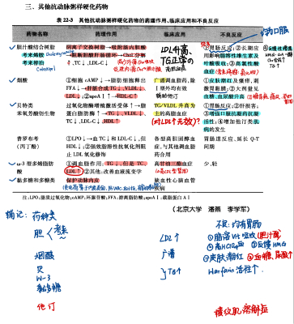
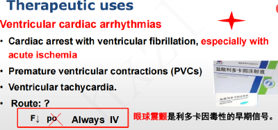

---
tags:
  - pharmacology
---
### 抗动脉粥样硬化药（1.5）
### 一、动脉粥样硬化疾病，高脂血症，血脂的来龙去脉及推测降脂药物的可能作用靶点
### 1. 病理生理学机制&药物作用

动脉粥样硬化的致病机制中，最为关键的一个致病物质是 “LDL-C”，即“由低密度脂蛋白（LDL）所运载的胆固醇”——对应：【调血脂药】降低机体内的LDL及胆固醇水平
【抗氧化剂】阻止“LDL-C”转变为对AS致病作用更强的“氧化型LDL-C”，从而减慢进展
各种非特异性因素而导致的血管内皮损伤，其实是动脉粥样硬化的重要初始原因—— 【保护动脉内皮药】中和各种血管活性物质，减少动脉内皮受到的损伤。有效减慢进展
### 2. 对Apo（载脂蛋白）和脂代谢在AS的理解
LDL、HDL主要运载胆固醇；VLDL、CM主要运载甘油三酯
LDL和HDL的不同之处—— 从运载的方向上看
##### HDL “将外周血液中的胆固醇重新带回肝脏”，好
##### LDL“将肝脏中的胆固醇向外运载到血液中”，坏
##### 胆固醇的分布：肝脏和血液的平衡 & LDL受体变化
当机体内胆固醇水平下降，肝脏会代偿性的把自己身上表达的“LDL受体”的水平以及活性增强，把外周血中循环的胆固醇向肝脏中集中，从而代偿由于HMG-CoA还原酶被抑制导致的肝脏中胆固醇水平的下降
胆固醇对粥样硬化促进作用显著大于甘油三酯——抗AS 药物应主要针对LDL和HDL
不同类别的调脂药物对甘油三酯和胆固醇的降低（调控）作用具有明显的选择性
→他汀类药物（HMG-CoA还原酶抑制剂）、胆固醇吸收抑制剂：对胆固醇的降低效果远强于对甘油三酯的降低效果
→贝特类药物、烟酸：对甘油三酯的降低作用远强于对胆固醇的降低作用。
——所以，从药物种类的角度上说，如果我们的目的是抗动脉粥样硬化，则我们应当多用他汀类药物，而不是贝特类药物。
虽然“贝特”类药物对治疗动脉粥样硬化的药效比较有限，但是，它可以治疗“高甘油三酯的高脂血症”
### 3. 药物选择

### 二、洛伐他汀、阿托伐他汀、普伐他汀、氟伐他汀
> 洛伐他汀 （Lovastatin）辛伐他汀 （Simvastatin）氟伐他汀 （Fluvastatin）普伐他汀 （Pravastatin）
### 药动学 & 分类

体内过程：洛伐他汀无活性，需口服后代谢为有活性物质；氟伐他汀有活性，口服后基本完全吸收
### 药理机制
HMG-CoA还原酶是胆固醇合成的限速酶。他汀类药物和代谢物的结构与HMG-CoA类似，竞争性抑制HMG-CoA还原酶活性，阻止肝脏内源性胆固醇合成 。
代偿性增加肝细胞膜上LDL受体的合成，LDL摄取增加。
大剂量使用可降低血浆甘油三酯的水平。
### 临床应用
##### 动脉粥样硬化患者心肌梗死和脑卒中的预防
##### 高胆固醇血症
### 不良反应
##### 较少，部分出现胃肠道反应、失眠、[皮疹](皮疹.md)
严重患者出现横纹肌溶解症 血管神经性水肿易发生于<mark style="background-color: #3F4B5E; color: white">甲减</mark>患者
##### 肝脏疾病、 孕妇、哺乳期妇女慎用（阻碍胎儿脂质合成发育）
### 三、其它

### Questions（搞求不懂
1. PPT红框里的是啥意思？

2. 利多卡因抑制Na通道，既可能缩短复极化过程，又有抑制延迟后除极化（DAD）作用，为何整体效应体现为可以抑制室性心律失常？
> 延迟后除极化 （Delayed Afterdepolarization, DAD）是一种在心肌细胞动作电位结束后在复极化阶段形成的的自发性膜电位波动。当这种波动达到阈值时，会触发新的动作电位，从而导致心律失常。DAD的发生往往和钙离子超载相关，因此常见于高钙状态或使用强心苷药物（如地高辛）时。
> 
> 虽然缩短不应期可能会让心肌更易响应快速电刺激，但利多卡因通过选择性阻滞异常心肌细胞的钠通道和减少触发性活动 ，可以有效抑制室性心动过速的发生。
> 选择性作用于异常组织 ：利多卡因的钠通道阻滞作用对正常心肌细胞影响较小，但对缺血性、损伤性或异常兴奋的心肌细胞影响更大。这些异常组织通常有延迟后除极化现象，容易产生异位节律。利多卡因优先作用在这些部位，抑制其异常放电，防止异位电活动的产生和传导。
> 尽管缩短不应期在理论上可能提高心肌细胞的反应频率，但在缺血性心肌细胞中，利多卡因的钠通道阻滞作用更有助于减少触发后除极化 （如DAD）。
> 仅缩短复极晚期 ：利多卡因主要缩短动作电位的晚期复极化 ，即动作电位接近完成时的阶段，不显著影响整个心肌的有效不应期。这样，利多卡因能在抑制异常放电的同时，不显著增加心律失常的风险。

3.为什么又说利多卡因可以减小4期去极化，又说利多卡因对心房肌作用差？利多卡因作用差的原因为什么不是 ~~心房肌去极化主要靠钙离子内流~~ ，而是“心房肌APD短，Na通道失活时间短”？
答：不要把心房肌和窦房结记混了。
4. 为什么氟卡尼致心律失常发生率较高，可致室性心动过速，室颤，诱发折返性心律失常，长Q-T综合征？
5. 为什么胺碘酮作为钾通道阻滞药还是非竞争性α、β受体阻断剂？它的扩血管作用和阻滞钾通道无关吧？
### 思考题（ppt后头
#### 抗高血压药
1. 抗高血压药物的分类可分为哪几类？各举一代表药。
2. 简述 [[氢氯噻嗪]] 、 普萘洛尔 、 [[硝苯地平]] 、 ACEI 、 哌唑嗪 、 可乐定 的抗高血压作用机制及临床应用。
3. 为什么肼屈嗪等血管扩张药很少单用于抗高血压病而需与利尿药及β-受体阻断药合用？
#### 抗CHF药
### 复习思考题
> 感觉大题考点在于【强心苷】和【CHF病生、用药总览】。

1．治疗慢性心功能不全的药物有几类？主要代表药是什么？
2．试述强心苷中毒的原理、表现和防治。
3．强心苷治疗充血性心力衰竭的药理学基础。
##### CHF定义、基本病理生理学
##### 强心苷基本机制
##### 强心苷药理作用
4．试述强心苷治疗心房纤颤和心房扑动的药理依据。
##### 微观机制
##### 心肌作用：注意抑制交感和兴奋迷走
心电作用：聚焦房室结区抑制；房扑先转房颤
5. 简述强心苷正性肌力作用的机理。
（1）心肌——正性肌力，负性频率，降低耗氧（Positive Inotropic, Negative chronotropic, reduce oxygen demands）
机制：部分 抑制Na+ -K+ -ATP酶 （20%-40%）——作用与不良就在程度差异
##### 6. 试述强心苷的药理作用
##### 药理作用
7.简述血管紧张素转化酶抑制药的药理作用。
##### 1. 药理作用（治疗CHF的机制）：
