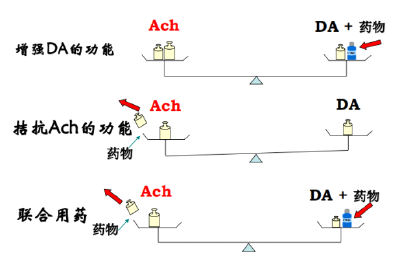
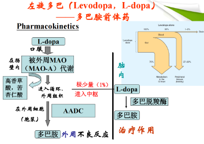

---
tags:
  - pharmacology
---
### 抗帕金森病药和抗老年痴呆药（2学时自学翻转课堂）
一． *帕金森病发病的病理机制* 及抗帕金森病药的分类。
### *介绍*
帕金森病（Parkinson's disease,PD）,又称为震颤麻痹，是一种主要表现为进行性锥体外系功能障碍的中枢神经系统退行性疾病。 ~~发病年龄多在50岁以上，随着社会老龄化，呈上升趋势。~~
~~*根据病因可分为：原发性和继发性（动脉硬化、脑炎后遗症、药物化学中毒引起的帕金森综合征）*~~
#### 主要临床症状：
> link氯丙嗪副作用判断
#### • 静止震颤 “搓丸样”动作
#### • 肌肉僵直 “面具脸”
#### • 运动障碍 “主动运动缓慢”
#### • 共济失调 “姿势与平衡异常”、“三屈征”、“慌张步态”
### 机制： 多巴胺学说
> 这里有点反常识，多巴胺抑制肌效应、Ach兴奋肌效应

帕金森病是因<mark style="background-color: #3F4B5E; color: white">纹状体内多巴胺减少</mark>或缺乏、<mark style="background-color: #1A4F10; color: white">胆碱能神经功能相对占优势</mark>所致，表现为肌张力增高，原发性因素是<mark style="background-color: #3F4B5E; color: white">黑质内多巴胺能神经元退行性病变</mark>
> DA-胆碱能的失衡。link氯丙嗪
#### 2条通路
黑质-纹状体多巴胺能神经通路 ——抑制脊髓前角运动神经元
胆碱能神经通路 ——兴奋脊髓前角运动神经元
正常下，平衡；帕金森病患者因黑质病变，DA合成减少，纹状体内DA含量↓，黑质-纹状体通路多巴胺能神经元功能减弱，胆碱能神经功能相对占优势，出现肌张力增高的症状。
### 治疗思路
#### 总体目标：恢复多巴胺能和胆碱能神经系统功能的平衡状态
药物：拟多巴胺类药、抗胆碱药。

### 抗帕金森病药的分类
#### 多巴胺类药
#### [[左旋多巴]](多巴胺前体药）
> levodopa，对于抗精神失常药引起的无效
#### [[卡比多巴]] ([[左旋多巴]]增效药)
##### <mark style="background-color: #1A4F10; color: white">托卡朋、恩他卡朋</mark>（COMT抑制药）
#### [[金刚烷胺]] (多巴胺促释放药)
#### 溴隐亭、培高利特 (多巴胺受体激动剂)
> bromocriptime
#### [[司来吉兰]] (MAO-B/单胺氧化酶B抑制剂)
> selegiline
#### <mark style="background-color: #705A16; color: white">中枢抗胆碱药</mark>
<mark style="background-color: #705A16; color: white">[[苯海索]]（安坦），</mark>可以治疗精神病药引起的帕金森
#### 苯扎托品、丙环定、[[苯海拉明]]
### 二．拟多巴胺类药：[[左旋多巴]]，搭配卡比多巴
[[左旋多巴]](levodopa，L-dopa)—— 多巴胺前体药
#### 体内过程

吸收：口服，经小肠芳香族氨基酸转运体迅速吸收；（食物中其他氨基酸能与左旋多巴竞争同一转运体，从而减少药物的吸收）
#### 分布
95%在外周组织被AADC（L-芳香族氨基酸脱羧酶）脱羧成为DA—→恶心、呕吐等外周不良反应；
1%通过血脑屏障进入CNS转变为DA— →疗效不佳
<mark style="background-color: #1A4F10; color: white">——同时使用AADC抑制剂</mark> <mark style="background-color: #705A16; color: white">[[卡比多巴]]</mark>，可增效、减毒。
#### 代谢
突触前膜摄取（返回多巴胺能神经末梢）；
##### 被MAO或儿茶酚胺-O-甲基转移酶（COMT）代谢
#### 排泄：肾
#### 抗震颤麻痹机制
增加纹状体中多巴胺含量，增强抑制性递质DA的作用，降低肌张力
*PD患者的多巴胺能神经元发生了退行性变，酪氨酸羟化酶↓，使脑内酪氨酸转变为L-DOPA↓↓↓，但将L-DOPA转变为多巴胺的能力仍存在，故使用本药，待其通过血脑屏障后，可以补充纹状体中多巴胺的不足而发挥治疗作用*
临床应用：①各种类型的PD， <mark style="background-color: #705A16; color: white">除了抗精神失常药引起的（阻断了多巴胺受体）</mark> ； <mark style="background-color: #705A16; color: white">②肝性脑病</mark>
#### 特点：
显效慢，持续长；
<mark style="background-color: #705A16; color: white">对</mark><mark style="background-color: #705A16; color: white">抗精神失常药物</mark><mark style="background-color: #705A16; color: white">（[[氯丙嗪]]）</mark><mark style="background-color: #705A16; color: white">引起的帕金森无效</mark>（ 阻断 <mark style="background-color: #1A4F10; color: white">中枢多巴胺受体</mark> ）
##### 改善肌强直、运动困难较肌肉震颤效果明显
#### 不良反应
#### 早期
胃肠道反应：L-DOPA在外周和中枢脱羧成DA，分别刺激胃肠道和延髓催吐化学感受区CTZ的 D2 受体，引发厌食、恶心、呕吐等症状
##### 可使用<mark style="background-color: #3F4B5E; color: white">多潘立酮</mark>治疗（<mark style="background-color: #3F4B5E; color: white">D</mark>2<mark style="background-color: #3F4B5E; color: white">受体阻断药</mark>）
##### 直立性低血压
心脏毒性（DA→β受体） ：心律不齐
##### 合用卡比多巴减轻
#### 长期
运动过多症Dyskinesias ：服用大量L-DOPA后，多巴胺受体过度兴奋，出现手足、躯体、舌的不自主运动；
症状波动： “ <mark style="background-color: #705A16; color: white">开-关现象”</mark> （on-off phenomenon）:患者突然多动不安，而后又出现肌强直运动不能，交替出现。
精神症状：与脑内DA增多，兴奋中脑-边缘系统和下丘脑-垂体DA通路有关
<mark style="background-color: #705A16; color: white">用</mark><mark style="background-color: #705A16; color: white">[[氯氮平]]</mark><mark style="background-color: #705A16; color: white">治疗</mark>（link：抗精神失常药）：特异性阻断中脑边缘&中脑皮层的D4
#### 药物相互作用
•禁止 同时服用 Vit-B6（脱羧酶辅酶加速外周代谢）
Vit-B6是L-DOPA脱羧酶辅酶，加速L-DOPA在外周脱羧，进入脑循环L-DOPA ↓，疗效↓，不良反应↑
• 不宜合用 吩噻嗪类（阻断受体精神分裂）、利血平（耗竭DA相互拮抗）
吩噻嗪类<mark style="background-color: #1A4F10; color: white">（[[氯丙嗪]]，治疗精神分裂）</mark>可阻断中枢DA受体，<mark style="background-color: #705A16; color: white">利血平</mark><mark style="background-color: #705A16; color: white">（降血压、安定，耗竭5-HT、NE和DA）可耗竭黑质-纹状体中的多巴胺</mark>，引起药源性PD，拮抗L-DOPA的作用
• 不宜与抗抑郁药合用 ——引起直立性低血压
##### 小结（图表）
##### 卡比多巴与左旋多巴的作用关系
[[卡比多巴]]（Carbidopa） ——AADC抑制剂
• <mark style="background-color: #705A16; color: white">不能通过血脑屏障</mark>，仅抑制外周AADC；
• 单用无意义，与L-DOPA配伍使用可减少其外周脱羧，增加L-DOPA进入中枢的量，提高疗效、减少副作用。
##### [[司来吉兰]]、[[金刚烷胺]]、溴隐亭、培高利特（了解作用特点）
[[司来吉兰]]（Selegilline） —— MAO-B抑制药
MAO-A：存在于肠道；MAO-B:存在于纹状体，参与DA的降解
##### 药理作用
选择性抑制中枢MAO-B，降低脑内DA代谢，使中枢DA浓度增加、有效时间延长；
##### 抗氧化
##### 减轻“开-关”现象
<mark style="background-color: #1A4F10; color: white">类比：恩他卡彭——抑制COMT</mark>
##### 临床应用
与L-DOPA合用；
##### 与抗氧化剂Vit-E合用（保护神经）
不良反应：大剂量（＞10mg/d）可抑制外周MAO-A，<mark style="background-color: #705A16; color: white">引发高血压危象</mark>（外周NE、DA过多）
[[金刚烷胺]]（Amantadine） ——促DA释放药
##### 药理作用
促进纹状体残存的完整DA能神经元释放DA；
抑制神经末梢对DA的再摄取；
对DA受体有一定兴奋作用；
有<mark style="background-color: #3F4B5E; color: white">部分抗胆碱</mark>作用。
##### 临床应用
抗震颤麻痹作用，与其它药物合用产生协同作用
##### 当患者<mark style="background-color: #705A16; color: white">不能耐受L-DOPA时</mark>可选用本药
##### 不良反应
长期应用，下肢皮肤可出现网状青斑（可能与儿茶酚胺释放引起外周血管收缩有关）
溴隐亭（Bromocriptine）——多巴胺受体激动剂
长期用L-dopa疗效减弱，D2-R激动剂直接激动DA受体，仍可获得疗效
##### -对黑质-纹状体内DA受体有强激动作用
##### -对结节漏斗处DA-R有选择激动作用，减少催乳素释放
##### -对α-R有弱激动作用
<mark style="background-color: #3F4B5E; color: white">不良反应较多——精神系统症状</mark>
##### 三．胆碱受体阻断药：[[苯海索]]
[[苯海索]]（ Trihexyphenidyl ） / 安坦（ artane ） ——中枢抗胆碱药
##### <mark style="background-color: #705A16; color: white">抗精神失常药引起的帕金森</mark>综合征
##### 药理作用：中枢胆碱能受体阻断药，减弱纹状体中ACh的作用
##### 不良反应&注意
##### 副作用较多，现已少用
##### 苯扎托品benzatropine
阿尔兹海默症：胆碱能和谷氨酸能的失衡。 AchE拮抗（他克林，石杉碱甲，加兰他敏）；NMDA受体拮抗（[[美金刚]]）
> 联系：帕金森病是多巴胺能和胆碱能的失衡；老年痴呆是胆碱能和谷氨酸能的失衡
##### 老年痴呆
组织学：老年斑、神经原纤维缠结、脑血管淀粉样蛋白沉积。
病理基础： 胆碱能神经兴奋传递障碍 ，中枢神经系统内Ach-R变性及神经元数目减少；谷氨酸的兴奋毒性所致的NMDA受体过度激活
##### 治疗策略
##### （ACh E 拮抗药）增强中枢胆碱能神经的功能
##### （NMDA受体拮抗药）拮抗谷氨酸能神经的功能
##### 胆碱酯酶抑制 药 ：<mark style="background-color: #3F4B5E; color: white">他克林，加兰他敏</mark>
> 知道是什么类型，名字

他克林Tacrine：严重不良反应（尤其是肝毒性），现已撤市；可以抑制AchE，还可以直接激动M、N受体
①抑制脑内AChE，增加脑内ACh含量。
②促进脑内ACh的释放。
③直接激动M-R和N-R。
##### ④促进脑组织对葡萄糖的利用,改善
学习、记忆能力的降低。
加兰他敏Galanthamine：<mark style="background-color: #705A16; color: white">轻、中度阿尔兹海默症的首选药。疗效与tacrine相当，无肝毒性。</mark>
##### 石杉碱甲Huperzine A
##### <mark style="background-color: #3F4B5E; color: white">多奈哌齐donepezil</mark>
##### <mark style="background-color: #3F4B5E; color: white">利斯的明rivastigmine</mark>
##### NMDA受体拮抗药：美金刚Memantine
##### 中重度AD
##### 拮抗NMDA受体，影响谷氨酸的功能
适度拮抗，可以保留学习认知功能。区别于金刚烷胺（促进多巴胺释放、抗病毒）。
