---
tags:
  - pharmacology
---
### 抗心律失常药（3 ） antiarrhythmic drugs
> 对应心肌电生理。
#### Keypoints
心律失常：定义，分类，机制
#### 抗心律失常药物的分类，离子通道基础（作用机制）
每一种类的代表药（[[奎尼丁]]、[[普鲁卡因胺]]、利多卡因、[[苯妥英钠]]、普奈洛尔、[[胺碘酮]]、[[维拉帕米]])
### 一、正常心肌电生理。
#### ​[4.⭐循环](https://mubu.com/doc1FkZV3kVUw0)​
#### 对心脏节律的影响
传导性：快反应细胞与慢反应细胞区别于0期离子通道不同，快反应快Na+通道，慢反应ICa-L通道/
### 二、心律失常的电生理学机制。
#### 心律失常（Arrhythmia）：心动节律和频率的异常
#### 分类
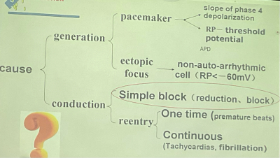
1. 冲动形成异常Aberrations in impulse generation
#### 自律性过强
起搏点： 交感过度兴奋；K+过少（针对药：II类/beta阻，K+-Ach开放药） 
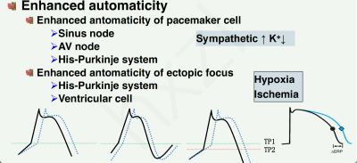
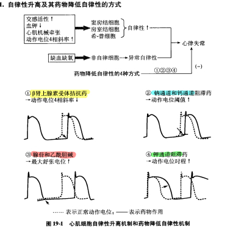
##### 异位起搏： 缺血缺氧 
####  触发活动：EAD、DAD 
定义：异位激动的产生是由一个动作电位的触发所形成，而不能由心肌自发的独立产生。异位激动点总是在一次正常的除极后发生，也就是以后除极为基础的心电活动，因此也称之为后除极。根据它在动作电位时相中出现的早晚，可分为 早期后除极和延迟后除极两种。 
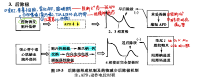
EAD：<mark style="background-color:#fef3c7;"> APD过长 </mark>，发生于AP 2、3期，Ca2+相对内流增多而K+相对外流不足。缺氧、 药物诱发（延长APD、阻断k外流药物尤其）  、  儿茶酚胺（交感过度兴奋）
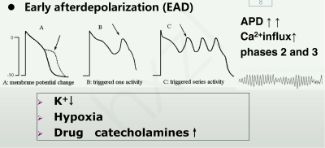
DAD：复极完成后。<mark style="background-color:#fef3c7;"> 钠/钙过多、钙超载。 </mark>心肌缺血、酸中毒、 [[地高辛]]、儿茶酚胺 引起。
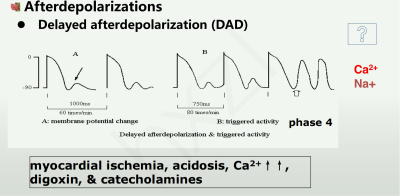
2. 冲动传导异常Defect in impulse conduction
#### 快速心律失常
##### 房性：房颤、房扑、PVST
##### 室性：室性早搏、室性心动过速、室颤
折返-Reentry：<mark style="background-color:#fef3c7;"> 单向 </mark> 传导阻滞  +  逆向折返（来自另一侧） 
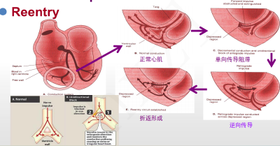
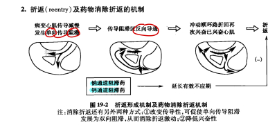
Wolff-Parkinson-White，WPW，预激综合征：解剖学畸形，存在房室旁路（肯氏束），运动时心脏形成折返旁路，心律失常易猝死。
※缓慢性心律失常  Slow arrhythmias——  异丙肾上腺素、阿托品 
窦性心动过缓、房室传导阻滞：阿托品、肾上腺素受体激动剂（eg 异丙肾上腺素）治疗
#### 3.基因缺陷、离子靶点学说
长Q-T间期综合征（Long Q-T syndrome, LQTS）是由于7个基因突变(Na内流↑, IKr↓, IKs ↓…)造成心肌复极化减慢，易诱发早后除极而产生心律失常
> link：红霉素有 <u>心脏毒性，可能引起LQTS</u>
离子靶点学说：当心肌细胞膜上某种离子通道的功能或表达异常时，通道间平衡被打破，将出现心律失常。
### <u>三、抗心律失常药的基本电生理作用及药物分类。</u>
> 降、减、改、延
#### 降低自律性
 增加静息膜电位的绝对值 ——腺苷、ACh，激活ACh敏感的钾通道，促进钾离子外流，静息电位绝对值↑；
> 这里促进K+外流对MDP影响更大，对APD影响没有那么大
 降低4相斜率 ——β受体阻断药，降低细胞内cAMP水平，减小If，4相斜率↓；
 延长动作电位时程— —钾通道阻滞药（阻止K+外流）
> 这里促进K+外流对APD影响更大，对MDP影响没有那么大
 提高动作电位发生阈值 ——钠通道阻滞药（快反应细胞）、钙通道阻滞药（快反应细胞）；
#### 减少后除极
 减少早后除极 ——缩短APD药；
 减少迟后除极 ——钙通道阻滞药、钠通道阻滞药。
#### 改变传导，消除折返
 ※ 延长有效不应期 ——钠、钾通道阻滞药（快反应细胞）；钙、钾通道阻滞药（慢反应细胞）
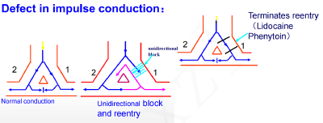
减弱膜反应性---减慢传导---使单向传导阻滞变为双向传导阻滞; ICa β↓等
##### 如奎尼丁：抑制Na+内流---Vmax↓-----传导↓
ERP↑﹥APD↑ --（绝对延长ERP）-- Na+ Ca2+ K+ ↓
增强膜反应性—改善传导—取消单向传导阻滞
如利多卡因\[[苯妥英钠]]: 促K+ 外流---最大舒张电位↑--与阈电位距离↑--传导↑
##### ERP↓﹤APD↓ --（相对延长ERP）
抑制传导——β受体拮抗药、钙通道阻滞药
#### 延长不应期
### 四、常用的抗心律失常药
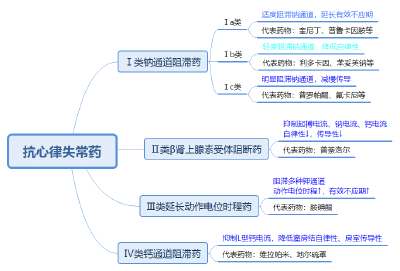
※需注意，抗心律失常药治疗心律失常的同时，也可能引发心律失常
药物分类：先记住有【抑制离子通道】和【阻断交感beta受体】两方向，再来排序
钠是I，beta是II，胺碘酮三个字——K+是III，维拉帕米四个字——CCB是IV
#### I类又分为适度、轻度、明显，a b c
#### 再各自想代表药
#### 易考～“首选”
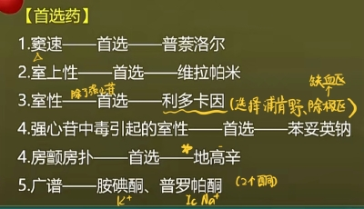
<mark style="background-color:#fef3c7;"> [[奎尼丁]]：广谱，不良反应爱考（又大又毒：啃树皮/胃肠道最常见；“亏心”/心血管最严重；特殊：金鸡纳反应、奎尼丁晕厥） </mark>
#### [[普鲁卡因胺]]： 红斑狼疮样反应 
#### 利多卡因中毒：眼球震颤
普罗帕酮：广谱。强。不与其它抗心律失常合用。
####  预防 心律失常：美托洛尔
翻转使用依赖性：心率越慢延长APD越长，心率越快延长APD越差，易引起尖端扭转型心动过速。[[奎尼丁]]、[[普鲁卡因胺]]。记住<mark style="background-color:#fef3c7;"> 胺碘酮没有翻转使用依赖性 </mark>！！
[[胺碘酮]]：含碘，特殊的甲状腺毒性。
####  迅速 终止折返性、阵发性室上心律失常：腺苷
合用β受体阻断药？
##### 硝苯地平推荐与β受体阻断药合用，防止反射性心率加快
奎尼丁推荐与β受体阻断药、CCB、地高辛合用，应对抗胆碱作用和反射性心率加快
##### 维拉帕米抑制心脏， 不 与β受体阻断药合用
#### 维拉帕米又名“异搏定”
#### PPT
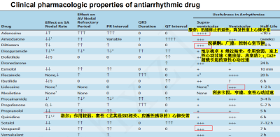
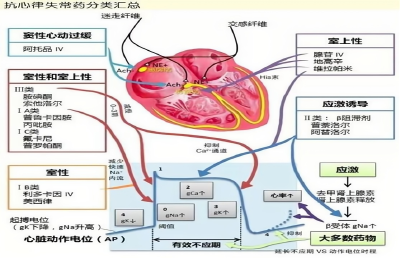
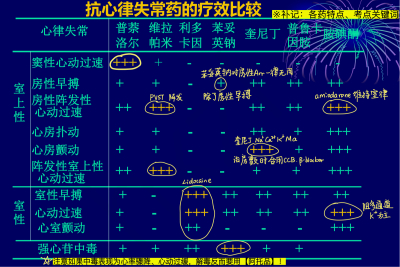
### I类药——钠通道阻滞药
#### IA类：  适度  阻滞钠通道，延长  有效不应期 

> <u>[[奎尼丁]]（Quinidine）</u> ；[[普鲁卡因胺]]（Procainnamide） 。广谱，室性＞室上性，注意合用。
#### <u>[[奎尼丁]]（Quinidine）。</u> 全心抑制剂，<mark style="background-color:#fef3c7;">Na+ K+ Ca2+ M α</mark>
#### 1. 体内过程
###### 吸收好
###### 心肌中浓度尤其高
###### 肝代谢
#### 2. 药物合用
###### ① [[地高辛]]  ↑  ：使地高辛肾清除率降低
###### ② 双香豆素、[[华法林]]   ↑ ：竞争血浆蛋白，抗凝血作用加强
###### ③肝药酶诱导剂可加速自身代谢（eg苯巴比妥）
#### 3. 药理作用
（1）阻滞离子通道：阻Na内流＞阻K外流＞阻Ca2+。
低浓度即可阻滞INa、IKr，较高浓度尚可阻滞IKs IK1、Ito、ICa（L）
（2）Na+： 适度  <u>阻滞</u>  <u>激活状态</u>  <u>的钠</u> <u>通道</u> ， <u>使其复活减慢</u> ——抑制异位起搏自律性，抑制 除极化组织 的兴奋性、传导性
> 治病原理
（3）K+：阻滞多种 钾 通道，延长  APD、ERP （在 心率减慢、细胞外低钾时，易诱发早后除极 ）、ERP/ADP（阻Na内流＞阻K外流）
> 不良反应、心肌毒性、主要用于室性而不是室上性原理
###### （4）Ca2+：减少Ca2+内流，负性肌力
######  （5）阻M阻α： 具有明显的抗胆碱作用和阻断外周血管α受体作用
> 治病时，需注意合用地高辛 β 钙阻滞、主要用于室性而不是室上性的原理
<mark style="background-color:#fef3c7;"> ※注意这些药理作用侧重于不同的甚至相反的方面，要结合情景。 </mark>
抑制钠 ，抑制起搏、传导，但只对于 <u>除极化组织</u> 有用；抗胆碱 ，又可以加快心率、加速传导，作用于窦房结和房室结；抑制钾 ，并不是主要作用，在本来就有心率减慢、细胞外低钾时会被放大作用，易诱发早后除极。
抑制钠，主要从临床应用角度考虑，解释为什么它可以治疗房颤、房扑、室上性&室性心动过速。
抑制钾，主要从不良反应角度考虑，见于“低钾血症”“腹泻”“房室传导阻滞”“心率过慢”。原理是超常期过分延长，早后除极 。
抗胆碱，主要从用药注意事项角度考虑，相当于发挥“抑制钠”作用（治疗房颤房扑）时，需要同时压住这边的抗胆碱作用，防止心率过快—— 提示我们合用地高辛、β、Ca2+阻滞剂。
为了防抗胆碱合用地高辛，与“合用后地高辛血药浓度会增加”，又是两个不同的知识点。
#### 4. 临床应用
<mark style="background-color:#fef3c7;"> 广谱 </mark> 抗心律失常药 ；室性＞室上性 ；注意治疗房颤时合用 
###### ①房颤、房扑、室上性、室性心动过速的转复和预防
②房颤、房扑电转律后防止复发（合用地高辛、钙通道阻滞剂、β 肾上腺素受体拮抗剂，防止心律加快 ）
#### 5. 不良反应
###### <mark style="background-color:#fef3c7;"> 安全范围很小 </mark>
（1） 胃肠道反应最常见（啃到了金鸡纳树皮） 腹泻 （最常见）—→  引起  低血钾—→  加重奎尼丁所致的尖端扭转性心动过速 ；
> 选择题：[[奎尼丁]]、奎宁最常见的不良反应是消化道反应，最严重的不良反应是心血管反应
 （2）金鸡纳反应：  <u>头痛、头晕、耳鸣、视物模糊、恶心、腹泻</u> 等症状；
> *奎尼丁来自金鸡纳树皮。与血浆奎尼丁血药浓度过高有关，可通过减少剂量防止
###### 奎尼丁晕厥和猝死
 （3）心脏毒性：传导阻滞、尖端扭转型心动过速，QT间期延长。最 严重，全心抑制剂
> [[奎尼丁]]“亏心”
奎尼丁治疗房颤可能引起心房血栓脱落，肺、脑栓塞
######  （4）α受体阻断 ：血管扩张心脏收缩力减弱血压下降
 （5）M阻断（抗胆碱）：  增加窦性心率，因此治疗房扑前应 先给予 钙通道阻滞药、β肾上腺素受体拮抗药、[[地高辛]]。
#### [[普鲁卡因胺]]（Procainnamide）——弱于奎尼丁，不阻M α
##### 药理作用：与奎尼丁相似，但 无明显抗M、阻 α 作用 
> 对房性、室性心动过速均有效
临床应用：房扑房颤（不如奎尼丁）室性心动过速（优于奎尼丁）急性治疗。对于 急性心梗后的 室性心律失常 ，不做首选  。
##### 不良反应
###### <mark style="background-color:#fef3c7;"> 红斑狼疮样反应 </mark>
肝脏中的代谢成分N-乙酰普鲁卡因胺（NAPA）仍有活性，过多NAPA易引起Tdp。久用引起“ 红斑狼疮样反应”，故用药以不超过1月为宜
口服可引起胃肠道反应；
静脉给药可引起低血压和传导减慢；
血药浓度>30 μg/ml时可发生尖端扭转型心动过速；
过敏反应较常见。
#### IB类：  <u>轻度</u> 抑制钠通道（＜1s），降低  自律性 

> 利多卡因（Lidocaine），[[苯妥英钠]]（phenytoin sodium），[[美西律]] （Mexiletine），妥卡尼。除极化型、室性心律失常good；对房性心律失常疗效差。
> 共性: 抑钠、促钾；膜稳定：局麻/抗癫痫
#### <u>利多卡因（Lidocaine）</u>
> <u>轻度抑制Na+内流，促进钾外流，相对延长ERP；
> ​选择作用于浦肯野纤维，因此只对室性心律失常有效，对心房无影响；
> ​特别适用于缺血性心律失常（冠心病、急性心梗）。
> 关注“眼球震颤”</u>
首过消除明显，不能口服，只能静脉给药、局部作用为 局麻 
#### 1. 药理作用： <u>轻度抑制Na+内流，</u> <mark style="background-color:#fef3c7;"> <u>促进</u> </mark> <u>钾外流，相对延长ERP；选择作用于浦肯野纤维，因此</u> <mark style="background-color:#fef3c7;"> <u>只对室性心律失常有效，</u> </mark> <u>对心房无影响；特别适用于</u> <mark style="background-color:#fef3c7;"> <u>缺血性</u> </mark> <u>心律失常（冠心病、急性心梗）</u> 
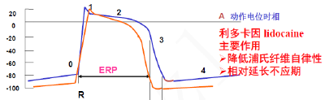
> 抑制复极2相少量Na+内流，缩短或不影响浦肯野和心室肌的APD；减小动作电位4期去极化斜率，降低自律性
（1）阻滞钠：  激活和失活状态，  有阻滞； 静息状态 ， 无阻滞
> *心房肌细胞AP时程短，钠通道处于失活态的时间短，因此对房性心律失常疗效差*
###### （2）减小动作电位4相除极斜率，提高兴奋阈值
（3）对  除极化组织（心肌缺血区）作用更强  —→缺血或强心苷中毒所致的除极化型心律失常
> <u>注释：缺血/强心苷如何引起除极化型心律失常？
> 
> 除极化型心律失常：钠超载（NK泵）；钙超载（钠钙交换、缺血、强心苷）；除极化振荡，DAD。
> 
> 缺血</u> 引起延迟后除极化（DAD）、触发活动 ，从而引起室性早搏、室性心动过速：①钾离子外流和钠离子内流的紊乱，细胞外钾离子浓度升高，静息电位接近除极化状态。② 钙离子积累 ：缺氧会影响钙离子外流，使细胞内钙离子浓度升高，导致触发性除极化，即动作电位的过早发生。
> 
> <u>强心苷（如地高辛</u> ）中毒：
> ①抑制钠钾泵，细胞内钠离子积聚，通过钠钙交换机制间接导致细胞内钙离子浓度升高。
> ②触发性除极化 ：细胞内钙超负荷会诱发延迟后除极化 ，即在动作电位结束后，细胞膜电位再次达到阈值，从而引起新的动作电位。这种除极化通常会导致早搏、快速性心律失常，甚至心室颤动等。
作用谱窄 → 室性心律失常，对心房肌、正常心肌组织作用弱
###### 主要作用于浦肯野纤维，对心房无影响
对心肌缺血性梗死区或强心苷中毒组织（失活状态）具有强效阻滞作用
#### 2. 临床应用
###### <mark style="background-color:#fef3c7;"> 室性心律失常首选 </mark> 药物（ 室性心动过速室性早搏室颤 ）
房性效果不好 （心房肌动作电位时程短，钠通道处于激活&失活态的时间短）
###### 缺血或强心苷中毒所致的除极化型心律失常作用强（不是首选）
#### 3. 不良反应
 （1）眼球震颤  ——  利多卡因中毒  的早期信号；
> 利多卡因能穿过血脑屏障作用于中枢神经系统中的钠通道。见于剂量较高或快速静脉注射时，药物在中枢神经系统浓度升高
###### （2）心脏毒性低，但剂量过大：心率减慢、房室传导阻滞、低血压
> Ⅱ、Ⅲ度房室传导阻滞的病人禁用
#### <u>苯妥英钠phenytoin sodium回顾（与利多卡因比较）</u>
###### （1）作用特点
###### ①心肌电生理作用：类似利多卡因
② 可以  加速强心苷代谢的同时，对抗强心苷中毒  所致的迟后除极：① 肝药酶诱导剂，加速强心苷的代谢；②与强心苷<mark style="background-color:#fef3c7;"> 竞争Na+-K+-ATP酶 </mark>，恢复酶的活性， 对抗强心苷中毒所致的迟后除极、触发活动和Arr 
（2）应用：解救强心苷中毒 ；麻醉、心脏病 术后 室性心律失常；癫痫大发作
（3）不良反应： 低血压 ；心动过缓；房室传导阻滞
###### 低血压时慎用， <u>窦性心动过缓及Ⅱ、Ⅲ度房室传导阻滞者禁用</u>
有致畸作用，孕妇禁用。
（4）合用：苯妥英钠可加速奎尼丁、[[美西律]]、[[地高辛]]、VitD、[[雌激素]]、茶碱的肝脏代谢。
##### 注意利多卡因还是局麻药，苯妥英钠还是癫痫大发作、局限性发作药
#### [[美西律]] （Mexiletine）
<mark style="background-color:#fef3c7;"> 共性: 抑钠、促钾；膜稳定/局麻 </mark>
 口服有效 ，效果持久， 维持利多卡因的疗效 
##### 应用：心肌梗死后急性室性心律失常
可出现神经症状，如震颤、共济失调、复视、精神失常等。禁用于严重心功不全、缓慢型心律失常和室内传导阻滞者。
#### IC类：  <u>明显</u> 阻滞钠通道（＞10s），明显<mark style="background-color:#fef3c7;">减慢</mark><mark style="background-color:#fef3c7;"> 传导 </mark> & 0期去极化 &自律性

> 只要求知道名字+荧光部分。“普罗帕酮”，罗汉都怕它，明显减慢
适应症： 广谱 ，对室性更好。室性心动过速、室颤、室上心动过速 （ eg房颤 ）
#### 普罗帕酮Propafenone（心律平）
> 明显抑制Na，Ca；微弱阻滞β（“普罗”“普洛” 远房亲戚）
##### 1. 药理作用
① 抑制INa ：长时明显，同时阻断 激活与失活 状态的Na+通道，减慢传导
> 目前只有奎尼丁是只阻滞激活态钠通道
###### ② 微弱阻断β受体 （化学结构似普萘洛尔）
*③抑制钾通道，延长APD，但弱于奎尼丁*
##### 2. 应用：广谱，室性更好
> Nearly every form of arrhythmia
☺ <mark style="background-color:#fef3c7;"> 长期口服 </mark>用于① 维持 室上性心动过速（房颤、房扑）的窦性心率，②也用于室性心律失常
##### 3. 不良反应
###### 一般<mark style="background-color:#fef3c7;"> 不宜与其他抗心律失常药合用 </mark>，以避免 心脏抑制 
> 不能合用奎尼丁、普萘洛尔、[[胺碘酮]]、[[维拉帕米]]
###### 致心律失常：加重折返性室性心动过速、加重充血性心衰
#### *氟卡尼（Flecainide）、恩卡尼、劳卡尼*
<mark style="background-color:#fef3c7;"> 共性：明显抑钠（传导性↓）；膜稳定 </mark>
明显降低心房、心室、希-浦系统、房室旁路的Vmax，减慢传导；抑制4相钠内流，降低自律性。
临床应用：室上性及室性心律失常。
不良反应：恶心、呕吐、头痛、视力模糊等。该药 致心律失常发生率较高 ，可致室性心动过速，室颤，诱发折返性心律失常，长Q-T综合征。
### II类药——β受体阻滞药
> xx洛尔：窦性，尤其是SNS相关的应激性诱导的心律失常
<u>*β肾上腺素受体作用：增*</u>  <u>*窦性*</u>  <u>*心律、增传导、强心力、加耗氧、糖脂代谢*</u>
性质：G蛋白偶联受体，激活cAMP-PKA通路，引起Ca2+、Na+内流
增强Ica-L——①正性肌力；②自律性↑（4期加快）
增强If——自律性↑，正性频率（心率↑）
激动β的病理情况：早后除极（平台期Ca2+多，振荡电位更易达到Threshold）、迟后除极（4期钙超载）；心率过快，自律性过高
*注意：β受体阻滞剂*  *索他洛尔*  *也可能通过*  *明显延长APD*  *诱发早后除极*  *（致）。* 
所以xx洛尔：<mark style="background-color:#fef3c7;"> 窦性心动过速首选 </mark>，尤其是SNS相关的应激性（<mark style="background-color:#fef3c7;"> 甲亢、嗜铬细胞瘤 </mark>）诱导的心律失常
<mark style="background-color:#fef3c7;"> 共性——阻断β受体：↓Na+、Ca2+，尤其是 ↓Ica-L、If起搏电流； </mark>
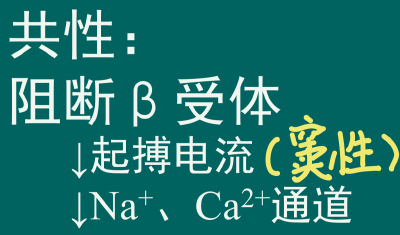
① 阻断β受体 ：4期K+ ↑、If ↓ ，钠、钙内流（Ica-L)↓ ，阻滞起搏电流，对于室上性心动过速（窦房结、房室结）最敏感
 ② 降低自律性 ，在运动及情绪激动时作用明显；
> 自律性
③  减少  儿茶酚胺所致的  迟后除极  发生（除了  <u>索他洛尔</u>  可致DAD）
> 兴奋性
##### ④减慢传导 ，延长AV结的有效不应期ERP
> 传导性
#### <u>普萘洛尔</u>
#### 1. 药理作用
##### <u>特别注意：普萘洛尔抗心律失常作用与β受体阻滞及膜效应的关系</u>
#### <u>2. 临床应用</u>
（1）多用于 室上性 心律失常，尤其是 <u>交感神经兴奋性过高</u>  <u>*（eg焦虑性、运动、情绪性心律失常）*</u>  <u>、甲状腺功能亢进</u>  <u>*（增强交感神经效应）*</u>  <u>、嗜铬细胞瘤</u>  *（过量儿茶酚胺分泌）* 引起的窦性心动过速 ；
窦性心动过速效果好；室性心动过速效果没那么好
> 首选利多卡因（阻滞钠通道）
> 室性心律失常通常与心肌缺血、钠离子通道功能紊乱（如心肌梗死急性期）有关，此时普萘洛尔对这些离子流的直接影响较弱，效果有限。此类情况下常用利多卡因治疗室性心律失常。
###### 室上Arr合并高血压或心绞痛患者
###### 运动或情绪变动引发的室性心律失常效果好
（2）与强心苷/地尔硫䓬合用，控制房扑、房颤、阵发性室上性心动过速时的室性频率过快
###### 普萘洛尔：降低窦房结频率、房室结传导性，减少过快的室性频率
###### 地尔硫䓬：钙通道阻滞，减少窦房结和房室结的兴奋性
###### 强心苷（如地高辛）：抑制钠钾泵，间接增强迷走神经
（3）减少心肌梗死、<mark style="background-color:#fef3c7;">肥厚型心肌病</mark>的心律失常，缩小心肌梗死范围，降低病死率
#### 3. 不良反应 & 禁忌症
（1）窦性心动过缓、房室传导阻滞，并可诱发心力衰竭和<mark style="background-color:#fef3c7;"> 哮喘 </mark>、低血压、精神压抑、记忆力减退等；
> 哮喘病人换用选择性 β受体阻断药，如美托洛尔。普萘洛尔阻断β2受体（气道平滑肌的主要受体）
（2）长期应用对脂质代谢和糖代谢有不良影响，高脂血症、糖尿病患者应慎用；
（3）突然停药可产生反跳现象。
##### 美托洛尔、艾司洛尔esmolol
#####  短效，选择性阻断β1 
##### 室上性心律失常
##### 抑制窦房结、房室结自律性、传导性，减慢房颤、房扑的心室率
##### *阿替洛尔atenolol*
#####  长效，选择性阻断β1 
##### 适应症：室上性、室性心律失常
##### 排在腺苷/[[地高辛]]/地尔硫卓之后
禁忌症：哮喘; CCF. Poor EF ；高度心脏传导阻滞；Ca通道阻滞剂；使用可卡因。
### III类药——钾通道阻滞药（显著延长APD ）
共性： 钾通道 阻滞药， 延长APD和ERP ，对AP幅度和去极化速率影响小
#### <u>[[胺碘酮]]（amiodarone）</u>
> 广谱、机制复杂（多种通道、多种受体，K+和非竞争性α、β受体为主）。
> ​毒性大。心、肺毒性、低血压、碘（甲状腺）。
> 维持正常窦性心律，不明显抑制心脏。
#### 1. 药理作用
 ① <mark style="background-color:#fef3c7;"> 抑制K+ </mark><mark style="background-color:#fef3c7;">为主</mark>的 多种 离子通道（INa,ICa,IK,IK1,Ito等↓），<mark style="background-color:#fef3c7;"> 明显延长APD、ERP。 </mark>降低自律性和传导性。
> 控制心室节律方面，优于β受体阻滞剂；降低传导、兴奋性方面，作用不如其它抗Arr药。
② 无翻转使用依赖性 （ No reverse use-dependence）：延长动作电位时程的作用不依赖于心率的快慢
翻转使用依赖性：心率快时，延长APD的作用不明显，而心率慢时，却使APD明显延长。该作用易诱发 尖端扭转型室性心动过速  。
 ③扩血管作用 ：<mark style="background-color:#fef3c7;"> 非竞争性α、β受体阻断剂 </mark>，还可以阻滞甲状腺激素（刺激β）的作用。—→舒张血管平滑肌（ADR：低血压）；扩张冠脉 ，降低心肌耗氧量。
#### 2. 临床应用
 广谱。顽固性心律失常。维持正常窦性心律。 
*用于对其他药物有抗性的室性心动过速或室颤；抑制与WPW综合征相关的心动过速。*
#### 3. 不良反应—— 多，与剂量、用时长短有关 
（1）心脏毒性：常见：窦性心动过缓、房室传导阻滞、Q-T间期延长，偶见尖端扭转型心律失常。←——→房室传导阻滞，Q-T延长者禁用
（2）静脉给药常见低血压←——→多巴胺、去甲肾上腺素维持血压
##### （3）碘：长期应用可见角膜褐色微粒沉着，停药后自行消失
甲状腺：少数有 甲状腺 功能亢进或减退，肝坏死： 胺碘酮有类似甲状腺素作用 ，可抑制外周T4向T3转化←——→ 甲状腺疾病、碘过敏禁用
（4）致死性肺毒性：个别：间质性肺炎、肺纤维化←——→ 长期使用应检测肺功能PFT、肺部X线；监测血清T3、T4
#### 4.药物合用（PPT有）
 CYP3A4代谢底物：  [[西咪替丁]] 可增加其血药浓度， [[利福平]] 可降低其血药浓度。
> [[西咪替丁]]：H2受体拮抗剂，作用于胃壁细胞、抑制肝药酶CYP3A4，减少胺碘酮的代谢。
##### 自身抑制其它肝脏代谢酶，增加地高辛、华法林浓度
#### 5. 使用注意与禁忌症
##### 多巴胺、去甲肾上腺素维持血压
##### 房室传导阻滞，Q-T延长者禁用
##### 甲状腺疾病 、碘过敏禁用
长期使用应检测肺功能PFT、肺部X线；监测血清T3、T4
#### 索他洛尔（Sotalol）：注意这是β阻滞剂，但属于III类药
##### 药理作用
选择性 阻滞IKr ， 非选择性阻断β受体。 
> 这里指3期复极化的rapid K+通道，阻滞IKr的药对房性心律失常效果更好
明显 延长APD及ERP  ，减弱窦房结及浦氏纤维自律性、房室传导 ，延长房室不应期而中止折返。
体内过程：口服吸收快，无首过消除。
临床应用：严重的室性、室上性心动过速、房颤。
不良反应较少 ，少数Q-T间期延长者可出现Tdp（一种室颤）。
#### 多非利特（dofetilide）：选择性阻滞IKr
> 对房性心律失常效果更好，应用于房颤 。
### IV类药——钙通道阻滞药 （Ica-L ↓）
##### 钙拮抗药综合作用对比：二氢吡啶类vs非二氢吡啶类
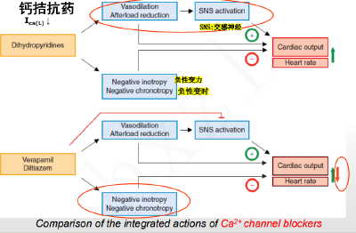
##### 二氢吡啶类：主要阻滞血管平滑肌的Ica-L，表现为 <u>舒血管作用</u>
非二氢吡啶类（[[维拉帕米]]、地尔硫卓）：主要 <u>阻滞心脏</u> Ica-L，负性变力、负性变时
### [[维拉帕米]]（Verapamil，异搏定）
#### 1. 药理作用
#####  抑制L型钙通道、 轻度抑制Ikr
##### <u>对心脏自律性、传导速度和不应期的影响</u>
###### - 降低窦房结自律性， 减少或消除后除极（以及触发活动）
###### 减慢房室 传导
> 可终止房室结折返 ，减慢心房扑动引起的心室率加快
延长窦房结、房室结的 ERP 。
#### 2. 临床应用
治疗 室上性心动过速、  房室结折返引起的心律失常。是<mark style="background-color:#fef3c7;"> 阵发性室上性心动过速（PSVT）首选药 </mark>
> Paroxysmal supraventricular tachycardia：容易被折返和后除极引起。口服可预防房PSVT的发作及减慢房颤患者的心室率；静注可终止PSVT
房颤、房扑：减慢心室内率（传不下去）。但首选地高辛，
##### 抑制钙超载相关的室性早搏
#### 3. 不良反应
CCB：扩血管、抑心脏、舒张平滑肌（胃肠、支气管）、保护肾（血流+）、抗动脉粥样硬化、抑制血小板聚集和红细胞脆性
口服安全，静脉给药可致血压降低、暂时窦性停搏 （尤其 <mark style="background-color:#fef3c7;"> 不能合用β受体阻滞剂 </mark> ） ；
房室传导阻滞、心功能不全、心源性休克，禁用；老年人、肾功能低下者慎用 。
##### *〔药物相互作用〕*
1.一般不与β受体阻断药合用：均抑制心肌收缩力、传导，合用有心脏停搏风险
###### 2.合用地高辛时，减少地高辛的剂量
### Others：腺苷Adenosine——快速起效， 迅速 终止折返性、阵发性室上心律失常
##### 药理作用
##### 作用于 A1腺苷受体 
激活KAch （ Ach依赖性K+通道），  缩短动作电位时程
> 心房、窦房结、房室结，对窦房结作用尤其明显
抑制Ca2+通道 ，延长Ca依赖性动作电位（eg房室结）的有效不应期，抑制迟后除极
##### 临床应用
#####  迅速 终止折返性、阵发性室上心律失常（腺苷静注起效非常快）
##### 不用于房颤和室性心动过速
*不良反应：注射过快引起短暂心脏停搏；低血压*
#### 抗心律失常药的致心律失常作用
定义：应用治疗量抗心律失常药物、血药浓度低于中毒水平时，药物 <u>诱发既往未曾发生过</u> 的心律失常或者 <u>使原有的心律失常恶化</u> 。
#### 发生原因
抗心律失常药物大部分可影响心肌的除极和复极，使电解质发生改变，对心脏特殊组织的自律性、兴奋性和传导性产生影响。这种作用具有个体差异、剂量差异。
二、心律失常的电生理学机制。（形成异常，传导异常）
#### 举例
[[奎尼丁]]：抑制心肌的传导，使有效不应期延长，故易诱发折返性心律失常
利多卡因：治疗室性快速心律失常，但大剂量时引起房室传导阻滞和严重的缓慢性心律失常。
#### 预防措施
原则：危及生命的心律失常（acute）→有效性；改善症状用药（outpatient/ take home）→安全性
1.能使用一种药物治疗有效的，尽量避免联合用药；
2.避免同时应用多种同一类药物；
##### 3.避免同时应用作用或副作用相似的药物
####  课后题 
1. 维持 正常窦性心律的抗心律失常药？—— [[胺碘酮]] 。主要特点是广谱，不明显抑制心脏
2.女性，44岁。八年来劳累后心慌气短。既往曾患过“风湿性关节炎”。近日因劳累病情加重，心慌，气短，咯血，不能平卧急诊入院。查体:半卧位慢性重病容。脉搏80次/分，血压13.3/9.33kPa(100/70mmg)。心向左侧扩大心律不齐，心率120次/分，心尖区舒张期雷鸣样杂音，主动脉瓣区收缩期和舒张期杂音。肝肋下3cm，下肢轻度浮肿。诊断:风湿性心脏病，二尖瓣狭窄主动脉瓣狭窄及关闭不全，心房纤颤，心功能不全1度。该病人在用强心药治疗的过程中， 心率突然减 为45-50次/分，此时应选用
A. 利多卡因
B.肾上腺素
C. [[吗啡]]
<mark style="background-color:#fef3c7;">D.阿托品</mark>
> 心动过缓性强心苷中毒
E.[[苯妥英钠]]
> 普通强心苷中毒
3.女性，74岁。自觉因擦背着凉后两肩和后背阵阵酸痛，每阵10分钟左右，不发烧，仍可下床走动。于今晨1时许，突然出现心前区剧痛并向双肩、后背和左臂放射，伴大汗，休息后不见缓解，早8点急诊住院。检查:年迈，半卧位，无明显青紫，颈静脉不怒张，肺(一)心略向左侧扩大，心律尚齐，未闻心脏杂音及摩擦音。心电图:病理性Q波，ST段抬高，T波倒置。诊断: 急性心肌梗塞 。为 防止 室性心律失常的发生，病人应先给予的下列药物较好的是
A.利多卡因
> 急性缺血性心律失常（eg心梗）已发作时用
B. [[奎尼丁]]
C. [[胺碘酮]]
<mark style="background-color:#fef3c7;">D. 美托洛尔</mark>
> 预防时用
E.[[苯妥英钠]]
4.Which of the following is an antiarrhythmic agent that has relatively few electrophysiologic effects on normal myocardial tissue but suppresses the arrhythmogenic tendencies of ischemic myocardial tissues?
a. Propranolol
b. Procainamide
c. Quinidine
<mark style="background-color:#fef3c7;">d. Lidocaine</mark>
e. Disopyramide
5. The first-line drug for treating an  acute  attack of  re-entrant supraventricular tachycardia(SVT) is
<mark style="background-color:#fef3c7;">a. Adenosine</mark>
> 对折返性室上心动过速作用非常快
b. Digoxin
c. Propranolol
d. Phenylephrine
e. Edrophonium
6.Suppression of arrhythmias resulting from a reentry focus is most likely to occur if the drug:
A. Has vagomimetic effects on the AV node.
B. ls a β-blocker.
<mark style="background-color:#fef3c7;">C. Converts a unidirectional block to a bidirectional block.</mark>
D. Slows conduction through the atria.
E. Has atropine-like effects on the AV node.
7. A 57-year-old man is being treated for an atrial arrhythmia.He complains of headache, dizziness, and tinnitus. Whichone of the following antiarrhythmic drugs is the most likely cause?
A. Amiodarone.
B. Procainamide.
C. Propranolol.
<mark style="background-color:#fef3c7;">D. Quinidine.</mark>
> 五官类副作用，金鸡纳反应
E. Verapamil.
8. 58-year-old woman is being treated for chronic suppression of a ventricular arrhythmia. After 2 months of therapy, she complains about feeling tired all the time. Examination reveals a resting heart rate of 10 beats per minute lower than her previous rate. Her skin is cool and clammy.Laboratory test results indicate low thyroxin and elevated thyroid stimulating hormone levels. Which of the following antiarrhythmic drugs is the likely cause of these signs and symptoms?
<mark style="background-color:#fef3c7;">A. Amiodarone.</mark>
> 关键词：甲状腺副作用
B. Procainamide.
C. Propranolol.
D. Quinidine.
E. Verapamil.
#### 抗心律失常药小结
#### 景晴

