---
tags:
  - pharmacology
---
### 抗心绞痛药（2 ）
> 还没看PPT和教材，妈的学的稀碎
### 一、冠心病基本情况
### 定义
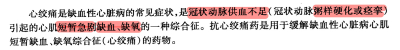
### 病理生理学
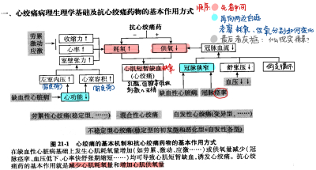
### 临床分型
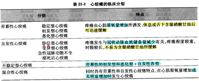
### 解剖学
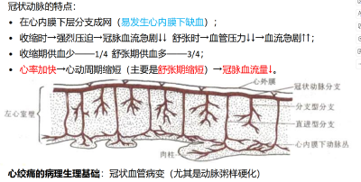
### 补充：冠脉窃血
冠脉狭窄引起损伤区组织释放舒血管物质，使局部血管代偿性扩张，以增加损伤区的血流灌注。但如果狭窄超过血管横截面的90%。其扩张的代偿机制将不足以弥补血流量的下降。如果同一冠脉有两条分支，一条为正常血管，另一条是严重狭窄血管，则内源性释放的舒血管介质将首先作用于正常血管，因为狭窄血管已经达到其扩张的极限。此现象称“冠脉窃血”，即正常组织的冠脉血流相对增加，而狭窄区域的血流反而减少。
##### 有冠脉窃血特点的药物
##### 肼苯哒嗪（hydralazine）
##### 硝普钠
##### 腺苷
##### PDE5抑制剂
### 抗心绞痛药的作用机制
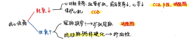
#####  针对疾病：增加供氧、减少心肌耗氧量 
1. 舒张血管、降低前后负荷、降低心率—→耗氧↓（硝酸酯类、β-受体阻断剂、钙拮抗剂）
2. 舒张冠脉，促进侧支循环/血流重分布—→冠脉供血↑，供氧↑ （硝酸酯类）
3. 抑制血小板聚集和血栓形成—→对抗动脉粥样硬化
##### 4. 保护心肌细胞 （钙拮抗剂）
### 抗心绞痛药概述

### 二、 <u>硝酸酯、亚硝酸类</u> <u>（Nitrate Esters）</u>
> [[硝酸甘油]]（nitroglycerin）戊四硝酯（pentaerithrityl tetranitrate）硝酸异山梨酯（Isosorbide Dinitrate）单硝酸异山梨酯（Isosorbide Mononitrate）
### 体内过程
舌下含服：通过口腔黏膜吸收，生物利用度可达80%（口服8%），且可避免“首过效应”
##### 不同类型心绞痛选用不同制剂
### 药理机制
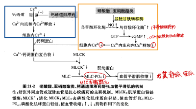
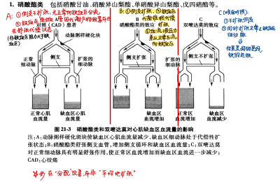
### 药理作用、临床应用、不良反应
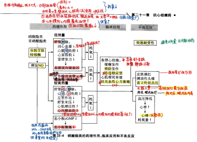
### 禁忌症
##### 颅脑外伤、颅内出血、青光眼患者慎用
##### 严重贫血低血压低血容量
### *药物互作*
与抗高血压药物合用时应适当减量（注意可以搭配使用，比如和β blockers，这样还可以减少耐受）
与肝素合用时会减弱肝素抗凝作用——应加大肝素用量
##### 与西地那非合用：易诱发心力衰竭、猝死
### 三、 <u>β–受体阻断剂（重在作用机制）</u> 普萘洛尔和硝酸甘油联合应用治疗心绞痛的药理基础
> 普萘洛尔（propranolol）美托洛尔（metoprolol）阿替洛尔（atenolol）
### 药理作用机制
##### 心绞痛发作时交感神经兴奋，心脏局部和血液中儿茶酚胺水平升高
增强心肌收缩力、心率加快、血管收缩，冠状动脉血流下降， 加重心肌缺氧 
 游离脂肪酸增加  游离脂肪酸的代谢消耗大量的氧，加重心肌缺血缺氧的程度
##### β–受体阻断剂抗心绞痛
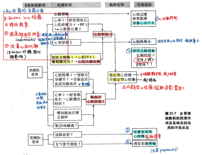
#### 禁忌症
##### 哮喘
##### 变异性心绞痛 （ 加重冠状动脉痉挛加重缺血）
##### 心动过缓低血压严重心功能不全
##### 慎用：糖尿病/血糖不稳定
抑制胰高血糖素升血糖作用并使胰岛素降血糖作用增强，可能会掩盖低血糖的症状
### 四． <u>钙拮抗药</u>
### <u>抗心绞痛作用机制</u> 及临床应用
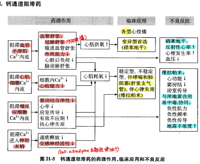
钙通道阻滞剂对支气管有适度扩张作用；对血管解痉挛有明显作用
对<mark style="background-color:#fef3c7;"> 冠脉痉挛所致的变异性心绞痛 </mark>最有效（强大的扩张冠状动脉作用），也用于稳定型及不稳定型心绞痛；
☺ 对伴有哮喘和阻塞性肺病的患者更合适（松弛支气管平滑肌）；
☺ （[[硝苯地平]]）较少诱发心力衰竭；
☺ 对心肌缺血伴有外周血管痉挛性疾病的患者适用。
### 五、其他药物
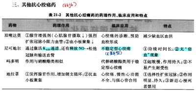
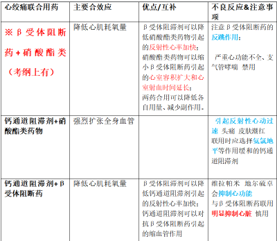
#### 尼可地尔（ Nicorandil ）
ATP敏感性K+通道激活药物可以发挥硝酸酯样作用
#### 较强扩张冠状动脉的输送血管持续时间较长同时对阻力血管影响弱
不易产生耐受多用于变异性慢性稳定性心绞痛
### 习题
#### 思考题
硝酸甘油抗心绞痛机制是什么?它有哪些不良反应?如何避免其耐受性的产生?
 β受体阻断药抗  心绞痛  机制  是什么?
 硝酸甘油与普萘洛尔合用  于治疗心绞痛有何优点?为什么?（从其  作用原理  解释：合用  疗效↑  ，  不良影响互相抵销  ）
#### 变异性心绞痛不建议用β受体阻断药
β受体阻断药不建议与维拉帕米合用。合用的话应该用一个对心脏的一个对血管的，两个都对心脏会强烈抑心。
#### 硝酸甘油的禁忌症是(ABCD)(多选)
A. 严重青光眼
B.严重贫血
C.使用西地那非
D.严重低血压
The therapeutic action of β-adrenergic receptor blockers such as propranolol in angina pectoris is believed to be  primarily  the result of
a. Reduced production of catecholamines
b. Dilation of the coronary vasculature
<mark style="background-color:#fef3c7;">c.Decreased requirement for myocardial oxygen</mark>
d. Increased peripheral resistance
e. Increased sensitivity to catecholamines
#### 普萘洛尔([[心得安]])对下列何种类型的心绞痛相对较好
> 考察变异型、稳定型和不稳定型心绞痛的区别
<mark style="background-color:#fef3c7;">A.活动时发生的心绞痛</mark>
B.活动、静息均可发生的心绞痛
C.静息时发生的心绞痛
D.支气管哮喘者并发心绞痛
E.以上均可
