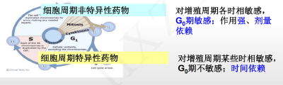
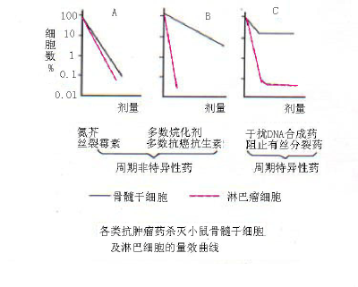
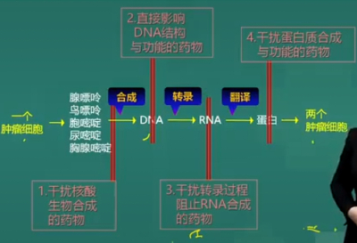
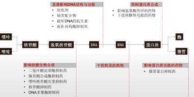
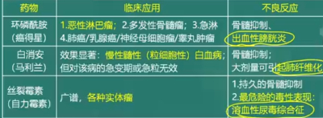
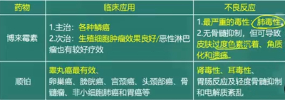
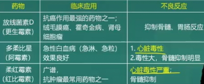
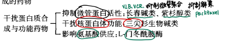

---
tags:
  - pharmacology
---
### 抗恶性肿瘤药（ 2.5学时）
#### 一．抗恶性肿瘤药的作用机制与分类
#### ~~根据化学结构和来源分类~~
烷化剂：包括 环磷酰胺（Cyclophosphamide）  卡莫司汀（Carmustine）马法兰（Busulfan）
抗代谢药：包括 甲氨喋呤  （Methotrexate,  MTX  ）  氟尿嘧啶  （Fluorouracil, 5-FU）巯嘌呤（Mercaptopurine, 6-MP）  阿糖胞苷  （Cytarabine, Ara-C）
抗肿瘤抗生素：包括 放线菌素D  （Dactinomycin D）多柔比  星  （Doxorubicin）博来霉素（Bicomycin）柔红霉素（Daunorubicin,DNR）丝裂霉素（Mitomycin, MMC）
> ~cin，~mycin
抗肿瘤植物药：包括 长春（新）碱  （VLB，VCR）  紫杉醇  （Paclitaxel）喜树碱（Camptothecine）
其他类：包括 顺铂  （Cisplatin）卡铂（Carboplatin）维甲酸（Retinoc Acid）
##### 激素类： 糖皮质激素 、[[雌激素]]、雄激素等
####  <u>※ 根据药物作用周期分类</u> 

> *间期分为G0静止期、G1期(蛋白质、RNA合成)、S(DNA合成期)、G2(蛋白质、RNA合成)、M期 （分裂）*
 （记：细胞周期非特异性药物只有 <mark style="background-color:#fef3c7;"> 烷化剂、抗肿瘤抗生素、顺铂、激素 </mark> ，其余均为细胞周期特异性药物） 
##### • 细胞周期 <u>非特异性</u> 药物
直接破坏DNA或影响复制、转录功能的药物。
##### 对增殖周期各时期的细胞敏感， G0 期敏感
作用强，杀伤作用呈剂量依赖性。
##### 剂量反应曲线是一条直线
##### 举例：烷化剂、抗肿瘤抗生素、顺铂和激素
烷化剂：氮芥；环磷酰胺；白消安；博来霉素；丝裂霉素
影响转录过程：放线菌素D；多柔比星；柔红霉素
###### 顺铂和激素
##### • 细胞周期 <u>特异性</u> 药物
仅对增殖周期某些时相敏感，对G0期不敏感；
作用往往较弱，杀伤作用呈时间依赖性。
剂量反应曲线是一条渐近线；
##### 举例：抗代谢药、干扰蛋白质合成（主要是M期纺锤丝）药
###### 作用于S期：干扰核酸生物合成（抗代谢药）：甲氨喋呤阿糖胞苷
作用于M期：干扰蛋白质合成药：长春新碱主要作用于M期；紫杉醇：主要作用于M期和G2期
#### 根据作用机制分类（图中4点+影响全程的“ 影响激素平衡药物 ”）

肿瘤细胞的共同特点：细胞  增殖  有关的基因被开启或激活，细胞  分化  有关的基因被关闭或抑制。
#### 抗肿瘤药的 <u>毒性反应</u>
##### • 共有反应
 骨髓抑制：除外激素类,博来霉素, 门冬酰胺酶； 
##### 消化道反应：恶心、呕吐
脱发。
##### • 特有反应
 心脏毒性 ： 柔 [[红霉素]]、 多柔 比星、三尖杉酯碱；
> 恩怨 <u>柔</u> 情 <u>多</u> 伤心
#####  呼吸 系统毒性： 博来 霉素、白消安、CTX（环磷酰胺）
> 平阳博来吵架了，肺气炸了
 肝脏 毒性：MTX甲氨蝶呤、羟基脲、CTX环磷酰胺、鬼臼毒素；
#####  膀胱 毒性：<mark style="background-color:#fef3c7;"> 环磷酰胺致出血性膀胱炎 </mark>
 肾毒性： CTX、顺铂；
> 为了买个铂金戒指，卖肾
 神经 毒性：顺铂、长春新碱、紫杉醇、门冬酰胺酶；
> 顺铂的两大毒性反应：“肾”“神”
 过敏 反应：博来霉素、门冬酰胺酶、紫杉醇。
> 因为都是生物制剂
<u>抗肿瘤药物联合用药原则。</u>
##### 1. 细胞增殖动力学机制
（1）招募作用: 周期特异和非特异性药物交替使用，先杀灭一部分肿瘤，引诱更多肿瘤细胞进入G0期再歼灭
（2）同步化抑制: 使用周期特异性药物，肿瘤细胞阻滞于某一时期、同步进入下一时期，再用下一时期抑制药
2.生化机制(作用于不同环节的药物互补): eg核酸合成(Doxorubicin)+ 细胞毒(cyclophosphamide)→DNA修复↓
3. 降低毒性: 合用激素,长春新碱,博来霉素→骨髓抑制↓
4. 抗癌谱： 消化道腺癌 → 5-FU ;  鳞癌 → MTX :  骨肉瘤 → Doxo 
##### 5. 合理剂量：考虑患者耐受性
#### 二．常用抗肿瘤药
#### (一) 细胞毒类抗肿瘤药
1．干扰 <u>核酸生物合成的药物 / （抗代谢药）：主要用于</u>  <u>S期</u>  <u>。</u>
> <u>5-氟尿嘧啶（5-FU）、6-巯基嘌呤（6-MP）、甲氨蝶呤（MTX）</u> 、阿糖胞苷、羟基脲
胸苷酸合成酶抑制药——氟 尿 嘧啶（５－FU） 可用于消化道癌、乳腺癌、卵巢癌等；
嘌呤核苷酸互变抑制药——巯嘌呤（６－MP） 用于儿童急性淋巴细胞白血病（维持治疗）；免疫抑制剂（用于自身免疫病）
二氢叶酸还原酶抑制剂——甲氨蝶呤（MTX） 可用于儿童急性白血病；
核苷酸还原酶抑制剂——羟基脲可用于慢性粒细胞白血病；
DNA多聚酶抑制剂——阿糖胞苷用于成人急性粒细胞／单核细胞白血病
##### <u>2．破坏DNA结构和功能：</u>  <u>细胞周期非特异性</u>  <u>药物</u>

> 氮芥、 <u>环磷酰胺（cyclophosphamide）、</u> 白消安、塞替哌、博莱霉素（bleomycin）、丝裂霉素（把红细胞“撕裂”～溶血性尿毒症）、 <u>顺氯氨铂（cisplatin, DDP）（“结合DNA”）</u>
烷化剂（DNA交联剂） ：氮芥、 <u>环磷酰胺（cyclophosphamide）</u> <u>、</u> 白消安
机制：与DNA或蛋白质分子中亲核基团（氨基、羧基、羟基、磷酸基）起烷化反应→交联或脱嘌呤→DNA链断裂
###### <u>环磷酰胺（cyclophosphamide）</u>
肝药酶代谢物为磷酰胺氮芥，对恶性淋巴瘤疗效显著；
###### 诱发 出血性膀胱炎 
###### 白消安busulfan、马利兰myleran
###### 慢性粒细胞、原发性血小板、真性红细胞增多
###### 久用后肺纤维化（马利兰肺）、闭经、睾丸萎缩
##### 破坏DNA的抗生素 ：博莱霉素（bleomycin）、丝裂霉素
###### 博莱霉素（bleomycin）
###### DNA结合-DNA链断裂一复制受阻
G2和M期；鳞状上皮癌，淋巴瘤，睾丸癌，卵巢癌
 不良反应：间质性肺炎->纤维化。 
###### 丝裂霉素（mytomycin）
生物还原烷化作用（与DNA双链交叉联结，抑制其复制；使DNA断裂）；周期非特异性；
 广谱 ； 毒性大. 
##### 破坏DNA的铂类 （金属与DNA共价结合）
###### <u>顺氯氨铂（cisplatin, DDP）/顺铂</u>
 Pt2+与碱基（G、A、C）交叉联结 ；
周期非特异性， 广谱 ；口服无效，静注
 肾和耳毒性 。
###### 卡铂（carboplatin）
##### 抑制拓扑异构酶：鬼臼毒素衍生物
3． <u>影响转录过程、阻止RNA合成：</u>  <u>细胞周期非特异性</u>  <u>药物（都是</u>  <u>抗癌抗生素</u>  <u>）</u>

> 只有博来、丝裂这两个抗癌抗生素是破坏DNA的，其它都是影响转录的
共性： 抗癌抗生素 、 周期非特异性 。 嵌入DNA碱基对，干扰转录 ，阻止RNA合成；
放线菌素D （dactinomycin）：G1期，拓扑酶II ⬇️
肾母细胞瘤、绒癌、恶性葡萄胎。“放射召回”．
<u>多柔比星</u> （doxorubicin，adriamycin，阿霉素，ADM）
######  S和M期 
急淋、急粒、恶性淋巴瘤、实体瘤；
######  心脏毒性 
##### 柔红莓素 （daunorubicin）同上
<u>4．干扰蛋白质合成：主要作用于</u>  <u>M期</u>  <u>。</u>

微管蛋白活性抑制药——长春碱（vinblatine，VLB）、长春新碱（vincristine，VCR）、紫杉醇（paclitaxel）
<u>长春碱（vinblatine，VLB）、长春新碱（vincristine，VCR）</u>
抑制微管聚合、纺锤丝形成，有丝分裂停止（M期）；急性白血病，恶性淋巴瘤，绒癌；
###### 不良反应：外周神经炎.
###### 紫杉醇（paclitaxel）
促进微管聚合，抑制解聚——纺锤体失去正常功能，有丝分裂停止。转移性卵巢癌、乳腺癌。
骨髓抑制、周围神经病变、过敏反应、心脏毒性等。
干扰核蛋白体功能——三尖杉酯碱（harringtonine）：
###### 抑制蛋白质合成起始阶段，有丝分裂↓
急粒，急单（急非淋），淋巴肉瘤，肺癌；
心肌损害。
影响氨基酸供应——L-门冬酰胺酶（asparaginase）
急淋；
过敏反应、精神症状。
#### (二) 非细胞毒类抗肿瘤药
内分泌治疗药物：激素类：肾上腺皮质激素，[[雌激素]]、雄性激素、他莫昔芬。
 糖皮质激素 ：急淋、恶性淋巴瘤、慢淋；
[[雌激素]]：前列腺癌、绝经期乳腺癌；
雄激素：晚期乳腺癌；
选择性雌激素受体阻断药—— 他莫昔芬 —乳腺癌
##### 小分子化合物：伊马替尼、吉非替尼、索拉非尼等
##### 其他：维A酸、亚砷酸、重组人血管内皮抑制素等
(三)肿瘤免疫治疗：伊匹单抗、尼伏单抗、阿替珠单抗等重组人白介素-2新药研究等
分子靶向抗肿瘤药： 利妥昔单抗（ 单克隆抗体）、 曲妥珠单抗（ 抗体耦联药） 、阿替利珠单抗（ <mark style="background-color:#fef3c7;"> 第一个PD-L1抑制剂 </mark> ） 等
#### 习题
1 ．简述抗肿瘤药的分类方法。
※ 根据药物作用周期分类——细胞周期特异性、非特异性，其中非特异性只有 烷化剂、抗肿瘤抗生素、顺铂、激素 
##### 根据作用机制分类（图中4点+影响全程的“ 影响激素平衡药物 ”）
2 ．周期特异性和非特异性药物。
3 ．简述抗肿瘤药的主要不良反应。
##### 抗肿瘤药的 <u>毒性反应</u> 
#### 4. 简述环磷酰胺的临床应用
##### 烷化剂，直接破坏DNA结构和功能
 广谱，恶性淋巴瘤、多发骨髓瘤 、急性淋巴细胞白血病、肺癌、乳腺癌、卵巢癌、神经母细胞瘤、率丸肿瘤等
##### <mark style="background-color:#fef3c7;">引起骨髓抑制</mark>
##### 代谢物引起<mark style="background-color:#fef3c7;">化学性膀胱炎</mark>
#### 5. 简述氟尿嘧啶的临床应用
##### 干扰核酸生物合成（S期）
#####  消化系统肿瘤、乳腺癌 疗效较好，宫颈癌、卵巢癌、头颈部肿瘤等有效
