---
aliases:
  - antibiotics
tags:
  - infection
  - pharmacology
---
- # β- 内酰胺类抗生素（3 学时）
  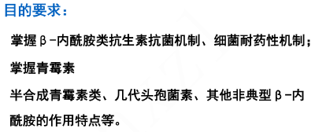
  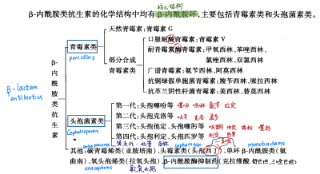
  > 青霉素类（Penicillins） 头孢菌素类（Cephalosporins）
  >  非典型 β-内酰胺类： 碳青霉烯类（Carbapenems） 头霉素类（Cephamycin） 氧头孢烯类（Oxacephems） 单环 β-内酰胺类（Monobactam ）
  - # 一. <u>β-内酰胺类抗生素</u>
    - ## <u>1. 抗菌机制</u>
      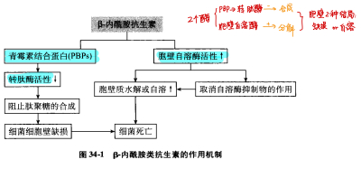
      - 作用于细菌菌体内的 青霉素结合蛋白（penicillin-binding proteins,PBPs） 
        - 抑制转肽酶活性→阻止肽聚糖合成→细胞壁缺损→细菌死亡；
        - 增加胞壁自溶酶活性（自溶酶活性↑，取消自溶酶抑制物的作用）→自溶或胞壁水解→细菌死亡。
      -  繁殖期   窄谱   杀  菌剂
      - 对G+细菌更敏感，对哺乳细胞几乎无毒
      - 对各种亚型的 PBPs 的结合能力不同，表现出抗菌活性的差异
    - ## <u>2. 影响抗菌作用的因素</u>
    - ## <u>3. 耐药机制</u>
      -  （1）生成β-内酰胺酶 
        - 青霉素耐药—— 青霉素酶 ； 头孢类耐药——ECBLs；碳青霉烯耐药——金属酶 
        - 其中， 金葡菌 易产生耐药性（ 除了MRSA之外的金葡菌都是靠产生酶来耐药的 ）
      - （2）牵制机制（Trapping Mechanism）： 通过 酶的结合 阻止抗生素到达靶点
        - β-内酰胺酶与某些耐酶的β-内酰胺类抗生素结合，使药物停留在胞膜外，不能到达靶位发挥作用。与MRSA 无关，耐酶青霉素无法治MRSA感染
      - （3）药物不能在作用部位达到有效浓度： 进入减少，外排增加
        - 主动外排系统增强
        - 通道蛋白数量和结构的改变
      - （4）靶位（PBP）改变：药物对 PBPs 的亲和力降低
        - 耐甲氧西林金黄色葡萄球菌（MRSA）、耐青霉素肺炎链球菌、耐第三代头孢菌素的菌株
      - （5） 缺乏自溶酶：金黄色葡萄球菌
  - # 二.[青霉素](青霉素.md)类
- # 氨基苷类抗生素 +多粘菌素、多肽类（均对  G-  作用强）
  - ## 氨基糖和氨基环醇以苷键相连接形成的 碱性 抗生素，在 碱性环境中作用更强
  - ## 包括
    - 链霉素类：  链霉素（streptomycin）   卡那霉素（Kanamycin）   妥布霉素（Tobramycin）   大观霉素（Spectinomycin） 新霉素（neomycin）
    - 庆大霉素类：  庆大霉素（gentamicin）   阿司米星（astromicin）
    - 半合成类药物：  阿米卡星（amikacin）   奈替米星（netilmicin） 
  - # 一． <u>氨基苷类抗生素的共性</u>
    - ## <u>1. 抗菌力&抗菌特点：</u>  <u>静止期（Quiescent）杀菌</u>  <u>，</u>  <u>蛋白质合成全程抑制剂</u> 
      - 药代动力学 / 体内过程
        - 浓度 依赖性， PAE很长  ， 首次接触后效应（FEE）明显 
        - 在 <u>碱性环境</u>  中作用更强
        -  水溶性很强（分布于细胞外液，不过BBB），脂溶性差（口服难以吸收，可肠道消毒） 
      - 谱 效
        - 高效、广谱 （除了链霉素）  ，但毒性更高
        - 仅对需氧菌有效，且抗菌活性显著强于其他药物， 对厌氧菌无效 ；
      - 毒
        -  内耳淋巴液、肾皮质中药物浓度高 ，耳毒性、肾毒性， 原形排泄不伤肝 
        - 原形经肾脏滤出，而青霉素是肾脏主动分泌排出（link 丙磺舒）
    - ## <u>2. 抗菌谱：</u>  <u>广谱，尤其G-杆；只作用于需氧菌</u> 
      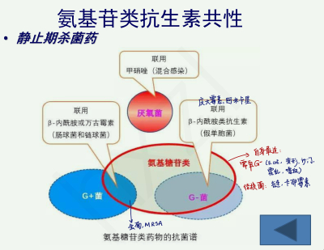
      - 1.尤适用于 需氧G— 的严重感染：铜绿假单胞菌、不动杆菌、大肠埃希菌、肠杆菌、变形杆菌、沙门氏菌、霍乱弧菌
      - 2.卡那、丁胺卡那、 链霉素 对 结核分歧杆菌 有效
      - 3.对 G+球菌 ：葡萄球菌强，（even MRSA），链球菌效果不佳
      - 4. 对 G-球菌作用差： 肠球菌,  厌氧菌无效 
      - 5. 大部分对 铜绿假单胞菌 有效（ 链霉素、 卡那霉素、大观霉素 无效） 
      - 6.  联合治疗： 常与  β-内酰胺类 治疗肠球菌、链球菌等 G+ 、铜绿假单胞菌等 G- ；与 甲硝唑 联合治疗 厌氧菌 
    - ## <u>3. 作用机制</u>
      - 全过程  抑制蛋白质合成  ： 30S 小亚基
        - 起始阶段：抑制 70S 复合体的形成
        - 延长：mRNA误读
        - 终止：阻止70S解离，肽链不能脱落
      - 裂解细菌  细胞膜  ：  对宿主也有一定毒性 
        - 竞争性置换脂多糖分子上的阳离子，结合膜上带负电磷酸基团
        - 增加膜的通透性，重要物质外漏——快速杀灭革兰氏阴性菌
      - 刺激菌体产生致死量的  羟自由基 
        - *氨基糖苷类抗生素可在 β-内酰胺酶之后使用（同时使用会相互反应）*
      - <mark style="background-color:#fef3c7;"> 为什么对厌氧菌无效，为什么碱性条件下杀菌作用更强？ </mark>
        - 氨基糖苷类进入细菌是在  需氧条件  下的主动转运过程 ， 可被 金属阳离子 、 低 pH 、厌氧环境阻断
          - 对厌氧菌无效（能量不足）；碱性环境高活性；
          - 与β-内酰胺酶和万古霉素配合（这些打破细胞壁，氨基糖苷随后进入），但 ※不宜在同一注射器内给药 （ 酸碱中和 可破坏氨基糖苷）
    - ## <u>4. 耐药机制</u>
      - 产生  钝化酶（modifying enzyme） 
        - 产生灭活酶：<mark style="background-color:#fef3c7;"> “绿林大安倍（β）”，背！ </mark>
        - 包括乙酰化酶（AC） 腺苷化酶（AD） 磷酸化酶（P）
      -  改变细胞膜通透性（主动外排 / 减少摄取） 
        - 绿脓杆菌对链霉素耐药
      -  靶位修饰  ：  30S亚基  结构改变
        - 结核杆菌对链霉素耐药
    - ## <u>5. 药代动力学/体内过程</u>
      - 吸收： 口服不吸收  ，除了算作 肠道感染时的局部作用。一般肌内注射 （毒性，不主张静脉注射）
      - 分布：细胞外液。集聚 于  肾皮质、耳蜗、前庭  ， 产生肾毒性和耳毒性； 可透过胎盘屏障，但不能透过血脑屏障。 
      - 代谢&排泄：在体内 不被肝代谢 ，以原形从 肾脏 排泄
    - ## <u>6.临床应用</u>
      -  需氧G-  菌的全身感染（脓毒症）
      - 联合用药（主要联用β内酰胺）
        - 联合攻G-杆：庆大霉素+头孢三代
        - 联合攻G+球：庆大霉素+青霉素/头孢一代
        - 联合攻需氧+厌氧：甲硝唑
      - 结核分歧杆菌和非典型分歧杆菌感染  ：结核~~链霉素 （  *卡那、丁胺卡那*  ）；  非典型~~阿米卡星 
    - ## <u>7.不良反应——</u> <mark style="background-color:#fef3c7;"> <u>耳毒肾毒肌肉阻，过敏仅次青霉素</u> </mark> <u>(对第八对脑神经、肾、肌肉神经接头的影响及过敏反应)</u>
      - ### ① 耳毒性（Ototoxicity）： 包括 耳蜗毒性 和 前庭毒性  ，引起 不可逆  性耳聋、 眩晕、恶心、呕吐、眼球震颤
        - 机制：在 内耳外淋巴液蓄积 ，损害内耳Corti器内、外毛细胞的能量产生及利用，引起细胞膜的 Na+-K+-ATPase功能障碍 ，造成毛细胞损伤
        - 前庭毒性：眩晕呕吐。新霉素＞卡那霉素＞链霉素＞庆大霉素＞妥布霉素
          > 新、卡那永远排前二，然后是链霉素、阿米卡星
        - 耳蜗毒性：耳鸣耳聋。新霉素＞卡那霉素＞阿米卡星＞庆大霉素＞妥布霉素＞链霉素
        - <mark style="background-color:#fef3c7;"> 避免合用耳毒性药物 </mark>
          -  一代头孢、万古霉素、多黏菌素 
            > 记：一代头孢耳肾毒，万古、多粘菌素和它在同章
          -  呋塞米等高效利尿药；甘露醇等脱水药 
          -  镇吐药 ；H1 受体阻断剂  （可能掩盖其耳毒性） 
          - 红霉素/大环内酯也有部分
      - ### ② 肾毒性（Nephrotoxicity）： <mark style="background-color:#fef3c7;">药源性肾衰竭</mark>最常见因素。在肾皮质聚集，破坏肾皮质近曲小管引起肾小管肿胀， <u>对肾小球影响不大。</u>
        - 严重程度：新霉素＞卡那霉素＞庆大霉素＞妥布霉素＞阿米卡星＞链霉素
          > 新、卡那永远排前二，然后是庆大霉素
        - <mark style="background-color:#fef3c7;"> 避免合用肾毒性药物 </mark>
          -  一代头孢、万古霉素、多黏菌素（25%）、两性霉素B 
      - ### ③ 神经肌肉麻痹（Neuromuscular Blockade）：重症肌无力、心肌抑制、血压下降、呼吸衰竭
        - 与突触前膜 Ca2+结合位点结合，阻滞Ca2+引起的乙酰胆碱释放
        -  抢救 ：葡萄糖酸 钙 、 新斯的明 
      - ### ④ 过敏反应（Allergic Reactions）： [皮疹](皮疹.md)、血管神经性水肿、偶见过敏性休克（ 链霉素  ， 仅次于青霉素，需 皮试）
        - 抢救 ： 肾上腺素 、葡萄糖酸钙
  - # 二．各氨基苷类抗生素的特点
    - ##  <u>1. 链霉素（Streptomycin）</u> 
      - ### 药代动力学
        - 共性的东西，水溶性强，硫酸盐，口服不吸收，不易透过血脑屏障（只在患脑膜炎时可进入脑脊液）；内耳淋巴液蓄积
      - ### 抗菌活性：  窄 谱，主要针对 G-需氧杆菌  ，  结核分枝杆菌 。 *对铜绿、G-球菌、厌氧几乎没用*
      - ### 临床应用（鼠 兔 布鲁，主要结核）
        - 联用 四环素（Tetracycline）， <mark style="background-color:#fef3c7;"> 首选于 </mark>： <u>鼠疫（plague）、 兔热病（tularemia）、布鲁氏病 （Brucella）</u> 
        -  结核   二线  用药  与其他[抗结核药](抗结核药.md)联用
        - 联用 青霉素（penicillin）  ：  感染性心内膜炎 （可首选链or庆大）
      - ### 不良反应
        -  变态反应： 过敏性休克、口周麻木
        -  耳毒性： 前庭反应出现早、可逆，耳蜗反应出现晚、不可逆
        - 肾毒性比其它少
    - ##  <u>2. 庆大霉素（Gentamicin）</u> 
      - ### 药代动力学： 硫酸盐，口服不吸收；与链霉素类似； 可在肾脏大量积聚 
      - ### 抗菌活性：  广 谱抗生素： G+ 、 G- 、 铜绿 、 葡萄球菌（包括金葡） 
      - ### 临床应用： 治疗<mark style="background-color:#fef3c7;"> 各种G-感染 </mark>的主要抗菌药，也是<mark style="background-color:#fef3c7;"> 氨基糖苷类抗生素的首选药 </mark>
        - 肺炎、脑膜炎、骨髓炎、心内膜炎、败血症等
        -  青庆合用 ：联用 青霉素（penicillin） 和 头孢菌素（cephalosporin）  ： 感染性心内膜炎；葡萄球菌；肠球菌；铜绿。
          - 联用时避免混合使用，因为青霉素酸性，氨基糖苷溶液碱性
        - 局部应用皮肤黏膜表面、肠道感染、肠道手术准备，对铜绿、MRSA均有效
      - ### 不良反应
        - 肾毒性排氨基苷类的第三
        - 耳毒性 以前庭损害为主；
        - 偶见过敏反应、神经肌接头阻滞作用、二重感染等
    - ##  <u>3.阿米卡星（amikacin，丁胺卡那霉素）</u>  ： <mark style="background-color:#fef3c7;"> 抗菌谱最广、专治耐药、对钝化酶稳定 </mark>， 用于<mark style="background-color:#fef3c7;"> 耐药 </mark>的 G— & 铜绿假单胞菌 感染。耳毒性很大。
    - ## 4.其它氨基苷类抗生素
      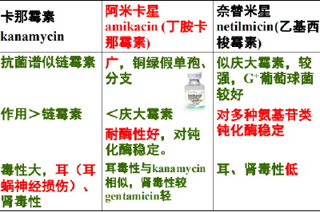
      - 卡那霉素：抗菌谱似 <u>链霉素</u> ，作用>链霉素。毒性大， 耳(耳蜗神经损伤)、 肾毒性
      - 妥布霉素（tobramycin）：广谱， 与庆大霉素类似。对<mark style="background-color:#fef3c7;"> 铜绿假单胞菌 </mark>抗菌活性强于庆大霉素，毒性小于庆大霉素。
      - 奈替米星（netilmicin）：广谱， 与庆大霉素类似。<mark style="background-color:#fef3c7;"> 毒性最低 </mark>的氨基糖苷类，有一定的稳定性，对G- & MRSA & 铜绿假单胞菌耐药有效
      - 西索米星 sisomicin：与庆大霉素类似，抗绿脓杆菌作用较强，但毒性也大
      - 新霉素（neomycin）： <mark style="background-color:#fef3c7;"> 毒性最大 </mark>，只用于局部外用（胃肠手术）
      - 大观霉素（Spectinomycin）：<mark style="background-color:#fef3c7;"> 窄谱 </mark>，适用于<mark style="background-color:#fef3c7;"> 淋球菌 </mark>和革兰氏阴性杆菌
      - 选择题
        -  兔热病、鼠疫首选：链霉素 
        - 过敏性休克：链霉素
        - 抗结核：链霉素、阿米卡星，没有庆大霉素
        -  一般G-杆菌感染  首选  ：庆大霉素 
        -  一般氨基糖苷类  耐药  株的感染首选：阿米卡星 
        -  目前抗菌谱最广的氨基糖苷类：阿米卡星 
        -  目前毒性较小的氨基糖苷类：奈替米星 
        -  毒性最大的氨基糖苷类：新 霉 素 
        -  对淋球菌敏感的氨基糖苷类：大观霉素 
    - ## 氨基糖苷类  不适用于社区获得性肺炎  或  单用，  主要  与其它抗生素联合治疗  医院获得性肺炎
      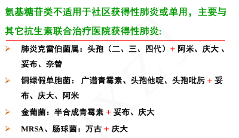
      - 肺炎克雷伯菌属：头孢(二、三、四代) + 阿米、庆大、妥布、奈替
      - 铜绿假单胞菌：广谱青霉素、头孢他啶、头孢吡肟 + 妥布、庆大、阿米
      - 金葡菌：半合成青霉素 + 妥布、庆大
      - MRSA、肠球菌：万古 + 庆大
    - ## 氨基苷类抗生素注意事项
      - 1. 该类药物过敏者禁用；
      - 2. 该类药物 均有耳、肾毒性和神经肌肉阻滞作用； 
      - 3.  社区获得性 上、下呼吸道感染不宜选用； 不宜联用 
      - 4. 新生儿、婴幼儿、老年患者应尽量避免使用，若有明确指征，应进行血药浓度监测；
      - 5. 妊娠期应避免使用；哺乳期应避免使用或停止哺乳；
      -  6. 不与其他耳、肾毒性药物同用 
        -  肾毒性 
          -  一代头孢类药物、万古霉素、多黏菌素、两性霉素 
        -  耳毒性 
          -  一代头孢类药物、万古霉素、多黏菌素 
          -  呋塞米等高效利尿药；甘露醇等脱水药 
          -  镇吐药 ；H1 受体阻断剂  （可能掩盖其耳毒性） 
          - 红霉素/大环内酯也有部分
      - 7. 庆大霉素耐药株近年增多。
  - ## 多黏菌素（Polymyxins） 
  - # 小结+习题
    - 思考题
      - 1. 简述氨基糖苷类抗生素的主要不良反应及防治措施
      - 2. 试述氨基糖苷类抗生素与β-内酰胺类合用使抗菌作用增强的药理基础
      - 3. 试述氨基苷类抗生素肾毒性和耳毒性与其体内过程的关系
        - 氨基糖苷类抗生素的耳毒性和肾毒性与其在内耳淋巴液和肾皮质药物蓄积有关。
      - 4. 试述氨基苷类抗生素的共同特点
    - 随堂习题: 丹毒-革兰阳性（G+球）；甲氧、苯唑-耐酶；交叉过敏-避免使用 
      - 1. 25岁肺部感染,处方:头孢哌酮钠舒巴坦钠3+ 复方甘草口服液：复方甘草口服液与头孢哌酮舒巴坦钠有药物相互作用。 复方甘草口服液含有乙醇，  与头孢哌酮钠舒巴坦钠合用会引起双硫仑样反应。
      - 2. In the treatment of <mark style="background-color:#fef3c7;">bacterial meningitis in children</mark>, the drug of choice is
        - a. Penicillin G
        - b.Penicillin V
        - c.Erythromycin 红霉素
        - d. Procaine penicillin
        - <mark style="background-color:#fef3c7;">e.Ceftriaxone 头孢曲松</mark>
      - 3. Clavulanic acid is important because it
        - a.  Easily penetrates Gram-negative microorganisms
        - b.ls specific for Gram-positive microorganisms
        - c. ls a potent inhibitor of cell-wall transpeptidase
        - <mark style="background-color:#fef3c7;">d. Inactivates bacterial β-lactamases</mark>
        - e. Has a spectrum of activity similar to that of penicillin G
      - 4.  In the treatment of infections caused by P, aeruginosa, the antimicrobial agent that has provedto be effective is
        - a. Penicillin G
        - <mark style="background-color:#fef3c7;">b. Piperacillin</mark>
        - c. Nafcilin a
        - d.Erythromycin
        - e. Tetracycline
      - 5. 男性，70岁，有脚癣史，近日突发高烧、恶寒、头痛、口渴、烦躁等，右下肢皮肤出现片状鲜红斑，手指按压后红色很快恢复，边缘清楚并稍有隆起。诊断为下肢急性丹毒，治疗应首选
        - <mark style="background-color:#fef3c7;">A.青霉素G</mark>
        - B.苯唑西林
        - C.氨苄西林
        - D.阿莫西林
        - E.羧苄西林
      - 6.男性，87岁，在重症监护室诊断为呼吸机相关肺炎、痰培养为铜绿假单胞菌，应选择较为敏感的抗生素为
        - A.头孢唑林
        - <mark style="background-color:#fef3c7;">B.头孢他啶</mark>
        - C.阿莫西林
        - D.头孢孟多
        - E.氨苄西林
      - 7.女性，50岁，患耐青霉素G的金葡菌性心内膜炎，青霉素试敏阴性，既往有慢性肾盂肾炎，治疗该患者应选用
        - A.青霉素G
        - B.头孢氨苄
        - <mark style="background-color:#fef3c7;">C.苯唑西林</mark>
        - D.庆大霉素
        - E.头孢唑林
      - 8. A 30-year-old type l diabetic with renal complications develops acute pyelonephritis. P.aeruginosa is found in urine cultures and biood cultures.Combined therapy is instituted with an aminoglycoside and which of the following?
        - a. Clavulanic acid
        - b. Vancomycin
        - C.A second-generation cephalosporin
        - <mark style="background-color:#fef3c7;">d. Azithromycin</mark>
        - e. Piperacillin
      - 9. A 35-year-old male is diagnosed with primary syphilis, Which of the following agents isthe prefer choice for treating this patient?
        - a. A first-generation cephalosporin
        - b.Oxacillin
        - c. lmipenen
        - d. Benzathine penicillin G
        - <mark style="background-color:#fef3c7;">e. Vancomycin</mark>
      - 10. A 60-year-old male with a temperature of 104°F and a productivecough is diagnosed as having staphylococcal pneumonia. After severaldays on nafcillin, he develops truncal urticaria and pruritis. Which of the following agents is best avoided in this patient?
        - <mark style="background-color:#fef3c7;">a. Cefazolin</mark>
        - b.Clarithromycin
        - c. Sparfloxacin
        - d. Clindamycin
        - e. Tetracycline
      - 11. A 20-year-old male has a urethral discharge. Culture of the discharge showsNeisseria gonorrhoeae. Which of the following agents is the best choice fortreating this patient?
        - <mark style="background-color:#fef3c7;">a.Ceftriaxone</mark>
        - b. Benzathine penicillin G
        - c. Cefazolin
        - d.Amikacin
        - e.Sulfamethoxazole-trimethoprim
    - 小 结
      - 1.氨基糖苷类抗生素的共性
      - 2.氨基糖苷类抗菌谱
      - 3.氨基糖苷类抗菌机理：抑制蛋白质的合成
      - 4.氨基糖苷类主要不良反应： 耳、肾毒性、肌毒、过敏等
      -  5.肌毒性的抢救措施：新斯的明 + 钙剂 
      -  6.过敏性休克的抢救措施：肾上腺素 +葡萄糖酸钙 
      - 7.兔热病、鼠疫首选：链霉素
      - 8.一般G-杆菌感染首选：庆大霉素
      - 9.一般氨基糖苷类耐药株的感染首选：阿米卡星
      - 10.目前抗菌谱最广的氨基糖苷类：阿米卡星
      - 11.目前毒性较小的氨基糖苷类：奈替米星
      - 12.毒性最大的氨基糖苷类：新 霉 素
      - 13.对淋球菌敏感的氨基糖苷类：大观霉素
- # 大环内酯类  （Macrolides） 、林可霉素类（lincomycins）、多肽类抗生素：万古霉素、 多粘菌素、杆菌肽
  - # 概论
    - ## 共同特点
      - 具有大环内酯环结构
      -  静止期、抑菌（quiescent bacteriostatic） 
      - 高浓度杀菌
      - 在 碱性  环境中 活性强
      - 机制：红绿林中50载（因此红绿林不可联用，相互拮抗）
    - ## 分代 & 分类（要记）
      - 第一代大环内酯类抗生素—— β过敏/耐药者 ： 红霉素（Ery  thromycin  ） 麦迪霉素（Midecamycin） 乙酰螺旋霉素（Acetylspiramycin）
      - 第二代大环内酯类抗生素—— 抗菌活性、PAE↑ 不良反应↓ ： 克拉、阿奇、罗红（Clari  thromycin  ） （Azi  thromycin  ） （Roxithromycin） 氟红霉素（Miocamycin）
      - 第三代大环内酯类抗生素—— 超级耐药 菌： 泰利  霉素（Telithromycin）   。地红霉素（Dirithromycin） 喹红霉素（Cethromycin） 酮基大环内酯（Ketolides）
      - *按结构分类*
        - 14 元环：天然：红霉素；人工半合成：克拉霉素      罗红霉素
        - 1 5  元环：半合成：阿 奇 霉素（唯一，“奇”-奇数）
        - 16 元环：天然：交沙霉素。人工：罗他霉素    乙酰螺旋霉素
    - ## 1. 抗菌能力—— <mark style="background-color:#fef3c7;"> 四个/军团/弯/弓/（射）一 </mark> 百 <mark style="background-color:#fef3c7;"> 个/太阳 </mark>
      - 天然（红霉素） ：与青霉素相似而略广，但青霉素是繁殖期杀菌剂，大环内酯是静止期抑菌剂： G+ ，厌氧菌 ， 部分 G-
        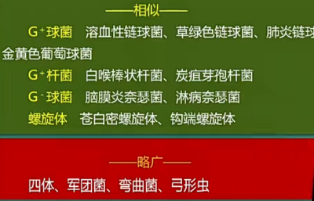
        > 四个军团弯曲如弓
        - 弯曲杆菌 引起的肠胃炎； 军团菌（Lp） 引起的肺炎； 百日咳杆菌 引起的百日咳
        -  支  原体、  衣  原体、  弓  形虫、立克次体、螺旋体
        - <mark style="background-color:#fef3c7;"> 四个/军团/弯/弓/（射）一 </mark> 百 <mark style="background-color:#fef3c7;"> 个/太阳 </mark> *（G+ & 厌氧）*
          > Legionella pneumophila (Lp) 军团菌,  Campylobacter 弯曲杆菌, Bordetella pertussis百日咳杆菌，mycoplasma 支原体 chlamydia 衣原体，mycoplasma 支原体, chlamydia 衣原体，Toxoplasma gondii弓形虫， Rickettsia 立克次体
        - <mark style="background-color:#fef3c7;"> “白衣空（空肠弯曲菌）军百支曲”（加了一个白喉） </mark>
          - 耐青霉素或青霉素过敏者的金葡菌感染
      - 半合成（阿奇、克拉、罗红）：广谱
    - ## 2.作用机制 ——抑制蛋白质的合成（50S、延长阶段）
      - 抑制蛋白质的合成  （50S、延长） 
        - 大环内酯类抗生素作用于  50S 核糖体亚基， 抑制 转肽酶 并 干扰mRNA移位
        - 阻止肽链 延长 ，使其提前脱落
        - 对哺乳动物核糖体无影响
    - ## 3. 耐药： 大环内酯易产生耐药性和 交叉耐药性，主要是外排 
      - 靶位点修饰（Target Modification）： 核糖体50S结合位点发生构象改变
      - 产生灭活酶： 质粒介导，打开内酯环
      - 主动外排系统增强/细胞膜通透性降低：  链球菌的外排系统是其主要耐药机制 
    - ## 4.药代动力学/体内过程
      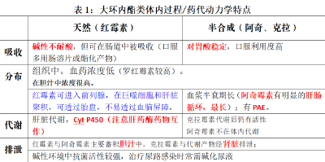
      - 吸收：红霉素可被胃酸灭活，但可在肠道内吸收。克拉霉素和阿奇霉素在胃酸稳定。
      - 分布：除了脑脊液。 胆汁蓄积 。天然macrolides 血药浓度低，所以不适合败血症。 
      - 代谢：肝脏，细胞色素P450
      - 排泄：主要通过 胆道。 
    - ## 5. 临床应用
      - <mark style="background-color:#fef3c7;"> 替代青霉素使用 </mark> （链球菌感染； 耐青霉素的金黄色葡萄球菌感染；对青霉素过敏者）
      - - 衣原体、支原体感染，<mark style="background-color:#fef3c7;">※</mark><mark style="background-color:#fef3c7;"> 非典型病原体的首选 </mark><mark style="background-color:#fef3c7;">；</mark> 社区性肺炎的一线用药
      - - 治疗军团菌病、白喉、百日咳；(<mark style="background-color:#fef3c7;">白衣军团百支曲</mark>/军团弯弓支援一百 ~~个太阳~~ ）
      - <mark style="background-color:#fef3c7;"> - HP（幽门螺旋杆菌）感染：三联疗法 </mark>
      - - 皮肤软组织感染等
      - *大环内酯的新药理作用*
        - 非特异抗炎作用
          - 1.肺部和呼吸道炎症。直接抗菌；对哮喘，泛细支气管炎治疗作用
        - 抗支气管哮喘作用
        - 抗肿瘤作用
          - 2.抗肿瘤作用。凋亡与免疫，肿瘤与免疫间相互作用
          - 3.逆转肿瘤细胞多药耐药。红霉素逆转急非淋白血病对高三尖杉酯碱、阿糖胞苷等体内耐药，预防化疗期间感染发生
        - 促进胃肠动力作用
        - 免疫调节（抑制多糖蛋白复合物合成酶）
        - 抗寄生虫  抗真菌  抗病毒
    - ## 6. 不良反应
      > 红伤心肠肝
      -  胃肠道反应： 主要联系它的碱性刺激——半合成药物胃肠道反应轻微。
      - 肝毒性：  ※胆汁淤积、肝功能不良者禁用红霉素  （从胆汁排泄） ；
      - 耳毒性： 大剂量使用时出现（＞12mg/L)听力下降
      - ※Superinfections 二重感染
      - 过敏性： 少见
      -  心脏毒性，LQTS——长 QT 间期综合征： 静注过快/与茶碱合用时发生率更高
    - ## <mark style="background-color:#fef3c7;"> 7. 药物相互作用：青红合用不对路，绿林红争结合点，四红合用增肝毒 </mark>
      - 青霉素是繁殖期杀菌药，红霉素抑制细菌繁殖，红霉素用了之后青霉素无法发挥作用，所以 青红合用不对路 
      - 拮抗 克林霉素、林可霉素、氯霉素 （作用位点相似）
      - 抑制 茶碱、卡马西平、华法林的代谢 （血药浓度异常升高；延长凝血时间）
      - 促进 环孢霉素 吸收，引起腹痛、高血压及肝功能障碍
      - 增加 地高辛 肝肠循环，体内存留时间延长
  - # 一． <u>红霉素(erythromycin)、阿奇霉素、克拉霉素等</u>
    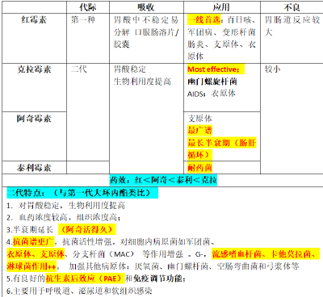
    - 红霉素（Erythromycin）
      -  概论说的主要就是它 
      - 胃酸中不稳定易分解 口服肠溶片/胶囊
      - 红霉素<mark style="background-color:#fef3c7;">是</mark><mark style="background-color:#fef3c7;"> 百 </mark><mark style="background-color:#fef3c7;">日咳 </mark><mark style="background-color:#fef3c7;"> 军团 </mark><mark style="background-color:#fef3c7;">病 </mark><mark style="background-color:#fef3c7;"> 变形 </mark><mark style="background-color:#fef3c7;">杆菌肠炎 </mark><mark style="background-color:#fef3c7;"> 支原体 衣原体 </mark><mark style="background-color:#fef3c7;">的首选用药</mark>
      - 胃肠道反应较大
      - 一代大环内酯系列
        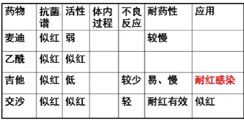
    - 二代大环内酯：克拉霉素（Clarithromycin）、阿奇霉素（Azithromycin）
      - 更容易被吸收，生物利用度更高
      - 抗菌活性更高：更长的 PAE 和更明显的免疫调节作用
      - 不良反应：胃肠道反应比红霉素低
      -  罗红  霉素（Roxithromycin）： 生物利用度高  血药浓度更高 
      - 克拉霉素（Clarithromycin）：抗菌活性 <mark style="background-color:#fef3c7;"> 最强， </mark>  对胃酸最稳定（用于治疗幽门螺旋杆菌）  ；对军团菌、 衣 原体效果最好。肺、扁桃体中蓄积；生物利用度略低。 联用时：先使用阿莫西林，后使用克拉霉素 
        - <mark style="background-color:#fef3c7;">治疗HP引起消化性溃疡：克拉克星，克拉霉素、克林霉素、沙星</mark>
      - 阿奇霉素（Azithromycin）： <mark style="background-color:#fef3c7;"> 最广谱 </mark>的大环内酯类抗生素 半衰期最长 对 支  原体肺炎 是大环内酯最强；明显的PAE，肠肝循环，吃三天停三天
      - 泰利霉素（Telithromycin）： <mark style="background-color:#fef3c7;"> 适用于耐药菌。 </mark>吸收度好，比阿奇霉素效果更好
  - # 二． <u>林可霉素类——</u>  <u>“抗厌氧、骨分布”</u> 
    > 林可霉素（lincomycin） 和 克林霉素（clindamycin）;与大环内酯类抗生素相互拮抗、交叉耐药。克林顿总统是骨干，一身正气，厌氧。身边很多小人（伪人），伪膜性肠炎。
    - ## 1.抗菌能力：克林霉素克  厌氧 
      - 抗菌谱：  G+ all；  但是对G-需氧菌无效 
      - 抗菌机制： 与大环内酯类类似，竞争50S结合位点，所以红绿林不可合用
    - ## 2.耐药性： 位点修饰、主动外排、 钝化酶（主要) ；对肠球菌耐药；与大环内酯类抗生素交叉耐药
    - ## 3.药代动力学： <mark style="background-color:#fef3c7;"> 骨分布 </mark>
      - 吸收：林可霉素吸收坏，克林霉素吸收好
        > 记：克林顿是正牌总统易进入白宫，林克顿是冒牌。
      - 分布：  在 <mark style="background-color:#fef3c7;"> 骨组织 </mark> 内 很好
      - 排泄：胆汁和尿液
    - ## 4.临床应用： <mark style="background-color:#fef3c7;"> 骨、腔感染 </mark>
      > 记：克林顿总统是骨干
      -  金葡菌 <mark style="background-color:#fef3c7;">所致的急、慢性</mark><mark style="background-color:#fef3c7;"> 骨关节感染 </mark><mark style="background-color:#fef3c7;">——</mark><mark style="background-color:#fef3c7;"> 首选药 </mark><mark style="background-color:#fef3c7;">；</mark>
      - 部分厌氧菌感染，口腔、盆腔、腹腔（合用氨基苷类效果好，G-）
      -  外用需氧G+菌 引起的感染（红霉素软膏，克林霉素软膏）
    - ## *5.不良反应：*  *假膜性肠炎* 
      - 口服给药易发生<mark style="background-color:#fef3c7;"> 假膜性肠炎 </mark> （AAPC, Antibiotic-Associated Pseudomembranous Colitis） 
        - 难辨梭状芽孢杆菌大量繁殖，产生外毒素，需用 万古霉素+甲硝唑治疗 
          > 打小人（伪人）是遗名万古的任务，甲硝“假消”消除假膜
      -  胃肠道反应常见 ，口服多见
        > 静脉缓慢滴注、不可静脉推注
      -  二重感染 
      - 肝、肾损害； 神经肌肉阻滞作用：黄疸、血尿等；避免与其他阻滞剂合用
      - 过敏反应
  - # 三．多肽类抗生素：万古霉素、 多粘菌素、杆菌肽——抗菌特点&不良反应
    > 万古霉素（vancomycin）、去甲万古霉素（norvancomycin）、替考拉宁（teicoplanin）——使用最多
    - ## 万古霉素(Vancomycin） 、去甲万古霉素、替考拉宁（teicoplanin）——使用最多
      - ### 抗菌能力：杀真菌剂；  窄谱 G+； <mark style="background-color:#fef3c7;"> 繁殖期快速杀菌（细胞壁合成） </mark>
        - 抗菌谱： 窄谱 ，对 G+菌 ，尤其是对 MRSA和MRSE、对  甲氧西林耐药  的菌 有强大抗菌作用
        - 去甲万古霉素<mark style="background-color:#fef3c7;">抗</mark><mark style="background-color:#fef3c7;"> 脆弱拟杆菌 </mark><mark style="background-color:#fef3c7;">作用最强</mark>
      - ### 抗菌机制： 与 细胞壁 合成前体肽聚糖五肽末端结合， 阻断高分子肽聚糖合成 ，从而 抑制细胞壁形成 —— 因此 对G-无效 
      - ### 耐药性：难以产生
        -  肠球菌 ：产生修饰细胞壁前体肽聚糖的酶；
        -  金葡菌 ：多种机制
          - 细胞壁增厚
          - 细胞壁成分改变
          - 青霉素结合蛋白（PBPs）变化
          - 耐药质粒传递
      - ### 药代动力学 ： 口服不能吸收 （但替考拉宁 治疗肠炎时口服 ）
        -  万古霉素 不能肌内注射,会刺激局部肌肉组织坏死， 只能静脉注射 
        - 替考拉宁可以i.m.
        - 炎症反应时可以通过血脑屏障
        - 肾小球滤过消除
      - ### 临床使用：一般不用，仅用于严重  耐药 G+ 感染
        -  多重  （MRSA MRSE）
        - 严重链球菌感染（对青霉素过敏）
        - 常规的G+，一般用 “青庆” （青霉素联合氨基苷类），治疗失败的肠球菌、链球菌心内膜炎再上万古霉素
        - 治疗假膜性肠炎： 替考拉宁  最好  （此时需要口服） 
      - ### 不良反应——  红人 
        - 多
        - 高  耳毒性、肾毒性 
        - 变态反应：  红人综合征（Red Man Syndrome, RMS） 
          - 极度的皮肤潮红、红斑、荨麻疹、心动过速、低血压等特征性症状
          -  万古霉素促进组胺释放 
          - 解救：使用 抗组胺药 和 糖皮质激素 
        -  单给 
          - *静注液中不宜加氯霉素、甾体激素、甲氧苯青霉素等，以免产生沉淀*
          - *禁止与碱性溶液配伍 禁止与重金属接触 禁止与具有肾毒性、耳毒性的药物合用*
    - ## 多黏菌素（Polymyxins）
      - 临床上多用 多黏菌素B、 多黏菌素 E
      - 抗菌活性：  窄谱 、慢效， 部分G—杆菌、 <mark style="background-color:#fef3c7;"> 铜绿假单胞菌 </mark>
      - 抗菌机制：  破坏、裂解细胞  膜→ 物质外漏
      - 临床应用： <mark style="background-color:#fef3c7;"> 耐药株很少， </mark>用于耐药铜绿假单胞菌、革兰氏阴性杆菌感染， 局部应用 
      - 不良反应：毒性很大，肾神。  肾毒性（25%） 、 神经毒性、变态反应
    - ## 杆菌肽
      - 抗菌能力：  慢效杀菌  药物； 对 G+菌 有强大抗菌作用（对耐β-内酰胺酶的细菌也有作用），对G-球菌、螺旋体、放线菌有一定作用，对G-杆菌无作用
      - 作用机制： 选择性 抑制细菌细胞壁合成 过程中的 脱磷酸化 ，阻碍 细胞壁合成 ，同时 破坏细胞膜 ，使内容物外漏，细菌死亡
      - 体内过程： 口服不吸收，只能局部给药
      - 不良反应 ：有 严重的肾毒性 ， 仅用于  局部抗感染 
  - ## <mark style="background-color:#fef3c7;"> 思考题 </mark>
    - 1.请阐述macrolides的抗菌谱及作用机制？
    - 2 第二代大环内酯类pk/pd有何特点？
    - 3.阿奇霉素克林霉素的抗菌作用和临床应用有何特点？
    - 4 Vancomycin类与β lactamantibiotics在作用机制和抗菌谱上有何不同？
    - 5. 简述多黏菌素的抗菌作用机制
  - ## 小结
    - 1.红霉素在胆汁中浓度高，主要  经胆汁排泄 
    - 2.红霉素抗菌谱的特点：  与青霉素相似而略广  ，“广”在对某些  G-杆菌  、军团菌、支原体、衣原体、立克次体、厌氧菌  有效
    - 3.红霉素的抗菌机理：抑制蛋白质的合成（50s）
    - 4.红霉素首选用于军团菌、弯曲杆菌、支原体、衣原体感染、白喉带菌者
    - 5.红霉素主要不良反应：胃肠道反应
    - 6. 其他第一代大环内酯类与红霉素比较主要特点是不良反应较轻
    - 7. 第二代大环内酯类的特点有哪些？
      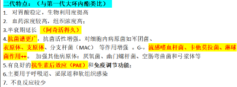
    - <mark style="background-color:#fef3c7;"> 8. </mark> <mark style="background-color:#fef3c7;"> 林可霉素类主要作用于 </mark> <mark style="background-color:#fef3c7;"> G+菌，对 G-杆菌无效 </mark>
    - 9. 林可霉素类的抗菌机理：与红霉素相同
    - 10. 林可霉素类主要特点：  骨组织  浓度高
    - 11.林可霉素类首选用于：金葡菌性急/慢性骨髓炎
    - 12. 林可霉素类主要不良反应：胃肠道反应
    - 13. 万古霉素类对 G  +  菌作用强大，对 G  -  菌无效
    - 14. 万古霉素类的抗菌机理：抑制  细胞壁粘肽  的合成
    - 15.  万古霉素类禁与氨基苷类、高效利尿药合用 
    - 16.   多粘菌素类仅对 G-杆菌  作用强大，尤其  绿脓杆菌  ，为  窄谱  杀菌剂
    - 17. 多粘菌素类的抗菌机理：增加  胞浆膜的通透性 
    - 18.  多粘菌素  类的主要不良反应：  肾毒性 
- # 四环素（~cycline）   氯霉素（ chloramphenicol）（1 学时）
  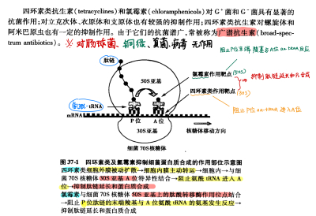
  - “广谱抗生素”：G+、G-、立克次、支、衣原体；四环素对螺旋体和阿米巴也有抑制作用
  - # 一. 四环素(Tetracycline)
    > 多西环素（Doxycycline）/ 强力霉素 、米诺环素（Minocycline）、替加环素（Tigecycline）
    - ## 四环素类（  Tetracyclines  ）
      - 分类
        - 天然： 土霉素（  oxy  tetracycline）  四环素（tetracycline）  地美环素
        - 部分合成： 多西环素（Doxycycline）  美他环素（Methacycline） 米诺环素（Minocycline）
      - <u>抗菌能力</u>  ：  广谱，快速，抑菌 剂；高浓度杀菌。<mark style="background-color:#fef3c7;">谱广效弱，所以大boss（铜绿、伤寒、结核）抗不了</mark>
        - 二菌（细菌+放线菌）四体一虫灵（阿米巴），基本无效伤绿结。
        - 霍乱，布氏，Hp ✔
        - 对 肠球菌、铜绿假单胞菌 、伤寒、结核没有作用
      - <u>作用机制</u>
        - 抑制蛋白质的合成：  30S 
          > 氨基苷类抗生素是全程
          - 结合30S 小亚基， 阻止 tRNA 转移到核糖体A 位
          - 阻止 延长 
        - 破坏细胞膜，物质外漏
        - 抑制DNA复制
      - 耐药性： 易产生；渐进性；天然药之间交叉耐药
        - 外排
          - 细胞外膜孔蛋白减少
          - 将四环素泵出胞外 降低血药浓度
        -  核糖体保护蛋白 
          - 改变核糖体构型，阻止四环素与核糖体结合
        - 四环素钝化酶
      - <u>体内过程/药代动力学</u>
        -  口服吸收 不完全，吸收率差别很大
          -  影响其吸收的因素 
            - - 多价阳离子（Ca2+、Mg2+等）——形成络合物；若需服用铁剂，两药的服药间隔需＞3h。
              > 分布：组织和体液中。 四环素  可以结合 Ca2+ 沉积于骨骼和牙齿之中  —— 对牙齿和骨骼影响：四环素牙 
            - -抗酸药、抗贫血药及食物、奶制品——空腹服用
            - - 胃酸酸度：酸度高，吸收好。
            - -合用H2-R阻断药、NaHCO3等可减少四环素吸收
            - 吸收量有限：当服药量＞0.5g时，多的吸收不了（有饱和性）；
            - 多西环素优秀：吸收好，脑脊液浓度高。
        - 分布：组织和体液中。 四环素  可以结合 Ca2+ 沉积于骨骼和牙齿之中  —— 对牙齿和骨骼影响：四环素牙 
          - 天然四环素不易通过血脑屏障，但半合成四环素在脑脊液浓度很高
          - 多西环素的胆汁、尿液浓度高（见下文“排泄”）
        - 排泄：胆汁和肾脏。 肝肠循环 ——特别注意 <mark style="background-color:#fef3c7;"> 多西环素 </mark> 久 
          -  多西环素 、米诺环素肝肠循环明显。半衰期长
            > 联系：大环内酯类 阿奇霉素
            -  从多西环素的排泄途径推知临床应用 
              - 原形经肾小球滤过，尿液药浓较高——  尿路感染 
              - 存在肝肠循环，胆汁药物浓度较高——  胆道感染 
      - <u>临床应用</u>
        - 使用本类药物时，首选 多西环素 
        - （1）<mark style="background-color:#fef3c7;"> 立克次体感染： </mark>斑疹伤寒、羌虫病  <mark style="background-color:#fef3c7;"> 首选 </mark>
        - （2）<mark style="background-color:#fef3c7;"> 衣原体感染 </mark>：鹦鹉，沙眼、肺炎（克拉霉素也有效）   <mark style="background-color:#fef3c7;"> 首选 </mark>
        - （3）<mark style="background-color:#fef3c7;"> 支原体： </mark>非典型性肺炎（阿奇霉素也有效）、尿道炎   <mark style="background-color:#fef3c7;"> 首选 </mark>
        - （4）螺旋体：<mark style="background-color:#fef3c7;"> 回归热  首选 </mark>（青霉素也有效。注：梅毒螺旋体首选青霉素。）
        - <mark style="background-color:#fef3c7;"> 首选—某些细菌感染： </mark><mark style="background-color:#fef3c7;">霍乱、布鲁氏菌病</mark>；
        - 鼠疫、幽门螺杆菌引起的消化性溃疡
      - <u>不良反应——</u>  <u>注意二重感染和对骨骼牙齿的影响</u> 
        - 胃肠道反应： 最常见
        - 二重感染（Superinfection）/ 菌群失调症
          - 应用 广谱药 物时（ <u>四环素类、氯霉素类、氟喹诺酮类、庆大霉素等</u> ），敏感菌被抑制， <u>不敏感菌趁机大量繁殖，引起的新的感染</u> 。婴儿、老年人、体弱者、合用糖皮质激素或抗肿瘤药等 抵抗力较弱 的患者容易发生。
          - 较常见
          - - 真菌感染 白色念珠菌感染所致的鹅口疮等 +抗真菌感染；
          - - 对四环素耐药的难辨梭状芽孢杆菌感染所致的假膜性肠炎（剧烈腹泻、发热、肠壁坏死、体液渗出甚至休克死亡）——立即停药+万古霉素/甲硝唑
        - 对牙齿和骨骼影响：四环素牙
          - 四环素牙——牙齿黄染，牙釉质发育不全
          - 婴幼儿骨骼生长抑制—— 孕妇、幼儿禁用
        - 光敏反应：  服用四环素类抗生素的患者易晒伤，多见于 地美环素、多西环素 
          > 两个光敏：四环素、氟喹诺酮
        - 前庭反应： 头昏眼花
        - 肝毒性、 肾毒性
    - ##  <u>多西环素（Doxycycline）/ 强力霉素</u> 
      -  快速、高效、长效 ，<mark style="background-color:#fef3c7;">最常用的四环素，</mark>高浓度时才可杀菌
      - 吸收：不受食物影响
      - 分布：脑脊液中浓度高
      - 代谢、排泄：在肝中代谢， 存在肝肠循环 ；经胆汁、尿液排出，故肾衰时仍可使用；
      - 对四环素或青霉素耐药的细菌仍敏感
      - 副反应较小：主要是胃肠道反应、光敏反应
    - ##  米诺环素（Minocycline） 
      - <mark style="background-color:#fef3c7;">效果最强的四环素</mark>  长效、最强 
      - 广、组织穿透力强（用于痤疮；可过BBB）
      - 不良反应较多，易出现 前庭损害 ——首剂发生快速，女性高于男性
    - ## 替加环素（Tigecycline）
      - 最广谱，多种多重耐药菌，但 仅对铜绿假单胞菌无效
      - 口服难以吸收 需要静脉给药
  - # 二、氯霉素(Chloramphenicol)
    -  广谱、抑菌， 高浓度杀菌
    - 体内过程：  脂溶性高，易穿过各种屏障  ， 可进脑脊液、眼、胎儿，典型的 肝药酶抑制剂 
    - 抗菌谱
      - 对真菌 结核分枝杆菌 病毒 原虫 无效 
      - G-： 尤其对   伤寒、副伤寒、流感、肺炎  链球菌、  脑膜炎  球菌、嗜血杆菌 有效
      - G+：不如青霉素、四环素
      - 对厌氧菌、各种体有效
        > 厌氧菌、支原体、衣原体、立克次体、螺旋体
    - 作用机制： 核糖体50S 亚基，可逆结合，抑制肽酰转移酶的转肽反应，阻止肽链延伸，使蛋白质合成受阻（对真核细胞也有较弱作用）
      - 作用位点与大环内酯类和林可霉素类相似，同时应用可产生拮抗作用
    - 耐药性： 产生很缓慢，主要靠氯霉素乙酰转移酶使药物失活
    - 临床应用： 毒性很大，不作为一线药物
      - 伤寒、副伤寒（ 首选氟喹诺酮或三代头孢 ）
      - 流感、嗜血杆菌感染引起的脑膜炎
      - 局部滴眼液
    - <u>※ 不良反应：</u>  <u>尤其注意血液系统毒性严重</u> 
      - 胃肠道反应、肝肾损害
      - 二重感染（Superinfection）/ 菌群失调症
      - 骨髓抑制  血液系统毒性
        - 剂量相关——可逆性骨髓抑制&  血细胞减少 ：剂量、疗程依赖
        - 剂量无关——不可逆性骨髓毒性&  再生障碍性贫血 ：可致死，与剂量无关
        - *防治措施：严格掌握适应症，详细询问有无与药物相关的血液毒性既往史；定期检查血象，发现异常立即停药；每日剂量不宜超过1g，疗程一般为5~7d（治伤寒、副伤寒可酌情延长）*
      -  灰婴综合征  ： 早产儿、新生儿缺乏氯霉素脱毒能力（本质：缺乏6-磷酸葡萄糖脱氢酶），引起氯霉素蓄积
        - 表现为呕吐低温呼吸困难、循环衰竭、发绀和休克、进行性血压下降
        - 缺乏6-磷酸葡萄糖脱氢酶、肝功不好的人都不宜使用
      - 精神病禁用：引起精神病患者严重失眠、幻视、狂躁、抑郁
      - 药物互作
        - 肝药酶抑制剂：增加苯妥英钠、甲苯磺丁脲、氯磺丙脲、双香豆素的血药浓度
        - 同位点（50S）相互拮抗：与林可霉素类、大环内酯类有拮抗作用；
        - 同作用时期相互拮抗（繁殖期杀菌剂 & 快速抑菌剂）：与青霉素类合用时产生拮抗
  - ## 习题
    - 1. 请阐述四环素的抗菌谱及作用机制？
    - 2. 四环素的不良反应？
    - 3. 氯霉素的不良反应？