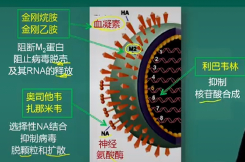

---
aliases:
  - 抗病毒药物
tags:
  - pharmacology
---
### 分类：抗流感、抗疱疹病毒、抗艾滋病、抗肝炎、广谱
#### 抗病毒药物的作用机制
病毒的增殖过程：吸附→脱壳→复制→装配→释放
##### 竞争细胞表面的受体，阻止病毒<mark style="background-color: #1A4F10; color: white">吸附</mark>
##### 阻碍病毒<mark style="background-color: #1A4F10; color: white">穿入</mark>细胞与<mark style="background-color: #1A4F10; color: white">脱壳</mark>
##### 阻碍病毒<mark style="background-color: #1A4F10; color: white">生物合成</mark>
<mark style="background-color: #1A4F10; color: white">增强宿主</mark>抗病毒能力——<mark style="background-color: #1A4F10; color: white">即广谱抗病毒药</mark>
#### 抗流感病毒药

包膜：磷脂双分子层，镶嵌有血凝素HA和神经氨酸酶NA；M1、M2构成病毒的外壳骨架。
HA促使病毒吸附；NA促进释放；M2蛋白促进脱壳。
##### [[金刚烷胺]]、金刚乙胺（rimantadine）
##### [[奥司他韦]]、扎那米韦（Zanamivir）
扎那米韦：与奥司他韦相似，不在体内代谢，肝肾毒性小
#### 广谱抗病毒药物
##### [[利巴韦林]]
##### 干扰素
###### [干扰素](干扰素.md)
#### 抗疱疹病毒，首选<mark style="background-color: #705A16; color: white">洛韦~clovir</mark>
##### 人类疱疹病毒是具有包膜的DNA病毒
##### [[阿昔洛韦]]
##### [[更昔洛韦]]
##### 代昔洛韦
##### [[碘苷]]
#### 抗艾滋病病毒药物
##### 齐多夫定（记：“多子多福”）
##### <mark style="background-color: #705A16; color: white">首选用药：逆转录酶抑制剂齐多夫定，不能合用司他夫定</mark>
分类——选择性抗HIV药物包括：入胞抑制药、逆转录酶抑制药（核苷类、非核苷类）、整合酶抑制药、蛋白酶抑制药
##### 入胞抑制剂
###### 马拉维若
##### 核苷反转录酶抑制剂NRTIs
###### [[齐多夫定]]
###### [[拉米夫定]]
##### 非核苷反转录酶抑制剂NNRTIs
###### 奈韦拉平
##### 整合酶抑制剂
###### 拉替拉韦
##### 蛋白酶抑制剂PI
###### 茚地那韦
##### 融合酶抑制剂
###### 恩夫韦肽
#### 抗[乙型肝炎](乙肝.md)病毒药
##### [干扰素](干扰素.md)、<mark style="background-color: #705A16; color: white">恩替卡韦、阿德福韦酯</mark>
（1）以干扰素为代表的免疫调节剂；
（2）另一类是核苷类似物（[拉米夫定](拉米夫定.md)、替比夫定、恩替卡韦）和核苷酸类似物前体药（阿德福韦酯、[富马酸替诺福韦酯](替诺福韦.md)）
##### 耐药
耐药可导致病毒学突破（HBV DNA再升高）、生化学突破（ALT再升高）、病毒学反弹及肝炎发作甚至肝衰竭。
#### 抗[HCV](丙肝.md)药
##### <mark style="background-color: #705A16; color: white">NS5BRNA聚合酶抑制剂</mark>索非布韦
#### 习题
##### 1. 简述抗病毒药物的分类及主要作用机制

| 药物 | 机制 | 抗病毒谱 | 不良反应 | 应用 |
| ------------------------------------------------------------------------- | --------------------- | ---------------------------- | ---------------------- | ------------------------- |
| [阿昔洛韦](阿昔洛韦.md)（无环鸟苷）  acyclovir, ACV & 喷昔洛韦  Penciclovir, PCV | 抑制DNA多聚酶 | 广：单纯、带状疱疹、乙肝等 | 少，胃肠刺激 | 单纯疱疹首选、其他感染 |
| [碘苷](碘苷.md)（疱疹净）  idoxuridine, IDUR | 抑制胸苷酸合成酶  T合成↓ | DNA病毒：单纯带状、水痘 | 毒性大  角膜浑浊 | 局部应用：单纯疱疹感染 |
| [利巴韦林](利巴韦林.md)  Ribavirin, RBV & 病毒唑virazole | 抑制病毒核苷酸合成，鸟嘌呤合成↓ | 广（RNA和DNA病毒）：流感、鼻、带状、肝炎、腺、麻疹 | 腹泻、造血系统的毒性贫血、白细胞↓ | 呼吸道、腹泻、口腔炎、流感、肝炎、接种病毒、麻疹等 |
| 阿糖腺苷 | 抑制DNA合成 | 广：疱疹病毒和乙肝病毒引起感染 | 胃肠  骨髓抑制  神经毒性 | 单疱、水痘、带疱 |
| [干扰素](干扰素.md)  IFN | 抑制mRNA和宿主rRNA结合，蛋白合成↓ | 各种病毒、肿瘤 | 胃肠肝损 | 慢性乙肝、单疱 |
| [金刚烷胺](金刚烷胺.md) | 抑制病毒吸附浸入宿主细胞 | 甲型流感病毒 | 胃肠、中枢反应 | 甲型流感的预防或早期的治疗耐药 |
##### 2. 简述齐多夫定的作用机制及不良反应
