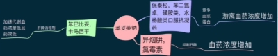

---
tags:
  - pharmacology
---
### 抗癫痫药和抗惊厥药（2学时自学翻转课堂）
#### 一． *癫痫的症状和分型* 、机制
癫痫：一种反复发作的神经系统疾病，是由脑局部病灶的神经元兴奋性过高而产生阵发性的异常高频放电，并向周围组织扩散，导致大脑功能短暂失调的综合征。
临床表现 ：①突然发作；②反复发作；③短暂的运动感觉功能或精神异常；④伴异常脑电图
##### 分类：局限性发作vs全身性发作
##### <mark style="background-color: #1A4F10; color: white">🔺教材P142表格</mark>
##### <mark style="background-color: #705A16; color: white">机制：</mark>中枢神经系统兴奋性和抑制性神经元平衡被打破
正常：兴奋性N—→Glu—→突触后膜Na+内流—→去极化；抑制性N—→GABA—→突触后膜Cl-内流、K+外流—→复极化。
—→ 局部兴奋性神经元释放Glu增多 / 抑制性神经元释放GABA减少，神经元过度兴奋。
—→过度兴奋神经元形成神经网络异常同步化，向周围扩布—→全身性发作
<mark style="background-color: #3F4B5E; color: white">—→由疾病机制推理得药物作用机制：</mark>改变细胞膜对离子通透性（Na、K、Ca）、调整神经递质作用强度，增强抑制性神经元，抑制兴奋性神经元。
#### 二．抗癫痫药
#### （一）概述
1.作用机制 <mark style="background-color: #3F4B5E; color: white">—→由疾病机制推理得药物作用机制： 改变细胞膜对离子通透性（Na、K、Ca）、调整神经递质作用强度，增强抑制性神经元，抑制兴奋性神经元。</mark>
目标：抑制病灶神经元异常过度放电；阻止病灶的异常放电现象朝周围的正常神经组织扩散
##### <mark style="background-color: #705A16; color: white">基本机制</mark>
① 增加 γ-氨基丁酸 的作用 ，拮抗兴奋性 氨基酸/神经递质的作用
> “调整神经递质作用强度”——多作用于突触后膜上的GABA-A受体，增加GABA介导的Cl-内流，导致膜超极化，降低兴奋性

②干扰Na，Ca，K等离子通道，发挥相应的 膜稳定作用
> “改变细胞膜对离子通透性”——阻滞Na+ Ca2+通透性，降低神经元兴奋性
##### 2.分3大类
> 按照“离子” & “神经递质”来分

<mark style="background-color: #705A16; color: white">（1）Na+通道阻滞药</mark> ——[[苯妥英钠]]、[[卡马西平]]、[[丙戊酸钠]]；托吡酯、氟桂利嗪&[[拉莫三嗪]]
<mark style="background-color: #705A16; color: white">（2）T型Ca2+通道阻滞药</mark> ——[[乙琥胺]]；氟桂利嗪&[[拉莫三嗪]]
> 针对丘脑神经元。注意苯妥英钠作用于L、N而不是T型钙通道阻断药。

<mark style="background-color: #705A16; color: white">（3）GABA神经元作用增强药</mark> ——[[卡马西平]]、[[苯巴比妥]]、[[扑米酮]]、[[苯二氮䓬类]]、[[丙戊酸钠]]、托吡酯
##### 3.用药原则
##### *对症选药*
> 慢性疾病，需长期用药

*剂量递增：* 由小剂量开始，逐渐增加剂量；剂量个体化；
*先加后撤：* 不可突然停药；不可随意更换药物；
##### *久用慢停*
#### （二）常用药
1. [[苯妥英钠]](phenytoin sodium)/大仑丁—— <mark style="background-color: #705A16; color: white">[ 乙酰脲类：</mark>[[苯妥英钠]]、美芬妥英mephenytoin<mark style="background-color: #705A16; color: white">]</mark>
##### （1）体内过程
①吸收：呈强碱性，刺激性大。<mark style="background-color: #705A16; color: white">不宜肌内/皮下注射（局部产生沉淀）；</mark> 口服吸收缓慢而不规则 ，个体差异大。
> 起效慢 ，常先用苯巴比妥控制癫痫、再换用苯妥英钠，但不宜与苯巴比妥合用。
> 刺激性强，联系不良反应

②分布：血浆蛋白结合率高，主要分布于血浆， Vd大；
##### <mark style="background-color: #3F4B5E; color: white">结合甲状腺球蛋白：故癫痫患者更可靠的甲状腺指标是TSH</mark>
##### ③代谢：60％～70％在肝代谢，<mark style="background-color: #705A16; color: white">诱导肝药酶</mark>
肝药酶代谢为<mark style="background-color: #3F4B5E; color: white">羟基苯妥英钠</mark>，经过<mark style="background-color: #3F4B5E; color: white">葡萄糖醛酸结</mark>合后通过<mark style="background-color: #3F4B5E; color: white">肾脏排出</mark>
##### ④ 排泄：消除速度与血药浓度有关
＜10 μg/ml，按一级动力学消除。t1/2为6~24h
＞10 μg/ml，按零级动力学消除。t1/2为20～60h
🔺注意：血药浓度个体差异大，需要剂量个体化；最好血浓监测
##### （2） 药理作用
①抑制 强直后增强Posttetanic Potentiation (PTP)，阻止异常脑电活动向周边组织转移扩散
> 给予突触前神经元一短串高频刺激后(也称强直刺激),突触传递易化、扩散易化、突触后反应增强 。由于强直刺激使突触前末梢轴浆内Ca2+浓度增加,导致递质释放量增加所致。

②膜稳定作用，降低细胞膜对于Na+和Ca2+的通透性，抑制两离子内流，抑制兴奋性
##### i. 钠通道 <mark style="background-color: #705A16; color: white">“利用依赖性”阻滞</mark>
###### 倾向于结合失活状态下的Na通道
> 延长钠通道失活时间，增加动作电位的阈值，使得钠离子内流依赖的动作电位不能产生

选择性阻断SRF （神经元持久高频反复放电，由于Na+依赖性动作电位不断产生而产生），抗电休克惊厥
> 注：根据机制，它可以对抗电休克产生的惊厥，但是不能对抗戊四氮产生的阵发性惊厥
##### ii. 阻断钙通道 （L型和N型）
对T型Ca2+通道无效 + T型存在于丘脑神经元—→故苯妥英钠<mark style="background-color: #3F4B5E; color: white">对失神发作（小发作）无效甚至有害</mark>
##### iii. 对钙调素激酶系统的影响：抑制钙调素及其激酶
—→抑制突触前膜磷酸化—→谷氨酸等钙离子依赖性兴奋性递质释放减少；
—→抑制突触后膜磷酸化—→减弱递质-受体结合后引起的去极化反应。
##### 备注
##### 治疗量 无镇静催眠效用
##### （3）临床应用
①抗癫痫 ——治疗大发作和局限性发作的<mark style="background-color: #705A16; color: white">首选药物</mark>，<mark style="background-color: #3F4B5E; color: white">对小发作（失神发作）无效；</mark>
②三叉、坐骨、舌咽神经痛 ；（膜稳定作用）
③<mark style="background-color: #705A16; color: white">抗心律失常</mark>——解救强心苷中毒
##### （4）不良反应
##### ①局部刺激
①吸收：呈强碱性，刺激性大。<mark style="background-color: #705A16; color: white">不宜肌内/皮下注射（局部产生沉淀）；</mark> 口服吸收缓慢而不规则 ，个体差异大。
口服引起厌食、恶心、呕吐、腹痛等（饭后服用）
静注——<mark style="background-color: #705A16; color: white">静脉炎（刺激性大）</mark>
##### <mark style="background-color: #705A16; color: white">牙龈增生</mark>：药物自唾液排出，刺激胶原组织增生
②神经系统反应：药量过大——<mark style="background-color: #3F4B5E; color: white">小脑-前庭系统功能失调</mark> ＞20μg/ml共济失调 ＞40μg/ml精神错乱 ＞50mg/ml昏迷
③血液系统 ：长期应用——抑制叶酸的吸收，加速其代谢——<mark style="background-color: #705A16; color: white">巨幼红细胞贫血</mark>。<mark style="background-color: #1A4F10; color: white">治疗：甲基四氢叶酸</mark>
##### ④骨骼系统
##### <mark style="background-color: #705A16; color: white">诱导肝药酶</mark>
##### <mark style="background-color: #3F4B5E; color: white">加速VitD代谢</mark>
<mark style="background-color: #705A16; color: white">低钙血症；儿童佝偻病；成人骨软化症</mark>
##### ⑤过敏反应： <mark style="background-color: #705A16; color: white">再生障碍性贫血</mark>，肝坏死
⑦其他 ：<mark style="background-color: #3F4B5E; color: white">男性增乳，女性多毛，胎儿致畸</mark>，心律失常，久服骤停诱导癫痫
##### *药物互作*

##### ①血浆蛋白结合角度
[[保泰松]]、[[苯二氮䓬类]]、磺胺类、水杨酸类、口服抗凝药：与苯妥英钠竞争血浆蛋白的结合部位，使本品游离型血药浓度增加。
##### ②肝药酶代谢角度
[[异烟肼]]、[[氯霉素]]：抑制肝药酶，提高本品的血药浓度；
[[苯巴比妥]]、[[卡马西平]]：肝药酶诱导作用，降低本品血药浓度和药效。
##### 2. [[卡马西平]](carbamazepine)
##### （1）作用特点
##### 抑制癫痫病灶内高频放电向外周神经元的扩散
口服吸收缓慢不规则，分布缓慢，血浆蛋白结合位点无竞争者，代谢物仍有抗癫痫功能。
<mark style="background-color: #3F4B5E; color: white">肝药酶诱导剂，加速自身代谢，连续用药后半衰期缩短。</mark>
##### （2）作用机制
##### 1.降低Na+、Ca2+的通透性
##### 2.增强GABA的功能
##### （3）临床应用
##### ①抗癫痫、惊厥
②治疗单纯性局限性发作、复合局限性发作（精神运动性）、大发作的 <mark style="background-color: #705A16; color: white">首选</mark> 药物之一。对小发作效果差
##### ③抗神经性疼痛（三叉、舌咽）
##### ④<mark style="background-color: #705A16; color: white">抗抑郁、抗躁狂（优于锂盐）</mark>
⑤<mark style="background-color: #705A16; color: white">抗中枢性尿崩症</mark>—促进ADH的分泌 / 提高效应器对ADH的敏感性
##### （4）不良反应
①常见的中枢神经系统反应：视力模糊 ， <mark style="background-color: #705A16; color: white">复视、共济失调（卡马西平最常见的剂量相关不良反应）</mark> ，眼球震颤；高剂量引起嗜睡。
##### ②胃肠道不适
##### ③偶见：水潴留、低钠血症，且依赖剂量
④少见的变态反应：中毒性表皮坏死溶解症、[皮疹](皮疹.md)、麻疹等；
⑤特异质反应：骨髓抑制（再生障碍性贫血、粒细胞缺乏）；常见红斑皮疹；偶发肝损害。
##### 3.其它抗癫痫药
##### （1）苯巴比妥phenobarbital
主要用于治疗癫痫 大发作及癫痫持续状态；对精神运动性发作有一定疗效
但在控制癫痫持续状态时不是首选 ，临床更倾向于用地西泮静脉注射。
不宜长期用药，<mark style="background-color: #705A16; color: white">先用</mark><mark style="background-color: #705A16; color: white">苯巴比妥控制，再用苯妥英钠维持</mark>
注意：<mark style="background-color: #3F4B5E; color: white">肝药酶诱导剂；耐受性</mark>
*既能抑制病灶的异常放电，又能抑制异常放电的扩散。*
①与突触后膜上的GABA-A受体结合，增加GABA介导的Cl-内流，导致膜超极化，降低兴奋性；
②阻断突触前膜Ca2+ 的摄取，减少Ca2+ 依赖性的神经递质（NE，ACh和谷氨酸等）的释放
③较高浓度时也可阻滞Na+ 和Ca2+（L型和N型）通道。
##### 扑米酮primidone （记作用特点）
化学结构类似苯巴比妥，活性代谢产物为苯巴比妥和苯乙基丙二酰胺，三者均有抗癫痫活性。
##### 作用机制：与苯巴比妥相似，即
##### ①增强GABA-A受体活性
##### ②抑制谷氨酸的兴奋性
##### ③作用于钠、钙通道
与苯妥英钠和卡马西平合用有协同作用，与苯巴比妥合用无意义（因为自身结构类似苯巴比妥）。
##### 乙琥胺ethosuximide
##### 作用机制：
##### ①阻断<mark style="background-color: #3F4B5E; color: white">T型Ca2+通道</mark>（丘脑神经元起搏电流）
②抑制Na+-K+ATP酶；
##### ③抑制大脑代谢率和GABA转氨酶
<mark style="background-color: #705A16; color: white">癫痫小发作/失神性发作首选</mark>；戊四氮引起的阵挛性惊厥 。其他类型无效
> 与氯硝西泮相比：疗效小（→“小发作”）、副作用和耐受性也小。

失神伴有大发作时，使用时参考苯妥英钠，建议先用苯巴比妥控制，再上乙琥胺。
副作用：可致粒细胞缺乏和再生障碍性贫血。 *胃肠道反应，中枢神经系统症状*
##### 丙戊酸钠sodium valproate
广谱，<mark style="background-color: #705A16; color: white">大、小混合</mark> 发作（ <mark style="background-color: #705A16; color: white">首选</mark> ）. 不抑制病灶放电，但阻止异常电扩散。
##### 应用注意：肝毒性
> 单纯小发作时，本药不首选。
##### [[苯二氮䓬类]]
##### 作用机制
①特异性结合GABA受体上BZ位点、增强GABA的抑制效应；
②提高Ca2+依赖性K+电导，降低神经元兴奋性。
[[地西泮]]（diazepam，安定）——治疗癫痫<mark style="background-color: #705A16; color: white">持续</mark>状态的<mark style="background-color: #705A16; color: white">首选</mark>药物
硝西泮（nitrazepam）——肌阵挛性癫痫、婴儿痉挛
<mark style="background-color: #1A4F10; color: white">氯硝西泮（clonazepam）</mark>——广谱抗癫痫，小发作&持续发作& <mark style="background-color: #705A16; color: white">肌阵挛性发作</mark>
##### *其它*
##### *加巴喷丁gabapentin*
> 记名字就好

*氟桂利嗪flunarizine、[[拉莫三嗪]]* *lamotrigine* ：广谱，局限性、大发作
成人局限性发作的<mark style="background-color: #705A16; color: white">辅助治疗</mark>药；<mark style="background-color: #705A16; color: white">单用可治疗全身性发作</mark>，疗效类似卡马西平
##### 作用机制及特点类似苯妥英钠和卡马西平
电压依赖性Na+ 通道阻滞药，通过减少Na+ 内流而增加神经元稳定性。
作用于电压门控Ca2+ 通道，减少谷氨酸的释放而抑制神经元过度兴奋
*托吡酯topiramate：* 与其他抗癫痫药物<mark style="background-color: #705A16; color: white">合用于难治性癫痫</mark> ；对癫痫部分性发作有效。
#### 三．抗惊厥药: [[硫酸镁]]
注意先区别判断惊厥和癫痫。惊厥：各种原因引起的中枢神经系统过度兴奋，表现为全身骨骼肌不自主地强烈收缩、抽搐，常见于高热、子痫、破伤风、癫痫大发作、药物中毒。
<mark style="background-color: #1A4F10; color: white">口服</mark>[[硫酸镁]]<mark style="background-color: #1A4F10; color: white">泻下、利胆，不抗惊厥</mark>；<mark style="background-color: #3F4B5E; color: white">注射</mark>才可！
##### 1. 作用机制
##### 特异性竞争Ca2+结合位点，拮抗Ca2+的作用
如运动神经末梢ACh的释放需要Ca2+的作用，Mg2+竞争性拮抗Ca2+的作用，干扰ACh释放，使神经肌接头处ACh↓，骨骼肌松弛
##### 2. 临床应用
血管扩张，血压下降；中枢机制；骨骼肌松弛
##### 缓解子痫、破伤风等惊厥
##### 常用于高血压危象
##### 3.不良
过量，呼吸抑制、血压剧降。
##### 过量中毒时用CaCl2+葡萄糖酸钙+人工呼吸解救
其它：[[地西泮]]、三唑仑、[[巴比妥类]]、水合氯醛 （1）Anticonvulsant抗癫痫、惊厥作用
