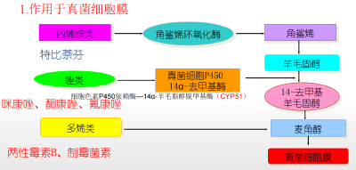
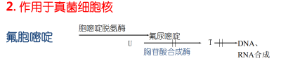

---
tags:
  - pharmacology
---
### 抗真菌药（1学时）
#### 真菌感染可分为
• 浅部真菌感染——各种癣菌引起，主要侵犯皮肤、毛发、指甲、趾甲；
> 局部抗真菌药
• 深部真菌感染——白色念珠菌、新型隐球菌，一般见于免疫缺陷患者
> 全身抗真菌药
抗真菌药物：具有抑制或杀死真菌生长或繁殖的药物，根据化学结构的不同，可分为
#### 抗生素类（antibiotic）：两性霉素B
#### 唑类（azole）：酮康唑
#### 丙烯胺类（allylamine）：特比奈芬
#### 嘧啶类（pyrimidine）：氟胞嘧啶
#### 棘白菌素类（echinocandins）
#### 机制分类
破坏真菌细胞膜麦角固醇，打孔——易有毒，人体也有固醇
#### 抑制麦角固醇合成
#### 在体内转化为5-FU，抑制真菌DNA合成
抗生素类——两性霉素B、灰黄霉素、制霉菌素
<u>两性霉素B （Amphotericin B）——</u>  <u>具有很大毒性；麦角固醇打孔</u> 
##### 作用： 广谱 ，对深部真菌有强效抑制作用
机制：与真菌胞膜 <u>麦角固醇</u> 结合，形成孔道，改变膜的通透性，营养物质外漏；细胞膜氧化损伤
注意：对细菌、立克次体无用（不含固醇类物质），对人毒性大而严重（人有固醇）
应用：<mark style="background-color:#fef3c7;"> 深部真菌感染首选药 </mark>；
> （真菌性肺炎、脑膜炎、尿路感染、心内膜炎等）
给药方法：静脉注射，要求静滴时间＞6h（毒性大）；肠道感染则口服；鞘内注射——治疗脑膜炎；局部应用——皮肤科、妇科等。对隐球菌感染，与5-氟胞嘧啶合用以提升疗效。
##### 不良反应  多 
急性毒性反应：最常见，由于本药引起单核细胞IL-1释放
##### 肾毒性：与剂量相关，不可合用氨基苷类抗生素
##### 低钾血症血液系统毒性心血管系统反应
##### 合用解热镇痛药、抗组胺药、地塞米松减轻不适感
灰黄霉素（Griseofulvin）——  浅表但口服；微管蛋白 
 口服 易吸收， 外用无效 （不能穿透角质层）；主要分布于皮肤、脂肪、毛发中
可抑制浅表皮肤癣菌，对深部真菌无效；
机制：干扰敏感真菌的 微管蛋白聚合成微管 ，抑制其有丝分裂；
##### 应用：<mark style="background-color:#fef3c7;"> 浅表真菌感染（尤其是头癣） </mark>
不良反应：多，消化系统反应多，有致畸、致癌作用
制霉菌素（Nystatin）：毒性更大。阴道滴虫、口服治疗胃肠道真菌、局部用药
氟胞嘧啶——抑制DNA，BBB脑膜炎
机制：在菌体内转变为5-氟胞嘧啶，抑制 真菌 DNA（胸腺嘧啶核苷）的合成而不抑制哺乳动物的，故 不良反应少 
#### 可以穿过血脑屏障
应用：  与两性霉素B合用，首选治疗隐球菌所致脑膜炎。 
> 两性霉素细胞膜打孔，氟胞嘧啶进入细胞抑制DNA合成。
抗菌谱较两性霉素B窄而弱，单用易耐药；适用于白色念珠菌隐球菌霉菌等
<u>咪唑类</u> 和三唑类 （酮  康唑  、伊曲康唑  *不尿路*  、氟康唑  *HIV*  ）
咪唑类：酮康唑（Ketoconazole）、克霉唑（clotrimazole）咪康唑（miconazole）益康唑（econazole）
三唑类：第一代：氟康唑（fluconazole）伊曲康唑（itraconazole）；第二代：伏立康唑（voriconazole）泊沙康唑（posaconazole）
#### 唑类抗真菌药是一种 广谱 抗真菌药， 毒性明显小于两性霉素 
机制：抑制真菌胞膜上的细胞色素P450-14-α-去甲基酶→14-α-甲基固醇蓄积，抑制真菌胞膜 <u>麦角固醇</u>  合成
#### 酮康唑（ Ketoconazole ）
抑制CYP3A4酶，严重影响相关药物代谢。严重肝毒性；抑制睾酮和肾上腺皮质激素合成
##### 已被氟康唑、伊曲康唑代替
##### 常见不良反应包括胃肠道反应、肝毒性、 肾上腺皮质抑制 
#### 伊曲康唑（ Itraconazole ）
##### 抗真菌作用更强、谱更广
##### <mark style="background-color:#fef3c7;">治疗</mark><mark style="background-color:#fef3c7;"> 罕见真菌 </mark><mark style="background-color:#fef3c7;">：组织胞浆菌、芽生菌感染的</mark><mark style="background-color:#fef3c7;"> 首选用药 </mark>
##### 用于治疗口腔、食管、阴道的念珠菌感染，但  不适合治疗尿路感染 
##### 不良反应比酮康唑少：包括胃肠道反应、一过性肝功能异常、皮疹
#### 氟康唑（ Fluconazole ）
##### 抗真菌谱广与伊曲康唑类似
##### <mark style="background-color:#fef3c7;"> 治疗 </mark> 艾滋病 <mark style="background-color:#fef3c7;"> 患者隐球菌性脑膜炎的首选药 </mark> 口服和静脉均有效
##### 与氟胞嘧啶合用增强疗效
咪康唑、克霉唑 ：毒性大，但强度高，<mark style="background-color:#fef3c7;"> 仅限局部浅表应用 </mark>
丙烯胺类：特比奈芬（terbinafine）、奈普芬（Terbinafine）
> 主要用于 <u>浅部，</u> 体外抗菌活性高
#### 选择性抑制真菌膜的角鲨烯环氧化酶，抑制麦角固醇合成
外用或口服治疗<mark style="background-color:#fef3c7;"> 甲癣 </mark>和其他一些<mark style="background-color:#fef3c7;"> 浅表 </mark>部真菌感染；
#### 深部需与唑类药物或两性霉素B合用，才可获良好效果
*棘白菌素类抗真菌药* ：卡泊芬净米卡芬净阿尼芬净，静脉注射抑制细胞壁
#### 非竞争性抑制葡聚糖合成酶，抑制真菌 细胞壁 合成
#### 用于侵袭性念珠菌病等
抗真菌药：灰黄霉素抗浅表真菌的作用与应用；制霉菌素、，其他抗真菌作用与应用、不良反应；新药。
#### 习题
1．抗深部真菌感染药——两性霉素B、氟胞嘧啶、酮康唑、氟康唑、伊曲康唑——的抗菌作用及临床应用。
2．抗浅表真菌感染药——特比萘芬、咪康唑、克霉唑——抗菌作用及临床应用。
 3. 抗真菌药物的分类及主要作用机制？ 
##### （1）作用于真菌细胞膜：丙烯胺（特比奈芬）、唑、多烯类
##### 抑制麦角固醇合成，或直接破坏打孔麦角固醇（两性霉素B、制霉菌素）

##### （2）作用于真菌细胞核：氟胞嘧啶
##### 转化为5-FU抑制真菌T和DNA合成

##### （3）作用于有丝分裂（微管蛋白）：灰黄霉素
##### 抑制微管蛋白合成围观

