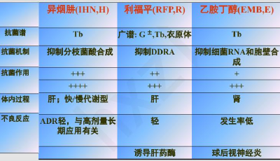

---
tags:
  - pharmacology
---
### 抗结核病药（ 1.5学时）
> 主要要求掌握异烟肼、[[利福平]]
### 结核分枝杆菌：①胞内寄生菌（异烟肼脂溶性高、穿透力强、抵达病灶和胞内）；②外层由分枝菌酸包裹，普通药物难以发挥作用；③易产生耐药性（耐药选贝达喹啉）
一线抗结核： [[异烟肼]]（Isoniazid, INH） ，[[利福平]]（Rifampin），[[链霉素]]（Streptomycin） ，乙胺丁醇（Ethambutol） ，吡嗪酰胺（Pyrazinamide, PZA）
二线抗结核：对氨基水杨酸（PAS） 、乙硫异烟胺（ethionamide）、[[氟喹诺酮类]]
#### 新药：贝达喹啉bedaquiline
### [[异烟肼]]（Isoniazid）
> 高选择性，专职抗痨 快慢代谢结核首选繁殖期杀（抑制 分枝菌酸 、 DNA ）；类似Vit B6 ，周围神经炎（GABA脱羧酶++）
#### 异烟肼是针对异烟肼敏感<mark style="background-color: #705A16; color: white">结核分枝杆菌感染</mark>的预防和治疗<mark style="background-color: #705A16; color: white">首选用药</mark>
#### 体内/药代
> 以后没特别说就是肝代谢肾排泄
##### 穿透性强，脂溶性高
口服吸收完全而迅速 ，广泛分布于全身，可渗入胞内、<mark style="background-color: #3F4B5E; color: white">干酪样及纤维化结核病灶</mark>中
<mark style="background-color: #3F4B5E; color: white">肝脏代谢</mark>，人群基因差异决定快慢（注意：分为 慢代谢、快代谢）
药理作用： <mark style="background-color: #705A16; color: white">抗菌谱；抗菌活性(强弱？杀抑?)；繁殖期or静止期；机制；耐药性（联合用药）</mark>
> 杀菌特点：高度选择性；细胞内外均可；强大；性质：繁殖期，杀菌bacteriocide
##### 抗菌谱： 仅结核杆菌（高度选择性杀菌作用）
##### 抗菌活性：强大，对胞内外均有杀菌作用
繁殖期<mark style="background-color: #1A4F10; color: white">杀</mark>菌剂（联系机制记忆，“抑制合成”，繁殖期作用强，静止期作用弱）
##### 机制
> 细胞壁、代谢、DNA三方面干扰占完了，最具特色的是细胞壁，针对分枝菌酸决定了其高度选择性抗菌。
1. 抑制<mark style="background-color: #705A16; color: white">分枝菌酸</mark>合成酶（结核杆菌特异性）—→细胞壁×
2. 抑制DNA合成；
3. 干扰代谢 。
耐药性：单用易耐药，联合用药可延缓（对其他抗结核药物无交叉耐药）
> 早期轻症、预防、巩固可以单用，规范化治疗 必须 与其他药合用
#### 临床应用：各种结核首选药，注意联合用药
#### 不良反应
基于化学结构<mark style="background-color: #1A4F10; color: white">与维生素B6相似</mark>、经<mark style="background-color: #1A4F10; color: white">肝代谢</mark>、<mark style="background-color: #1A4F10; color: white">抑制肝药酶</mark>三大特点
##### （1）[周围神经炎](周围神经病.md) 、中枢神经症状 （眩晕、失眠、兴奋、精神错乱）
机制：化学结构与Vit B6相似，竞争性抑制Vit B6参与的GABA合成；
#### 预防：及时补充Vit B6
##### （2）肝损害
##### 乙酰化代谢物所致，老年、酗酒、快代谢型多见
用药期间可出现转氨酶升高、黄疸、多发性肝小叶坏死
※异烟肼为 肝药酶抑制剂（<mark style="background-color: #1A4F10; color: white">伏笔：异烟肼有药酶抑制作用利福平有药酶诱导作用</mark>）
> 记：异与抑同音；利与诱同意
##### （3）过敏、胃肠道反应
### [[利福平]]（Rifampin） ；利福喷丁 （rifapentine）、利福定（rifabutin）
> 广谱，兼职抗痨，联合使用 （结核麻风金葡沙眼衣原体）繁殖、静止期全杀（抑制DNA依赖性的RNA pol，即mRNA合成）
#### 体内过程
吸收易受食物影响，推荐空腹服用（伏笔：胃肠道不良反应），可透过血脑屏障
代谢产物为红色（抗结核药服用者，红色粪便），使用时现配现用
##### 经<mark style="background-color: #1A4F10; color: white">胆汁</mark>排泄（治疗重症胆道感染）
药理作用 —— <mark style="background-color: #705A16; color: white">抗菌谱；抗菌活性(强弱？杀抑?)；繁殖期or静止期；</mark><mark style="background-color: #705A16; color: white">~~*机制；耐药性*~~</mark>
#### 抗菌谱：广谱全杀，繁殖期静止期胞内胞外均有效
✓ 分枝杆菌：结核分枝杆菌、麻风 分枝杆菌 ；（用于麻风病（合用氨苯砜））
✓ G+球菌 （活性＜[[青霉素G]]，＞[[红霉素]]、[[头孢]]），尤其是对于耐药金葡菌；
##### ✓ G-菌，高浓度时对某些病毒、沙眼衣原体也有抑制作用
#### 抗菌活性强大
机制：）；
作用机制：抑制DNA依赖性 RNA pol，阻碍细菌mRNA的合成（对人、动物的无影响）
#### 利福平的临床应用
结核病（与其他药联合）；
##### 麻风病（合用氨苯砜）
##### 耐药金葡菌
##### 局部，主要是眼睛（沙眼、急性结膜炎等）
重症胆道感染；（胆汁排泄）
#### 利福平的不良反应
##### 胃肠道反应为主（link：食物影响吸收，推荐空腹服用）
肝毒性：与异烟肼合用肝毒性增加；
※ 利福平为 肝药酶诱导剂<mark style="background-color: #1A4F10; color: white">（注意：异烟肼和利福平一上一下，异烟肼抑制肝药酶，利福平诱导肝药酶，但都在肝脏代谢）</mark>
##### 致畸性：※妊娠早期禁用
大剂量间隔使用时，可引起 “流感综合征”
利福喷丁 （rifapentine）、利福定、利福布汀（rifabutin）
与利福平一起，三者之间交叉耐药；其中，利福布汀是不完全交叉耐药
##### 利福喷丁 （rifapentine）：更长效、高效
利福定（rifabutin）：活性更大，进入细胞内浓度更高。不完全交叉耐药，用于之前利福平有效的复治结核。
### [[链霉素]]（Streptomycin SM）
> 氨基苷类抗生素。胞外，适合渗出病灶，易耐药；肾毒性大
#### 对结核作用 & 适应症 （还是从化疗药药理作用的几个方面来答）
主要在胞外，穿透力弱，对胞内作用小——不能根除、不易进入纤维化干酪病灶，适合<mark style="background-color: #705A16; color: white">渗出病灶</mark>
##### 抗结核作用＜INH、RFP
仍是一线抗结核药，联合用于急性期、严重结核感染（结核性脑膜炎、粟粒性结核、重要器官结核）
#### 耐药性：单用很容易耐药
#### 不良：肾毒性、耳毒性
### 乙胺丁醇（ <mark style="background-color: #705A16; color: white">E</mark> th/am/but/ol）
> 球后可逆性视神经炎
#### 特点
高度选择性：乙胺丁醇对所有结核分枝杆菌均具有抗菌活性，对其他细菌无效
易耐药但耐药慢：耐药产生较慢，对耐异烟肼和链霉素者仍有效；没有交叉耐药性
机制：结合Mg2+，干扰RNA合成 ，胞内外杀菌；
> 记：“醇美”

不良反应：发生率低，最严重的是球后可逆性视神经炎（Reversible Retrobulbar Neuritis）
> 视野缩小、视力下降、盲点，发生率与剂量有关

应用：联合用药治疗各型结核。毒性少，容易被患者接受。
> 记：“醇”，每个人接受度高。
### 吡嗪酰胺pyrazinamide
> 酸性好用，毒性大，联合用药
#### 在酸性环境中抗菌作用增强，中性环境中无作用
单用易耐药，与异烟肼和利福平有协同作用；
可能影响分枝菌酸的合成；
> 注意：“zin”烟酰，与异烟肼相似

常用于其他抗结核药失败的复治病人；
-毒性较大，尤其是肝损害。
### 二线抗结核药：对氨基水杨酸（PAS） 、乙硫异烟胺（ethionamide）
> PAS类似PABA（联想到磺胺），抑制叶酸代谢、分枝杆菌素合成；乙硫异烟胺类似异烟肼，主要抑制分枝菌酸的合成

对氨基水杨酸（Para-aminosalicylic acid PAS）
##### 干扰结核杆菌的二氢蝶酸合酶 ，抑制叶酸代谢、分枝杆菌素合成
作用弱，但耐药产生慢；
##### 联合应用治疗各型结核，对<mark style="background-color: #705A16; color: white">渗出病灶好</mark>
### [[氟喹诺酮类]]：<mark style="background-color: #705A16; color: white">耐多药结核病</mark>的首选
### 新药：贝达喹啉bedaquiline（*好*）
> 抑制ATP合成

全新作用靶位：抑制结核分枝杆菌ATP合成酶质子泵，影响ATP合成。
#### 对耐药菌、休眠菌也有很好的作用
#### 安全性高
### 抗结核病药的应用原则：早期、联合、适量、 长期（全程规范） 、规律用药。
※教材有趣点：糖尿病合并结核（实质：药物互作的考虑；特色不良反应）
①肝毒性：避免口服降糖药和抗结核药合用，多重肝损伤，首选注射类胰岛素
##### ②糖尿病视网膜病变：避免 <mark style="background-color: #3F4B5E; color: white">乙胺丁醇</mark>
##### ③周围神经病变：避免<mark style="background-color: #705A16; color: white">[[异烟肼]]</mark>
##### ④肾病：避免氨基苷类<mark style="background-color: #1A4F10; color: white">[[链霉素]]</mark>
### 对比表

