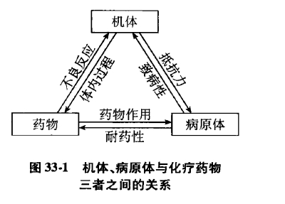
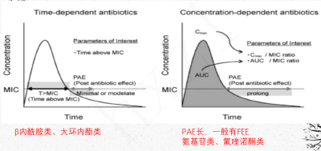
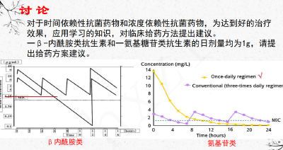
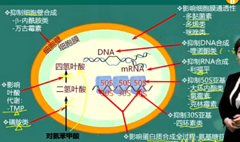
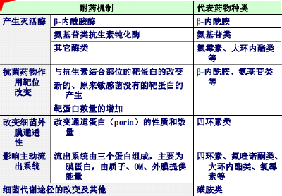
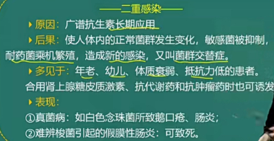

---
tags:
  - pharmacology
---
### 抗菌药物=[抗生素](抗生素.md)+人工合成抗菌药
### 后者包括[喹诺酮](喹诺酮.md)类、[磺胺](磺胺药.md)类、甲氧苄啶、硝基咪唑类、噁唑烷酮类等

### 一．抗病原微生物药及化学治疗的定义。
定义：化学治疗是指对病原微生物、寄生虫所致的感染性疾病与恶性肿瘤的药物治疗
#### 机体、病原体和抗菌药物三者间的相互关系

常用术语：抗菌谱，抗菌活性MIC，抑菌药，杀菌药，化疗指数(chemotherapy index，CI)，PAE，首次接触效应(FEE)
1. 抗菌谱 （antibacterial spectrum）:抗菌药物的抗菌范围，包括广谱和窄谱两种，是临床选药的<mark style="background-color: #3F4B5E; color: white">基础</mark>
广谱——对多种病原微生物有效如四环素、[[氯霉素]]、第三&四代氟喹诺酮类等
窄谱——仅对单一菌种或种属有效如[[异烟肼]]
2. 抗菌活性 ：抗菌药抑制或杀灭病原体的能力，评价抗菌活性的指标：常用MIC和MBC
最低抑菌浓度 （minimum inhibitory concentration, MIC ）体外培养18~24h后能抑制培养基内病原菌生长繁殖的最低药物浓度；
最低杀菌浓度 （minimum bactericidal concentration, MBC ）能够杀灭培养基内细菌或使细菌数减少99.9%的最低药物浓度。
3. 抑菌药——仅能抑制微生物生长而无杀灭作用的药物；杀菌药——既能抑制微生物生长又有杀灭作用的药物。
4. 化疗指数 （chemotherapy index,CI）：评价化学治疗药物安全性与应用价值的指标——LD50/ED50或LD5/ED95。CI↑，表明该药物的<mark style="background-color: #3F4B5E; color: white">毒性越小（但不一定越安全！）</mark>，临床应用价值越高
> link：治疗指数TI

注意：CI越大不一定越安全，只是越不容易中毒致死。青霉素类药物CI指数大，几乎对身体无毒性，但可能发生过敏性休克
5. 抗生素后效应（post antibiotic effect,PAE）：细菌与抗生素短暂接触，当抗生素浓度下降低于MIC或消失后，细菌生长仍受到持续抑制的效应。eg <mark style="background-color: #705A16; color: white">阿奇霉素PAE非常好，可以间歇给药。</mark>
> 不能只说“不再给药”，要说“低于MIC或消失后”
6. 首次接触效应（first expose effect，FEE）：抗菌药物在初次接触细菌时有强大的抗菌效应，再度接触时不再出现该强大效应，或者与细菌接触后抗菌效应不再明显增强，需要间隔相当时间以后，才会再起作用。（如<mark style="background-color: #705A16; color: white">氨基苷类由于FEE，需要间隔给药</mark>）
时间依赖性抗生素：药物浓度超过一定范围后，浓度对杀菌效果影响不大。<mark style="background-color: #1A4F10; color: white">β内酰胺连续按时给药</mark>
浓度依赖性抗生素：杀菌效果随浓度的增加而增加，PAE长、FEE明显，剂量大效果明显。<mark style="background-color: #1A4F10; color: white">氨基苷类给三天歇三天</mark>

### 二． 抗菌药物的作用机制（背！）

> 从外往内记：细胞壁、细胞膜、胞内蛋白质、核酸、 叶酸 。1.抑制细菌细胞壁合成；2.影响细菌细胞浆膜的通透性；3.影响胞浆内生命物质（蛋白质）的合成；4.抑制细菌核酸合成；5. 影响叶酸代谢
#### 1. 抑制细菌细胞壁的合成：[[青霉素]]&头孢菌素、万古霉素&杆菌肽
##### 均作用于繁殖期
青霉素和头孢菌素——抑制PBPs，抑制<mark style="background-color: #705A16; color: white">交联</mark>过程
万古霉素和杆菌肽——抑制<mark style="background-color: #705A16; color: white">粘肽</mark>合成
#### 2. 改变细胞膜的通透性：多黏菌素 & 两性霉素
多黏菌素——与膜磷脂结合；
两性霉素——与固醇类物质结合（麦角固醇打孔）。
##### 副作用/不良反应强，因为人体也有
3. 抑制蛋白质合成：氨基苷（链、庆大、妥布、[[阿米卡星]]）、大环内酯（[[红霉素]]）、林可霉素、[[氯霉素]]、四环素
氨基苷类——影响蛋白质合成的<mark style="background-color: #3F4B5E; color: white">全过程</mark>；
大环内酯类、林可霉素类、氯霉素类——<mark style="background-color: #3F4B5E; color: white">50S</mark>，抑制转肽；（“红绿林中50载”）
四环素——<mark style="background-color: #3F4B5E; color: white">30S</mark>，抑制进位（30而立四环素）
#### 4. 影响核酸代谢：[[喹诺酮]]（xx沙星）、[[利福平]]
喹诺酮类——抑制DNA合成；
[[利福平]]——抑制<mark style="background-color: #1A4F10; color: white">RNA</mark>合成。（DNA依赖性RNA pol）
#### 5. 影响 叶酸代谢：磺胺、甲氧苄啶TMP
##### 复方新诺明：SMZ + TMP，双重阻断四氢叶酸合成
哺乳动物可以直接用叶酸，细菌原核生物需要用到四氢叶酸
### 三． 细菌耐药性的概念，产生耐药性的机制 。
1. 耐药性 （bacterial resistance）：细菌产生对抗生素不敏感的现象，产生原因是细菌在自身生存过程中的一种特殊表现形式。
> 区别：人的“耐受性”

固有耐药性（Intrinsic Resistance）：由细菌染色体基因决定，代代相传不改变。（如：<mark style="background-color: #1A4F10; color: white">G- 对青霉素G天然耐药</mark>）
获得性耐药性（Acquired Resistance）：细菌与抗生素反复接触，由质粒介导，亦可由染色体介导，通过改变自身代谢途径使其不被抗生素杀灭的特性。可逆，可因不再接触抗生素而消失<mark style="background-color: #1A4F10; color: white">（如：金黄色葡萄球菌产生 β 内酰胺酶而对 β 内酰胺类抗生素耐药）</mark>
*多重耐药性（Multiple-drug Resistance）：* *细菌对多种抗生素耐药*
MRSA （ Methicillin Resistant Staphylococcus ） ：耐甲氧西林金黄色葡萄球菌
ESBL （Extended Spectrum β-lactamases）：产超广谱 β-内酰胺酶细菌
PRSP （Penicillin-Resistant Streptococcus Pneumoniae）：青霉素耐药肺炎球菌
#### 2. 耐药性机制

##### 改变细胞外膜通透性
改变通道蛋白（porin）的性质和数量。<mark style="background-color: #705A16; color: white">铜绿假单胞菌</mark>对抗生素的天然耐药
##### 影响主动外排系统
##### <mark style="background-color: #705A16; color: white">大肠埃希菌</mark>对<mark style="background-color: #1A4F10; color: white">四环素、大环内酯类、[[氯霉素]]、氟喹诺酮</mark>的多重耐药
产生灭活酶： 主要是β和氨基苷。
<mark style="background-color: #1A4F10; color: white">氯霉素乙酰转移酶；林可霉素类（核苷转移酶）；大环内酯类（酯酶）；[[氨基糖苷类]]</mark>抗生素钝化酶；<mark style="background-color: #1A4F10; color: white">β-内酰胺酶</mark>；
##### 抗菌药物作用靶位改变
与抗生素结合的靶蛋白改变 、出现新的靶蛋白、靶蛋白数量增加
<mark style="background-color: #705A16; color: white">耐压淋病奈瑟菌、MRSA</mark>的青<mark style="background-color: #1A4F10; color: white">霉素结合蛋白</mark>改变影响青霉素的结合
##### ※ 改变代谢途径 <mark style="background-color: #705A16; color: white">磺胺</mark>
<mark style="background-color: #705A16; color: white">金黄色葡萄球菌</mark>产生大量PABA，逆转<mark style="background-color: #705A16; color: white">磺胺类</mark>药物的 竞争性 拮抗作用
> 磺胺：干扰结核杆菌的二氢蝶酸合酶 ，抑制叶酸代谢、分枝杆菌素合成
#### 二重感染（Superinfection）/ 菌群失调症

### 四．抗菌药的合理使用
不能用抗菌药的场景： ①病毒感染不用；②原因未明的发热；③绝大部分不局部应用→诱发过敏反应和细菌耐药
尽早明确诊断 ，根据抗菌药的活性、耐药性、药动，根据患者生理病理免疫状态选药——根据感染菌种类、药敏试验、感染部位、患者全身情况、抗菌谱、药代动力学、不良反应
> eg G- 选氨曲南
#### 严格掌握预防应用的适应症：手术外伤风湿疫区接触
#### 特殊人群用药
（1）肾功能不全：避免肾毒性药、避免合用N个肾毒性药（氨基糖苷，多粘菌素，万古霉素，氟胞嘧啶，[[青霉素]]，一二代头孢，[[喹诺酮]]，四环素）
肾不好肝好，双通道（选择肝脏代谢、肝胆系统排泄的药）：大环内酯，[[氯霉素]]，利福霉素，多西环素，[[异烟肼]]
（2）肝功能不全：由肝清除但无毒，可用、减量；肝毒性，禁用；肝肾双途径，减量
原型经肾排泄正常用：[[青霉素]]、头孢唑林&他啶、万古霉素、氨基糖苷、多粘菌素、乙胺丁醇
减量：[[红霉素]]、氟胞嘧啶、哌拉西林、美洛西林、头孢噻肟&哌酮&曲松、克林霉素、林可霉素、氟罗沙星
禁用：磺胺，四环素，[[氯霉素]]，红霉素酯化剂，[[利福平]]，[[异烟肼]]，两性霉素B，酮康唑，咪康唑
（3）新生儿：禁用可能发生严重不良的磺胺、[[氯霉素]]、[[喹诺酮]]、氨基苷。 哺乳暂停，吃药不吃奶。
（4）小儿：①氨基苷、万古霉素，耳、肾毒性；②四环素，牙齿黄染四环素牙；③喹诺酮：骨骼发育不良（“煞星”）
（5）妊娠：致畸性、明显毒性。一青一红不能用。
#### 合理联合用药
繁殖期杀菌剂（<mark style="background-color: #1A4F10; color: white">β-内酰胺</mark>）+ 静止期杀菌剂（氨基糖苷）协同
快速抑菌剂（<mark style="background-color: #1A4F10; color: white">大环内酯类四环类氯霉素</mark>）+静止期杀菌剂（氨基糖苷）协同
##### 快速 + 慢效协同
繁殖期杀菌剂（<mark style="background-color: #1A4F10; color: white">β-内酰胺</mark>）+ 快速抑菌剂（<mark style="background-color: #1A4F10; color: white">大环内酯类四环类氯霉素</mark>）拮抗
注意 给药顺序：先用四环素，后用青霉素，产生拮抗效应。反之则无
轮换使用抗生素、 <mark style="background-color: #3F4B5E; color: white">降级使用（de-escalation）</mark> 同类药物、序贯使用不同药物
### 习题
1、名词解释：化疗指数；抗菌谱；最低杀菌浓度（MIC）；最低抑菌浓度(MBC)；抗生素后效应（PAE）
##### 2、简述抗菌药的抗菌作用机制
##### 3、简述细菌的耐药机制
4、如何正确地联合应用抗菌药？
