---
tags:
  - pharmacology
---
### 抗高血压药（3.5）
<u>*抗高血压药对高血压病治疗的意义。*</u> 按其作用原理和作用部位进行分类。（图1的心脏功能指心率、心肌收缩力）
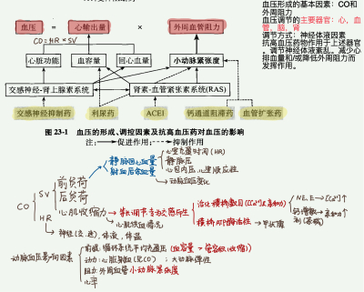
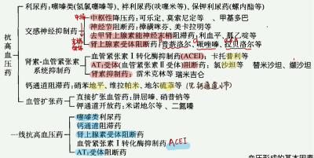
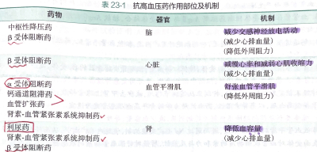
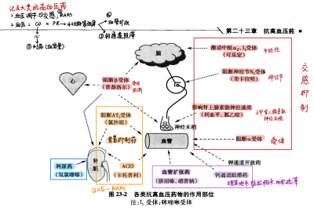
#### *PPT的部分高血压知识*
1.原发性高血压（也称为原发性或特发性高血压）占90%以上。
2.继发性高血压：肾动脉狭窄；内分泌疾病：库欣综合征（肾上腺皮质亢进）、甲状腺疾病、肾上腺髓质嗜铬细胞瘤；主动脉缩窄；自身免疫性疾病；酒精滥用；动脉粥样硬化；可卡因；糖尿病
#### 高血压增加终端器官损害
### 一、利尿药
> [[氢氯噻嗪]]（Hydrochlorothiazide）、[[吲达帕胺]]（indapamide）
### <u>[[氢氯噻嗪]]</u>
#### 降压作用：可降低10%
①降低 血容量 ；
##### ②类似PG， 扩血管：[Na+]↓ 
Na+降低的继发影响：保钙 活RAS→钾、糖
钠钙交换——Ca2+↓，促进钙重吸收
漏洞：远曲小管致密斑Na＋↓，排钾， 激活RAAS ——低血钾、低血糖、肾素活性继发↑
但另一面，<mark style="background-color:#fef3c7;">适用于</mark><mark style="background-color:#fef3c7;"> 肾功能衰竭引起的肾素活性降低的高血压 </mark>
##### ③肾性尿崩症
> *氢氯噻嗪治疗肾性尿崩症的机制主要与其能减少肾脏对钠的重吸收有关* 。通过减少钠的重吸收,可增加肾小管内的渗透压,从而在一定程度上改善尿液浓缩功能,减少尿量。？
##### 不产生耐受性
#### 用途：①水肿（心源性；CHF） ②<mark style="background-color:#fef3c7;">各型高压，尤其肾素活性↓</mark> ③尿崩 ④高钙结石
#### 轻、中度心源性水肿； CHF；高血压：利尿+温和的扩血管作用；（肾源性）尿崩症；高尿  钙型尿结石 
#### 不良反应：低血钾；高尿酸血症（痛风）；糖脂代谢障碍；不合用吲哚美辛（anti-PG）
### [[吲达帕胺]]
##### 结构：非噻嗪类
##### 机制：利尿、利钠、扩血管（Ca2+↓）
##### 临床应用：轻、中度高血压<mark style="background-color:#fef3c7;"> （伴高脂血症） </mark>
##### 不良反应轻微，不引起 血脂改变 
禁忌症：  磺胺过敏 、肝肾（ 严重肾衰竭、肝性脑病、严重肝衰竭）、低钾血症、妊娠或哺乳期。
#### 其它利尿剂
保钾利尿药适用于 低钾血症，高尿酸血症  ，原发性醛固酮增多症；不可用于肾功能不全、少尿。一般与噻嗪合用。
> 保钾，可能拮抗醛固酮，不像高效利尿药会引起高尿酸血
氨苯喋呤triamterene ：与其它利尿药合用增加疗效并对抗不良反应
高效利尿药仅用于高血压危象 、 慢性肾功能不全  的高血压 、 肺水肿  合并高血压。注意高尿酸血症。
> 高效，冲刷肾，肺水肿（尤其急性
### 二、血管紧张素I转化酶抑制药及血管紧张素II受体（AT1）阻断药
> ~普利，~沙坦。PPT重点：作用、应用、不良（禁忌症）
#### 关于RAAS
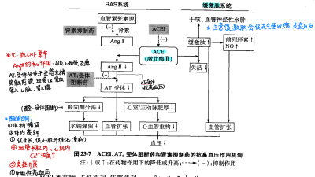
#### 三、RAAS抑制药：CHF基础，伴缺血、伴肾高
#### ACEI卡 <u>托普利（Captopril）</u>
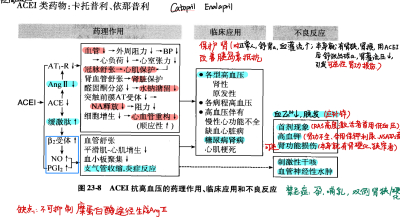
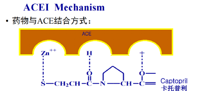
ACEI也有首剂效应（first-dose phenomenon）：哌唑嗪首次给药时发生严重的直立性低血压（ orthostatic hypotension） 、晕厥、心悸
<u>氯沙坦（Losartan），</u> <u>*缬沙坦（Valsartan），厄贝沙坦*</u> （Irbesartan）；ARNI
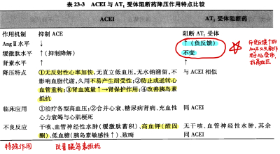
### 三、交感抑制药
> 中枢：• Clonidine； Methyldopa；Guanabenz；Guanfacine
> 神经节：Guanadrel ；Guanethidine ； Reserpine
> 受体阻滞药： propranolol (β） ；Labetalol (α&β） Prazosin, Terazosin (α）
### 中枢抗高血压药：可乐定Clonidine、α-甲基多巴（methyldopa） ，莫索尼定moxonidine、利美尼定rilmenidine
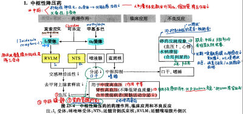
##### 可乐定（ Clonidine ）
➢ 药理作用——  中等偏强 
> ppt重点
抑制交感神经活性→血压和心一起落，心收缩力↓，CO↓，外周血管舒张→BP↓；
- 抑制胃酸分泌和胃肠蠕动；
##### -抑制肾素分泌
##### -中枢镇静
##### ➢ 作用机制
选择性激动延髓孤束核（NTS）突触后膜的 α2受体 、延髓头端腹外侧核（RVLM）的咪唑啉 I1受体 →外周交感活性↓→BP↓；
> 延髓孤束核突触后膜的α2受体、延髓头端腹外侧核的咪唑啉I1受体
 首次给药一过性血压升高 /大剂量激活外周血管平滑肌上的α2受体，血管收缩，减弱降压效果。
##### ➢ 临床应用
中度高血压，尤其是<mark style="background-color:#fef3c7;"> 肾性高血压 </mark>或<mark style="background-color:#fef3c7;"> 高血压兼胃溃疡 </mark>者。
##### <mark style="background-color:#fef3c7;"> 戒毒：阿片类 </mark>
##### ➢ 不良反应
口干、便秘；
嗜睡、恶心、眩晕、腮腺痛；
 停药反跳现象：交感亢进，血压↑↑  。长期服药引起突触前膜 α2受体敏感性下降。突然停药会有交感功能亢进的症状停药前应逐渐减量出现停药反应可用可乐定酚妥拉明治疗
##### α- 甲基多巴（ methyldopa ）
与可乐定相似，激动延脑突触后膜α2受体，扩血管而降低外周阻力（包括肾血管）
药热、溶血、血小板及粒细胞减少、肝损害及狼疮样综合征，应立即停药。
##### 莫索尼定moxonidine、利美尼定rilmenidine
作用与可乐定相似，但 对咪唑啉I1受体选择性更高 ， 无镇静、停药反跳现象。 
### 肾上腺素受体阻滞药
### α 受体阻断： <u>哌唑嗪（Prazosin）</u>
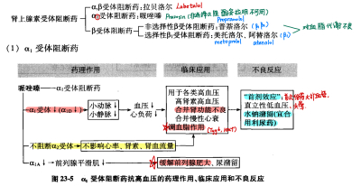
阻断α1→  血管收缩↓ 
非选择性α肾上腺素受体阻断剂vs选择性α1肾上腺素受体阻断剂
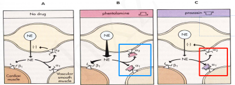
酚妥拉明（ Phentolamine ），  非选择性  α 肾上腺素受体阻断剂，可以 反射性激活交感神经与RAAS系统，不良反应多，兴奋心脏、减少肾血流， 长期降压效果差，不作为常规抗高血压药使用，仅用于控制  嗜铬细胞瘤患者  的高血压危象。
<u>哌唑嗪（</u> <u>Prazosin</u> <u>）</u> 、特拉唑嗪（Terazosin)、多沙唑嗪（Doxazosin) ，选择性 α1受体阻断剂，长期用药可引起 水钠潴留（  长期不免激活RAAS  ）  ，需加服利尿剂； 对血脂无不良影响 
##### 哌唑嗪
##### 机制：选择性阻断交感神经突触后膜、小动脉&静脉的 α1 受体
##### 作用特点
##### ①降低心脏前、后负荷
②不减少肾血流量、GFR；不改变CO、心率及肾素分泌，
③长期使用有利血脂：可  升高HDL  ，降低血浆甘油三酯、总胆固醇LDL
##### 临床应用
用于<mark style="background-color:#fef3c7;"> 各型高血压 </mark>。重度高血压时合用利尿药、β受体阻断药
可阻断膀胱 <mark style="background-color:#fef3c7;"> 前列腺 </mark> 尿道处 α1受体，因此适宜用于 <mark style="background-color:#fef3c7;"> 高血压合并前列腺肥大者 </mark>
##### CHF
#####  ※ 不良反应： “首剂效应” 
> PPT重点
首剂效应（first-dose phenomenon） ：哌唑嗪首次给药时发生严重的直立性低血压（ orthostatic hypotension） 、晕厥、心悸
（哌唑嗪首次给药时阻断交感神经的缩血管效应，扩张容量血管，减少回心血量）
######  如何避免：  首剂减量为0.5mg、睡前服用 
长期用药可引起水钠潴留，需加服利尿剂
> 哌唑嗪：长期联合利尿剂，重度联合利尿剂
### β受体阻断药： <u>普萘洛尔、美托洛尔</u> 、阿替洛尔、卡维洛尔
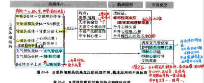
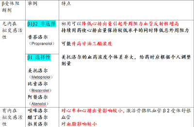
> 其中阿替洛尔疗效不佳，不能降低死亡率和MACE；
> 普萘洛尔不会造成直立性低血压
#####  <u>※ 药理机制</u> 
> ppt重点
##### 1.阻断心脏β1 受体，降低心脏排出量（不是主要作用）
2.阻断肾球旁器β1受体，减少肾素分泌，抑制RAS系统
3.通过血脑屏障，阻断  中枢β受体  ，降低外周交感神经活性
4. 阻断去甲肾上腺素能神经末梢 外周突触前膜β2  受体，减少NE的正反馈释放
> 注 <u>：α2负反馈NE释放，β2正反馈NE释放！</u>
5. 促进 前列环素PG生成  （注意β2的骨骼肌扩血管作用！） 
#####  <u>※临床应用</u> 
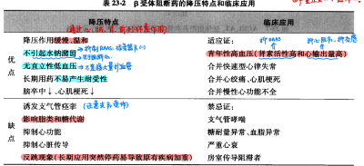
> ppt重点////特别注意合并心绞痛etc
##### 轻、中、重度高血压，特别是：
##### ❖高血压伴<mark style="background-color:#fef3c7;"> 冠状动脉粥样硬化 </mark>性心脏病、脑血管病变
> <u>*“洛尔落心脏”；但注意对冠心病的双重性，既可以落心脏，好，又可以促血脂，坏。*</u>
##### ❖年轻患者
##### ❖伴<mark style="background-color:#fef3c7;"> 心绞痛，心肌梗死 </mark>
❖伴<mark style="background-color:#fef3c7;"> 心律失常，心动过速 </mark>，房颤
##### 注意区别： ~~伴稳定性心绞痛首选CCB~~ 
β受体阻断药+利尿药+扩血管药——合用可有效治疗中度/顽固性高血压。
##### 不良反应、禁忌症
##### 急性心衰、房室传导阻滞、心动过缓
> “落心脏”药物通警
##### 哮喘（可引起支气管收缩)
##### 周围血管疾病，雷诺氏综合征
##### 坏血脂： ↑ TGs and VLDLs, ↓HDL
注意事项：  反跳现象（Withdrawl Syndrome）： 长期使用该类药物后突然停药，原有疾病加重
##### 在停药前应提前两周逐步减量
##### 起效较慢，使用时应从小剂量给药
### α  1  β阻断剂 ：拉贝洛尔（Labetalol）、卡维地洛（Carvedilol）
##### 拉贝洛尔（Labetalol）
##### β1=β2 ＞α1 
##### 药理作用：降压作用温和，  对心 排出量和心率 无明显影响 
> 区别与βblocker
临床应用：各种高血压；高血压急症；静脉注射可治疗高血压危象
##### 不良反应：无严重不良反应
### 神经节阻断药：樟磺咪芬（Trimetaphan）美卡拉明（Mecamylamine）潘必定（Pempidine）潘托安pentolonium
##### 同时阻断交感神经与副交感神经，作用很强副作用较多临床少用
##### 药理作用
选择性与神经节细胞  N1胆碱受体 结合，阻断神经冲动在神经节传递
##### 阻断交感神经节：动静脉舒张外周阻力下降血压降低
##### 阻断副交感神经节：心率下降视力模糊口干
##### 临床应用
##### 仅用于<mark style="background-color:#fef3c7;"> 高血压危象、主动脉夹层动脉瘤、外科手术控制血压 </mark>
### 影响去甲肾上腺素能  神经递质  的药物 ：利血平（Reserpine）胍乙啶（Guanethidine）
##### 降血压作用弱不良反应较多
##### 利血平
降压作用特点：缓慢、温和、持久；
##### 原理：抑制NE合成、再摄取，促使其排出囊泡
不良反应多，现已少用。
##### 胍乙啶
降压作用特点：迅速、强大、持久；
抑制NE释放，耗竭囊泡内递质；
易引起肾、脑血流减少及水钠潴留；
主要用于重症高血压。
### 四、钙拮抗药
> 二氢吡啶类 （Dihydropyridines）：氨氯地平（amlodipine）[[硝苯地平]]（nifedipine） nitrendipine尼群地平、 Lacidipine拉西地平
> Felodipine非洛地平、Nimodipine尼莫地平Isradipine伊拉地平Nicardipine尼卡地平
> 
> 非二氢吡啶类 ：地尔硫卓（Diltiazem）[[维拉帕米]]（verapamil）
#### [[硝苯地平]]（nifedipine）
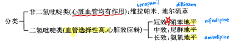
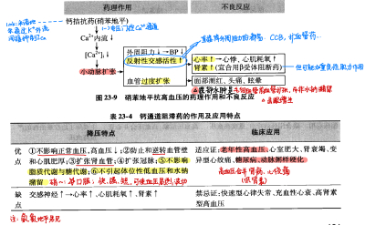
#### 对伴有缺血性心脏病者慎用
#### <u>*氨氯地平（amlodipine）*</u>
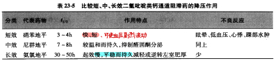
#### ➢ 降压特点
对血管平滑肌选择性更强；
口服吸收率及生物利用度更高；
起效缓和，渐进降压，疗效更持久；
##### 不增加交感活性
#### ➢ 应用：轻中度高血压
### 五、扩张血管药
####  考：硝酸酯类和β受体阻滞药合用 
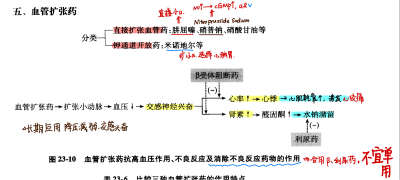
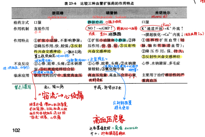
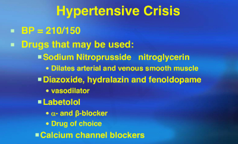
#### <u>*酮色林（Ketanserin）*</u>
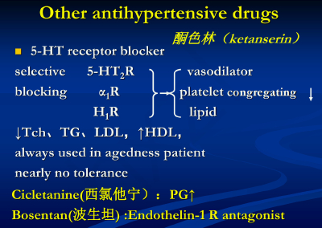
### 六、抗高血压药物的应用原则
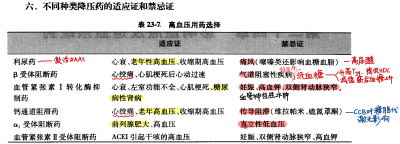
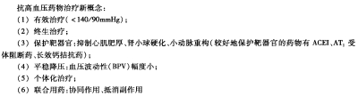
<mark style="background-color:#fef3c7;">老年高血压</mark>的5个特点是:收缩压升高、脉压差增大、易受体位变动影响、易受药物影响、易发并发症。<mark style="background-color:#fef3c7;"> 适合：CCB </mark>
青年高血压：高肾素活性（水钠潴留）、高心输出量（可用β-R blocker）
