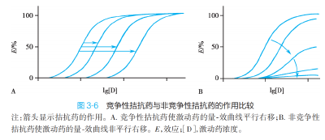

---
aliases:
  - antagonist
tags:
  - pharmacology
---
有较强亲和力（ 🔺配体位点or其它位点 ）、无内在活性。拮抗药本身不能产生负性作用，但因为可以占据受体，表现为拮抗激动药。

### 分类
### 竞争 & 非竞争
i. 竞争性拮抗药 （competitive antagonist）可以与激动药竞争相同受体，并与受体<mark style="background-color: #1A4F10; color: white">可逆性结合</mark>，但并<mark style="background-color: #705A16; color: white">不降低内在活性也不改变最大效能</mark>；可以使量效<mark style="background-color: #1A4F10; color: white">曲线</mark>右移。
ii.非竞争性拮抗药（ noncompetitive antagonist ）与受体结合非常牢固、<mark style="background-color: #1A4F10; color: white">不可逆</mark>、非竞争性；可以降低激动药的亲和力与内在活性，使得药物的<mark style="background-color: #705A16; color: white">最大效能降低</mark>；不仅使曲线右移，也使<mark style="background-color: #1A4F10; color: white">曲线</mark>下移。

### 拮抗 & 少数拮抗
### i. 大部分拮抗药：α=0
ii. 少数拮抗药α≠0，但是具有很小的内在活性，因此表现为主要的拮抗作用和少量的激动作用。因此需要注意，1＞α＞0的药物既有可能是部分激动药，也有可能是少数拮抗药。其具体表现为，在剂量较低时呈现出对受体的激动作用，但是当大剂量使用或者与完全激动药联合使用时，则会表现出明显的拮抗作用。
### <mark style="background-color: #705A16; color: white">eg</mark><mark style="background-color: #705A16; color: white">oxprenolol</mark>

### ---
### 竞争性VS非竞争性拮抗剂

激动剂 + 竞争性拮抗剂 —— 影响亲和力（ 效价下降 ），不影响内在活性（ 效能不变 ），量 -效曲线平行右移 ；激动剂增多，可以减轻抑制。
> 与激动剂竞争同一结合位点

激动剂 + 非竞争性拮抗剂 —— 影响亲和力（ 效价下降 ）、内在活性（ 效能变低 ），量 -效曲线不平行右移、下移。
> 与位点以外的基团结合受体变构影响
