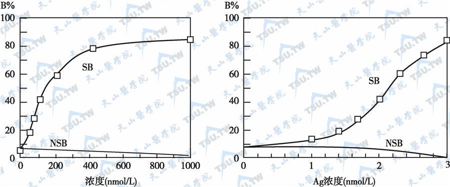

---
aliases:
  - RIA
tags:
  - nuclear-medicine
---
### 一、原理
放射性标记抗原（✳️Ag）与非标记抗原（Ag）与有限量的特异性抗体（Ab）进行竞争性免疫结合，彼此抑制。

<span style="font-size: 18px; color: #FFDEDE; font-weight: bold">成立条件</span>：
- ✳️Ag 与 Ag 的免疫活性相同。
- ✳️Ag 与 Ag 对 Ab 具有同样的亲和力。
- ✳️Ag 和 Ab 的<span style="font-weight: bold; text-decoration: underline;">量恒定</span>。
- ✳️Ag 与 Ag 的总量大于 Ab 上的有效结合点数目。

<span style="font-size: 18px; color: #FFDEDE; font-weight: bold">竞争结合规律</span>：
- 将 ✳Ag、Ag、Ab 混匀后，✳Ag-Ab 的形成量随 Ag 量的增加而减少。
- 剩余的未结合或游离 ✳️Ag 则随 Ag 量的增加而增多。
- 测定 ✳️Ag-Ab 或游离 ✳️Ag，即可推算出被测 Ag 的量。
### 二、标准竞争抑制曲线

#### 1. 制作步骤

1. 配制已知递增量的标准抗原 Ag。
2. 分别加入固定量的 ✳️Ag 和 Ab。
3. 待竞争结合反应达到平衡。
4. 分离结合部分（B）和游离部分（F）。
5. 测定 ✳️Ag-Ab 结合的放射性（B）或游离 ✳️Ag 的放射性（F）。
#### 2. 结合率计算
- **B (Bound)**：在**存在**待测物（未标记抗原）的管中，与抗体**结合**的标记抗原的放射性计数。
- **B₀ (Zero Standard)**：在**不含**待测物（或待测物浓度为零）的“零标准管”中，与抗体**结合**的标记抗原的放射性计数。理论上，这是抗体结合能力的**最大值**。
- **F (Free)**：未与抗体结合、处于**游离**状态的标记抗原的放射性计数。

```
B% = [B/（B+F）100%]
```

#### 3. 绘制标准曲线

- 纵坐标：B% 或 B/B0​%
- 横坐标：<mark style="background-color: #1A4F10; color: white">标准抗原浓度</mark>

作图得到标准竞争抑制曲线。
[Open: Pasted image 20261022101122.png](attachments/ab5370f8c0191f19497b3695ceb45b15_MD5.jpg)


#### 4. 样品测定
测得待测样品的 B% 或 B/B0%，在标准曲线上即可算出样品中被测抗原（Ag）的浓度。
### 三、质量控制
#### 1）最高结合率
最高结合率 B<sub>0</sub>%（又叫零标准管结合率），指不加非标记抗原时，标记抗原与抗体的结合率，要求在 30~50%
#### 2）非特异结合率
非持异结合率（NSB%），指不加抗体时标记抗原与非特异性物质的结合率，一般要求<5~10%
#### 3）ED25、ED50 及 ED75
ED25、ED50 及 ED75 指标准曲线结合率在 25%，50%及 75%时对应的抗原浓度值，反映标准曲线的稳定性，有助于批间结果比较
#### 4）反应误差关系
RER=平行管计数误差的均值/全部反应管计数的均值，应控制RER<0.04

