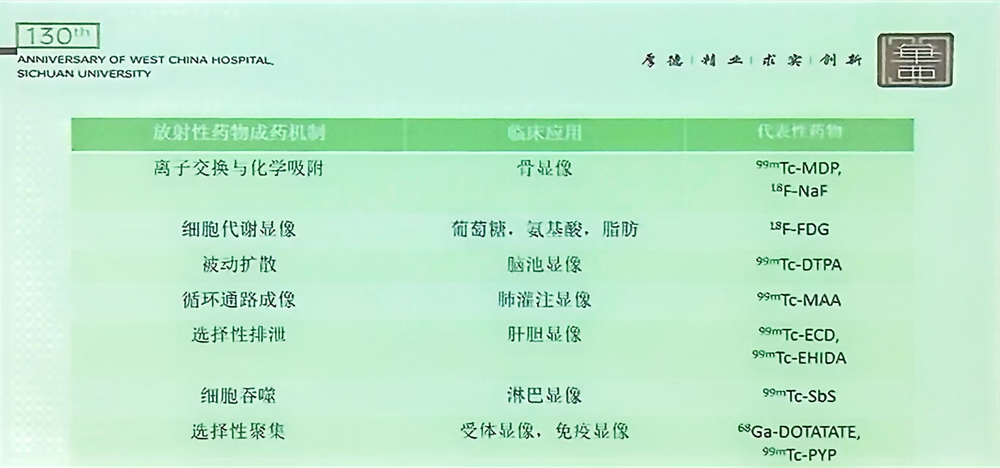

---
tags:
  - nuclear-medicine
---
### 质量控制

### [[放射免疫分析]] RIA 的基本原理及其方法学

### 成药机制
[Open: a157816939f97973978df73bc8e3b61e.jpg](attachments/255e9aa806fd34c04c00f22625cf6d1f_MD5.jpg)

#### 离子交换与化学吸附

#### 细胞代谢显像
肿瘤糖酵解与Warbug Effect
大脑唯一可以利用的能源是葡萄糖，所以FDG显像时大脑会很亮
此外心脏会亮，因血流丰沛
#### 被动扩散显像

### 常用放射性药物
99m</sip>TcO4-：可被胃肠黏膜、唾液腺、甲状腺摄取和分泌，用于梅克尔憩室显像、唾液腺显像、甲状腺显像。
99m</sip>Tc-MDP：离子交换，亲骨，用于骨关节显像。
99m</sip>Tc-MIBI：（甲状旁腺、听肿瘤、循环系统心肌灌注显像）易进入线粒体，高代谢部位浓聚。
99m</sip>Tc-MAA：
99m</sip>Tc-DTPA：不被摄取，用于肾、尿路显像（只滤过，GFR测定），大血管显像，脑脊液显像。
99m</sip>Tc-EHIDA
131I（e.g. 131I-间位碘代苄胍MIBG）：γ+β射线，甲状腺显像，甲状腺功能测定；甲亢治疗，甲状腺癌治疗。
123I：仅γ射线，甲状腺显像，甲状腺功能测定。
18F-FDG：PET，肿瘤显像。脑代谢显像。

| 药物                                                                                 | 应用                                 | 原理                                                                                                                                                                                                    |
| ---------------------------------------------------------------------------------- | ---------------------------------- | ----------------------------------------------------------------------------------------------------------------------------------------------------------------------------------------------------- |
| 99mTcO4-                                          | 甲状腺显像                              | 99mTcO4- 经过肘静脉弹丸注射，同时启动 γ 相机，或者 SPECT 动态采集，2秒/帧，采集 16 帧. 观察随着动脉血流经甲状腺的流量及流速以及甲状腺的摄取情况，判断甲状腺及其病灶部位血流灌注及功能状态.                                                          |
|                                                                                    | 甲状旁腺显像                             | 99mTcO4- <mark style="background-color: #1A4F10; color: white">不被甲状旁腺摄取</mark>，配合 99mTc-MIBI 或 201Tl 进行减影显像.                                   |
|                                                                                    | 消化道出血显像                            | 正常情况下血管内的显像剂不会溢出血管来到肠管内；如果出血，那么显像剂就随着消化道管壁走行变化，以此确认出血点.                                                                                                                                               |
|                                                                                    | 唾液腺显像                              | 唾液腺的小叶间导管上皮细胞可以将血液中的 99mTcO4- 主动摄取到细胞内，后面逐渐分泌到管腔内并由此进入口腔.                                                                                                            |
| 99mTc-RBC                                                               | 心血池显像、肝血池显像                        | 能够暂时停留在血管中的显像剂，一定时间达到平衡后，在目标脏器出现放射性浓聚                                                                                                                                                                 |
|                                                                                    | 消化道出血显像                            |                                                                                                                                                                                                       |
| 99mTc-MDP                                                               | 骨显像                                | 不易被磷酸酶水解，体内稳定，血液清除快，骨组织摄取迅速（静注后 2 ~ 3h，> 50% 沉积在骨），经过肾排出（膀胱显影）. 由于靶/非靶组织比值较高，为理想的显像剂，常用.                                                                                                              |
| 99mTc-MIBI * 掌握 | 心肌灌注显像                             | 脂溶性，正一价化合物，首次通过心肌摄取率 66%，通过被动弥散进入心肌线粒体，并牢固结合到膜，从而滞留在细胞内超过 5 小时                                                                                                                                        |
|                                                                                    | 甲状旁腺显像                             | 功能亢进、增生的甲状旁腺 99mTc-MIBI 摄取好，但是正常的甲状旁腺摄取极低. 此外，由于 99mTc-MIBI 从甲状腺组织和亢进甲状旁腺组织（更快）的洗脱速度不同，可以通过双时相法将早期、延迟影像进行比较，获得亢进的甲状旁腺影像. 或者配合 99mTcO4- 进行剪影显像. |
| 99mTc-MAA1                                                   | 肺显像                                | 可以均匀地暂时栓塞在肺毛细血管床内，局部栓塞的颗粒数与该处血流灌注量成正比，由于栓塞的毛细血管仅占毛细血管总数的几十万分之一，不会引起心肺血液动力学和肺功能的改变. 通常于注射后立即显像，正常人双肺影像清晰，放射性分布基本均匀，受重力影响肺尖部血流量低，放射性相对稀疏.                                                               |
| 99mTc-DTPA                                                              | 肾动态显像、肾图                           | 仅从肾小球滤过，或由肾小管上皮细胞分泌而不被重吸收的放射性示踪剂，立即启动专用的肾图仪连续记录示踪剂到达双肾、被肾浓聚以及排出的全过程                                                                                                                                   |
| 99mTc-EHIDA                                                             | 放射性核素肝胆动态显像                        | 肝摄取率好，肝内排泄速度快，胆管内系统显影清晰，并受到血清胆红素的影响较小.                                                                                                                                                                |
| 131I                                                                    | 甲状腺功能体内测定、甲状腺摄取碘试验、甲状腺显像、甲状腺癌转移灶寻找 | 甲状腺滤泡细胞具有 NIS，可以大量摄取 131I                                                                                                                                                                  |
|                                                                                    | 甲状腺癌治疗、甲亢治疗                        | 利用 131I 的放射性，损害浓聚局部组织.                                                                                                                                                                     |
|                                                                                    | 肾上腺显像                              | 131I-MIBG 是去甲肾上腺素的类似物，可以被肾上腺髓质的嗜铬细胞摄取                                                                                                                                                      |
|                                                                                    | 肾动态显像、肾图                           | 131I-OIH 由肾小管上皮细胞分泌而不被重吸收的放射性示踪剂，立即启动专用的肾图仪连续记录示踪剂到达双肾、被肾浓聚以及排出的全过程                                                                                                                        |
| 18F-FDG                                                                 | 心肌代谢显像、肿瘤代谢显像、脑代谢显像                | 葡萄糖代谢显像剂，其被代谢为6-P-18F-FDG，而后不能继续代谢，同时由于其带有负电荷，不能自由通过细胞膜，于是在细胞内滞留，其集中程度反映了组织的葡萄糖代谢活性.                                                                                                       |
