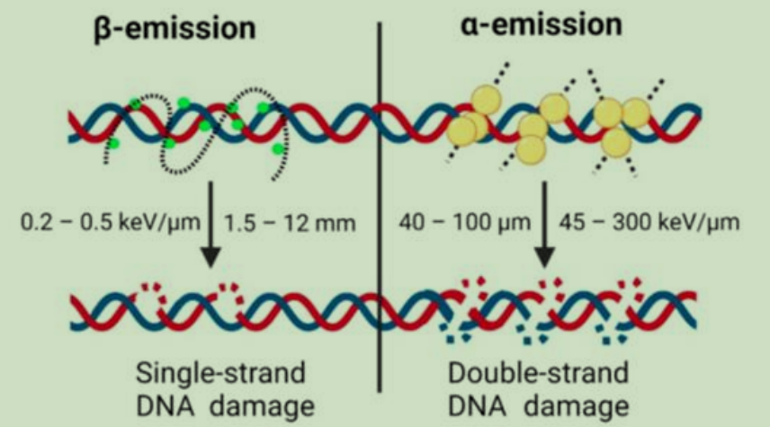
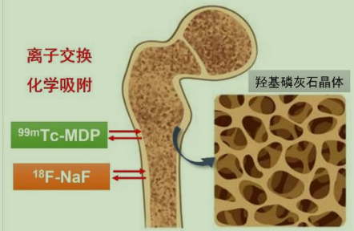
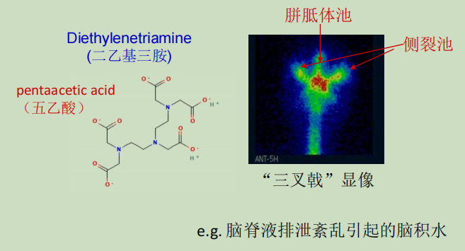
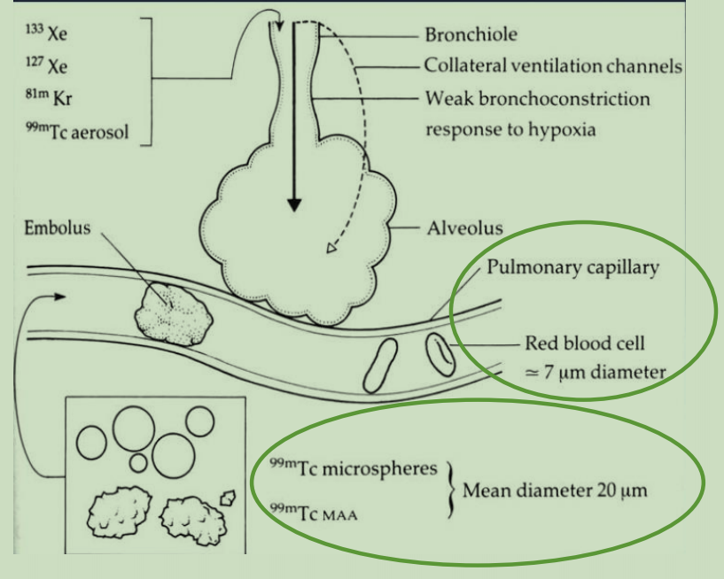
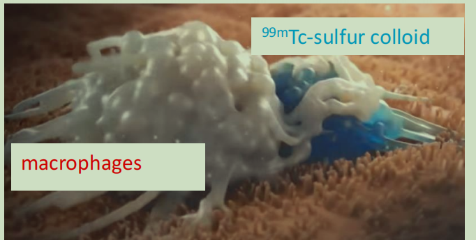

---
tags:
  - nuclear-medicine
---
### 概论
#### 三要素
核素、前体分子、标记技术
#### 正电子显像与单光子显像
#### 放射性药物治疗原理
DNA、RNA 断裂/降解
羟基自由基
细胞周期紊乱/阻滞
- **外照射（敷贴）**：β射线。用锶-90/磷-32。治血管瘤，顽固性疤痕、疣。
- **内照射（植入）**：放射籽源（碘-125）、微球。直接植入病灶。
#### 诊疗一体化
<mark style="background-color: #1A4F10; color: white">同一个多肽</mark>（如DOTATATE），换上 68Ga 就能做PET显像（找肿瘤），换上 177Lu 就能做放射性核素治疗（杀肿瘤）。
##### 诊断用放射性核素

|核素|半衰期|
|---|---|
|Ga-68|68 min|
|Zr-89|3.3 d|
|Cu-64|12.7 h|
|I-124|4.2 d|
##### 治疗用放射性核素

| 核素               | 半衰期   | 衰变类型及主要能量          |
| ---------------- | ----- | ------------------ |
| 177Lu | 6.6 d | 134 keV, 100% (β-) |
| Cu-67            | 2.6 d | 141 keV, 100% (β-) |
| 131I  | 8.0 d | 182 keV, 100% (β-) |
[Open: Pasted image 20261106102452.png](attachments/b65128d34748659ec1c86bc75b16c0e2_MD5.jpg)

###### 医用放射性治疗β核素

| 核素                                                                               | 半衰期    | 射线类型   | 能量/最大射程                | 核心考点与临床应用 #AI                                             |
| -------------------------------------------------------------------------------- | ------ | ------ | ---------------------- | --------------------------------------------------------- |
| <mark style="background-color: #1A4F10; color: white">131I</mark>     | 8.0 d  | β⁻ / γ | 606 keV / 2.3 mm       | **经典诊疗一体化**。γ用于显像（甲癌转移灶等），β用于治疗（甲亢、甲癌）。射程短，适合微小病灶。        |
| 89Sr（锶）                                                               | 50.5 d | 纯 β⁻   | 1.49 MeV / 7.0 mm      | **骨转移瘤止痛**。纯β射线，无γ射线，不能体外显像。半衰期较长。                        |
| 153Sm（钐）                                                              | 46.3 h | β⁻ / γ | 810 keV / 9 mm         | **骨转移瘤止痛**。带有γ射线，**不仅能治疗还能同时显像**。半衰期比Sr短。                 |
| 90Y（钇）                                                                | 64.1 h | 纯 β⁻   | 2.28 MeV / **11.3 mm** | **长射程、高能量**代表。常用于**肝癌微球介入治疗**或大体积实体瘤（利用交叉火力杀伤）。           |
| <mark style="background-color: #1A4F10; color: white">177Lu（镥）</mark> | 6.7 d  | β⁻ / γ | 497 keV / 1.8 mm       | **热门诊疗一体化**（常连DOTATATE或PSMA）。**射程极短**，对正常组织损伤极小，适合受体靶向治疗。 |
| 32P（磷）                                                                | 14.3 d | 纯 β⁻   | 1.71 MeV / 8.2 mm      | 老牌纯β核素，半衰期长。用于血液病（如真性红细胞增多症）或骨转移。                         |
###### 医用放射性治疗α核素
特点为多次衰变。

| alpha核素             | 半衰期     | 射线类型            | 能量/组织射程            |
| ------------------- | ------- | --------------- | ------------------ |
| 225Ac（锕） | 10.0d   | α               | 6.83 MeV/50~90 μm  |
| 227Th（钍） | 18.7d   | α               | 6.14 MeV/50~70 μm  |
| 212Pb（铅） | 10.64h  | β（衰变后α）         | 6.14 MeV/20~60 μm  |
| 149Tb（铽） | 4.1h    | α/β+ | 3.97 MeV/25~30 μm  |
| 211At（砹） | 7.2h    | α/EC            | 5.87 MeV/55~80 μm  |
| 213Bi（铋） | 45.6min | α/β             | 5.87 MeV/40~100 μm |
### 质量控制
#### 物理鉴定
- **放射性核素纯度** _Radionuclide purity_
    特定放射性核素的活度占到总活度的百分数，放射性药物中如果混入放射性核素杂质，会增加受检者的辐射危害，同时也会影响显像的质量。
- [放射性活度](放射性活度.md)
- **放射性浓度**  
    取 1 mL 标记物，测定其放射性活度，即为其放射性浓度，单位为 _Bq/mL_。
#### 化学鉴定
- **稳定性**  
    稳定性对于放射性药物具有十分重要的意义，脱标可能会影响诊断结果的准确性，治疗的疗效。
    - **体外稳定性测试**：包括磷酸盐缓冲液（PBS）稳定性测试和血清稳定性测试。将目标药物和相应环境混合后，在 37℃ 孵育 1 ~ 2 个半衰期，通过色谱法检测标记物稳定性。
    - **体内稳定性测试**：直接注射到模型动物，一定时间后取得动物标本，通过色谱法测定放射性含量。
- **放射化学纯度** _Radio-chemical purity_ ⭐️
    特定的化学形式中存在的放射性活度占到总放射性活度的百分比。放射性化学杂质可以从制备过程和药物自身分解中产生。由于放射性化学杂质可能影响人体内放射性药物的分布，并有潜在的危险风险，因此应当进行控制，一般要求 < 5 ~ 10%。
- **放射性<mark style="background-color: #1A4F10; color: white">比</mark>活度** _Specific activity_  
    单位质量的某种放射性物质的放射性活度，单位是 _Bq/g_ 或者 _Bq/mol_。
- **化学纯度** _Chemical purity_  
    以特定形式存在的某物质质量占到总质量的比例，同放射性无关。一般是生产过程和药物分解带入的，可能会导致毒副反应。
### [[放射免疫分析]] RIA 的基本原理及其方法学
放射免疫分析是一切体外分析法的鼻祖！
#### 核医学体外分析
以放射性核素或其他非放射性物质标记的配体为<mark style="background-color: #1A4F10; color: white">示踪剂</mark>，以配体和结合体的特异性结合反应为基础，以放射性、荧光、酶显色等测定数据为<mark style="background-color: #1A4F10; color: white">定量依据</mark>，在体外实验条件下，对微量生物活性物质进行定量检测的一类技术的总称。
### 成药机制
| 放射性药物成药机制 | 临床应用       | 代表性药物                                               | 备注                                                                                                                                                                      |
| --------- | ---------- | --------------------------------------------------- | ----------------------------------------------------------------------------------------------------------------------------------------------------------------------- |
| 离子交换与化学吸附 | 骨显像        | 99mTc-MDP,   18F-NaF       | [Open: Pasted image 20261106091153.png](attachments/561ee1965bb51f9b06f9a6f1719572a0_MD5.jpg)               |
| 细胞代谢显像    | 葡萄糖，氨基酸，脂肪 | 18F-FDG                                  | 肿瘤糖酵解与Warburg Effect                                                                                                                                                    |
| 被动扩散      | 脑池显像       | 99mTc-DTPA                               | 腰椎穿刺注入脑脊液池 [Open: Pasted image 20261106091625.png](attachments/57be8214f9d172a53e7ad3514201df2c_MD5.jpg) |
| 循环通路成像    | 肺灌注显像      | 99mTc-MAA                                | [Open: Pasted image 20261106092031.png](attachments/92591e2618a115b5a4416d4690c72be0_MD5.jpg)               |
| 选择性排泄     | 肝胆显像       | 99mTc-ECD,   99mTc-EHIDA   | 99mTc-EHIDA = 锝-依替菲宁，可结合血浆白蛋白并进入肝脏。诊断新生儿胆道闭锁。                                                                                                                |
| 细胞吞噬      | 淋巴显像       | 99mTc-SbS                                | [Open: Pasted image 20261106092201.png](attachments/91fbaf0f0f25ca7527e3393df3dedb8c_MD5.jpg)               |
| 选择性聚集     | 受体显像，免疫显像  | 68Ga-DOTATATE,   99mTc-PYP | 受体结合显像/免疫（抗原抗体结合）显像                                                                                                                                                     |
#### 离子交换与化学吸附（Chemisorption）
该机制常用于骨显像，代表性药物包括<mark style="background-color: #705A16; color: white"> 99mTc-MDP 和 18F-NaF</mark>。
#### 细胞代谢显像（Metabolic Imaging）
主要反映体内葡萄糖、氨基酸、脂肪的代谢情况，代表性药物为<mark style="background-color: #705A16; color: white"> 18F-FDG</mark>。
- **肿瘤糖酵解与 Warburg Effect**：肿瘤细胞即使在有氧环境下也倾向于通过糖酵解获取能量，导致对葡萄糖的极度渴求。
- **大脑**：大脑唯一可以利用的能源是葡萄糖，所以 FDG 显像时大脑会自然显影且很亮。
- **心脏**：此外心脏也会亮，因血流丰沛，且心肌代谢需要消耗大量能量。
#### 被动扩散显像（Passive Diffusion）
此机制多用于脑池显像，代表性药物是<mark style="background-color: #705A16; color: white"> 99mTc-DTPA</mark>。
#### 循环通路成像（Circulatory Pathway Imaging）
常用于肺灌注显像，代表性药物为<mark style="background-color: #705A16; color: white"> 99mTc-MAA</mark>。
- MAA 颗粒（20~60 微米）大于肺部毛细血管直径（7~20 微米），因此静脉注射后会暂时嵌顿（栓塞）在肺毛细血管床中，从而实现肺循环成像。
- 通过桡静脉注射。
- 注射的颗粒数量极少，仅占肺部毛细血管总数的 0.1%，不会引起明显的血流动力学改变或肺功能受损。
- 颗粒在肺部停留时间短，大约 2~4 小时后可完全排出体外。
#### 选择性排泄（Selective Excretion）
主要应用于肝胆显像，代表性药物包括<mark style="background-color: #705A16; color: white"> 99mTc-ECD 和 99mTc-EHIDA</mark>。
#### 细胞吞噬（Phagocytosis）
此机制用于淋巴显像，代表性药物是<mark style="background-color: #705A16; color: white"> 99mTc-SbS</mark>。
#### 选择性聚集（Selective Localization）
常用于受体显像和免疫显像，代表性药物有<mark style="background-color: #705A16; color: white"> 68Ga-DOTATATE 和 99mTc-PYP</mark>。
### 常用放射性药物
99m</sip>TcO4-：可被胃肠黏膜、唾液腺、甲状腺摄取和分泌，用于梅克尔憩室显像、唾液腺显像、甲状腺显像。
99m</sip>Tc-MDP：离子交换，亲骨，用于骨关节显像。
99m</sip>Tc-MIBI：（甲状旁腺、听肿瘤、循环系统心肌灌注显像）易进入线粒体，高代谢部位浓聚。
99m</sip>Tc-MAA：肺显像。
99m</sip>Tc-DTPA：不被摄取，用于肾、尿路显像（只滤过，GFR测定），大血管显像，脑脊液显像。
99m</sip>Tc-EHIDA
131I（e.g. 131I-间位碘代苄胍MIBG）：γ+β射线，甲状腺显像，甲状腺功能测定；甲亢治疗，甲状腺癌治疗。
123I：仅γ射线，甲状腺显像，甲状腺功能测定。
18F-FDG：PET，肿瘤显像。脑代谢显像。

| 药物                                                                                 | 应用                                                                                              | 原理                                                                                                                                                                                                                                                                                                                                                                                                  | 成药机制   |
| ---------------------------------------------------------------------------------- | ----------------------------------------------------------------------------------------------- | --------------------------------------------------------------------------------------------------------------------------------------------------------------------------------------------------------------------------------------------------------------------------------------------------------------------------------------------------------------------------------------------------- | ------ |
| 99mTcO4-                                          | <mark style="background-color: #705A16; color: white">甲状腺</mark>显像                              | 99mTcO4- 经过肘静脉弹丸注射，同时启动 γ 相机，或者 SPECT 动态采集，2秒/帧，采集 16 帧. 观察随着动脉血流经甲状腺的流量及流速以及甲状腺的摄取情况，判断甲状腺及其病灶部位血流灌注及功能状态.                                                                                                                                                                                                                                                        | 选择性聚集  |
|                                                                                    | 甲状旁腺显像                                                                                          | 99mTcO4- <mark style="background-color: #1A4F10; color: white">不被甲状旁腺摄取</mark>，配合 99mTc-MIBI 或 201Tl 进行减影显像.                                                                                                                                                                                                                                 | 无      |
|                                                                                    | 消化道出血显像                                                                                         | 正常情况下血管内的显像剂不会溢出血管来到肠管内；如果出血，那么显像剂就随着消化道管壁走行变化，以此确认出血点.                                                                                                                                                                                                                                                                                                                                             | 循环通路成像 |
|                                                                                    | 唾液腺显像                                                                                           | 唾液腺的小叶间导管上皮细胞可以将血液中的 99mTcO4- 主动摄取到细胞内，后面逐渐分泌到管腔内并由此进入口腔.                                                                                                                                                                                                                                                                                                          | 选择性聚集  |
| 99mTc-RBC                                                               | 心血池显像、肝血池显像                                                                                     | 能够暂时停留在血管中的显像剂，一定时间达到平衡后，在目标脏器出现放射性浓聚                                                                                                                                                                                                                                                                                                                                                               | 循环通路成像 |
|                                                                                    | 消化道出血显像                                                                                         |                                                                                                                                                                                                                                                                                                                                                                                                     | 循环通路成像 |
| 99mTc-MDP（**亚甲基二膦酸盐**）                                                  | 骨显像                                                                                             | 不易被磷酸酶水解，体内稳定，血液清除快，骨组织摄取迅速（静注后 2 ~ 3h，> 50% 沉积在骨），经过肾排出（膀胱显影）. 由于靶/非靶组织比值较高，为理想的显像剂，常用.                                                                                                                                                                                                                                                                                                            | 化学吸附   |
| 99mTc-MIBI * 掌握 | 心肌灌注显像                                                                                          | 脂溶性，正一价化合物，首次通过心肌摄取率 66%，通过被动弥散进入<mark style="background-color: #1A4F10; color: white">心肌线粒体</mark>，并牢固结合到膜，从而滞留在细胞内超过 5 小时                                                                                                                                                                                                                                                                         | 被动扩散   |
|                                                                                    | 甲状旁腺显像                                                                                          | <mark style="background-color: #1A4F10; color: white">功能亢进、增生的甲状旁腺</mark> 99mTc-MIBI 摄取好，但是正常的甲状旁腺摄取极低. 此外，由于 99mTc-MIBI 从甲状腺组织和亢进甲状旁腺组织（更快）的洗脱速度不同，可以通过双时相法将<mark style="background-color: #1A4F10; color: white">早期、延迟</mark>影像进行比较，获得亢进的甲状旁腺影像. 或者配合 99mTcO4- 进行减影显像. | 选择性聚集  |
| 99mTc-MAA（**巨聚白蛋白**）                                                    | 肺显像                                                                                             | 可以均匀地暂时<mark style="background-color: #1A4F10; color: white">栓塞</mark>在肺毛细血管床内，局部栓塞的颗粒数与该处血流灌注量成正比，由于栓塞的毛细血管仅占毛细血管总数的几十万分之一，不会引起心肺血液动力学和肺功能的改变. 通常<mark style="background-color: #1A4F10; color: white">于注射后立即显像</mark>，正常人双肺影像清晰，放射性分布基本均匀，受重力影响肺尖部血流量低，放射性相对稀疏.                                                                                                                                   | 循环通路成像 |
| 99mTc-DTPA                                                              | 肾动态显像、肾图                                                                                        | 仅从肾小球滤过，或由肾小管上皮细胞分泌而<mark style="background-color: #1A4F10; color: white">不被重吸收</mark>的放射性示踪剂，立即启动专用的肾图仪连续记录示踪剂到达双肾、被肾浓聚以及排出的全过程                                                                                                                                                                                                                                                                    | 选择性排泄  |
|                                                                                    | 脑池显像                                                                                            |                                                                                                                                                                                                                                                                                                                                                                                                     | 被动扩散   |
| 99mTc-EHIDA                                                             | 放射性核素肝胆动态显像                                                                                     | 肝摄取率好，<mark style="background-color: #1A4F10; color: white">肝内排泄</mark>速度快，胆管内系统显影清晰，并受到血清胆红素的影响较小.                                                                                                                                                                                                                                                                                                 | 选择性排泄  |
| 131I                                                                    | <mark style="background-color: #705A16; color: white">甲状腺功能</mark>体内测定、甲状腺摄取碘试验、甲状腺显像、甲状腺癌转移灶寻找 | 甲状腺滤泡细胞具有 NIS，可以大量摄取 131I                                                                                                                                                                                                                                                                                                                                                                | 选择性聚集  |
|                                                                                    | 甲状腺癌治疗、甲亢治疗                                                                                     | 利用 131I 的放射性，损害浓聚局部组织.                                                                                                                                                                                                                                                                                                                  | 选择性聚集  |
|                                                                                    | 肾上腺显像                                                                                           | 131I-MIBG 是去甲肾上腺素的类似物，可以被肾上腺髓质的嗜铬细胞摄取                                                                                                                                                                                                                                                                                                                                                    | 选择性聚集  |
|                                                                                    | 肾动态显像、肾图                                                                                        | 131I-OIH 由肾小管上皮细胞分泌而不被重吸收的放射性示踪剂，立即启动专用的肾图仪连续记录示踪剂到达双肾、被肾浓聚以及排出的全过程                                                                                                                                                                                                                                                                                                                      | 选择性排泄  |
| 18F-FDG                                                                 | 心肌代谢显像、肿瘤代谢显像、脑代谢显像                                                                             | 葡萄糖代谢显像剂，其被代谢为6-P-18F-FDG，而后不能继续代谢，同时由于其带有负电荷，不能自由通过细胞膜，于是在细胞内滞留，其集中程度反映了组织的葡萄糖代谢活性.                                                                                                                                                                                                                                                                                                     | 细胞代谢显像 |
