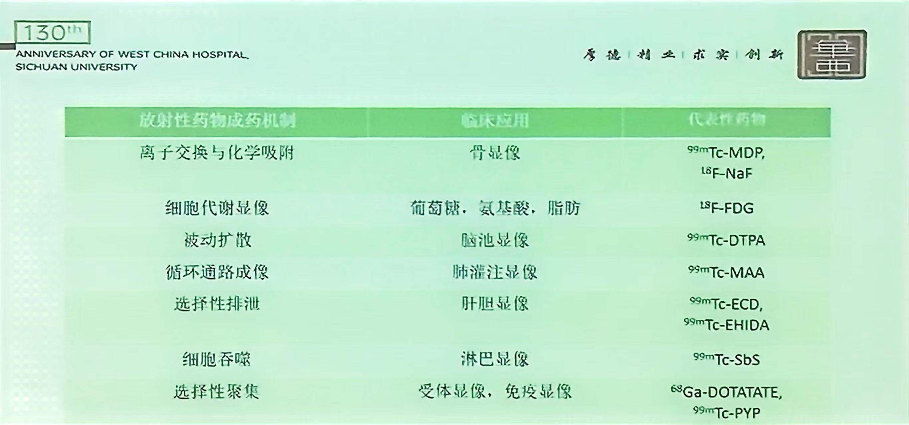

---
tags:
  - nuclear-medicine
---
99m</sip>TcO4-：可被胃肠黏膜、唾液腺、甲状腺摄取和分泌，用于梅克尔憩室显像、唾液腺显像、甲状腺显像。
99m</sip>Tc-MDP：离子交换，亲骨，用于骨关节显像。
99m</sip>Tc-MIBI：（甲状旁腺、听肿瘤、循环系统心肌灌注显像）易进入线粒体，高代谢部位浓聚。
99m</sip>Tc-MAA：
99m</sip>Tc-DTPA：不被摄取，用于肾、尿路显像（只滤过，GFR测定），大血管显像，脑脊液显像。
99m</sip>Tc-EHIDA
131I（e.g. 131I-间位碘代苄胍MIBG）：γ+β射线，甲状腺显像，甲状腺功能测定；甲亢治疗，甲状腺癌治疗。
123I：仅γ射线，甲状腺显像，甲状腺功能测定。
18F-FDG：PET，肿瘤显像。脑代谢显像。
### [[放射免疫分析]] RIA 的基本原理及其方法学

### 成药机制
[Open: a157816939f97973978df73bc8e3b61e.jpg](attachments/255e9aa806fd34c04c00f22625cf6d1f_MD5.jpg)

#### 离子交换与化学吸附

#### 细胞代谢显像
肿瘤糖酵解与Warbug Effect
大脑唯一可以利用的能源是葡萄糖，所以FDG显像时大脑会很亮
此外心脏会亮，因血流丰沛
#### 被动扩散显像
