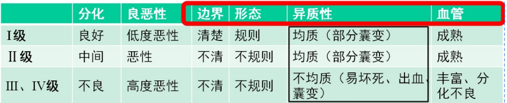
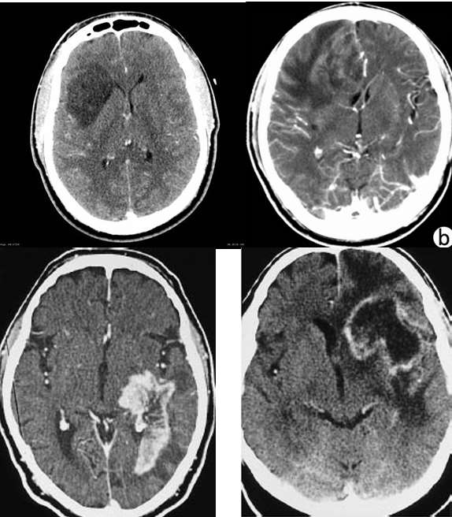
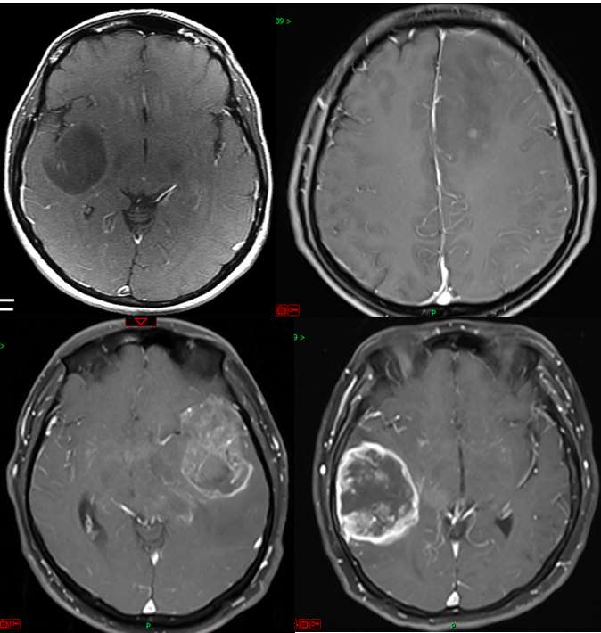

---
tags:
  - pathology
aliases:
  - 星形细胞肿瘤
---
<mark style="background-color: #8B0000; color: white">最常见</mark>的胶质细胞肿瘤，CNS最常见原发瘤（最常见脑内原发肿瘤）
#### 流行病学
男性多于女性
#### 病理特点
起源：<mark style="background-color: #1A4F10; color: white">神经上皮组织</mark>
肿瘤细胞明显浸润脑组织并伴有胶质纤维酸性蛋白 GFAP+（特异性标志）
脑内肿瘤（轴内），浸润性生长
好发于大脑半球（以<mark style="background-color: #705A16; color: white">额叶和颞叶</mark>受累多见），儿童多见于小脑
边界不清，灰白色
##### 分型
毛细胞型（分化良好、界限清，常伴囊性变） 
室管膜下巨细胞型 
间变型（<mark style="background-color: #1A4F10; color: white">多形性</mark> 异型性明显）
##### 分级
Ⅰ~Ⅳ级
- 毛细胞星形
- 弥漫性星形
- 渐变型星形
- 多形性胶质母细胞瘤
[Open: Pasted image 20261013111235.png](attachments/9c36c435686298eb7f616c65fdf7d721_MD5.jpg)

##### 多形性[[胶质母细胞瘤]]

#### 影像学表现
##### CT
1️⃣ 病变位于<mark style="background-color: #1A4F10; color: white">白质</mark>。
2️⃣ I级肿瘤通常呈低密度灶，分界清楚，占位效应轻，无或轻度强化。
3️⃣ Ⅱ～Ⅳ级肿瘤多呈高、低或混杂密度的囊性肿块，可有斑点状钙化和瘤内出血，肿块形态不规则，边界不清，占位效应和瘤周水肿明显
[Open: Pasted image 20261013203425.png](attachments/8863f3b60353c49b3f3f12bcfef42ef5_MD5.jpg)

##### CT增强
Ⅱ级肿瘤多数不强化或轻度强化；
Ⅲ、Ⅳ级肿瘤多数强化明显。（少数也可表现为无明显强化）
##### MRI
[Open: Pasted image 20261013203459.png](attachments/6fe76807a56ba8efcd1d0dfa820fec6d_MD5.jpg)

###### 平扫
T1W1呈稍低或混杂信号
T2W1呈均匀或不均匀高信号
###### 增强
与CT类似
###### DWI
恶性度越高，ADC值越低。DTI可显示白质纤维是否破坏。
###### MRS
磁共振波谱成像，Magnetic Resonance Spectroscopy，是一种无创探测活体组织代谢物化学组成的技术。
<mark style="background-color: #1A4F10; color: white">NAA</mark>（N-乙酰天冬氨酸，主要存在于成熟神经元及其轴突中）下降，
<mark style="background-color: #1A4F10; color: white">Cho</mark>（是细胞膜磷脂代谢的重要成分，代表细胞膜的更新换代速度）增高，
二者比值可反应恶性程度。
###### PWI
CBV（脑血容量）、CBF（脑血流量）增高，与肿瘤恶性程度有关

| 影像要素   | I级（低级别） | II级（低级别） | III~IV级（高级别）                                                                      | 演变规律总结                |
| ------ | ------- | -------- | --------------------------------------------------------------------------------- | --------------------- |
| **位置** | 白质      | 白质       | 白质                                                                                | 均好发于白质（胶质细胞分布区）       |
| **数目** | 单发      | 单发       | 单发/多发                                                                             | 高级别易多发或颅内播散           |
| **分布** | 白质      | 白质       | 白质                                                                                | 无明显差异                 |
| **大小** | 大小不等    | 大小不等     | <mark style="background-color: #1A4F10; color: white">多较大</mark>                  | 高级别生长迅速，体积通常更大        |
| **形态** | 较规则     | 不规则      | 不规则                                                                               | 恶性度越高，形态越怪异、呈蟹足状      |
| **边界** | 清楚      | 不清       | 不清                                                                                | 高级别呈浸润性生长，与正常脑组织分界不清  |
| **密度** | 低密度     | 高、低或混杂   | 混杂（可有<mark style="background-color: #1A4F10; color: white">钙化</mark>、[出血](出血.md)） | 高级别内部易缺血坏死、出血、钙化，异质性高 |
| **增强** | 无/轻     | 无/轻      | <mark style="background-color: #1A4F10; color: white">明显</mark>                   | 高级别破坏血脑屏障（BBB），造影剂易渗漏 |
| **周边** | 无/轻     | 轻        | <mark style="background-color: #1A4F10; color: white">明显</mark>                   | 高级别伴随明显的血管源性水肿和占位效应   |
#### 鉴别诊断
##### （一）低级别星形细胞瘤的鉴别
###### 1.低级别星形细胞瘤
- **表现**：T2WI/FLAIR高信号，无明显强化或轻度强化，PWI呈低灌注。
- **机制**：肿瘤生长缓慢，<mark style="background-color: #1A4F10; color: white">血脑屏障相对完整</mark>，无显著新生血管生成。
###### 2.脑梗死
- **表现**：低密度与血管供应区一致，皮髓质同时受累；亚急性期出现<mark style="background-color: #1A4F10; color: white">脑回状强化</mark>；DWI呈高信号。
- **机制**：血管闭塞导致细胞毒性水肿（水分子进入细胞内，DWI受限）；亚急性期血脑屏障破坏，对比剂沿皮层血管漏出。
###### 3.蛛网膜囊肿
- **表现**：位于脑实质外，CT值更低（接近脑脊液），无强化。
- **机制**：先天性脑外病变，内含纯脑脊液，无血供。
###### 4. 胆脂瘤（表皮样囊肿）
- **表现**：CT可为负值（脂肪密度），MRI呈短T1长T2信号，DWI呈高信号。
- **机制**：含角质蛋白及胆固醇（脂肪成分）；内部碎屑黏稠，限制水分子扩散（DWI高信号）。
###### 5. 脑炎
- **表现**：起病急，变化快；常累及颞叶、边缘系统或皮层/皮层下，T2/FLAIR高信号，可有<mark style="background-color: #1A4F10; color: white">脑回状强化</mark>。
- **机制**：病原体感染导致急性炎症、充血及水肿，嗜神经病毒具有特定区域亲和性。
##### （二）高级别或环形强化星形细胞瘤的鉴别
###### 1. 高级别星形细胞瘤
- **表现**：环形强化，壁厚薄不均伴壁结节，瘤周水肿广泛，PWI高灌注。
- **机制**：肿瘤生长迅速，中心缺血坏死（不强化）；周边血脑屏障严重破坏（环形强化）；大量新生血管生成（PWI高灌注）。
###### 2. 脑脓肿
- **表现**：壁较光滑，<mark style="background-color: #1A4F10; color: white">厚薄均匀</mark>，一般无壁结节，DWI脓腔呈高信号。
- **机制**：脓液黏稠，限制水分子扩散（DWI高信号）；包膜形成均匀，故壁光滑。
###### 3. 转移瘤
- **表现**：壁较厚且不均匀，内缘凹凸不平，瘤周水肿广泛；常多发于皮髓质交界区。
- **机制**：血行播散，生长迅速且不均，中心易坏死；压迫周围静脉导致广泛水肿。
##### （三）少数高密度、<mark style="background-color: #1A4F10; color: white">均一强化</mark>肿瘤的鉴别
根据<mark style="background-color: #3F4B5E; color: white">病史及骨质改变</mark>等鉴别。
###### 1. 脑膜瘤
- **表现**：脑外宽基底，均一强化，可见“脑膜尾征”，邻近骨质增生硬化。
- **机制**：脑外良性肿瘤，血供丰富且均匀；刺激邻近骨膜导致骨质增生。
###### 2. 转移瘤
- **表现**：结合<mark style="background-color: #3F4B5E; color: white">原发肿瘤病史及骨质改变</mark>进行鉴别。