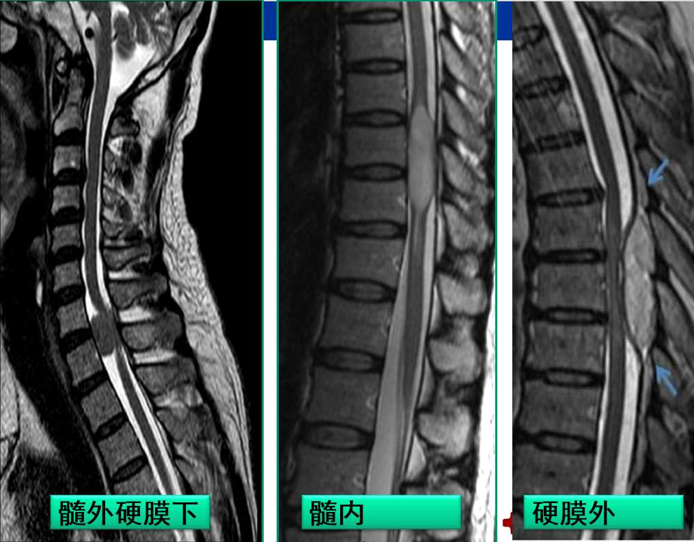
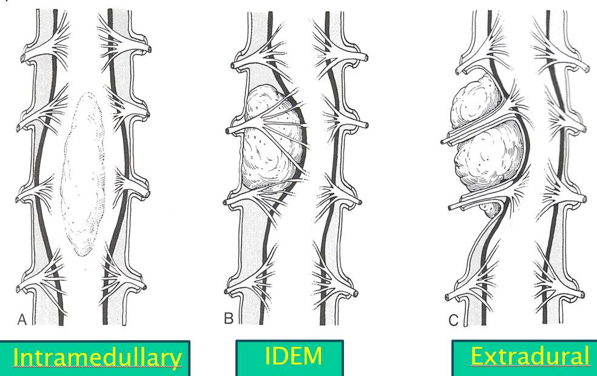

---
tags:
  - Neurology
---
椎管内占位性病变首选<mark style="background-color: #1A4F10; color: white">MRI</mark>（MRM：MR脊髓成像），能只管显示椎管内肿瘤及其周围组织的关系，是诊断椎管内肿瘤的可靠法。
[Open: Pasted image 20261014093342.png](attachments/b545b8bc0cb4bd3c9a5dad4d9371e1f9_MD5.jpg)

[Open: Pasted image 20261014093404.png](attachments/931097b1329eabac3247b53edaab1d7f_MD5.jpg)

| 分类                        | 来源                                 | 影像学表现                                                                                 |
| ------------------------- | ---------------------------------- | ------------------------------------------------------------------------------------- |
| **髓内肿瘤**                  | [室管膜瘤](室管膜肿瘤.md)和[星形细胞瘤](星形细胞瘤.md) | 脊髓增粗，蛛网膜下腔<mark style="background-color: #1A4F10; color: white">对称性变窄</mark>、闭塞       |
| **髓外硬膜内肿瘤**   (蛛网膜下腔内) | [神经源性肿瘤](神经系统肿瘤.md)和脊膜瘤            | <mark style="background-color: #1A4F10; color: white">患侧蛛网膜下腔增宽</mark>，对侧变窄，脊髓受压向对侧移位 |
| **硬膜外肿瘤**                 | 转移瘤                                | <mark style="background-color: #1A4F10; color: white">蛛网膜下腔变窄</mark>，脊髓受压移位           |
