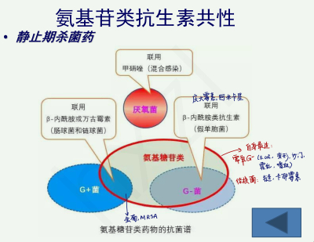
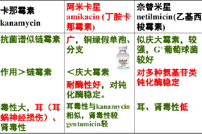
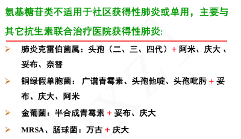

---
tags:
  - pharmacology
---
### 氨基苷类抗生素 +多粘菌素、多肽类（均对  G-  作用强）
### 氨基糖和氨基环醇以苷键相连接形成的 碱性 抗生素，在碱性环境中作用更强
### 包括
链霉素类：  [[链霉素]]（streptomycin）  卡那霉素（Kanamycin）  妥布霉素（Tobramycin）  大观霉素（Spectinomycin）新霉素（neomycin）
庆大霉素类：  [[庆大霉素]]（gentamicin）  阿司米星（astromicin）
半合成类药物：  [[阿米卡星]]（amikacin）   奈替米星（netilmicin） 
### 一． <u>氨基苷类抗生素的共性</u>
### <u>1. 抗菌力&抗菌特点：</u>  <u>静止期（Quiescent）杀菌</u>  <u>，</u>  <u>蛋白质合成全程抑制剂</u> 
##### 药代动力学 / 体内过程
浓度依赖性， PAE很长 ， 首次接触后效应（FEE）明显 
##### 在 <u>碱性环境</u>  中作用更强
 水溶性很强（分布于细胞外液，不过BBB），脂溶性差（口服难以吸收，可肠道消毒） 
##### 谱效
##### 高效、广谱 （除了链霉素）  ，但毒性更高
仅对需氧菌有效，且抗菌活性显著强于其他药物， 对厌氧菌无效 ；
##### 毒
 内耳淋巴液、肾皮质中药物浓度高 ，耳毒性、肾毒性， 原形排泄不伤肝 
##### 原形经肾脏滤出，而青霉素是肾脏主动分泌排出（link丙磺舒）
### <u>2. 抗菌谱：</u>  <u>广谱，尤其G-杆；只作用于需氧菌</u> 

1.尤适用于 需氧G— 的严重感染：铜绿假单胞菌、不动杆菌、大肠埃希菌、肠杆菌、变形杆菌、沙门氏菌、霍乱弧菌
##### 2.卡那、丁胺卡那、链霉素对 结核分歧杆菌 有效
3.对 G+球菌 ：葡萄球菌强，（even MRSA），链球菌效果不佳
##### 4. 对 G-球菌作用差： 肠球菌,  厌氧菌无效 
5. 大部分对 铜绿假单胞菌 有效（ [[链霉素]]、 卡那霉素、大观霉素 无效） 
6.  联合治疗： 常与  β-内酰胺类 治疗肠球菌、链球菌等G+ 、铜绿假单胞菌等G- ；与 [[甲硝唑]] 联合治疗 厌氧菌 
### <u>3. 作用机制</u>
##### 全过程  抑制蛋白质合成  ： 30S小亚基
##### 起始阶段：抑制70S复合体的形成
##### 延长：mRNA误读
##### 终止：阻止70S解离，肽链不能脱落
##### 裂解细菌  细胞膜  ：  对宿主也有一定毒性 
##### 竞争性置换脂多糖分子上的阳离子，结合膜上带负电磷酸基团
增加膜的通透性，重要物质外漏——快速杀灭革兰氏阴性菌
##### 刺激菌体产生致死量的  羟自由基 
##### *氨基糖苷类抗生素可在 β-内酰胺酶之后使用（同时使用会相互反应）*
<mark style="background-color:#fef3c7;"> 为什么对厌氧菌无效，为什么碱性条件下杀菌作用更强？ </mark>
氨基糖苷类进入细菌是在  需氧条件  下的主动转运过程 ， 可被 金属阳离子 、 低pH 、厌氧环境阻断
对厌氧菌无效（能量不足）；碱性环境高活性；
与β-内酰胺酶和万古霉素配合（这些打破细胞壁，氨基糖苷随后进入），但 ※不宜在同一注射器内给药 （ 酸碱中和 可破坏氨基糖苷）
### <u>4. 耐药机制</u>
产生  钝化酶（modifying enzyme） 
产生灭活酶：<mark style="background-color:#fef3c7;"> “绿林大安倍（β）”，背！ </mark>
##### 包括乙酰化酶（AC）腺苷化酶（AD）磷酸化酶（P）
#####  改变细胞膜通透性（主动外排 / 减少摄取） 
##### 绿脓杆菌对链霉素耐药
#####  靶位修饰  ：  30S亚基  结构改变
##### 结核杆菌对链霉素耐药
### <u>5. 药代动力学/体内过程</u>
吸收： 口服不吸收  ，除了算作肠道感染时的局部作用。一般肌内注射 （毒性，不主张静脉注射）
分布：细胞外液。集聚 于  肾皮质、耳蜗、前庭  ，产生肾毒性和耳毒性； 可透过胎盘屏障，但不能透过血脑屏障。 
##### 代谢&排泄：在体内 不被肝代谢 ，以原形从 肾脏 排泄
### <u>6.临床应用</u>
#####  需氧G-  菌的全身感染（脓毒症）
##### 联合用药（主要联用β内酰胺）
##### 联合攻G-杆：[[庆大霉素]]+头孢三代
##### 联合攻G+球：[[庆大霉素]]+[[青霉素]]/头孢一代
##### 联合攻需氧+厌氧：[[甲硝唑]]
结核分歧杆菌和非典型分歧杆菌感染  ：结核~~[[链霉素]] （  *卡那、丁胺卡那*  ）；  非典型~~[[阿米卡星]] 
### <u>7.不良反应——</u> <mark style="background-color:#fef3c7;"> <u>耳毒肾毒肌肉阻，过敏仅次青霉素</u> </mark> <u>(对第八对脑神经、肾、肌肉神经接头的影响及过敏反应)</u>
#### ① 耳毒性（Ototoxicity）：包括耳蜗毒性和前庭毒性 ，引起 不可逆  性耳聋、眩晕、恶心、呕吐、眼球震颤
机制：在 内耳外淋巴液蓄积 ，损害内耳Corti器内、外毛细胞的能量产生及利用，引起细胞膜的 Na+-K+-ATPase功能障碍 ，造成毛细胞损伤
前庭毒性：眩晕呕吐。新霉素＞卡那霉素＞[[链霉素]]＞[[庆大霉素]]＞妥布霉素
> 新、卡那永远排前二，然后是链霉素、[[阿米卡星]]
耳蜗毒性：耳鸣耳聋。新霉素＞卡那霉素＞[[阿米卡星]]＞[[庆大霉素]]＞妥布霉素＞[[链霉素]]
###### <mark style="background-color:#fef3c7;"> 避免合用耳毒性药物 </mark>
######  一代头孢、万古霉素、多黏菌素 
> 记：一代头孢耳肾毒，万古、多粘菌素和它在同章
 呋塞米等高效利尿药；甘露醇等脱水药 
 镇吐药 ；H1受体阻断剂  （可能掩盖其耳毒性） 
###### [[红霉素]]/大环内酯也有部分
#### ② 肾毒性（Nephrotoxicity）： <mark style="background-color:#fef3c7;">药源性肾衰竭</mark>最常见因素。在肾皮质聚集，破坏肾皮质近曲小管引起肾小管肿胀， <u>对肾小球影响不大。</u>
###### 严重程度：新霉素＞卡那霉素＞[[庆大霉素]]＞妥布霉素＞[[阿米卡星]]＞[[链霉素]]
> 新、卡那永远排前二，然后是庆大霉素
###### <mark style="background-color:#fef3c7;"> 避免合用肾毒性药物 </mark>
######  一代头孢、万古霉素、多黏菌素（25%）、两性霉素B 
#### ③ 神经肌肉麻痹（Neuromuscular Blockade）：重症肌无力、心肌抑制、血压下降、呼吸衰竭
与突触前膜Ca2+结合位点结合，阻滞Ca2+引起的乙酰胆碱释放
######  抢救 ：葡萄糖酸 钙 、 [[新斯的明]] 
#### ④ 过敏反应（Allergic Reactions）： [皮疹](皮疹.md)、血管神经性水肿、偶见过敏性休克（ [[链霉素]]  ，仅次于青霉素，需皮试）
###### 抢救 ： 肾上腺素 、葡萄糖酸钙
### 二．各氨基苷类抗生素的特点
###  <u>1. [[链霉素]]（Streptomycin）</u> 
#### 药代动力学
共性的东西，水溶性强，硫酸盐，口服不吸收，不易透过血脑屏障（只在患脑膜炎时可进入脑脊液）；内耳淋巴液蓄积
#### 抗菌活性：  窄 谱，主要针对 G-需氧杆菌  ，  结核分枝杆菌 。 *对铜绿、G-球菌、厌氧几乎没用*
#### 临床应用（鼠兔布鲁，主要结核）
联用 四环素（Tetracycline）， <mark style="background-color:#fef3c7;"> 首选于 </mark>： <u>鼠疫（plague）、兔热病（tularemia）、布鲁氏病 （Brucella）</u> 
######  结核二线  用药与其他[抗结核药](抗结核药.md)联用
联用 [[青霉素]]（penicillin）  ：  感染性心内膜炎 （可首选链or庆大）
#### 不良反应
######  变态反应： 过敏性休克、口周麻木
 耳毒性： 前庭反应出现早、可逆，耳蜗反应出现晚、不可逆
###### 肾毒性比其它少
###  <u>2. [[庆大霉素]]（Gentamicin）</u> 
#### 药代动力学：硫酸盐，口服不吸收；与链霉素类似； 可在肾脏大量积聚 
#### 抗菌活性：  广 谱抗生素： G+ 、 G- 、 铜绿 、 葡萄球菌（包括金葡） 
#### 临床应用：治疗<mark style="background-color:#fef3c7;"> 各种G-感染 </mark>的主要抗菌药，也是<mark style="background-color:#fef3c7;"> 氨基糖苷类抗生素的首选药 </mark>
###### 肺炎、脑膜炎、骨髓炎、心内膜炎、败血症等
 青庆合用 ：联用 [[青霉素]]（penicillin） 和 头孢菌素（cephalosporin）  ：感染性心内膜炎；葡萄球菌；肠球菌；铜绿。
联用时避免混合使用，因为青霉素酸性，氨基糖苷溶液碱性
局部应用皮肤黏膜表面、肠道感染、肠道手术准备，对铜绿、MRSA均有效
#### 不良反应
###### 肾毒性排氨基苷类的第三
耳毒性以前庭损害为主；
###### 偶见过敏反应、神经肌接头阻滞作用、二重感染等
###  <u>3.[[阿米卡星]]（amikacin，丁胺卡那霉素）</u>  ： <mark style="background-color:#fef3c7;"> 抗菌谱最广、专治耐药、对钝化酶稳定 </mark>，用于<mark style="background-color:#fef3c7;"> 耐药 </mark>的G— & 铜绿假单胞菌感染。耳毒性很大。
### 4.其它氨基苷类抗生素

卡那霉素：抗菌谱似 <u>[[链霉素]]</u> ，作用>[[链霉素]]。毒性大， 耳(耳蜗神经损伤)、 肾毒性
妥布霉素（tobramycin）：广谱，与庆大霉素类似。对<mark style="background-color:#fef3c7;"> 铜绿假单胞菌 </mark>抗菌活性强于庆大霉素，毒性小于庆大霉素。
奈替米星（netilmicin）：广谱，与庆大霉素类似。<mark style="background-color:#fef3c7;"> 毒性最低 </mark>的氨基糖苷类，有一定的稳定性，对G- & MRSA & 铜绿假单胞菌耐药有效
西索米星sisomicin：与庆大霉素类似，抗绿脓杆菌作用较强，但毒性也大
新霉素（neomycin）： <mark style="background-color:#fef3c7;"> 毒性最大 </mark>，只用于局部外用（胃肠手术）
大观霉素（Spectinomycin）：<mark style="background-color:#fef3c7;"> 窄谱 </mark>，适用于<mark style="background-color:#fef3c7;"> 淋球菌 </mark>和革兰氏阴性杆菌
##### 选择题
#####  兔热病、鼠疫首选：[[链霉素]] 
##### 过敏性休克：[[链霉素]]
##### 抗结核：[[链霉素]]、[[阿米卡星]]，没有庆大霉素
#####  一般G-杆菌感染  首选  ：[[庆大霉素]] 
#####  一般氨基糖苷类  耐药  株的感染首选：[[阿米卡星]] 
#####  目前抗菌谱最广的氨基糖苷类：[[阿米卡星]] 
#####  目前毒性较小的氨基糖苷类：奈替米星 
#####  毒性最大的氨基糖苷类：新霉素 
#####  对淋球菌敏感的氨基糖苷类：大观霉素 
### [[氨基糖苷类]]  不适用于社区获得性肺炎  或  单用，  主要  与其它抗生素联合治疗  医院获得性肺炎

##### 肺炎克雷伯菌属：[[头孢]](二、三、四代) + 阿米、庆大、妥布、奈替
铜绿假单胞菌：广谱青霉素、头孢他啶、头孢吡肟 + 妥布、庆大、阿米
##### 金葡菌：半合成青霉素 + 妥布、庆大
##### MRSA、肠球菌：万古 + 庆大
### 氨基苷类抗生素注意事项
1. 该类药物过敏者禁用；
2. 该类药物 均有耳、肾毒性和神经肌肉阻滞作用； 
3.  社区获得性 上、下呼吸道感染不宜选用； 不宜联用 
4. 新生儿、婴幼儿、老年患者应尽量避免使用，若有明确指征，应进行血药浓度监测；
5. 妊娠期应避免使用；哺乳期应避免使用或停止哺乳；
#####  6. 不与其他耳、肾毒性药物同用 
#####  肾毒性 
######  一代头孢类药物、万古霉素、多黏菌素、两性霉素 
#####  耳毒性 
######  一代头孢类药物、万古霉素、多黏菌素 
 呋塞米等高效利尿药；甘露醇等脱水药 
 镇吐药 ；H1受体阻断剂  （可能掩盖其耳毒性） 
###### [[红霉素]]/大环内酯也有部分
7. 庆大霉素耐药株近年增多。
### 多黏菌素（Polymyxins） 
### 小结+习题
#### 思考题
##### 1. 简述氨基糖苷类抗生素的主要不良反应及防治措施
##### 2. 试述氨基糖苷类抗生素与β-内酰胺类合用使抗菌作用增强的药理基础
##### 3. 试述氨基苷类抗生素肾毒性和耳毒性与其体内过程的关系
氨基糖苷类抗生素的耳毒性和肾毒性与其在内耳淋巴液和肾皮质药物蓄积有关。
##### 4. 试述氨基苷类抗生素的共同特点
随堂习题: 丹毒-革兰阳性（G+球）；甲氧、苯唑-耐酶；交叉过敏-避免使用 
1. 25岁肺部感染,处方:头孢哌酮钠舒巴坦钠3+ 复方甘草口服液：复方甘草口服液与头孢哌酮舒巴坦钠有药物相互作用。 复方甘草口服液含有乙醇，  与头孢哌酮钠舒巴坦钠合用会引起双硫仑样反应。
2. In the treatment of <mark style="background-color:#fef3c7;">bacterial meningitis in children</mark>, the drug of choice is
a. Penicillin G
b.Penicillin V
c.Erythromycin红霉素
d. Procaine penicillin
<mark style="background-color:#fef3c7;">e.Ceftriaxone头孢曲松</mark>
3. Clavulanic acid is important because it
a. Easily penetrates Gram-negative microorganisms
b.ls specific for Gram-positive microorganisms
c. ls a potent inhibitor of cell-wall transpeptidase
<mark style="background-color:#fef3c7;">d. Inactivates bacterial β-lactamases</mark>
e. Has a spectrum of activity similar to that of penicillin G
4. In the treatment of infections caused by P, aeruginosa, the antimicrobial agent that has provedto be effective is
a. Penicillin G
<mark style="background-color:#fef3c7;">b. Piperacillin</mark>
c. Nafcilin a
d.Erythromycin
e. Tetracycline
5. 男性，70岁，有脚癣史，近日突发高烧、恶寒、头痛、口渴、烦躁等，右下肢皮肤出现片状鲜红斑，手指按压后红色很快恢复，边缘清楚并稍有隆起。诊断为下肢急性丹毒，治疗应首选
<mark style="background-color:#fef3c7;">A.[[青霉素G]]</mark>
B.苯唑西林
C.[[氨苄西林]]
D.[[阿莫西林]]
E.羧苄西林
6.男性，87岁，在重症监护室诊断为呼吸机相关肺炎、痰培养为铜绿假单胞菌，应选择较为敏感的抗生素为
A.头孢唑林
<mark style="background-color:#fef3c7;">B.头孢他啶</mark>
C.[[阿莫西林]]
D.头孢孟多
E.[[氨苄西林]]
7.女性，50岁，患耐青霉素G的金葡菌性心内膜炎，青霉素试敏阴性，既往有慢性肾盂肾炎，治疗该患者应选用
A.[[青霉素G]]
B.头孢氨苄
<mark style="background-color:#fef3c7;">C.苯唑西林</mark>
D.[[庆大霉素]]
E.头孢唑林
8. A 30-year-old type l diabetic with renal complications develops acute pyelonephritis. P.aeruginosa is found in urine cultures and biood cultures.Combined therapy is instituted with an aminoglycoside and which of the following?
a. Clavulanic acid
b. Vancomycin
C.A second-generation cephalosporin
<mark style="background-color:#fef3c7;">d. Azithromycin</mark>
e. Piperacillin
9. A 35-year-old male is diagnosed with primary syphilis, Which of the following agents isthe prefer choice for treating this patient?
a. A first-generation cephalosporin
b.Oxacillin
c. lmipenen
d. Benzathine penicillin G
<mark style="background-color:#fef3c7;">e. Vancomycin</mark>
10. A 60-year-old male with a temperature of 104°F and a productivecough is diagnosed as having staphylococcal pneumonia. After severaldays on nafcillin, he develops truncal urticaria and pruritis. Which of the following agents is best avoided in this patient?
<mark style="background-color:#fef3c7;">a. Cefazolin</mark>
b.Clarithromycin
c. Sparfloxacin
d. Clindamycin
e. Tetracycline
11. A 20-year-old male has a urethral discharge. Culture of the discharge showsNeisseria gonorrhoeae. Which of the following agents is the best choice fortreating this patient?
<mark style="background-color:#fef3c7;">a.Ceftriaxone</mark>
b. Benzathine penicillin G
c. Cefazolin
d.Amikacin
e.Sulfamethoxazole-trimethoprim
#### 小结
##### 1.氨基糖苷类抗生素的共性
##### 2.氨基糖苷类抗菌谱
##### 3.氨基糖苷类抗菌机理：抑制蛋白质的合成
##### 4.氨基糖苷类主要不良反应：耳、肾毒性、肌毒、过敏等
#####  5.肌毒性的抢救措施：[[新斯的明]] + 钙剂 
#####  6.过敏性休克的抢救措施：肾上腺素 +葡萄糖酸钙 
##### 7.兔热病、鼠疫首选：[[链霉素]]
##### 8.一般G-杆菌感染首选：[[庆大霉素]]
##### 9.一般氨基糖苷类耐药株的感染首选：[[阿米卡星]]
##### 10.目前抗菌谱最广的氨基糖苷类：[[阿米卡星]]
##### 11.目前毒性较小的氨基糖苷类：奈替米星
##### 12.毒性最大的氨基糖苷类：新霉素
##### 13.对淋球菌敏感的氨基糖苷类：大观霉素
