---
tags:
  - pharmacology
---
### 治疗充血性心力衰竭的药物（3 ）
### 一、 <u>基本病理生理学</u> 及治疗药物分类
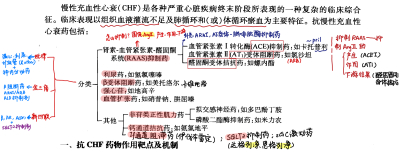
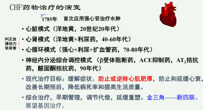
### 慢性心力衰竭（chronic heart failure）：各种严重心脏病的终末阶段，以 组织 血液灌流不足及 体/肺循环  淤血为主要特征。①是一种 超负荷 心肌病：心肌收缩/舒张功能下降，CO不能满足机体需要；②是心功能异常状态下的病理生理反应。
### <mark style="background-color:#fef3c7;"> 临床表现：动脉缺血，静脉淤血，心脏充血 </mark>
> 本质：心肌功能下降CO不能满足机体需要
### <u>（一）心肌</u> <u>功能</u> <u>和</u> <u>结构</u> <u>变化</u>
#### 心肌功能变化  （起点） 
收缩功能障碍 / HFrEF：心肌收缩力减弱，射血异常 （LVEF下降）。对正性肌力药物反应  良好 
> Heart failure with reduced ejection fraction
舒张功能障碍 / HFpEF：心室 充盈异常 ，舒张受限&不协调，心室顺应性降低，输出量减少、但 射血分数可能正常 ，对于正性肌力药物反应  较差  。
> Heart failure with preserved ejection fraction
#### 心肌结构变化
> ——在压力负荷、缺氧下，细胞由内到外，由个体到集体
长期心衰→心肌细胞钙超载→心肌细胞肥大、凋亡、细胞外基质堆积（胶原量增加）→胶原网破坏、心肌组织纤维化→心室重构、肥厚
①心肌细胞——凋亡/坏死；
②细胞外基质ECM——纤维化；
##### ③心肌肥厚与心室重构（对压力负荷、缺氧的适应性反应）
#####  *注：复习可以照着PPT p8来画画图* 
##### here
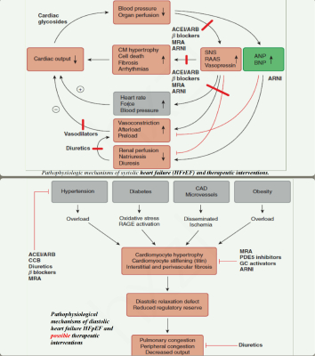
### <u>（二）CHF时的神经内分泌变化：</u>  <u>早期—长期—物质机制</u> 
#### <u>交感神经系统的激活</u>
1. 心输出量下降，反馈性激活交感神经系统，早期代偿
2. 长期激活，心肌后负荷、耗氧量增加，促进心肌肥厚、心律失常
3. 血NE浓度↑ 诱发钙超载→心肌坏死；血管收缩→加重负荷、CHF
> link:交感的多方面心血管效应
#### <u>RAAS激活</u>
1.肾血流量急剧减少，反馈性激活RAAS，早期代偿
##### 2. 长期加重：<mark style="background-color:#fef3c7;"> 围绕Ang II </mark>
> 反面物质：缓激肽（被抑制）
血管：直接收缩血管，增加心脏负荷 ，引发心血管重构；  氧自由基↑，  血管内皮损伤  ↑
 促交感  ，多NE：结合交感神末梢突触前膜AT1受体，促进NE释放，正反馈恶性循环
[[醛固酮]] （水钠容量）：促肾上腺皮质释放 [[醛固酮]]，水钠潴留，排钾 
促生长，致肥厚 ：促 生长因子 、ECM合成，引起心肌肥厚
> 根本上通过AT1受体作用，更根本上通过Ca2+作用。 Ang II→AT1→IP3-DAG→Ca2+→PKC激活→原癌基因激活
#### <u>精氨酸加压素（AVP）、内皮素（ET）、利尿钠肽（NP）增多；NO、</u>  <u>CGRP减少</u> 
AVP & ET：经PLC-IP3-DAG通路→增加细胞内Ca2+→强烈缩血管、正性肌力
NP：好人，拮抗上述所有，排钠利尿，包括ANP、BNP、CNP。
 BNP（脑利尿钠肽）作用最强，是心衰的血浆标记物。 
###### 心肌细胞分泌产生
BNP的升高程度与心室扩张和w压力超负荷成正比 ，以100pg/ml作为分界线判断心衰
### <u>（三）CHF时心肌肾上腺素 β 受体信号转导的变化</u>
主要目的： 下调β1受体 ，或者不让β1受体引起兴奋。β1受体是GPCR，磷酸化后与G蛋白脱耦联。
##### β1受体下调、与兴奋性Gs脱耦联、GPCR激酶（GRK）活性增加
### <u>（四）治疗药物分类；金三角、新四联——从疾病本质（神经-内分泌）调节入手</u>
 记：CHF药——“强心、利尿、扩血管（其它）”  + “  神经内分泌抑制（RAAS、β受体阻断）  药”
金三角：RAAS抑制药 （ARNI/ARB+醛固酮抑制剂）+ β 受体阻断剂
> β受体阻断药、醛固酮受体阻断药、ARNI（血管紧张素受体-脑啡肽酶抑制药）或ACEI或ARB（血管紧张素受体阻断药）
> “金三角”必须与神经内分泌抑制药有关，方可“治本”。
新四联：金三角+ SGLT-2抑制药 （钠-葡萄糖协同转运蛋白2抑制剂）/ sGC刺激剂 （维立西呱）
### 二、强心苷类 （Cardiac Glycosides）
> 洋地黄毒苷（Digitoxin），长效。 <u>[[地高辛]]（Digoxin），中效。</u> 、去乙酰毛花苷（Deslanoside） 、毒毛花苷K（Strophanthin K）
强心苷防治——高血钙，缺氧，低血镁，低血钾  “搞gay，少养美甲”(高钙，少氧镁钾) 
强心苷均来源于 植物 ；包括：洋地黄毒苷（Digitoxin）、 <u>[[地高辛]]（Digoxin）</u> 、去乙酰毛花苷（Deslanoside）、毒毛花苷G（哇巴因） 、毒毛花苷K（Strophanthin K）。
### <u>[[地高辛]]（Digoxin）</u>
### 机制：  部分  抑制Na+ -K+ -ATP酶 （20%-40%）
核心药理机制：细胞内K+减少而Na+增多，并通过Na+-Ca2+交换机制使Ca2+增多
①对心肌：  升高细胞内Ca2+  ，增加Ca2+内流， CICR又使肌浆网释放Ca2+
②对颈动脉窦感受器 ： 减少细胞内K+，  解除超极化，增加窦弓反射敏感性
不良反应：抑制能力过强（60-80%）时，引起心肌细胞内  钙超载 ； 低K+引起心律失常 
##### 继发效应机制
降低耗氧量——CHF背景下，收缩力增加、室壁张力&心室容积降低、负性频率
负性频率——①CO增加反馈引起 迷走神经（+）、交感神经（-） ，②对颈动脉窦感受器 ： 减少细胞内K+，  解除超极化，增加窦弓反射敏感性 ，③增加心肌对迷走神经调节的敏感性
### <u>药理作用</u>
#####  对心脏高度选择性 
#### （1）心肌——正性肌力，负性频率，降低耗氧（Positive Inotropic, Negative chronotropic, reduce oxygen demands）
> <u>作用机制）；对神经-激素（交感、迷走神经系统）的作用；对心脏电生理特性（自律性、传导速度及有效不应期）的影响，心电图改变特点</u> ，对肾脏的作用。
##### 强心苷对心脏有高度选择性，“有力而敏捷”
##### ①加快心肌纤维缩短速度，但 减少耗氧量  （舒张期相对延长） 
②加强 衰竭 心肌收缩力、 在CHF患者  增加心排血量 、不变外周阻力；而在正常人 ，增加外周阻力 ，不变心排出量。
正常人：交感正常的背景下——强心苷对CO无明显作用，反而明显继发激活交感、收缩血管
CHF：交感已在代偿的背景下——负反馈抑制交感、兴奋迷走，从而外周阻力不增加
#### 正性肌力
机制： 部分  抑制Na+ -K+ -ATP酶 （20%-40%）
核心药理机制：细胞内K+减少而Na+增多，并通过Na+-Ca2+交换机制使Ca2+增多
#### 负性频率
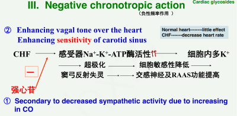
负性频率——①CO增加反馈引起 迷走神经（+）、交感神经（-） ，②对颈动脉窦感受器 ： 减少细胞内K+，  解除超极化，增加窦弓反射敏感性 ，③增加心肌对迷走神经调节的敏感性
###### 意义
①心动周期↑，舒张期↑，心室充盈好，增加CO、SV；
②冠脉供血↑（coronary perfusion)；
###### ③心肌获得充分休息，降低CHF心脏耗氧量（但增加正常心脏耗氧量）
##### 降低心肌耗氧
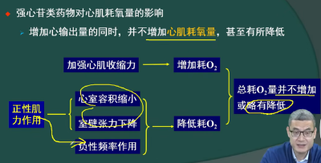
###### 多重因素影响心肌耗氧
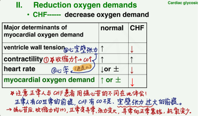
正常人与CHF患者因收缩力（心排血量）的背景差异，导致强心苷增加心收缩力后室壁张力变化不同， 再加上负性频率作用 ，最终心肌耗氧量变化朝向2个不同方向。
#### （2）心电：主要考虑 <mark style="background-color:#fef3c7;"> 自律 </mark> 组织 & <mark style="background-color:#fef3c7;"> 传导 </mark> 组织
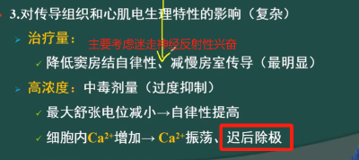
##### <mark style="background-color:#fef3c7;"> 洋地黄化： </mark> T波低平、倒置，ST段鱼钩状 
##### 各部位具体变化
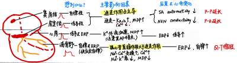
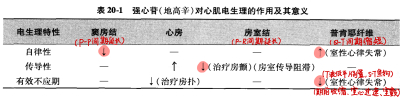
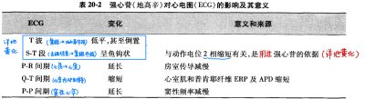
###### 机制
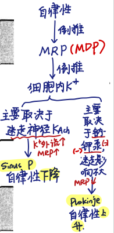

####  （3）神经内分泌（※重要作用） 
##### 抑制交感，抑制RAAS
##### 促进迷走，促进ANP
#####  *注意中毒量反而兴奋交感* 
#### （4）肾脏：利尿利钠
##### 利尿：正性肌力后肾血流量增加
##### 利钠：减少对Na+重吸收，抑制肾小管Na+-K+-ATP酶
#### （5）血管作用
##### 直接缩血管，但直接间接抑制交感
对CHF患者，直接间接抑制交感＞直接缩血管效应，降低外周阻力
##### 对正常人，增加加外周阻力、升高血压
### 临床应用
####  （1）各种收缩功能障碍型CHF  ，尤适用于 房颤或心室率快  的CHF
> 联想：正性肌力，负性频率
> 联想2: 舒张功能障碍的CHF对正性肌力药物作用不敏感
不是高血压、冠心、先心CHF首选：先用ACEI beta利尿剂
 欠佳：能量代谢功能障碍的CHF。贫血甲亢VB缺乏 
无效：扩张型心肌病（用Carvedilol），心肌肥厚等舒张型功能障碍
##### 对心肌外机械因素的CHF不好：二尖瓣狭窄缩窄性心包炎
#### （2）房颤：兴奋迷走神经、 抑制房室结传导，让多余冲动隐匿于房室结中，不下传至心室 
> 但并不能终止房颤
#### （3）房扑：  不均一地缩短心房不应期，让房扑转为房颤，再抑制房颤 
#### （4）阵发性室上性心动过速：增强迷走神经活性（但因为心肌毒性，现不常用）
### <u>不良反应</u>
####  ※安全范围小。推导毒性： 
过度抑制心肌钠钾泵—钠钙交换—钙超载—心脏毒性
过度反射性激活迷走神经—心动过缓
浓度过高，超越其对心脏的选择性，对不同部位钠钾ATP酶的广泛抑制：胃肠道、中枢
#### （1)心脏毒性 （最严重、最危险，各种心律失常）
机制：中毒量过度抑制钠钾泵，为了排出过多的胞内Na+，钠钙交换反向激活，心肌细胞内聚集了平台期入胞的Ca2+，和钠钙交换进入的Ca2+，钙超载——迟后除极——最常引起【室性期前收缩、二联律】。
#####  - 快速型心律失常 
###### 室性早搏、二联律（1/3），室性心动过速甚至室颤
#####  窦性心动过缓 （＜60次/分）、 房室传导阻滞 
抑制窦房结，降低其自律性。与提高迷走神经兴奋性、高度抑制Na+-K+-ATP酶有关。窦缓是停药指征之一
#### （2）胃肠道反应：厌食呕吐
> 恶性反馈，加重强心苷中毒的低钾血症
#### （3）中枢神经系统反应 ：眩晕、头痛、视觉障碍（黄视、绿视、复视等，停药指征之一）
#### 中毒先兆：  色视障碍、室性期前收缩、窦性过缓 
#### 中毒防治
##### 防
###### 严格掌握适应证，注意用量个体化
###### 注意诱发因素，防止 低血钾、低血镁 
##### 治
###### 出现 中毒先兆 
###### 停药
###### 快速型心律失常：静脉滴注氯化钾、[[苯妥英钠]]
 补钾 ——快速型心律失常，与强心苷竞争Na+-K+-ATP酶，减少强心苷与酶的结合；
[[苯妥英钠]]：与强心苷竞争结合Na+-K+-ATP酶，恢复酶活性；
> 苯妥英钠第三次出现：①抗癫痫；②抗心律失常；③解救强心苷中毒
###### 利多卡因 ：室性心动过速或室颤
######  心动过缓、传导阻滞：  阿托品， (不宜补钾)
###### 极严重中毒：地高辛抗体Fab片段
#### <u>药物相互作用</u>
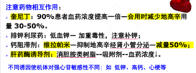
#### 给药方法  <u>：维持量法</u> 
> 联想：强心苷急性升高【浓度】会中毒
经典给药方法：首剂加倍，但易导致强心苷中毒，仅用于急性发作
##### 维持给药方法： 每日给予小剂量维持量至稳定血药浓度
### 三、RAAS抑制药：CHF基础，伴缺血、伴肾高
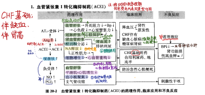
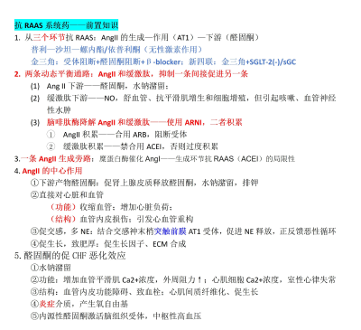
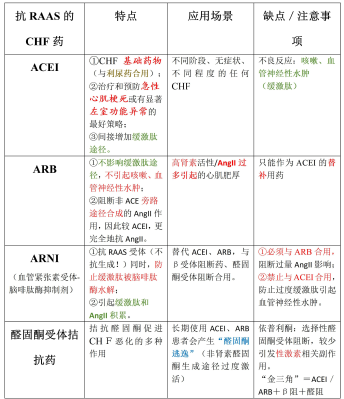
### （一）血管紧张素I转化酶抑制药  ACEI  <mark style="background-color:#fef3c7;"> “普利”</mark>
> 卡托普利captopril、依那普利enalapril 、培哚普利、雷米普利、福辛普利
#### <u>1. 药理作用（治疗CHF的机制）：</u>
 ①抑制ACE活性（AngI→AngII），考虑  AngII  和  缓激肽  两个抗衡通路 
减少[[醛固酮]]释放→减轻水钠潴留
减少 缓激肽 降解→缓激肽产生NO，舒血管、抗平滑肌增生和细胞增殖
> 这就是为什么ARB不是金三角成员，ARB无法获得缓激肽增加的优点。
##### ②降低醛固酮水平
##### ③血流动力学：后负荷降低
降低外周阻力，降低心脏前后负荷，扩张冠脉、 扩张血管、保护心肌 ，缓解急性心梗；增加肾血流量和尿量
#####  ④抑制和逆转心肌肥厚与血管重构 
减轻AngII、ALD的致肥厚作用（AT1→IP3-DAG-Ca2+→PKC→原癌基因）
减少缓激肽降解→NO、PGI2↑—→逆转心肌肥厚
5⃣️降低交感神经系统活性：对应AngII的促交感作用；上调β受体
> AngII结合交感前膜AT1受体，促进NE释放，加重心肌负荷和损伤
#### <u>2.临床应用：各阶段，尤其左室、收缩功能不全</u>
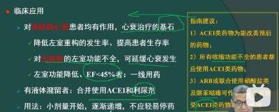
#### 3. ACEI的不足
①不良反应： 对缓激肽的相对促进 →咳嗽、血管神经性水肿
##### ②对糜蛋白酶催化AngI生成AngII的途径无效
### （二）血管紧张素II受体（AT1）拮抗药  ARB  <mark style="background-color:#fef3c7;"> “沙坦”</mark>
> 氯沙坦（Losartan）、缬沙坦（Valsartan）及厄贝沙坦（Irbesartan）
#### 药理作用
##### 与ACEI类似
不影响 缓激肽 途径，不产生血管神经性水肿/咳嗽等副作用
#### 临床应用
高肾素活性/AngII过多引起的心肌肥厚
#### 疗效特点
作用于Ang II的受体，而不是AngII生成的途径，同理， *也就在缓激肽生成途径的下游层次* 
弥补 3. ACEI的不足：不良反应↓，其它AngII途径↓，心率无影响、无耐受
##### 只能作为替代方案
### （三）血管紧张素受体-脑啡肽酶抑制药ARNI
> 司库必曲、Valsartan
🔺CHF神经内分泌变化：①交感 ②RAAS激活 ③利尿钠肽激活（好）
脑啡肽：降解缓激肽和AngII——单独使用脑啡肽抑制药ARNI会导致AngII积累，必须与ARB合用；不得与ACEI合用，否则缓激肽过度积累。
### （四）醛固酮拮抗剂
> [[螺内酯]]（spironolactone）依普利酮（eplerenone）
 🔺醛固酮逃逸现象 ： ACEI/ARB治疗CHF患者时，患者血中醛固酮浓度升高
#### 1. 药理作用：拮抗醛固酮的一系列促CHF恶化效应
> 醛固酮具有促CHF恶化效应！
①醛固酮引起心肌间质纤维化、  促生长重构 作用刺激蛋白质合成
②醛固酮增加 <u>血管平滑肌</u>  细胞Ca2+离子浓度 ，外周阻力↑； <u>心肌细胞</u> 内Ca2+浓度，室性心律失常
③ 血管内皮功能障碍 —— 醛固酮致血栓 
> PAI-1与醛固酮浓度相平行
##### ④ 水钠潴留 
##### ⑤炎症介质，产生氧自由基
##### ⑥内源性醛固酮激活脑组织受体，中枢性高血压
#### 2. 临床应用
 CHF  金三角：RAAS抑制药（ARNI/ARB+醛固酮抑制剂）+ β 受体阻断剂 ；新四联：金三角+ SGLT-2抑制药 （钠-葡萄糖协同转运蛋白2抑制剂）/ sGC刺激剂 （维立西呱）
依普利酮选择性更高，可以避免螺内酯的 性激素相关副作用 
### 四、利尿药：容量管理，CHF伴水肿、淤血；不能单用（ACEI）
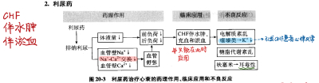
#### 药理作用：排Na+
> 联想thiazides：轻度扩血管+减少容量
 ① Na+-Ca2+交换， 降低血管壁Ca2+含量，降低血管张力（外周阻力）
##### ②水钠排泄，减少体液量、淤血水肿
#### 临床应用： <mark style="background-color:#fef3c7;"> 唯一最能充分控制CHF体液潴留的药物 </mark>
仅适用于有  容量超负荷迹象  （水肿）的CHF患者，无该征象时使用  反而激活RAAS加重CHF恶化  。
 必须与ACEI合用（抑制RAAS通路） ，单用利尿剂会反馈性刺激RAAS系统
##### 小剂量辅助给药，合用小剂量地高辛、ACEI和β受体阻断药
#### 不良反应
电解质紊乱（低钾血症，利尿药是CHF诱发心律失常的常见原因）；糖代谢紊乱脂代谢紊乱（噻嗪类利尿药）
### 五、其他治疗CHF药。
### （一） <u>β 受体阻断药：</u> <u>美托洛尔</u> <u>和</u>  <u>卡维地洛</u>  <u>——CHF伴扩张型心肌病</u>
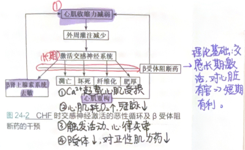
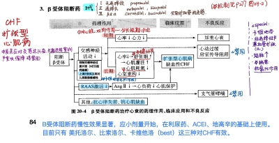
> 选择性β1-R阻断剂：美托洛尔、比索洛尔 (bisoprolol)；非选择性β兼α1-R阻断剂（扩血管）：卡维地洛（carvedilol）、拉贝洛尔(labetalol)
 只有3种  β 受体阻断剂能用于治疗CHF ：美托洛尔比索洛尔  卡维地洛（非选择性兼有血管扩张作用） 
#####  🔺β受体阻断剂治疗CHF机制：见上图，前置知识 

> 书P277图24-2
#### 1. 药理作用
（1）对心脏“矛盾”影响：短期抑制，长期降心率、延长舒张期、减少心肌耗氧量。
> 严重收缩障碍无法挺过短期抑制阶段，加重心衰，禁用
（2）抑制交感神经过度兴奋， 上调 β 受体 
①防止高浓度NE导致大量Ca2+内流；
② 上调心肌β受体数量： 美托洛尔与受体结合使其处于失活态，抑制受体磷酸化，恢复CHF患者β受体敏感性，使β受体密度上调。 卡维地洛不具有此作用 
##### （3） 抑制RAAS系统激活 
> 概念植入：RAAS与交感相互激活
##### （4）长期效应： 干预心肌重构，抗心律失常  抗心肌缺血
#### 2. 临床应用：适用于扩张型心肌病为基础的CHF
（1）注意事项：①  小剂量开始 用药；② 长期 用药，慢性效果显著；③联合用药：充分使用地高辛、利尿药、ACEI
##### （2）禁忌症：  支气管哮喘、 心动过缓、房性传导阻滞、低血压
#### *卡维地洛*
##### （1）选择性阻断β、α1作用
##### 阻断β：降低钙超载、心肌耗氧量
 阻断α1： 扩血管，增加冠脉供血，同时可能反射性兴奋交感神经，使其对静息心率影响小、不影响夜间褪黑素分泌
##### （2） 抗氧化作用  （其它β阻断剂不具有的特点） 
##### 极强的亲脂性，抑制脂质过氧化
##### （3）不具有上调 β 受体作用
### （二）钙拮抗药：只能选长效CCB氨氯地平；伴冠心病，高血压的心衰
> 氨氯地平（amlodipine）
> 警惕短期负性肌力作用过强，反射性激活神经内分泌系统
机制：扩张外周小动脉；扩张冠脉；缓解钙超载
 短效CCB 可使CHF 恶化， 如硝苯地平、[[维拉帕米]]、地尔硫䓬等（ 负性肌力、反射性激活神经内分泌系统 ），增加CHF患者的病死率， 不适于CHF治疗  ；
长效CCB如氨氯地平 ，作用出现缓慢、持久，负性肌力作用弱，治疗时不伴有反射性激活神经内分泌系统的作用，还可逆转心肌肥厚。氨氯地平还有抗动脉粥样硬化、抗TNF-α及IL等作用。
### （三） <u>非强心苷类正性肌力药：PDEI（本质上促进IP3-PKC增加钙内流，因此</u>  <u>短期</u>  <u>使用）；缺血性心衰</u>
> 米力农（Milrinone），维司力农
#### 磷酸二酯酶抑制剂（ Phosphodiesterase Inhibitor, PDEI ）
#####  正性肌力+扩血管 药物 ，不增加心肌耗氧量 
##### <mark style="background-color:#fef3c7;"> 米力农（Milrinone） </mark> 、维司力农
 抑制PDE  Ⅲ→ cAMP↑——促进 Ca2+通道磷酸化使Ca2+内流→正性肌力、扩血管→外周阻力↓→心输出量↑
用于心衰 短时间的支持疗法 ，尤其对强心苷、利尿药、扩血管药反应差者，提高运动耐力
##### <mark style="background-color:#fef3c7;"> 严重CHF短期静脉给药首选正性肌力药 </mark>
##### *β受体激动药（多巴酚丁胺（dobutamine））*
不作为常规治疗药应用。只用于强心苷治疗效果不佳或禁忌者，适用于伴有心率减慢或有传导阻滞者。
##### 多巴酚丁胺（dobutamine）
主要激动β1受体→心肌收缩力↑→心排出量↑
激动β2受体→扩血管→心脏后负荷↓
##### <mark style="background-color:#fef3c7;"> 短期应用 </mark>有良好的血液动力学效应
### （四）其他治疗CHF的血管舒张药：应用根据。常用药物（[[硝酸甘油]]、肼曲嗪、硝普钠、哌唑嗪）舒血管效应的特点及临床选用。
### 钙增敏剂（ Calcium Sensitizers ）
> 匹莫苯（Pimobendan）硫马唑（Sulmazole）
匹莫苯（ Pimobendan ）硫马唑（ Sulmazole ）
增加肌钙蛋白对Ca2+ 敏感性、 抑制PDE-III、激活K+通道
##### 增加收缩力但不增加能量消耗，但有舒张延缓和提高舒张期张力等副作用
### 扩血管药（Vasodilators）——对正性肌力药物，利尿药无效的顽固性心衰
主要用于 <mark style="background-color:#fef3c7;"> 对正性肌力药物，利尿药无效的顽固性心衰病人。 </mark>
据病情选药。久用易耐受，多数不降低病死率。
前负荷升高，肺淤血明显 ——扩张静脉的硝酸酯类
后负荷升高，外周阻力升高 ——扩张动脉的肼苯达嗪
前后负荷均升高 ——扩张a&v的硝普钠、哌唑嗪
### 复习思考题
> 感觉大题考点在于【强心苷】和【CHF病生、用药总览】。
1．治疗慢性心功能不全的药物有几类？主要代表药是什么？
2．试述强心苷中毒的原理、表现和防治。
3．强心苷治疗充血性心力衰竭的药理学基础。
##### CHF定义、基本病理生理学
##### 强心苷基本机制
##### 强心苷药理作用
4．试述强心苷治疗心房纤颤和心房扑动的药理依据。
##### 微观机制
##### 心肌作用：注意抑制交感和兴奋迷走
心电作用：聚焦房室结区抑制；房扑先转房颤
5. 简述强心苷正性肌力作用的机理。
（1）心肌——正性肌力，负性频率，降低耗氧（Positive Inotropic, Negative chronotropic, reduce oxygen demands）
机制： 部分  抑制Na+ -K+ -ATP酶 （20%-40%） ——作用与不良就在程度差异 
#### 6. 试述强心苷的药理作用
##### 药理作用
7.简述血管紧张素转化酶抑制药的药理作用。
##### 1. 药理作用（治疗CHF的机制）：
