---
tags:
  - pharmacology
---
### 消化系统（2）
> 记求不到
### 一．抗消化性溃疡药
### 分类及药理机制：抗酸药+抑酸药；胃粘膜屏障保护药；抗幽门螺杆菌药
##### 抗酸药（弱碱性药）
抑制胃酸分泌药——H₂受体阻断药；质子泵抑制药 (PPI) ；抗胆碱（M受体阻断）药；胃泌素受体阻断药
### 1．抗酸药<mark style="background-color: #3F4B5E; color: white">（弱碱性药）</mark>
#### （1）特点：①口服、中和、胃蛋白酶↓；②短时，合用；③部分具有胶体特性；④并非首选
口服；直接在胃内中和胃酸；升高胃pH—→降低胃蛋白酶活性：pH=4时胃蛋白酶失活；减轻胃蛋白对胃黏膜的侵袭作用
作用时间短，大多合用（复方制剂），增强疗效，减少不良反应。
###### 胃舒平（氢氧化铝、三硅酸镁、颠茄流浸膏）
###### 三硅酸镁复方制剂（氢氧化铝、三硅酸镁、海藻酸）
氢氧化铝、三硅酸镁可以覆盖于胃黏膜形成胶状保护层，防止胃酸再侵袭
抗酸药仅仅直接中和胃酸，并不能调节胃酸的分泌，甚至可造成反跳性胃酸分泌增加，因此非首选药物
#### （2）各药对比
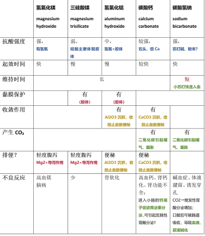
### 2. H2受体阻断药 <mark style="background-color: #3F4B5E; color: white">（~替丁tidine）</mark>
> [[西咪替丁]](Cimetidine)，[[雷尼替丁]](Ranitidine)，法莫替丁(famotidine)
#### 生理基础
<mark style="background-color: #705A16; color: white">肠嗜铬样细胞</mark>释放<mark style="background-color: #705A16; color: white">组胺—</mark>→激动壁细胞基底侧膜上的H2-R→H+-K+-ATPase活性↑，泌酸↑
#### 药理作用、临床应用、不良反应
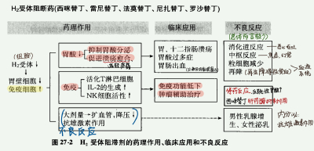
#### 注意
##### <mark style="background-color: #705A16; color: white">胃、十二指肠溃疡（首选药物）</mark>
##### 药理作用记得有个免疫（+）
不良反应较少，容易忘记：血液系统（粒细胞减少、再生障碍性贫血）；抗雄激素作用；停药反应
### 3．壁细胞H+泵抑制药（Proton Pump Inhibitor, PPI） <mark style="background-color: #3F4B5E; color: white">（~拉唑prazole）</mark>
> omeprazole ( *Prilosec* [[奥美拉唑]], 洛赛克)，rabeprazole ( *Aciphex* 雷贝拉唑 )，lansoprazole ( *Prevacid* 兰索拉唑 )，Pantoprazole ( *Protonix* 潘多拉唑 )， esomeprazole ( *Nexium* 埃索美拉唑）
#### 作用特点
H+-K+-ATPase是胃酸分泌的最后环节，故对各种因素引起的胃酸分泌均有抑制作用；
作用强大而持久；
<mark style="background-color: #705A16; color: white">兼具抗消化性溃疡的三方面功能：</mark>除了抑制胃酸，还使胃蛋白酶产生减少，对胃黏膜有保护作用；还可抑制幽门螺杆菌。
### 抗溃疡作用、机制、临床应用
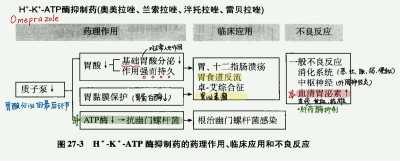
#### 注意
##### <mark style="background-color: #705A16; color: white">根治幽门螺旋杆菌感染</mark>
用于消化性溃疡，对<mark style="background-color: #3F4B5E; color: white">[[NSAIDs]]、乙醇、应激</mark>所致的胃黏膜损伤有预防保护作用
##### 不良反应易忘：<mark style="background-color: #1A4F10; color: white">血清胃泌素 ↑</mark>
> 动物实验提示上消化道肿瘤发生率增加。
##### PPI vs H2RA
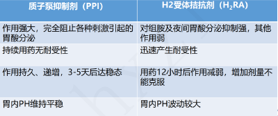
### 4． M受体阻断药：<mark style="background-color: #3F4B5E; color: white">哌仑西平</mark> 5． 胃泌素受体阻断药：<mark style="background-color: #3F4B5E; color: white">丙谷胺</mark>
> 哌仑西平（Pirenzepine） & 丙谷胺（Proglumide）
#### 作用特点
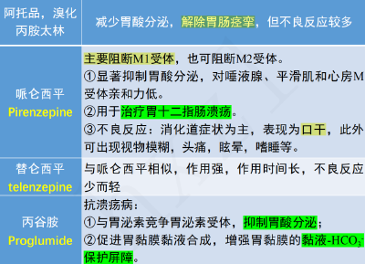
##### 哌仑西平
###### <mark style="background-color: #705A16; color: white">选择性M1受体阻断药</mark> ，弱M2阻断
显著抑制胃酸分泌，缓解症状，治疗胃、十二指肠溃疡；
不良反应以消化道症状为主，口干。还可能：视物模糊、头痛、眩晕、嗜睡等
##### *其它M阻断药：阿托品、溴化丙胺*
阻断胃壁细胞上的M受体，抑制胃酸分泌；
阻断胃黏膜嗜铬细胞上的M受体，减少组胺的释放；
阻断胃窦G细胞上的M受体，减少胃泌素的释放，间接减少胃酸的分泌。
###### 此外，M受体阻断药还有解痉作用
##### 丙谷胺
抑制胃酸分泌——竞争胃泌素受体
增强胃黏膜屏障——促进胃黏膜粘液合成
### 6．粘膜保护药：前列腺素衍生物、硫糖铝、 枸橼酸铋钾的作用及应用。
> 前列腺素类（Prosglands）：米索前列醇（misoprostol）、恩前列素（enprostil）；硫糖铝（Sucralfate）；枸橼酸铋钾（Bismuth potassium citrite）
#### 生理基础
> ①共有；②~④后两种（硫糖铝、枸橼酸铋钾）

① 类似前列腺素or促进前列腺素分泌：前列腺素PGE1、PGE2可以降低AC和cAMP，抑制胃酸、胃蛋白酶分泌，促进粘液、碳酸氢根分泌。预防NSAIDS引起的溃疡
##### ②具有黏附/沉淀的物化性质：形成保护屏障
##### ③具有吸附的物化性质：结合胃蛋白酶，使其↓
##### ④ 抗幽门螺旋杆菌
#### 应用
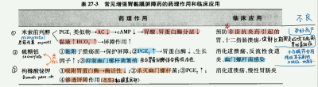
### 7．抗幽门螺旋杆菌药
#### 根除幽门螺旋杆菌：四联疗法（PPI、铋、抗生素组合）
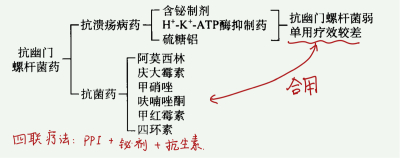
##### 含铋
###### 经典：PPI+铋剂+ 四环素+[[甲硝唑]]
###### 其它：PPI+铋剂+另外两种抗生素
##### 不含铋
###### 经典：PPI +克拉霉素+[[阿莫西林]]+[[甲硝唑]]
###### 其它：PPI+另外三种抗生素
### 二．消化功能调节药
### *促动力药（大纲无，ppt有）——针对GERD*
> 甲氧氯普胺（metoclopramide）、多潘立酮（domperidone）、西沙比利（Cisapride）
#### GERD：胃内容物反流导致，不是酸相关疾病，而是动力相关疾病
#### 作用原理
##### ①胆碱酯酶抑制：迷走神经促胃肠运动
##### ②多巴胺受体抑制：中枢止吐，胃肠促动
##### ③ENS肌间神经丛5-HT受体激动：5-HT4受体促胃肠运动
##### 原理示意图
#### 三大常见促动力药
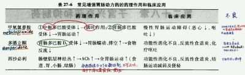
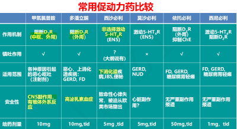
### 助消化药
> Pepsin胃蛋白酶，Pancreatin胰酶，Lactasin乳酶生，干酵母yeast，卡尼汀，Chinese medicine
#### 消化液成分 、促进消化液分泌药、维生素B（食欲）
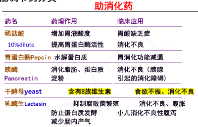
#### *消化不良治疗思路（PPT）*
##### 药物治疗
– 器质性消化系统慢性病引起的消化不良
###### 改善生活习惯，治疗原发疾病
###### – OTC
食欲减退：<mark style="background-color: #1A4F10; color: white">VitB1、VitB6或干酵母片；</mark>
消化酶不足：<mark style="background-color: #1A4F10; color: white">胰酶片、多酶片</mark>；
偶然性消化不良或进食蛋白食物过多者：<mark style="background-color: #1A4F10; color: white">乳酶生、胃蛋白酶合剂；</mark>
消胀气药：二甲硅油制剂；
中度功能性消化不良或餐后上腹痛、嗳气、恶心、呕吐者：<mark style="background-color: #1A4F10; color: white">多潘立酮</mark>(吗丁啉)?……
##### – 处方药
• 精神因素引起的消化不良：<mark style="background-color: #1A4F10; color: white">*[[地西泮]]*</mark> *,等*
• 功能性消化不良伴反酸： *莫沙比利、依托比利* 等（<mark style="background-color: #1A4F10; color: white">促胃动力</mark>药物）
###### • 胆汁分泌不足者： *复方阿嗪米特肠溶片*
• 慢性胃炎、胃溃疡、十二指肠溃疡：<mark style="background-color: #1A4F10; color: white">*抑酸药与胃粘膜保护剂，根除HP治疗*</mark> *等*
### 止吐药（ Antiemetic）
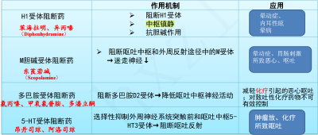
#### 记忆思路——呕吐反射
#### 中枢：呕吐中枢、延髓催吐化学感受区（CTZ）——多巴胺受体、H1受体
#### 外周：ENS（胃肠运动）、迷走——多巴胺受体、5-HT受体、M受体
#### 应用场景：晕动症；放化疗
### 1．5-HT3受体阻断药：昂丹司琼（ondansetron）
> 放化疗呕吐
##### 机制:选择性阻断中枢及迷走神经的5-HT3受体，阻断呕吐反射
#### 应用
对<mark style="background-color: #3F4B5E; color: white">晕动症无效</mark>，用于肿瘤放化疗引起的呕吐
对强致吐性化疗药物 （顺铂环磷酰胺多柔比星）的呕吐抑制作用强
##### 不良:长期使用，静坐不能、急性肌张力障碍
### 2．多巴胺受体阻断剂：甲氧氯普安、 多潘立酮 、 ~~*西沙必利*~~ 、[[氯丙嗪]]
> 放化疗呕吐（但不能有效控制）
##### 三大常见促动力药
### 泻药
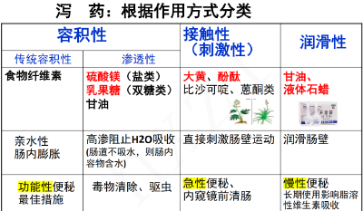
> ①容积性 ：扩张肠内容物容积、改变渗透压，进而刺激胃肠蠕动； ②接触性：直接急性刺激肠动； ③润滑性：慢性润滑。
#### <mark style="background-color: #3F4B5E; color: white">巧记</mark>
#### <mark style="background-color: #3F4B5E; color: white">盐离子&糖类</mark>~渗透性、不好吸收；
#### <mark style="background-color: #3F4B5E; color: white">化学、中药</mark>~刺激性<mark style="background-color: #3F4B5E; color: white">；</mark>
#### <mark style="background-color: #3F4B5E; color: white">甘油、石蜡（物理）</mark>~润滑
[[硫酸镁]]：硫酸根和镁离子在肠道难以被吸收，使肠内容物渗透压↑，抑制水分的吸收，增加肠腔容积、扩张肠道、刺激肠道蠕动。
用于外科术前/结肠镜检查前排空内容物；辅助排出一些肠道寄生虫或肠内毒物
乳果糖：口服不吸收；到结肠被细菌分解成乳酸，刺激结肠局部渗出；还可以抑制对氨的吸收，降低血氨；
甘油：轻度刺激性导泻；润滑
酚酞：刺激肠壁，抑制水分重吸收；
液体石蜡：润滑肠壁、软化大便。
便秘治疗：①泻药；②促动力药；③微生态制剂
### 止泻药
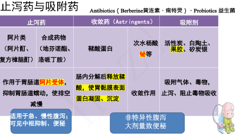
#### 吸附剂 （气体、毒物）
#### 收敛剂 （在肠黏膜表面成膜）
#### 抗动力剂 （阿片制剂 / 地芬诺酯/洛哌丁胺）
常用：Diphenoxylate(地芬诺酯), loperamide (洛哌丁胺)
###### -两者都是哌替啶衍生物
###### -激活突触前阿片受体，抑制乙酰胆碱释放
阿片类：易成瘾，少用。用于较严重的非细菌感染性腹泻，激动μ阿片受体，减少胃肠推进性蠕动，发挥止泻作用；
##### 抗胆碱药 ：不良反应多
### 利胆药
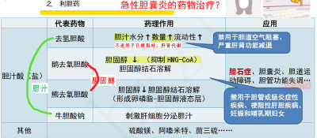
> “两头促胆汁，中间抑固醇”。此外还有茴三硫、[[硫酸镁]]。
